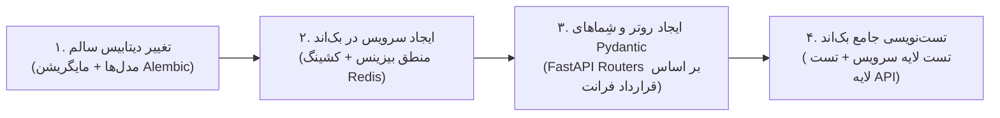

# 🤖 دستورالعمل و راهنمای حیاتی ایجنت‌های هوش مصنوعی (AI Agent Directives)

> **قانون طلایی و تخطی‌ناپذیر (Golden Rule):**  
> تمامی ایجنت‌های هوش مصنوعی فعال در پروژه **دکتر گیم (DrGame-Ecommerce)** موظف هستند در تمامی دستورات، تسک‌ها، چت‌ها و اقدامات خود، **سند جامع سیاست‌های توسعه بک‌اند (`backend/agent/development-policy.md`) را به عنوان قانون اساسی پروژه بدون کوچک‌ترین انحراف و به صورت ۱۰۰٪ اجرا نمایند؛ حتی اگر کاربر در پیام خود صراحتاً نامی از این سند یا قوانین آن نبرد.**

---

## 🚨 سیاست بنیادین: تمرکز منحصراً بر بک‌اند (Strict Backend-Only Policy)

1. **کدبیس فرانت‌اند (`frontend/`) کاملاً فریز (Locked / Read-Only) است:** هیچ تغییری در هیچ فایلی از فرانت‌اند مجاز نیست.
2. **فرانت‌اند به عنوان سند مرجع و مشخصات قرارداد (Frontend as Reference Spec):** تمامی نیازمندی‌ها، فیلدها و اندپوینت‌های مورد انتظار کلاینت باید صرفاً و منحصراً از طریق توسعه و اصلاح لایه بک‌اند (`backend/`) پیاده‌سازی شوند.

---

## ۱. چرخه اجباری و ۴ مرحله‌ای توسعه فیچرهای بک‌اند (4-Step Backend Pipeline)

هرگونه ایجاد یا ارتقای قابلیت در بک‌اند بدون استثنا باید دقیقاً از ۴ گام زیر به ترتیب عبور کند:

1. **تغییر دیتابیس سالم:** مدل‌سازی در `models.py` ماژول مربوطه + مایگریشن کانتینری Alembic (`alembic revision` و `alembic upgrade head`).
2. **ایجاد سرویس در بک‌اند:** پیاده‌سازی متدهای بیزینس لاجیک در `services.py` همراه با اتصال به کش Redis و سیاست ابطال فعال کش (`Explicit Invalidation`).
3. **ایجاد API یا اندپوینت:** ساخت روت‌های FastAPI در `router.py` به همراه DTOهای Pydantic V2 در `schemas.py` و گاردهای دسترسی در `dependencies.py` منطبق بر قراردادهای فرانت‌اند.
4. **تست‌نویسی دو لایه بک‌اند:** نگارش تست لایه سرویس (`test_services.py`) و تست لایه API (`test_router.py`) با Pytest و کسب قبولی ۱۰۰٪ آزمون‌ها در داکر (`pytest -v`).

---

## ۲. ساختار گام‌های توسعه در پوشه `backend/agent/`

توسعه پروژه بر اساس مراحل شماره‌گذاری شده در پوشه `backend/agent/` پیش می‌رود (`backend/agent/xx-step-name/`). هر مرحله شامل دو فایل اجباری است:
1. **`instructions.md`:** حاوی تشریح عملکردی دقیق، منطق الگوریتمی و محاسباتی، نمونه کدهای استاندارد بک‌اند، و مسیردهی دقیق فایل‌های جدید یا ویرایشی.
2. **`tasks.md`:** چک‌لیست ترتیبی عملیات با فرمت چک‌باکس مارک‌داون (`- [ ]`).  
   ⚠️ **الزام حیاتی:** ایجنت **موظف است بلافاصله پس از تکمیل هر تسک**، فایل `tasks.md` را باز کرده و آن تسک را با علامت `- [x]` مشخص کند. هیچ تسکی بدون تیک زدن در این فایل نباید رها شود.

---

## ۳. سیستم گزارش‌گیری در پوشه `backend/reports/`

- پوشه گزارش‌های بک‌اند در مسیر `backend/reports/` قرار دارد.
- پس از اتمام موفقیت‌آمیز هر چند استپ (یا پایان یک فاز کاری)، ایجنت باید یک فایل گزارش شماره‌گذاری شده به صورت `backend/reports/xx.md` (مانند `06.md` و ...) ایجاد کرده و خلاصه دستاوردها، فایل‌های ایجاد/ویرایش شده، نتایج تست‌ها و وضعیت پروژه را گزارش کند.

---

## ۴. خطوط قرمز فنی و محیط کانتینری

1. **ممنوعیت اجرای مستقیم روی سیستم میزبان (Host):** تمامی دستورات توسعه، تست و مایگریشن منحصراً باید داخل کانتینرهای داکر از طریق `docker compose -f docker-compose.dev.yml ...` اجرا شوند.
2. **عدم دستکاری فرانت‌اند:** پوشه `frontend/` دست‌نخورده باقی می‌ماند.
3. **ایزولاسیون کامل ماژول‌ها:** هیچ جدولی در یک ماژول حق برقراری رابطه Foreign Key با جدول ماژول دیگر را ندارد. ارتباطات صرفاً با شناسه خام (`Raw ID`) و فراخوانی متدهای لایه Service صورت می‌گیرد.
4. **پوشش تست ۱۰۰٪:** ادغام هیچ فیچری بدون قبولی کامل تست‌های واحد و یکپارچگی بک‌اند مجاز نیست.
