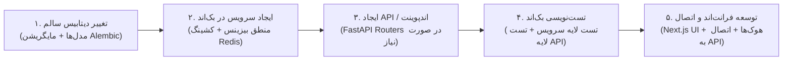

# 🤖 دستورالعمل و راهنمای حیاتی ایجنت‌های هوش مصنوعی (AI Agent Directives)

> **قانون طلایی و تخطی‌ناپذیر (Golden Rule):**  
> تمامی ایجنت‌های هوش مصنوعی فعال در پروژه **دکتر گیم (DrGame-Ecommerce)** موظف هستند در تمامی دستورات، تسک‌ها، چت‌ها و اقدامات خود، **سند جامع سیاست‌های توسعه (`agent/development-policy.md`) را به عنوان قانون اساسی پروژه بدون کوچک‌ترین انحراف و به صورت ۱۰۰٪ اجرا نمایند؛ حتی اگر کاربر در پیام خود صراحتاً نامی از این سند یا قوانین آن نبرد.**

---

## ۱. چرخه اجباری و ۵ مرحله‌ای توسعه هر فیچر (5-Step Feature Pipeline)

هرگونه ایجاد یا ارتقای فیچر در پروژه بدون استثنا باید دقیقاً از ۵ گام زیر به ترتیب عبور کند:

1. **تغییر دیتابیس سالم:** مدل‌سازی بدون باگ در `models.py` ماژول مربوطه + مایگریشن کانتینری Alembic (`alembic revision` و `alembic upgrade head`).
2. **ایجاد سرویس در بک‌اند:** پیاده‌سازی متدهای بیزینس لاجیک در `services.py` همراه با اتصال به کش Redis و سیاست ابطال فعال کش (`Explicit Invalidation`).
3. **ایجاد API یا اندپوینت:** در صورت لزوم، ساخت روت‌های FastAPI در `router.py` به همراه DTOهای Pydantic V2 در `schemas.py` و گاردها در `dependencies.py`.
4. **تست‌نویسی دو لایه بک‌اند:** نگارش تست لایه سرویس (`test_services.py`) و تست لایه API (`test_router.py`) با Pytest و کسب قبولی ۱۰۰٪ آزمون‌ها در داکر (`pytest -v`).
5. **توسعه فرانت‌اند و اتصال به بک‌اند:** پیاده‌سازی کامپوننت‌ها و صفحات با تم بنفش کهکشانی در Next.js 14، اتصال به بک‌اند، و رعایت استاندارد 10-Foot UI برای کنترلر و تلویزیون.

---

## ۲. ساختار گام‌های توسعه در پوشه `agent/`

توسعه پروژه بر اساس مراحل شماره‌گذاری شده در پوشه `agent/` پیش می‌رود (`agent/xx-step-name/`). هر مرحله شامل دو فایل اجباری است:
1. **`instructions.md`:** حاوی تشریح عملکردی دقیق، منطق الگوریتمی و محاسباتی، نمونه کدهای استاندارد، و مسیردهی دقیق فایل‌های جدید یا ویرایشی.
2. **`tasks.md`:** چک‌لیست ترتیبی عملیات با فرمت چک‌باکس مارک‌داون (`- [ ]`).  
   ⚠️ **الزام حیاتی:** ایجنت **موظف است بلافاصله پس از تکمیل هر تسک**، فایل `tasks.md` را باز کرده و آن تسک را با علامت `- [x]` مشخص کند. هیچ تسکی بدون تیک زدن در این فایل نباید رها شود.

---

## ۳. سیستم گزارش‌گیری در پوشه `reports/`

- پوشه `reports/` در ریشه پروژه قرار دارد.
- پس از اتمام موفقیت‌آمیز هر چند استپ (یا پایان یک فاز کاری)، ایجنت باید یک فایل گزارش شماره‌گذاری شده به صورت `reports/xx.md` (مانند `01.md`، `02.md` و ...) ایجاد کرده و خلاصه دستاوردها، فایل‌های ایجاد/ویرایش شده، نتایج تست‌ها و وضعیت پروژه را گزارش کند.

---

## ۴. خطوط قرمز فنی و محیط کانتینری

1. **ممنوعیت اجرای مستقیم روی سیستم میزبان (Host):** تمامی دستورات توسعه، تست و مایگریشن منحصراً باید داخل کانتینرهای داکر از طریق `docker compose -f docker-compose.dev.yml ...` اجرا شوند.
2. **ایزولاسیون کامل ماژول‌ها:** هیچ جدولی در یک ماژول حق برقراری رابطه Foreign Key با جدول ماژول دیگر را ندارد. ارتباطات صرفاً با شناسه خام (`Raw ID`) و فراخوانی متدهای لایه Service صورت می‌گیرد.
3. **پوشش تست ۱۰۰٪:** ادغام هیچ فیچری بدون قبولی کامل تست‌های واحد و یکپارچگی بک‌اند مجاز نیست.
4. **استاندارد رابط کاربری ۱۰ فوتی (10-Foot UI):** رابط کاربری علاوه بر موبایل و دسکتاپ، باید با دکمه‌های جهتی گیم‌پد و D-Pad روی تلویزیون و کنسول‌های بازی روان و بدون نقص کار کند.
