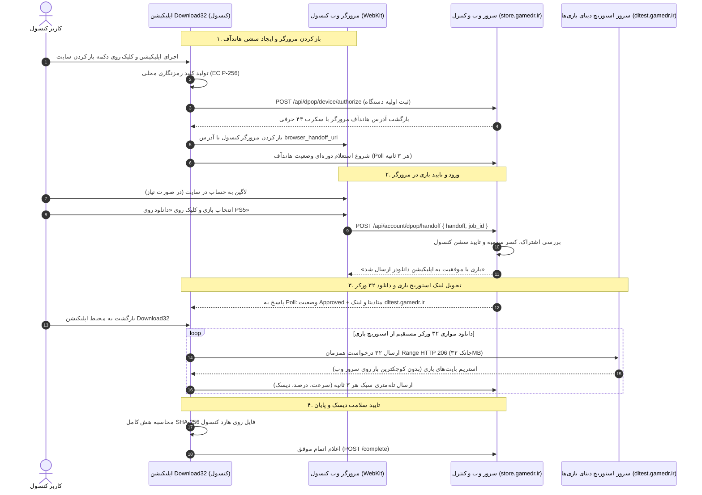

# 🎮 سند جامع مشخصات فنی، معماری و پروتکل ارتباطی با اپلیکیشن Download32 کنسول‌های پلی‌استیشن (PS4 / PS5)

**نسخه مستند:** ۳.۱ (معماری مبتنی بر هاندآف مرورگر کنسول و استریم مستقیم از سرور استوریج بازی‌ها `dltest.gamedr.ir`)  
**تاریخ نگارش:** ۲۰۲۶-۱۱-۰۹  
**طرفین قرارداد:** پلتفرم وب و بک‌اند دکتر گیم (DrGame Web & Core API) ⟷ تیم توسعه نرم‌افزار بومی کنسول (Download32 App Team)  
**مخاطب:** برنامه‌نویسان C++/بومی کنسول، توسعه‌دهندگان زیرساخت و سرپرست محصول  

---

## ۱. اصول بنیادین و توپولوژی هاست‌ها

این سند بر اساس دو اصل کلیدی و تفکیک دقیق زیرساخت‌های استوریج تنظیم شده است:

### ۱.۱. تفکیک دقیق ۳ هاست پلتفرم:
1. **سرور کنترل و وب‌سایت اصلی (`store.gamedr.ir`):**  
   مدیریت کاربران، لاگین در مرورگر وب کنسول، کنترل اشتراک، کسر سهمیه، هماهنگی هاندآف (Browser Handoff) و دریافت گزارش‌های تله‌متری (فقط پکت‌های سبک چند کیلوبایتی JSON).
2. **سرور استوریج اختصاصی دیتای بازی‌ها (`dltest.gamedr.ir`):**  
   هاست اختصاصی ذخیره‌سازی پکیج‌های سنگین بازی‌های کنسول (FPKG و FAT32). تمام ۳۲ ورکر اپلیکیشن Download32 مستقیماً به این هاست متصل می‌شوند و استریم رنج HTTP 206 از اینجا انجام می‌شود. هیچ ترافیک دانلودی به سرور اصلی وب وارد نمی‌شود.
3. **آبجکت استوریج عمومی وب‌سایت (`storage.gamedr.ir`):**  
   مخصوص فایل‌های عمومی سایت مثل کاورها، بنرها، اسکرین‌شات‌ها و آواتارهای کاربران (کاملاً مستقل از دیتای سنگین بازی‌ها).

### ۱.۲. عدم وجود لاگین در اپلیکیشن دانلودر (No In-App Login):
اپلیکیشن Download32 هیچ فرم لاگین، فیلد نام‌کاربری یا رمز عبور ندارد. فرایند احراز هویت، انتخاب بازی و تایید دانلود منحصراً درون **مرورگر وب رسمی پلی‌استیشن (PlayStation Web Browser)** انجام می‌شود و اپلیکیشن صرفاً مجوز و لینک دانلود مستقیم استوریج را از طریق هاندآف از مرورگر تحویل می‌گیرد.

---

## ۲. دیاگرام جریان کلان داده‌ها (Architecture Flow)



---

## ۳. مکانیزم هاندآف مرورگر کنسول به اپلیکیشن دانلودر

### ۳.۱. درخواست اولیه اپلیکیشن دانلودر (Authorize):
اپلیکیشن در بدو اجرا یا با کلیک کاربر روی دکمه ورود به سایت، کلید عمومی خود را به سرور کنترل می‌فرستد:

- **متد و آدرس:** `POST https://store.gamedr.ir/api/dpop/device/authorize`
- **هدر:** `Content-Type: application/json`
- **بدنه درخواست:**
```json
{
  "device_name": "PS5-Download32-Client",
  "scope": "download:file",
  "browser_handoff": true,
  "storage": {
    "volume": "/data",
    "total_bytes": 1000204886016,
    "free_bytes": 350123955200
  }
}
```
- **پاسخ سرور کنترل (200 OK):**
```json
{
  "device_code": "dpop_dc_a8f9c1b2...",
  "browser_handoff_uri": "https://store.gamedr.ir/login/#ps5=X8kL9mNpQrStUvWxYz1234567890abcdefghijklmno",
  "expires_in": 600,
  "interval": 3
}
```
> [!NOTE]
> پارامتر `ps5` یک رشته ۴۳ کاراکتری امن و یکتا است (`handoff_secret`) که مرورگر وب کنسول و اپلیکیشن را به یکدیگر متصل می‌کند.

### ۳.۲. باز شدن مرورگر وب کنسول و کلیک روی دانلود:
- اپلیکیشن Download32 مرورگر وب کنسول را با آدرس `browser_handoff_uri` باز می‌کند.
- کاربر در سایت می‌چرخد، بازی مورد نظر را انتخاب و دکمه **«دانلود روی PS5»** را می‌زند.
- مرورگر وب کنسول درخواست تایید هاندآف را به سرور کنترل ارسال می‌کند:
  ```http
  POST https://store.gamedr.ir/api/account/dpop/handoff
  Content-Type: application/json
  Cookie: <کوکی_ورود_کاربر_در_مرورگر>
  
  {
    "handoff": "X8kL9mNpQrStUvWxYz1234567890abcdefghijklmno",
    "job_id": "job_spiderman2_ps5_v102"
  }
  ```
- سرور کنترل سهمیه کاربر را کسر کرده و وضعیت نشست کنسول را از `pending` به `approved` تغییر می‌دهد.

### ۳.۳. استعلام و تحویل لینک استوریج به اپلیکیشن:
اپلیکیشن که هر ۳ ثانیه اندپوینت زیر را Poll می‌کند:
- **متد:** `POST https://store.gamedr.ir/api/dpop/device/token`
- **بدنه:**
```json
{
  "grant_type": "urn:ietf:params:oauth:grant-type:device_code",
  "device_code": "dpop_dc_a8f9c1b2..."
}
```
- به محض تایید هاندآف در مرورگر، پاسخ ۲۰۰ همراه با لینک مستقیم استوریج بازی‌ها (`dltest.gamedr.ir`) صادر می‌شود:
```json
{
  "status": "approved",
  "grant_id": "grant_82f19a0c",
  "job_id": "job_spiderman2_ps5_v102",
  "file": {
    "title": "Marvel's Spider-Man 2",
    "file_name": "PPSA01234-SpiderMan2-v102.pkg",
    "size_bytes": 42949672960,
    "sha256": "e3b0c44298fc1c149afbf4c8996fb92427ae41e4649b934ca495991b7852b855",
    "format_category": "fpkg"
  },
  "download_url": "https://dltest.gamedr.ir/dpop-download/job_spiderman2_ps5_v102/PPSA01234-SpiderMan2-v102.pkg",
  "access_token": "DPOP_ACCESS_TOKEN_HERE",
  "max_connections": 32
}
```

---

## ۴. استریم مستقیم ۳۲ ورکر از سرور استوریج بازی‌ها (`dltest.gamedr.ir`)

اپلیکیشن دانلودر با دریافت لینک مستقیم، ۳۲ ورکر خود را منحصراً روی سرور استوریج بازی‌ها باز می‌کند:

### مشخصات قرارداد HTTP Range با سرور `dltest.gamedr.ir`:
- **اندازه استاندارد هر رنج (Chunk):** ۳۲ مگابایت = ۳۳,۵۵۴,۴۳۲ بایت.
- **هدرهای ارسالی هر ورکر:**
```http
GET /dpop-download/job_spiderman2_ps5_v102/PPSA01234-SpiderMan2-v102.pkg HTTP/1.1
Host: dltest.gamedr.ir
Authorization: DPoP <ACCESS_TOKEN>
Range: bytes=0-33554431
User-Agent: PS5-Download32/01.015
Accept-Encoding: identity
```
- **پاسخ سرور استوریج بازی‌ها (HTTP 206 Partial Content):**
```http
HTTP/1.1 206 Partial Content
Content-Type: application/octet-stream
Accept-Ranges: bytes
Content-Range: bytes 0-33554431/42949672960
Content-Length: 33554432
ETag: "sha256-e3b0c442..."
```

### الزامات دیسک کنسول (Resume Support):
1. فایل نیمه‌کاره در `/data/download32/files/{job_id}/{file_name}.part` نوشته شود.
2. متادیتای رنج‌های دریافت شده در فایل `.resume` ذخیره و پس از هر رنج دستور `fsync` فراخوانی شود.
3. در زمان پاز یا ادامه (Resume)، اپلیکیشن از آخرین بایت ثبت‌شده دانلود را پی می‌گیرد.

---

## ۵. ارسال تله‌متری زنده به سرور وب (`store.gamedr.ir`)

اپلیکیشن حین دانلود پرسرعت از `dltest.gamedr.ir`، فقط گزارش‌های سبک JSON را **هر ۳ ثانیه** به سرور وب می‌فرستد:

- **متد:** `POST https://store.gamedr.ir/api/console/telemetry`
- **بدنه درخواست:**
```json
{
  "job_id": "job_spiderman2_ps5_v102",
  "status": "downloading",
  "progress_pct": 52.8,
  "downloaded_bytes": 22677427322,
  "total_bytes": 42949672960,
  "speed_mbps": 110.5,
  "active_workers": 32,
  "storage": {
    "volume": "/data",
    "total_bytes": 1000204886016,
    "free_bytes": 389912000000
  }
}
```

---

## ۶. تایید صحت دیسک (SHA-256) و اعلام پایان

1. پس از اتمام آخرین بایت، اپلیکیشن فایل `.part` را به `.pkg` تبدیل می‌کند.
2. اپلیکیشن هش کامل SHA-256 فایل روی دیسک کنسول را محاسبه می‌کند و با مقدار `sha256` که از سرور گرفته تطبیق می‌دهد.
3. در صورت انطباق، پایان موفق را به سرور کنترل گزارش می‌دهد:
   `POST https://store.gamedr.ir/api/dpop/downloads/{grant_id}/complete`
   ```json
   {
     "sha256": "e3b0c44298fc1c149afbf4c8996fb92427ae41e4649b934ca495991b7852b855",
     "bytes_verified": 42949672960,
     "revoke_grant": true
   }
   ```
4. سرور وضعیت دانلود را نهایی کرده و مجوز را می‌بندد.

---

## ۷. ماتریس تعهدات طرفین

### الف) تعهدات تیم توسعه اپلیکیشن دانلودر (Download32):
| ردیف | شرح وظیفه |
| :--- | :--- |
| **۱** | عدم پیاده‌سازی فرم لاگین در اپلیکیشن و باز کردن مرورگر کنسول با آدرس `browser_handoff_uri` |
| **۲** | استعلام وضعیت هاندآف هر ۳ ثانیه از اندپوینت `device/token` تا زمان تایید در مرورگر |
| **۳** | هدایت تمام ۳۲ ورکر دانلود مستقیماً به هاست دیتای بازی‌ها (`dltest.gamedr.ir`) |
| **۴** | پشتیبانی از رنج‌های ۳۲ مگابایتی HTTP 206 و مدیریت فایل‌های `.part` و `.resume` با سینک دیسک |
| **۵** | گزارش تله‌متری زنده هر ۳ ثانیه به سرور وب و اعتبارسنجی هش SHA-256 در پایان دانلود |

### ب) تعهدات پلتفرم وب و بک‌اند دکتر گیم:
| ردیف | شرح وظیفه |
| :--- | :--- |
| **۱** | مدیریت ۱۰۰٪ ورود، عضویت، اشتراک و سهمیه درون مرورگر وب کنسول |
| **۲** | تولید و نگهداری سشن هاندآف ۴۳ کاراکتری و تحویل آنی به اپلیکیشن به محض کلیک در مرورگر |
| **۳** | ارائه لینک مستقیم سرور دیتای بازی‌ها (`dltest.gamedr.ir`) با تضمین پشتیبانی از HTTP 206 و پهنای باند بالا |
| **۴** | تخلیه کامل بار شبکه از روی دامنه اصلی وب و عدم افت سرعت سایت در دانلودهای همزمان |

---

## ۸. جدول مراجع اندپوینت‌ها (API Reference)

| متد | آدرس اندپوینت (URL) | میزبان (Host) | هدف |
| :---: | :--- | :---: | :--- |
| `POST` | `/api/dpop/device/authorize` | `store.gamedr.ir` (وب) | ثبت اولیه اپلیکیشن و تولید لینک هاندآف مرورگر |
| `POST` | `/api/dpop/device/token` | `store.gamedr.ir` (وب) | استعلام تایید هاندآف و دریافت لینک مستقیم استوریج دیتای بازی |
| `POST` | `/api/account/dpop/handoff` | `store.gamedr.ir` (وب) | ارسال تایید دانلود از طرف مرورگر وب کنسول |
| `GET` | `/dpop-download/{job_id}/{file}` | **`dltest.gamedr.ir` (استوریج بازی)** | استریم موازی ۳۲ ورکر با هدر Range ۲۰۶ (ترافیک اصلی دانلود) |
| `POST` | `/api/console/telemetry` | `store.gamedr.ir` (وب) | گزارش ۳ ثانیه‌ای سرعت، درصد و حافظه هارد |
| `POST` | `/api/dpop/downloads/{grant_id}/complete` | `store.gamedr.ir` (وب) | ثبت اتمام و اعتبارسنجی نهایی هش SHA-256 |
