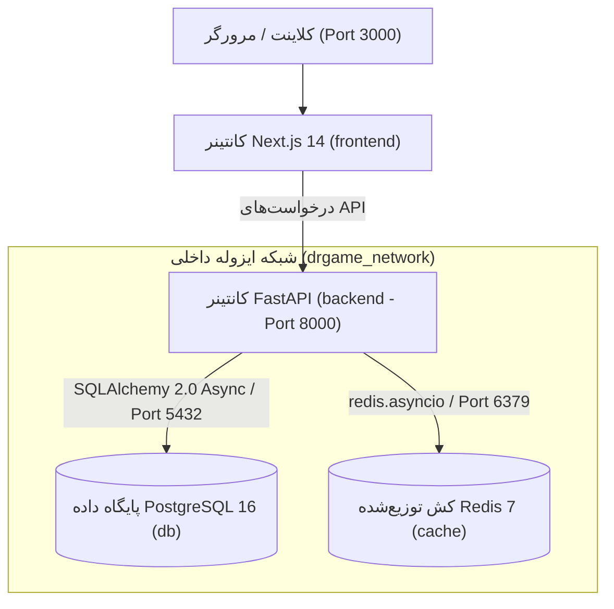

<div dir="rtl" lang="fa">

# 🛠️ دستورالعمل اجرایی گام اول: راه‌اندازی زیرساخت داکر و هسته مرکزی پروژه (01-environment-and-docker-setup)

> **شماره گام:** ۰۱  
> **عنوان مرحله:** راه‌اندازی زیرساخت کانتینری داکر، هسته بک‌اند FastAPI، پیکربندی پایگاه داده و ردیس، و محیط فرانت‌اند Next.js 14  
> **وابستگی‌ها:** ندارد (نقطه شروع پروژه)  
> **مرجع سیاست‌ها:** `agent/development-policy.md` و `build.md`  

---

## ۱. اهداف و نیازمندی‌های عملکردی (Functional Requirements & Overview)

هدف از این گام، ایجاد بستر پایدار، مقیاس‌پذیر و ۱۰۰٪ کانتینری برای کل پلتفرم دکتر گیم است به طوری که هیچ ابزاری به صورت مستقیم روی سیستم‌عامل میزبان اجرا نشود. در پایان این گام باید:
1. **کانتینرهای ۴گانه داکر:** با فایل `docker-compose.dev.yml` سرویس‌های زیر به طور خودکار، پایدار و با Healthcheck راه‌اندازی شوند:
   - `backend`: سرویس FastAPI بر پایه Python 3.12-slim.
   - `frontend`: سرویس Next.js 14 بر پایه Node 20-alpine با پیکربندی App Router و تایپ‌اسکریپت.
   - `db`: پایگاه داده PostgreSQL 16-alpine با ولوم پایدار داده‌ها.
   - `cache`: حافظه پرسرعت Redis 7-alpine برای لایه کشینگ و سشن‌ها.
2. **هسته مشترک بک‌اند (`backend/app/core/`):**
   - اتصال ناهمگام به PostgreSQL 16 با SQLAlchemy 2.0 Async و `asyncpg`.
   - کلاینت ناهمگام و تک‌نمونه (Singleton) ردیس با `redis.asyncio`.
   - ساختار بارگذاری متغیرهای محیطی با `pydantic-settings`.
   - ساختار استثناهای سفارشی (`AppException`) و مدیریت متمرکز خطاها.
   - زیرساخت مایگریشن دیتابیس با Alembic به صورت کاملاً ناهمگام.
   - روت سلامت سیستم (`GET /api/health`) جهت بررسی وضعیت دیتابیس و ردیس.
3. **هسته فرانت‌اند (`frontend/`):**
   - پروژه Next.js 14 با App Router، TypeScript و Tailwind CSS.
   - تنظیم سیستم طراحی کهکشانی (Cosmic Purple Design Tokens) در `tailwind.config.ts` و `globals.css` شامل رنگ‌های OLED مشکی (`#070709`)، کارت‌های شیشه‌ای بلورین (`#101116`) و رنگ‌های بنفش (`#7C3AED` و `#A855F7`).
   - صفحه خوش‌آمدگویی و تست اتصال به بک‌اند در صفحه اصلی.
4. **آزمون‌های خودکار اولیه (Pytest Suite):**
   - تست اتصال سالم به دیتابیس و ردیس.
   - تست اندپوینت `/api/health`.

---

## ۲. منطق معماری و جریان ارتباطی زیرساخت (Architecture & Network Flow)



### استانداردهای ارتباطی:
- سرویس‌ها در یک شبکه بریج اختصاصی داکر به نام `drgame_network` قرار می‌گیرند.
- سرویس `backend` تا زمان بالا آمدن و آماده‌باش کامل `db` و `cache` (از طریق Healthcheck) منتظر می‌ماند (`depends_on: condition: service_healthy`).
- تمامی پورت‌ها و رمزهای عبور از طریق فایل متمرکز `.env` مدیریت می‌شوند.

---

## ۳. الگوهای کد و استانداردهای پیاده‌سازی (Code Examples & Patterns)

### ۳.۱. فایل تنظیمات محیطی (`backend/app/core/config.py`):
```python
from pydantic_settings import BaseSettings, SettingsConfigDict
from functools import lru_cache

class Settings(BaseSettings):
    PROJECT_NAME: str = "DrGame API"
    ENVIRONMENT: str = "development"
    DEBUG: bool = True
    API_V1_PREFIX: str = "/api"
    
    # Database
    POSTGRES_USER: str = "drgame_user"
    POSTGRES_PASSWORD: str = "drgame_pass123"
    POSTGRES_DB: str = "drgame_db"
    POSTGRES_HOST: str = "db"
    POSTGRES_PORT: int = 5432
    
    @property
    def DATABASE_URL(self) -> str:
        return f"postgresql+asyncpg://{self.POSTGRES_USER}:{self.POSTGRES_PASSWORD}@{self.POSTGRES_HOST}:{self.POSTGRES_PORT}/{self.POSTGRES_DB}"
    
    # Redis
    REDIS_HOST: str = "cache"
    REDIS_PORT: int = 6379
    REDIS_PASSWORD: str = ""
    
    @property
    def REDIS_URL(self) -> str:
        if self.REDIS_PASSWORD:
            return f"redis://:{self.REDIS_PASSWORD}@{self.REDIS_HOST}:{self.REDIS_PORT}/0"
        return f"redis://{self.REDIS_HOST}:{self.REDIS_PORT}/0"
        
    # Security
    JWT_SECRET_KEY: str = "dev_secret_key_change_in_production_1234567890"
    JWT_ALGORITHM: str = "HS256"
    ACCESS_TOKEN_EXPIRE_MINUTES: int = 60 * 24  # 1 day
    
    # RAWG
    RAWG_API_KEY: str = "91c0c1c9c30c4796bbff63a7471fdfdd"

    model_config = SettingsConfigDict(env_file=".env", extra="ignore")

@lru_cache
def get_settings() -> Settings:
    return Settings()

settings = get_settings()
```

### ۳.۲. اتصال ناهمگام پایگاه داده (`backend/app/core/database.py`):
```python
from typing import AsyncGenerator
from sqlalchemy.ext.asyncio import create_async_engine, async_sessionmaker, AsyncSession
from sqlalchemy.orm import DeclarativeBase
from app.core.config import settings

engine = create_async_engine(
    settings.DATABASE_URL,
    echo=settings.DEBUG,
    pool_size=10,
    max_overflow=20,
    pool_pre_ping=True
)

AsyncSessionLocal = async_sessionmaker(
    bind=engine,
    class_=AsyncSession,
    expire_on_commit=False,
    autocommit=False,
    autoflush=False
)

class Base(DeclarativeBase):
    pass

async def get_db() -> AsyncGenerator[AsyncSession, None]:
    async with AsyncSessionLocal() as session:
        try:
            yield session
        finally:
            await session.close()
```

### ۳.۳. کلاینت متمرکز ردیس (`backend/app/core/redis_client.py`):
```python
import redis.asyncio as aioredis
from app.core.config import settings

class RedisManager:
    def __init__(self):
        self.redis: aioredis.Redis | None = None

    async def connect(self):
        self.redis = aioredis.from_url(
            settings.REDIS_URL,
            decode_responses=True,
            socket_timeout=5.0
        )
        await self.redis.ping()

    async def close(self):
        if self.redis:
            await self.redis.aclose()

redis_manager = RedisManager()

async def get_redis() -> aioredis.Redis:
    if not redis_manager.redis:
        await redis_manager.connect()
    return redis_manager.redis
```

---

## ۴. آدرس‌دهی دقیق فایل‌ها (Explicit File Paths)

### فایل‌های جدید که باید ایجاد شوند (New Files):
- `.env`: فایل تنظیمات عمومی کانتینرها و سرویس‌ها در ریشه پروژه.
- `.env.example`: نمونه فایل کانفیگ برای سایر توسعه‌دهندگان.
- `docker-compose.dev.yml`: کانفیگ کانتینرهای ۴گانه، شبکه‌ها، ولوم‌ها و پورت‌ها.
- **پوشه بک‌اند:**
  - `backend/Dockerfile`: دستورالعمل ساخت ایمیج پایتون ۳.۱۲ و نصب نیازمندی‌ها.
  - `backend/requirements.txt`: نیازمندی‌ها (FastAPI, Uvicorn, SQLAlchemy, Asyncpg, Alembic, Redis, Pydantic-Settings, Pytest, HTTPX, Pytest-Asyncio, Bcrypt).
  - `backend/alembic.ini`: پیکربندی ابزار Alembic.
  - `backend/alembic/env.py`: اسکریپت اجرای ناهمگام مایگریشن‌ها با SQLAlchemy Async Engine.
  - `backend/alembic/script.py.mako`: تمپلیت مایگریشن‌های Alembic.
  - `backend/app/__init__.py`
  - `backend/app/main.py`: نقطه ورود FastAPI، میدل‌ورهای CORS، طول عمر کانتینر (Lifespan) و رجیستر روت `/api/health`.
  - `backend/app/core/__init__.py`
  - `backend/app/core/config.py`: لود تنظیمات از .env.
  - `backend/app/core/database.py`: اتصال PostgreSQL 16 و نشست AsyncSession.
  - `backend/app/core/redis_client.py`: کلاینت ناهمگام ردیس.
  - `backend/app/core/exceptions.py`: کلاس‌های استثنای ساختاریافته.
  - `backend/tests/__init__.py`
  - `backend/tests/conftest.py`: فیکسچرهای تست Pytest شامل کلاینت ناهمگام `httpx.AsyncClient` و فیکسچر تست دیتابیس و ردیس.
  - `backend/tests/test_health.py`: آزمون بررسی وضعیت سلامت سرویس و ارتباط با دیتابیس و ردیس.
- **پوشه فرانت‌اند:**
  - `frontend/Dockerfile`: دستور ساخت کانتینر توسعه Next.js 14.
  - `frontend/package.json`: پکیج‌های Next.js 14, React 18, TypeScript, Tailwind CSS, Lucide React, Zustand, Framer Motion.
  - `frontend/tsconfig.json`: کانفیگ تایپ‌اسکریپت با مسیرهای مستعار `@/*`.
  - `frontend/tailwind.config.ts`: تعریف توکن‌های رنگ کهکشانی و استایل‌های شیشه‌ای.
  - `frontend/postcss.config.js`: کانفیگ PostCSS برای Tailwind.
  - `frontend/next.config.js`: کانفیگ Next.js برای داکر و رندرینگ بهینه تصاویر.
  - `frontend/src/app/layout.tsx`: لایوت ریشه با فونت Vazirmatn، جهت RTL و ساختار تم تاریک.
  - `frontend/src/app/globals.css`: تعاریف استایل‌های پایه بنفش کهکشانی و گلس‌مورفیسم.
  - `frontend/src/app/page.tsx`: صفحه بررسی اولیه وضعیت و لودینگ سلامت API بک‌اند.

### فایل‌های موجود که ویرایش می‌شوند (Modified Files):
- `.gitignore`: نادیده گرفتن پوشه‌های `node_modules`، `.next`، `__pycache__`، `.pytest_cache`، `volumes/` و فایل‌های دیتای موقت.

</div>
