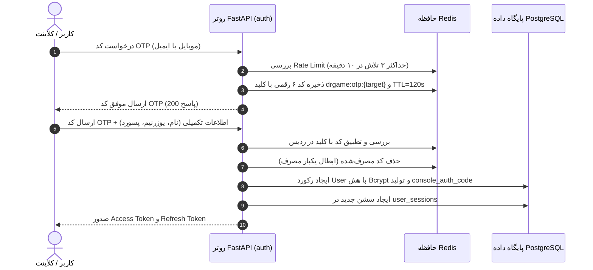
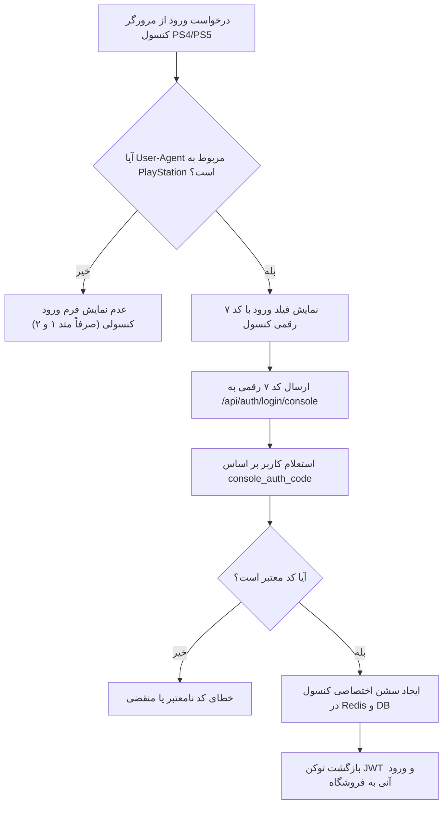

<div dir="rtl" lang="fa">

# 🔐 دستورالعمل اجرایی گام دوم: ماژول احراز هویت و مدیریت کاربران (02-auth-and-users)

> **شماره گام:** ۰۲  
> **عنوان مرحله:** پیاده‌سازی کامل سیستم ثبت‌نام، ورود سه‌گانه (OTP، پسورد، کد ۷ رقمی کنسول)، مدیریت نشست‌ها و پروفایل کاربری با آواتارهای سونی  
> **وابستگی‌ها:** گام ۰۱ (`01-environment-and-docker-setup`)  
> **مرجع سیاست‌ها:** `agent/development-policy.md` (بخش‌های ۲ و ۱۰) و `build.md` (بخش‌های ۳.۱، ۳.۵ و ۵.۲)  

---

## ۱. اهداف و نیازمندی‌های عملکردی (Functional Requirements & Overview)

در این مرحله، زیرساخت کامل هویت و دسترسی کاربران بر پایه معماری ماژولار پیاده‌سازی می‌شود. در پایان این گام باید:
1. **فرآیند ثبت‌نام با اعتبارسنجی دوگانه (Dual OTP Registration):**
   - کاربر می‌تواند با شماره موبایل یا آدرس ایمیل ثبت‌نام کند.
   - کد تایید ۶ رقمی تصادفی با انقضای ۱۲۰ ثانیه‌ای (۲ دقیقه) در حافظه ردیس کش شده و برای کاربر ارسال (در فاز فعلی لاگ شبیه‌سازی) می‌شود.
   - پس از تایید کد، نام و نام خانوادگی، نام کاربری یکتا (`username`) و رمز عبور امن دریافت و حساب فعال می‌شود.
2. **ورود کاربران با ۳ متد مجزا (Tri-Factor Authentication):**
   - **متد ۱ (ورود با OTP):** ارسال کد یکبار مصرف به شماره موبایل یا ایمیل و ورود بدون نیاز به رمز عبور.
   - **متد ۲ (ورود با رمز عبور):** ورود با `username` یا `email` و کلمه عبور با هش Bcrypt.
   - **متد ۳ (ورود سریع کنسول با کد ۷ رقمی - Console Quick Auth):**
     - هر کاربر در پنل خود دارای یک **کد یکتای ۷ رقمی الفبانومریک دائمی** (مانند `DR-7X9K` یا `A8F3K2P`) است.
     - فرم ورود با این کد منحصراً زمانی در صفحه لاگین به کاربر نشان داده می‌شود که **User-Agent درخواست مربوط به مرورگر کنسول پلی‌استیشن (PS4 یا PS5)** باشد.
     - با وارد کردن این کد، کاربر بلافاصله روی کنسول احراز هویت شده و سشن برای آن ثبت می‌شود.
3. **مدیریت سشن‌ها و دستگاه‌های متصل (Session Registry & Device Tracking):**
   - استخراج نوع دستگاه (کنسول، موبایل، دسکتاپ)، مرورگر و سیستم‌عامل از روی User-Agent و ذخیره در جدول نشست‌ها.
   - توکن‌های JWT شامل Access Token (انقضای کوتاه‌مدت) و Refresh Token.
   - قابلیت خروج از حساب و ابطال فعال سشن از طریق بلک‌لیست شناسه توکن (`jti`) در Redis.
   - امکان مشاهده لیست دستگاه‌های فعال در داشبورد و سلب دسترسی هر دستگاه (Revoke Session).
4. **پروفایل کاربری و آواتارهای آماده سونی (Sony Avatars & Profile Customization):**
   - تولید خودکار کد رفرال اختصاصی ۸ رقمی برای هر کاربر تازه ثبت‌نام‌شده.
   - امکان ویرایش مشخصات فردی (نام کامل، ایمیل، موبایل، بیو).
   - انتخاب آواتار و بنر هیرو از گالری کاراکترهای کنسولی سونی (طرح `121.png`) یا آپلود عکس دلخواه.

---

## ۲. منطق الگوریتمی و جریان احراز هویت (Data Flow & Sequences)

### ۲.۱. جریان ثبت‌نام و ورود با OTP:


### ۲.۲. جریان ورود کنسول با کد ۷ رقمی:


---

## ۳. الگوهای کد و تعاریف مدل‌ها (Code Examples & Patterns)

### ۳.۱. مدل‌های ماژول Auth (`backend/app/modules/auth/models.py`):
```python
from datetime import datetime
from sqlalchemy import String, Boolean, DateTime, Integer
from sqlalchemy.orm import Mapped, mapped_column
from app.core.database import Base

class UserSession(Base):
    __tablename__ = "user_sessions"

    id: Mapped[int] = mapped_column(Integer, primary_key=True, index=True)
    user_id: Mapped[int] = mapped_column(Integer, index=True, nullable=False)
    jti: Mapped[str] = mapped_column(String(64), unique=True, index=True, nullable=False)
    device_name: Mapped[str] = mapped_column(String(100), nullable=False)  # e.g., "PlayStation 5 Browser", "Chrome on Windows"
    device_type: Mapped[str] = mapped_column(String(30), nullable=False)   # "console", "mobile", "desktop"
    ip_address: Mapped[str] = mapped_column(String(45), nullable=True)
    user_agent: Mapped[str] = mapped_column(String(500), nullable=True)
    is_active: Mapped[bool] = mapped_column(Boolean, default=True, nullable=False)
    last_active_at: Mapped[datetime] = mapped_column(DateTime, default=datetime.utcnow, nullable=False)
    created_at: Mapped[datetime] = mapped_column(DateTime, default=datetime.utcnow, nullable=False)
```

### ۳.۲. مدل‌های ماژول Users (`backend/app/modules/users/models.py`):
```python
import secrets
from datetime import datetime
from sqlalchemy import String, Boolean, DateTime, Integer
from sqlalchemy.orm import Mapped, mapped_column
from app.core.database import Base

def generate_console_code() -> str:
    """تولید کد ۷ رقمی یکتای الفبانومریک برای ورود با کنسول مانند 7X9K2PL"""
    alphabet = "23456789ABCDEFGHJKLMNPQRSTUVWXYZ"  # حذف کاراکترهای مبهم مثل 0, O, 1, I
    return "".join(secrets.choice(alphabet) for _ in range(7))

def generate_referral_code() -> str:
    alphabet = "ABCDEFGHJKLMNPQRSTUVWXYZ23456789"
    return "".join(secrets.choice(alphabet) for _ in range(8))

class User(Base):
    __tablename__ = "users"

    id: Mapped[int] = mapped_column(Integer, primary_key=True, index=True)
    full_name: Mapped[str] = mapped_column(String(150), nullable=False)
    username: Mapped[str] = mapped_column(String(50), unique=True, index=True, nullable=False)
    email: Mapped[str | None] = mapped_column(String(255), unique=True, index=True, nullable=True)
    phone: Mapped[str | None] = mapped_column(String(20), unique=True, index=True, nullable=True)
    password_hash: Mapped[str] = mapped_column(String(255), nullable=False)
    console_auth_code: Mapped[str] = mapped_column(String(10), unique=True, index=True, default=generate_console_code)
    referral_code: Mapped[str] = mapped_column(String(12), unique=True, index=True, default=generate_referral_code)
    
    avatar_url: Mapped[str | None] = mapped_column(String(500), nullable=True)
    hero_banner_url: Mapped[str | None] = mapped_column(String(500), nullable=True)
    is_preset_avatar: Mapped[bool] = mapped_column(Boolean, default=True)
    
    is_active: Mapped[bool] = mapped_column(Boolean, default=True, nullable=False)
    is_verified: Mapped[bool] = mapped_column(Boolean, default=False, nullable=False)
    created_at: Mapped[datetime] = mapped_column(DateTime, default=datetime.utcnow, nullable=False)
    updated_at: Mapped[datetime] = mapped_column(DateTime, default=datetime.utcnow, onupdate=datetime.utcnow)
```

---

## ۴. آدرس‌دهی دقیق فایل‌ها (Explicit File Paths)

### فایل‌های جدید که باید ایجاد شوند (New Files):
- **ماژول Auth در بک‌اند:**
  - `backend/app/modules/auth/__init__.py`
  - `backend/app/modules/auth/models.py`: تعریف جدول `user_sessions`.
  - `backend/app/modules/auth/schemas.py`: شِماهای Pydantic V2 برای ورودی‌های OTP، لاگین با پسورد، لاگین کنسول و پاسخ‌های توکن.
  - `backend/app/modules/auth/services.py`: لاجیک تولید OTP، تایید کد در Redis، ایجاد توکن‌های JWT و بلک‌لیست JTI.
  - `backend/app/modules/auth/router.py`: اندپوینت‌های احراز هویت (`/api/auth/register/*`, `/api/auth/login/*`, `/api/auth/logout`, `/api/auth/refresh`).
  - `backend/app/modules/auth/tests/__init__.py`
  - `backend/app/modules/auth/tests/conftest.py`
  - `backend/app/modules/auth/tests/test_services.py`: آزمون‌های واحد لاجیک توکن، OTP و هش پسورد.
  - `backend/app/modules/auth/tests/test_router.py`: آزمون‌های یکپارچگی HTTP با بررسی کدهای 200, 201, 400, 401, 422.
- **ماژول Users در بک‌اند:**
  - `backend/app/modules/users/__init__.py`
  - `backend/app/modules/users/models.py`: تعریف جدول `users`.
  - `backend/app/modules/users/schemas.py`: DTOهای ویرایش پروفایل، آواتار و خروجی مشخصات کاربر.
  - `backend/app/modules/users/services.py`: متدهای واکشی پروفایل، انتخاب آواتار سونی و تغییر مشخصات.
  - `backend/app/modules/users/router.py`: اندپوینت‌های اطلاعات کاربر (`/api/users/me`, `/api/users/profile`, `/api/users/sessions`, `/api/users/sessions/{id}/revoke`).
  - `backend/app/modules/users/tests/__init__.py`
  - `backend/app/modules/users/tests/conftest.py`
  - `backend/app/modules/users/tests/test_services.py`
  - `backend/app/modules/users/tests/test_router.py`
- **امنیت هسته مشترک (`backend/app/core/`):**
  - `backend/app/core/security.py`: توابع رمزنگاری Bcrypt و ایجاد/رمزگشایی توکن‌های JWT.
  - `backend/app/core/dependencies.py`: وابستگی‌های FastAPI شامل `get_current_user` و گارد بررسی توکن.
- **اسکریپت مایگریشن Alembic:**
  - تولید فایل مایگریشن نسخه جداول `users` و `user_sessions` در `backend/alembic/versions/`.
- **فرانت‌اند:**
  - `frontend/src/stores/useAuthStore.ts`: مدیریت وضعیت لاگین، سشن و یوزر در کلاینت با Zustand.
  - `frontend/src/lib/apiClient.ts`: کلاینت سراسری ارسال درخواست‌های احراز هویت‌شده با مدیریت خودکار Refresh Token.
  - `frontend/src/components/auth/AuthModal.tsx`: مودال شیشه‌ای ورود و ثبت‌نام با تب‌های OTP، پسورد و کد ۷ رقمی کنسول.
  - `frontend/src/components/profile/AvatarPicker.tsx`: کامپوننت انتخاب آواتار و بنرهای آماده سونی (طرح `121.png`).
  - `frontend/src/app/(dashboard)/profile/page.tsx`: صفحه پروفایل کاربری، نمایش کد ۷ رقمی کنسول و کد رفرال.
  - `frontend/src/app/(dashboard)/sessions/page.tsx`: صفحه مشاهده و خروج از دستگاه‌های فعال متصل.

### فایل‌های موجود که ویرایش می‌شوند (Modified Files):
- `backend/app/main.py`: رجیستر کردن روترهای `auth` و `users` در نقطه ورود FastAPI.
- `backend/alembic/env.py`: معرفی `Base.metadata` هر دو ماژول جهت تشخیص خودکار مایگریشن‌ها.
- `frontend/src/components/layout/Header.tsx`: به‌روزرسانی هدر با اتصال به وضعیت احراز هویت `useAuthStore` (دکمه پروفایل یا ورود).

</div>
