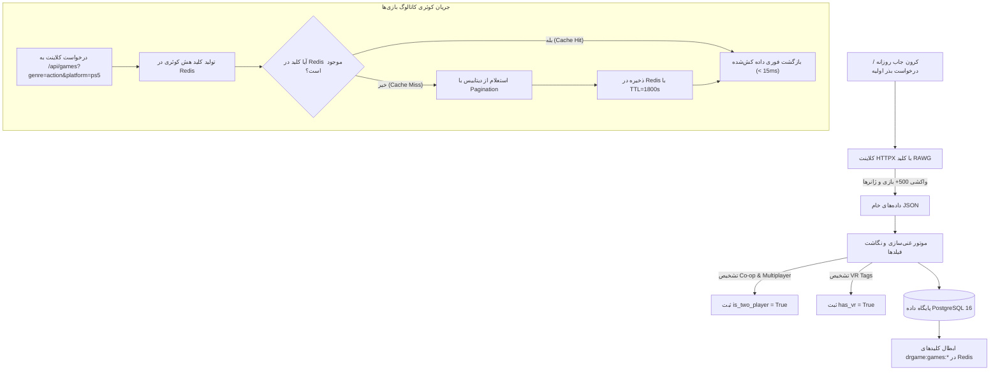

<div dir="rtl" lang="fa">

# 🎮 دستورالعمل اجرایی گام سوم: همگام‌سازی RAWG و کاتالوگ جامع بازی‌ها (03-rawg-sync-and-catalog)

> **شماره گام:** ۰۳  
> **عنوان مرحله:** موتور یکپارچه‌سازی و همگام‌سازی RAWG API (۵۰۰+ بازی)، کاتالوگ جامع بازی‌ها، کشینگ تهاجمی ردیس و رابط کاتالوگ با فیلتر پیشرفته  
> **وابستگی‌ها:** گام‌های ۰۱ و ۰۲  
> **مرجع سیاست‌ها:** `agent/development-policy.md` (بخش‌های ۲، ۳ و ۶) و `build.md` (بخش‌های ۲.۴ و ۵.۵)  

---

## ۱. اهداف و نیازمندی‌های عملکردی (Functional Requirements & Overview)

هدف از این گام، ایجاد دیتابیس غنی از جدیدترین و محبوب‌ترین بازی‌های کنسولی جهان، سیستم کشینگ چندلایه زیر ۱۵ میلی‌ثانیه، و پیاده‌سازی صفحه کاتالوگ و جزئیات بازی بر اساس استانداردهای PlayStation Store است:
1. **موتور واکشی عمیق از RAWG API (RAWG Sync Engine):**
   - اتصال به API بین‌المللی RAWG با کلید اختصاصی `91c0c1c9c30c4796bbff63a7471fdfdd` بر اساس مستندات `reports/rawg.json`.
   - **فاز Seed اولیه:** واکشی خودکار ۵۰۰ الی ۶۰۰ بازی برتر و پرطرفدار پلی‌استیشن (`platforms=187,18,16,15,27`) به همراه فهرست کامل تمامی ژانرها (`/genres`) و ذخیره در دیتابیس لوکال.
   - **کرون‌جاب همگام‌سازی روزانه (Daily Cron Sync):** اجرای خودکار در هر ۲۴ ساعت جهت استعلام عناوین جدید و به‌روزرسانی نمرات با قفل توزیع‌شده Redis.
   - نگاشت خودکار تگ‌های `co-op` و `multiplayer` به ویژگی بازی‌های ۲ نفره (دو دسته)، و تگ‌های `vr` به دسته واقعیت مجازی.
2. **لایه کشینگ تهاجمی در Redis (Aggressive Caching Layer):**
   - کش کردن نتایج کوئری‌های فیلتر کاتالوگ با کلید `drgame:games:catalog:{query_hash}` با مدت زمان ۳۰ دقیقه (TTL=1800s).
   - کش کردن اطلاعات جزئیات عمیق هر بازی با کلید `drgame:game:{id}` به مدت ۲ ساعت (TTL=7200s).
   - سیاست ابطال فعال کش (`Explicit Invalidation`) با هر لایک، دیس‌لایک، یا افزودن بازی جدید.
3. **سیستم لایک، دیس‌لایک و علاقه‌مندی‌ها (Interactions Engine):**
   - ثبت آرا منحصراً برای کاربران لاگین‌کرده مجاز است.
   - رفتار دوطرفه و تاگل (Toggle): فشردن مجدد لایک آن را حذف می‌کند؛ فشردن دیس‌لایک، لایک قبلی را پاک کرده و دیس‌لایک ثبت می‌نماید.
   - لیست علاقه‌مندی‌ها (Wishlist) با شمارنده زنده تعداد ذخیره‌سازی.
4. **رابط کاربری کاتالوگ و صفحه جزئیات بازی (Storefront Catalog & Details):**
   - فیلتربار کامل در سمت راست (ژانر، پلتفرم‌های PS5, PS4, Xbox, Switch با آیکون‌های SVG موجود در ریشه، بازه حجم دیتا با اسلایدر، محدوده امتیاز و حالت بازی تک‌دسته/دو‌دسته).
   - کارت‌های مستطیلی با نسبت استاندارد **۳ در ۴ عمودی** (کاور کنسول).
   - صفحه جزئیات بازی با هیرو بنر سینمایی، گالری گیم‌پلی، داستان بازی، مشخصات استودیو و جوایز، و باکس دانلود داینامیک ۵ تکه.

---

## ۲. منطق الگوریتمی و گردش داده همگام‌سازی و کشینگ (Data Pipelines)



---

## ۳. الگوهای کد و شِمای مدل‌ها (Code Examples & Patterns)

### ۳.۱. مدل‌های ماژول Games (`backend/app/modules/games/models.py`):
```python
from datetime import datetime
from sqlalchemy import String, Boolean, DateTime, Integer, Float, Text, JSON
from sqlalchemy.orm import Mapped, mapped_column
from app.core.database import Base

class Genre(Base):
    __tablename__ = "genres"

    id: Mapped[int] = mapped_column(Integer, primary_key=True, index=True)
    rawg_id: Mapped[int] = mapped_column(Integer, unique=True, index=True, nullable=False)
    name_fa: Mapped[str] = mapped_column(String(100), nullable=False)
    name_en: Mapped[str] = mapped_column(String(100), nullable=False)
    slug: Mapped[str] = mapped_column(String(100), unique=True, index=True, nullable=False)
    image_background: Mapped[str | None] = mapped_column(String(500), nullable=True)

class Game(Base):
    __tablename__ = "games"

    id: Mapped[int] = mapped_column(Integer, primary_key=True, index=True)
    rawg_id: Mapped[int] = mapped_column(Integer, unique=True, index=True, nullable=False)
    title_fa: Mapped[str] = mapped_column(String(200), nullable=False)
    title_en: Mapped[str] = mapped_column(String(200), index=True, nullable=False)
    slug: Mapped[str] = mapped_column(String(200), unique=True, index=True, nullable=False)
    
    description_fa: Mapped[str | None] = mapped_column(Text, nullable=True)
    description_en: Mapped[str | None] = mapped_column(Text, nullable=True)
    storyline_fa: Mapped[str | None] = mapped_column(Text, nullable=True)
    
    released: Mapped[str | None] = mapped_column(String(20), index=True, nullable=True)
    rating: Mapped[float] = mapped_column(Float, default=0.0, index=True)
    metacritic: Mapped[int | None] = mapped_column(Integer, index=True, nullable=True)
    download_size_gb: Mapped[float] = mapped_column(Float, default=0.0, index=True)
    
    is_two_player: Mapped[bool] = mapped_column(Boolean, default=False, index=True)
    has_vr: Mapped[bool] = mapped_column(Boolean, default=False, index=True)
    platforms: Mapped[list[str]] = mapped_column(JSON, default=list)  # ["PS5", "PS4", "Xbox", "Switch"]
    
    publisher: Mapped[str | None] = mapped_column(String(150), nullable=True)
    developer: Mapped[str | None] = mapped_column(String(150), nullable=True)
    awards: Mapped[list[str]] = mapped_column(JSON, default=list)
    
    cover_image_url: Mapped[str | None] = mapped_column(String(500), nullable=True)
    banner_image_url: Mapped[str | None] = mapped_column(String(500), nullable=True)
    screenshots: Mapped[list[str]] = mapped_column(JSON, default=list)
    
    likes_count: Mapped[int] = mapped_column(Integer, default=0, index=True)
    dislikes_count: Mapped[int] = mapped_column(Integer, default=0)
    wishlist_count: Mapped[int] = mapped_column(Integer, default=0, index=True)
    is_active: Mapped[bool] = mapped_column(Boolean, default=True, index=True)
    created_at: Mapped[datetime] = mapped_column(DateTime, default=datetime.utcnow)

class GameInteraction(Base):
    __tablename__ = "game_interactions"

    id: Mapped[int] = mapped_column(Integer, primary_key=True, index=True)
    game_id: Mapped[int] = mapped_column(Integer, index=True, nullable=False)
    user_id: Mapped[int] = mapped_column(Integer, index=True, nullable=False)
    interaction_type: Mapped[str] = mapped_column(String(20), nullable=False)  # "like", "dislike", "wishlist"
    created_at: Mapped[datetime] = mapped_column(DateTime, default=datetime.utcnow)
```

---

## ۴. آدرس‌دهی دقیق فایل‌ها (Explicit File Paths)

### فایل‌های جدید که باید ایجاد شوند (New Files):
- **ماژول Games در بک‌اند:**
  - `backend/app/modules/games/__init__.py`
  - `backend/app/modules/games/models.py`: تعریف جداول `games`, `genres`, `game_interactions`, `game_download_links`.
  - `backend/app/modules/games/schemas.py`: شِماهای Pydantic V2 برای لیست بازی‌ها، فیلترها، جزئیات بازی و اکشن‌های لایک/ویش‌لیست.
  - `backend/app/modules/games/services.py`: لاجیک استعلام و فیلتر کاتالوگ با کش ردیس، محاسبه تاگل لایک و دیس‌لایک، و ثبت ویش‌لیست.
  - `backend/app/modules/games/router.py`: اندپوینت‌های عمومی و کاربری بازی‌ها (`GET /api/games`, `GET /api/games/{id}`, `POST /api/games/{id}/like`, `POST /api/games/{id}/dislike`, `POST /api/games/{id}/wishlist`, `GET /api/genres`).
  - `backend/app/modules/games/tests/__init__.py`
  - `backend/app/modules/games/tests/conftest.py`
  - `backend/app/modules/games/tests/test_services.py`: آزمون‌های کشینگ، فیلترها و منطق تاگل آرا.
  - `backend/app/modules/games/tests/test_router.py`: آزمون‌های یکپارچگی HTTP برای روت‌های بازی‌ها.
- **ماژول همگام‌سازی RAWG:**
  - `backend/app/modules/rawg_sync/__init__.py`
  - `backend/app/modules/rawg_sync/client.py`: کلاینت ناهمگام ارتباط با `api.rawg.io` با کلید معتبر و مدیریت محدودیت‌های نرخ (Rate Limiting).
  - `backend/app/modules/rawg_sync/services.py`: جاب‌های واکشی بذر اولیه ۵۰۰ بازی، نگاشت تگ‌های ۲ نفره و VR، و کرون‌جاب روزانه.
  - `backend/app/modules/rawg_sync/router.py`: اندپوینت ادمین جهت تریگر دستی سینک اولیه یا روزانه.
  - `backend/app/modules/rawg_sync/tests/test_sync.py`: آزمون ماک واکشی و تبدیل داده‌های RAWG به ساختار لوکال.
- **مایگریشن دیتابیس:**
  - اسکریپت جدید مایگریشن در `backend/alembic/versions/` برای جداول کاتالوگ، ژانرها و تعاملات.
- **فرانت‌اند:**
  - `frontend/src/types/game.ts`: تعاریف کامل اینترفیس‌های تایپ‌اسکریپت بازی، ژانر، تعاملات و فیلترها.
  - `frontend/src/components/games/GameCard.tsx`: کامپوننت کارت مستطیلی ۳ در ۴ با نسبت استاندارد، نشان پلتفرم و حجم بازی.
  - `frontend/src/components/games/FilterSidebar.tsx`: سایدبار فیلترهای چندگانه با آیکون‌های SVG پلتفرم‌ها (`ps5.svg`, `ps4.svg`, `xbox360.svg`, `switch.svg`) و اسلایدر حجم.
  - `frontend/src/components/games/DownloadBox.tsx`: باکس دانلود ۵ تکه با کنترل استیت خاکستری بر اساس سطح اشتراک.
  - `frontend/src/app/(store)/games/page.tsx`: صفحه کاتالوگ جامع با Live Search و ویجت وضعیت سهمیه.
  - `frontend/src/app/(store)/games/[id]/page.tsx`: صفحه سینمایی جزئیات بازی، گالری تصاویر، داستان و دکمه‌های تاگل لایک/دیس‌لایک.

### فایل‌های موجود که ویرایش می‌شوند (Modified Files):
- `backend/app/main.py`: رجیستر روترهای `games` و `rawg_sync`.
- `backend/alembic/env.py`: شناسایی مدل‌های جدید `Game`, `Genre`, `GameInteraction`.
- `frontend/src/app/(store)/page.tsx`: اتصال کاروسل‌های ژانری صفحه خانه به داده‌های کاتالوگ بازی‌ها.

</div>
