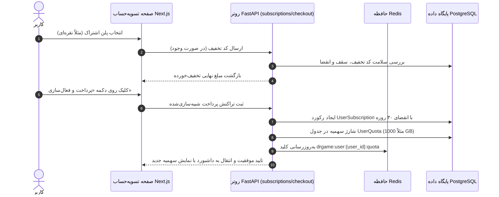
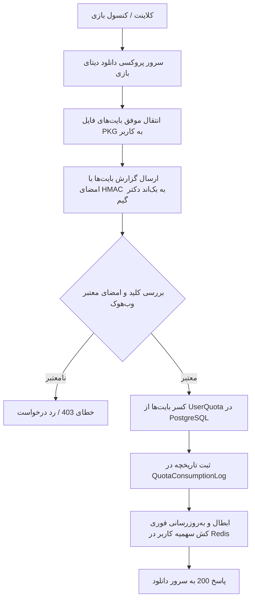

<div dir="rtl" lang="fa">

# 💎 دستورالعمل اجرایی گام چهارم: پلن‌های اشتراک، موتور سهمیه دانلود و تسویه‌حساب (04-subscriptions-and-quota)

> **شماره گام:** ۰۴  
> **عنوان مرحله:** پیاده‌سازی پلن‌های ۴گانه اشتراک، موتور محاسبه سهمیه مصرفی با وب‌هوک سرویس دانلود، سیستم کدهای تخفیف و تسویه‌حساب شبیه‌سازی‌شده  
> **وابستگی‌ها:** گام‌های ۰۱، ۰۲ و ۰۳  
> **مرجع سیاست‌ها:** `agent/development-policy.md` (بخش‌های ۲، ۳ و ۷) و `build.md` (بخش‌های ۲.۶، ۵.۳ و ۳.۴)  

---

## ۱. اهداف و نیازمندی‌های عملکردی (Functional Requirements & Overview)

در این گام، قلب بیزینسی و درآمدزایی پلتفرم دکتر گیم شامل پلن‌های اشتراکی، کنترل مصرف پهنای باند و سهمیه دانلود، و جریان خرید اشتراک پیاده‌سازی می‌گردد:
1. **ماتریس پلن‌های ۴گانه اشتراک (Subscription Matrix):**
   - **پلن طلایی (Gold):** ۲.۲ ترابایت (۲۲۰۰ گیگابایت)، حداکثر سرعت، دسترسی به کلیه کنسول‌ها (PS1 تا PS5، نینتندو، ایکس‌باکس)، امکان دانلود زیرنویس و DLC، و خرید تم پلی‌استیشن با قیمت ۳,۰۰۰,۰۰۰ تومان.
   - **پلن نقره‌ای (Silver):** ۱ ترابایت (۱۰۰۰ گیگابایت)، سرعت بالا، کنسول‌های PS3 تا PS5، امکان دانلود زیرنویس و DLC با قیمت ۱,۵۰۰,۰۰۰ تومان.
   - **پلن برنز (Bronze):** ۵۰۰ گیگابایت، سرعت بالا، صرفاً PS4 و PS5، بدون زیرنویس و DLC با قیمت ۷۰۰,۰۰۰ تومان.
   - **پلن رایگان (Free):** بدون سقف حجمی اما محدود به دانلود **منحصراً ۵ بازی مجاز** که توسط ادمین به صورت پویا تعیین می‌شوند.
   - **مدت اعتبار:** کلیه اشتراک‌های غیررایگان دارای انقضای دقیق **یک‌ماهه (۳۰ روز تقویمی)** هستند.
2. **موتور محاسبه و کسر دقیق سهمیه دانلود (Quota Deduction Engine):**
   - نگهداری وضعیت لحظه‌ای سهمیه کاربر در Redis با کلید `drgame:user:{user_id}:quota` جهت پاسخ‌دهی آنی به کپسول هدر (Quota Pill).
   - **مکانیسم کسر سهمیه با کال‌بک خارجی:** کسر حجم دانلود مستقیماً بر اساس کلیک کاربر در فرانت‌اند رخ نمی‌دهد؛ بلکه کاربر لینک دانلود امضاشده موقت دریافت کرده و پس از اتمام یا پیشرفت دانلود، سرور یا پروکسی دانلود (Download Proxy / CDN) یک درخواست امن و امضاشده با HMAC به اندپوینت `/api/quota/callback/consume` ارسال می‌کند تا بایت‌های واقعی منتقل‌شده از سهمیه کاربر کسر و لاگ ثبت شود.
3. **موتور کدهای تخفیف و تسویه‌حساب شبیه‌سازی‌شده (Checkout & Discounts):**
   - اعتبارسنجی کدهای تخفیف درصدی و مبلغی، سقف تخفیف، بررسی تاریخ انقضا و تعداد استفاده.
   - صفحه تسویه‌حساب `/checkout`: نمایش خلاصه فاکتور، اعمال کد تخفیف، بازنگری قیمت، و دکمه پرداخت که در فاز فعلی اشتراک ۳۰ روزه را شبیه‌سازی کرده و سهمیه کاربر را شارژ می‌نماید.
4. **ویجت کپسولی سهمیه در هدر (Header Quota Pill):**
   - نمایش حجم باقیمانده لحظه‌ای در تمام صفحات (مثلاً `420 GB / 1 TB`) به همراه درصد پیشرفت و رنگ وضعیت (سبز، نارنجی هشدار در زیر ۲۰٪، قرمز در پایان سهمیه).

---

## ۲. منطق الگوریتمی و گردش کسر سهمیه و خرید (Data Pipelines)

### ۲.۱. جریان خرید و فعال‌سازی اشتراک:


### ۲.۲. جریان وب‌هوک کسر سهمیه با سرور دانلود:


---

## ۳. الگوهای کد و تعاریف مدل‌ها (Code Examples & Patterns)

### ۳.۱. مدل‌های ماژول Subscriptions (`backend/app/modules/subscriptions/models.py`):
```python
from datetime import datetime
from sqlalchemy import String, Boolean, DateTime, Integer, Float, JSON
from sqlalchemy.orm import Mapped, mapped_column
from app.core.database import Base

class SubscriptionTier(Base):
    __tablename__ = "subscription_tiers"

    id: Mapped[int] = mapped_column(Integer, primary_key=True, index=True)
    code: Mapped[str] = mapped_column(String(30), unique=True, index=True, nullable=False)  # "free", "bronze", "silver", "gold"
    name_fa: Mapped[str] = mapped_column(String(100), nullable=False)
    name_en: Mapped[str] = mapped_column(String(100), nullable=False)
    price_toman: Mapped[int] = mapped_column(Integer, default=0, nullable=False)
    price_usd: Mapped[float] = mapped_column(Float, default=0.0, nullable=False)
    
    quota_gb: Mapped[int] = mapped_column(Integer, default=0, nullable=False)
    speed_limit_mbps: Mapped[int] = mapped_column(Integer, default=20, nullable=False)
    allowed_platforms: Mapped[list[str]] = mapped_column(JSON, default=list)  # ["PS4", "PS5"]
    
    allow_dlc: Mapped[bool] = mapped_column(Boolean, default=False)
    allow_subtitles: Mapped[bool] = mapped_column(Boolean, default=False)
    allow_themes: Mapped[bool] = mapped_column(Boolean, default=False)
    is_active: Mapped[bool] = mapped_column(Boolean, default=True)

class UserSubscription(Base):
    __tablename__ = "user_subscriptions"

    id: Mapped[int] = mapped_column(Integer, primary_key=True, index=True)
    user_id: Mapped[int] = mapped_column(Integer, index=True, nullable=False)
    tier_code: Mapped[str] = mapped_column(String(30), nullable=False)
    start_date: Mapped[datetime] = mapped_column(DateTime, default=datetime.utcnow, nullable=False)
    end_date: Mapped[datetime] = mapped_column(DateTime, nullable=False)  # start_date + 30 days
    status: Mapped[str] = mapped_column(String(20), default="active", index=True)  # "active", "expired", "cancelled"
    payment_id: Mapped[int | None] = mapped_column(Integer, nullable=True)

class FreeTierAllowedGame(Base):
    __tablename__ = "free_tier_allowed_games"

    id: Mapped[int] = mapped_column(Integer, primary_key=True, index=True)
    game_id: Mapped[int] = mapped_column(Integer, unique=True, index=True, nullable=False)
    is_active: Mapped[bool] = mapped_column(Boolean, default=True)
    added_at: Mapped[datetime] = mapped_column(DateTime, default=datetime.utcnow)
```

### ۳.۲. مدل‌های ماژول Quota (`backend/app/modules/quota/models.py`):
```python
from datetime import datetime
from sqlalchemy import DateTime, Integer, Float, BigInteger
from sqlalchemy.orm import Mapped, mapped_column
from app.core.database import Base

class UserQuota(Base):
    __tablename__ = "user_quotas"

    id: Mapped[int] = mapped_column(Integer, primary_key=True, index=True)
    user_id: Mapped[int] = mapped_column(Integer, unique=True, index=True, nullable=False)
    total_quota_gb: Mapped[float] = mapped_column(Float, default=0.0, nullable=False)
    used_quota_gb: Mapped[float] = mapped_column(Float, default=0.0, nullable=False)
    remaining_quota_gb: Mapped[float] = mapped_column(Float, default=0.0, nullable=False)
    updated_at: Mapped[datetime] = mapped_column(DateTime, default=datetime.utcnow, onupdate=datetime.utcnow)

class QuotaConsumptionLog(Base):
    __tablename__ = "quota_consumption_logs"

    id: Mapped[int] = mapped_column(Integer, primary_key=True, index=True)
    user_id: Mapped[int] = mapped_column(Integer, index=True, nullable=False)
    game_id: Mapped[int] = mapped_column(Integer, index=True, nullable=False)
    bytes_downloaded: Mapped[int] = mapped_column(BigInteger, nullable=False)
    gb_deducted: Mapped[float] = mapped_column(Float, nullable=False)
    download_server_id: Mapped[str] = mapped_column(String(100), nullable=False)
    created_at: Mapped[datetime] = mapped_column(DateTime, default=datetime.utcnow)
```

---

## ۴. آدرس‌دهی دقیق فایل‌ها (Explicit File Paths)

### فایل‌های جدید که باید ایجاد شوند (New Files):
- **ماژول Subscriptions در بک‌اند:**
  - `backend/app/modules/subscriptions/__init__.py`
  - `backend/app/modules/subscriptions/models.py`: تعریف جداول `subscription_tiers`, `user_subscriptions`, `free_tier_allowed_games`, `discount_codes`, `order_payments`.
  - `backend/app/modules/subscriptions/schemas.py`: DTOهای پلن‌ها، فاکتور خرید، اعمال تخفیف و فعال‌سازی اشتراک.
  - `backend/app/modules/subscriptions/services.py`: لاجیک استعلام پلن‌ها، تخفیف، تسویه‌حساب و فعال‌سازی ۳۰ روزه.
  - `backend/app/modules/subscriptions/router.py`: اندپوینت‌های `/api/subscriptions/tiers`, `/api/subscriptions/my-status`, `/api/checkout/apply-discount`, `/api/checkout/process`.
  - `backend/app/modules/subscriptions/tests/__init__.py`
  - `backend/app/modules/subscriptions/tests/test_services.py`
  - `backend/app/modules/subscriptions/tests/test_router.py`
- **ماژول Quota در بک‌اند:**
  - `backend/app/modules/quota/__init__.py`
  - `backend/app/modules/quota/models.py`: جداول `user_quotas` و `quota_consumption_logs`.
  - `backend/app/modules/quota/schemas.py`: شِماهای وضعیت سهمیه و ساختار ورودی کال‌بک وب‌هوک دانلود.
  - `backend/app/modules/quota/services.py`: لاجیک کسر حجم، شارژ اولیه سهمیه و همگام‌سازی لحظه‌ای با کش Redis.
  - `backend/app/modules/quota/router.py`: اندپوینت امن کال‌بک وب‌هوک `/api/quota/callback/consume`.
  - `backend/app/modules/quota/tests/__init__.py`
  - `backend/app/modules/quota/tests/test_services.py`
  - `backend/app/modules/quota/tests/test_router.py`
- **مایگریشن دیتابیس:**
  - اسکریپت جدید Alembic در `backend/alembic/versions/` برای اشتراک‌ها، سهمیه‌ها و فاکتورها.
- **فرانت‌اند:**
  - `frontend/src/types/subscription.ts`: تعاریف اینترفیس‌های پلن‌های اشتراک، وضعیت سهمیه و فاکتور.
  - `frontend/src/components/layout/QuotaPill.tsx`: ویجت کپسولی حجم دانلود در هدر با استایل درخشان نئونی بنفش.
  - `frontend/src/components/subscriptions/TierCard.tsx`: کارت مقایسه‌ای هر یک از ۴ پلن با نمادهای پلی‌استیشن در بک‌گراند و چک‌لیست ویژگی‌ها.
  - `frontend/src/app/(store)/subscriptions/page.tsx`: صفحه اصلی مقایسه و انتخاب پلن‌های اشتراک ۴گانه.
  - `frontend/src/app/(store)/checkout/page.tsx`: صفحه شبیه‌سازی پرداخت و اعمال کد تخفیف با آپدیت آنی مبالغ.

### فایل‌های موجود که ویرایش می‌شوند (Modified Files):
- `backend/app/main.py`: رجیستر روترهای `subscriptions` و `quota`.
- `backend/alembic/env.py`: معرفی متادیتای مدل‌های جدید اشتراک و سهمیه.
- `frontend/src/components/layout/Header.tsx`: ادغام ویجت `QuotaPill` در هدر اصلی سایت.

</div>
