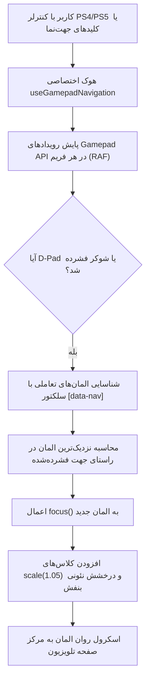

<div dir="rtl" lang="fa">

# 🎮 دستورالعمل اجرایی گام پنجم: رابط کاربری فروشگاه، هوم‌پیج و ناوبری ۱۰ فوتی گیم‌پد (05-storefront-ui-and-gamepad)

> **شماره گام:** ۰۵  
> **عنوان مرحله:** پیاده‌سازی کامل صفحه اصلی (هیرو بنر، ویجت رفرال، کاروسل‌های ژانری)، هدر سراسری، فوتر دوگانه، و ناوبری فضایی کنترلر (10-Foot UI)  
> **وابستگی‌ها:** گام‌های ۰۱، ۰۲، ۰۳ و ۰۴  
> **مرجع سیاست‌ها:** `agent/development-policy.md` (بخش‌های ۴ و ۵) و `build.md` (بخش‌های ۲.۱، ۲.۲، ۲.۳ و ۵.۴)  

---

## ۱. اهداف و نیازمندی‌های عملکردی (Functional Requirements & Overview)

در این گام، پوسته بصری اصلی پلتفرم دکتر گیم بر پایه سیستم طراحی بنفش کهکشانی (Cosmic Purple) و استانداردهای نمایشگرهای بزرگ کنسول و تلویزیون پیاده‌سازی می‌شود:
1. **هدر سراسری دو وضعیتی (Global Header):**
   - پس‌زمینه شیشه‌ای بلورین با افکت `backdrop-filter: blur(16px)`.
   - **سمت راست (RTL):** دسترسی‌های بازی‌ها (با آیکون دسته)، ابزارها (آیکون آچار/دسته)، و مقالات (آیکون ژورنال).
   - **مرکز:** لوگوی رسمی دکتر گیم با آیکون بنفش نئونی درخشان.
   - **سمت چپ:** وضعیت احراز هویت (دکمه ورود/ثبت‌نام یا پروفایل کاربر)، عنوان اشتراک فعال با رنگ مربوطه (طلایی/نقره‌ای/برنز) یا دکمه «خرید اشتراک»، زنگوله اعلان‌ها با نشانگر تعداد اعلان‌های جدید، دکمه تغییر زبان (FA/EN)، و ویجت کپسولی سهمیه لحظه‌ای (`QuotaPill`).
2. **فوتر منعطف دوگانه (Dual Dynamic Footer):**
   - **فوتر داخلی (ایران):** لوگوی درگاه پرداخت شاپرک/زیبال (پلیس‌هولدر)، نماد اعتماد اینماد و ساماندهی (پلیس‌هولدر)، تلفن پشتیبانی، آدرس فیزیکی، لوگو دکتر گیم، لینک‌های تلگرام و اینستاگرام.
   - **فوتر بین‌المللی:** لوگوی درگاه‌های ویزا/کریپتو، ایمیل پشتیبانی بین‌المللی، شبکه‌های تلگرام، دیسکورد و ایکس (توییتر) بدون نمادهای داخلی.
   - **دکمه سوئیچ تست:** دکمه سوئیچ دستی در فوتر جهت دمو، با قابلیت تشخیص خودکار مبتنی بر IP کلاینت.
3. **صفحه اصلی هوشمند (Homepage Architecture):**
   - **کارت خلاصه درآمد رفرال:** در بالاترین بخش صفحه (دقیقاً بالای هیرو بنر)، منحصراً برای کاربران لاگین‌کرده همراه با نمایش درآمد، موجودی کیف پول و کد رفرال.
   - **بنر هیرو سینمایی:** مطابق تصویر مرجع `1131.png` با پس‌زمینه عریض پوستر بازی روز، تگ پلتفرم، عنوان تماشایی، دکمه بنفش اکشن و خلاصه داستان.
   - **کاروسل ۵ بازی لیست علاقه‌مندی‌ها (Wishlist):** نمایش ۵ بازی آخر اضافه شده به ویش‌لیست کاربر لاگین‌کرده با دکمه هدایت به پنل.
   - **کاروسل ۵ بازی تازه منتشر شده:** جدیدترین بازی‌ها بر اساس تاریخ انتشار.
   - **سکشن ۵ بلاگ برتر آموزشی:** **دقیقاً بین سکشن بازی‌های تازه و سکشن بازی‌های دو نفره** قرار می‌گیرد.
   - **کاروسل ۵ بازی پرلایک دو نفره / دو دسته (Local Co-op):** بازی‌های پشتیبانی‌کننده از دو کنترلر.
   - **کاروسل‌های ۵تایی به تفکیک ژانرها:** اکشن-ماجراجویی، مبارزه‌ای، ترسناک، ایندی، مهمانی، پلتفرمر و معمایی، نقش‌آفرینی، شوتر، ورزشی و مسابقه‌ای، استراتژی، بقا و جهان‌باز، و بازی‌های دارای قابلیت واقعیت مجازی (VR).
4. **استاندارد رابط کاربری ۱۰ فوتی و کنترلر (10-Foot UI & Gamepad Navigation):**
   - ناوبری کامل کل صفحات بدون موس و کیبورد، صرفاً با دکمه‌های جهت‌نما (D-Pad) و شوکر دسته پلی‌استیشن ۴ و ۵ (Gamepad API).
   - بزرگ‌نمایی المان فوکوس‌شده به میزان `scale(1.05)` به همراه حاشیه ۲ پیکسلی بنفش نئونی (`#A855F7`) و درخشش فضایی (`box-shadow: 0 0 25px rgba(168, 85, 247, 0.6)`).
   - اسکرول نرم و خودکار المان فعال به مرکز صفحه نمایشگر (`scrollIntoView({ behavior: 'smooth', block: 'center' })`).

---

## ۲. منطق ناوبری فضایی با گیم‌پد (Spatial Navigation Algorithm)



---

## ۳. الگوهای کد و استانداردهای پیاده‌سازی (Code Examples & Patterns)

### ۳.۱. هوک ناوبری گیم‌پد (`frontend/src/hooks/useGamepadNavigation.ts`):
```typescript
import { useEffect, useRef } from 'react';

export function useGamepadNavigation() {
  const lastPressRef = useRef<number>(0);

  useEffect(() => {
    let animationFrameId: number;

    const scanGamepad = () => {
      const gamepads = navigator.getGamepads ? navigator.getGamepads() : [];
      const gp = gamepads[0]; // اولین گیم‌پد متصل

      if (gp) {
        const now = Date.now();
        if (now - lastPressRef.current > 180) { // کول‌داون ۱۸۰ میلی‌ثانیه‌ای برای دکمه‌ها
          const dpadUp = gp.buttons[12]?.pressed;
          const dpadDown = gp.buttons[13]?.pressed;
          const dpadLeft = gp.buttons[14]?.pressed;
          const dpadRight = gp.buttons[15]?.pressed;
          const buttonX = gp.buttons[0]?.pressed; // دکمه ضربدر در پلی‌استیشن (تایید/کلیک)

          if (dpadUp || dpadDown || dpadLeft || dpadRight) {
            handleSpatialMove(dpadUp, dpadDown, dpadLeft, dpadRight);
            lastPressRef.current = now;
          } else if (buttonX) {
            const activeEl = document.activeElement as HTMLElement;
            if (activeEl) activeEl.click();
            lastPressRef.current = now;
          }
        }
      }
      animationFrameId = requestAnimationFrame(scanGamepad);
    };

    animationFrameId = requestAnimationFrame(scanGamepad);
    return () => cancelAnimationFrame(animationFrameId);
  }, []);
}

function handleSpatialMove(up: boolean, down: boolean, left: boolean, right: boolean) {
  const focusables = Array.from(
    document.querySelectorAll<HTMLElement>('a, button, input, [tabindex="0"], [data-nav]')
  ).filter(el => el.offsetParent !== null && !el.hasAttribute('disabled'));

  const current = document.activeElement as HTMLElement;
  if (!current || !focusables.includes(current)) {
    focusables[0]?.focus();
    return;
  }

  const currentRect = current.getBoundingClientRect();
  let bestTarget: HTMLElement | null = null;
  let minDistance = Infinity;

  focusables.forEach(target => {
    if (target === current) return;
    const targetRect = target.getBoundingClientRect();

    let isValidDirection = false;
    if (down && targetRect.top >= currentRect.bottom - 10) isValidDirection = true;
    if (up && targetRect.bottom <= currentRect.top + 10) isValidDirection = true;
    if (right && targetRect.left >= currentRect.right - 10) isValidDirection = true;
    if (left && targetRect.right <= currentRect.left + 10) isValidDirection = true;

    if (isValidDirection) {
      const dx = targetRect.left + targetRect.width / 2 - (currentRect.left + currentRect.width / 2);
      const dy = targetRect.top + targetRect.height / 2 - (currentRect.top + currentRect.height / 2);
      const distance = Math.hypot(dx, dy);

      if (distance < minDistance) {
        minDistance = distance;
        bestTarget = target;
      }
    }
  });

  if (bestTarget) {
    (bestTarget as HTMLElement).focus();
    (bestTarget as HTMLElement).scrollIntoView({ behavior: 'smooth', block: 'center' });
  }
}
```

### ۳.۲. استایل فوکوس کنترلر در `frontend/src/app/globals.css`:
```css
/* استایل درخشان ویژه استاندارد 10-Foot UI برای تلویزیون و کنترلر */
:focus-visible {
  outline: none !important;
  transform: scale(1.05);
  border-color: #A855F7 !important;
  box-shadow: 0 0 25px rgba(168, 85, 247, 0.6), inset 0 0 10px rgba(168, 85, 247, 0.3) !important;
  transition: transform 0.2s cubic-bezier(0.16, 1, 0.3, 1), box-shadow 0.2s ease, border-color 0.2s ease;
  z-index: 50;
}
```

---

## ۴. آدرس‌دهی دقیق فایل‌ها (Explicit File Paths)

### فایل‌های جدید که باید ایجاد شوند (New Files):
- **کامپوننت‌های لایوت سراسری:**
  - `frontend/src/components/layout/Header.tsx`: هدر شیشه‌ای کامل با پشتیبانی از وضعیت احراز هویت، اشتراک، تغییر زبان و نوتیفیکیشن.
  - `frontend/src/components/layout/Footer.tsx`: فوتر دوگانه داخلی و بین‌المللی با دکمه سوئیچ تست.
  - `frontend/src/components/layout/LanguageSwitcher.tsx`: کامپوننت تغییر زبان فارسی/انگلیسی و مدیریت RTL/LTR.
- **کامپوننت‌های صفحه اصلی:**
  - `frontend/src/components/home/ReferralSummaryBanner.tsx`: کارت درآمد رفرال بالای هیرو بنر برای کاربران لاگین‌کرده.
  - `frontend/src/components/home/HeroShowcase.tsx`: بنر هیرو سینمایی الهام‌گرفته از کد تصویر `1131.png`.
  - `frontend/src/components/home/GameCarousel.tsx`: کاروسل ریسپانسیو و لمسی با دکمه‌های اسکرول و پشتیبانی از D-Pad.
  - `frontend/src/components/home/TutorialBlogsSection.tsx`: سکشن ۵ بلاگ آموزشی قرارگرفته بین بازی‌های تازه و دو نفره.
- **هوک‌های ناوبری و وضعیت:**
  - `frontend/src/hooks/useGamepadNavigation.ts`: پیاده‌سازی ناوبری فضایی کنترلر با Gamepad API.
  - `frontend/src/hooks/useLanguage.ts`: مدیریت جهت‌بندی RTL/LTR و تغییر متون سراسری.
- **صفحات فروشگاه:**
  - `frontend/src/app/(store)/page.tsx`: صفحه اصلی کامل با چیدمان تمامی ۱۲ کاروسل ژانری، هیرو بنر و مقالات آموزشی.

### فایل‌های موجود که ویرایش می‌شوند (Modified Files):
- `frontend/src/app/globals.css`: اضافه کردن متغیرهای انیمیشن، ترنزیشن‌های کنترلی و استایل‌های `:focus-visible` نئونی.
- `frontend/src/app/layout.tsx`: الحاق هوک ناوبری گیم‌پد و هدر/فوتر سراسری.

</div>
