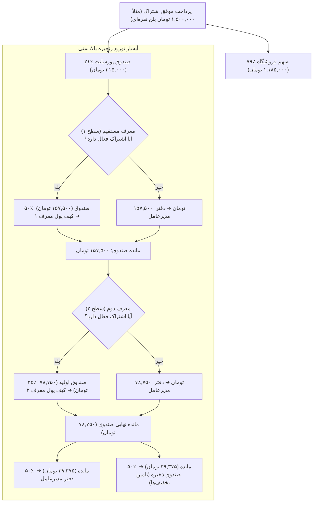

<div dir="rtl" lang="fa">

# 🤝 دستورالعمل اجرایی گام ششم: سامانه بازاریابی ارجاعی و کیف پول (06-referral-system)

> **شماره گام:** ۰۶  
> **عنوان مرحله:** پیاده‌سازی سامانه تخصیص پورسانت چندسطحی (Branch Ledger)، کیف پول، حساب‌های تسویه ریالی و کریپتو، و داشبورد جامع رفرال  
> **وابستگی‌ها:** گام‌های ۰۱، ۰۲ و ۰۴  
> **مرجع سیاست‌ها:** `agent/development-policy.md` (بخش‌های ۲ و ۸)، `build.md` (بخش‌های ۳.۷، ۴.۷ و ۴.۸) و سند کسب‌وکار `source/referral/SYSTEM-PROPOSAL-FA.md`  

---

## ۱. اهداف و نیازمندی‌های عملکردی (Functional Requirements & Overview)

در این گام، موتور مالی و بازاریابی ارجاعی پلتفرم دکتر گیم دقیقاً منطبق بر مدل ریاضی و قوانین ارائه‌شده در پروپوزال رسمی `source/referral/SYSTEM-PROPOSAL-FA.md` پیاده‌سازی می‌گردد:
1. **فرمول تسهیم مبالغ فروش اشتراک (Revenue Split Formula):**
   - **سهم فروشگاه:** ۷۹٪ از مبلغ واقعی پرداخت‌شده پس از تخفیف.
   - **کل صندوق پورسانت بازاریابی:** ۲۱٪ از همان مبلغ.
   - **توزیع پورسانت در زنجیره بالادستی (Halving Commission Waterfall):**
     - معرف مستقیم (سطح ۱): ۵۰٪ از کل صندوق ۲۱درصدی (معادل ۱۰.۵٪ مبلغ پرداخت‌شده).
     - معرف دوم (سطح ۲): ۲۵٪ از کل صندوق (معادل ۵.۲۵٪).
     - معرف سوم (سطح ۳): ۱۲.۵٪ از کل صندوق (معادل ۲.۶۲۵٪).
     - سهم سطوح بعدی به طور متوالی نصف می‌شود.
   - **تخصیص مانده نهایی:** مبالغ باقیمانده پس از عبور از زنجیره بالادستی نصف شده و نیمی به **دفتر مدیرعامل (CEO Ledger)** و نیمی به **صندوق ذخیره (Reserve Fund)** تخصیص می‌یابد.
2. **شرط اساسی صلاحیت دریافت پورسانت (Active Subscription Prerequisite):**
   - برای اینکه یک کاربر در زمان خرید زیرمجموعه‌اش پورسانت دریافت کند، **اشتراک شخصی او باید در همان لحظه فعال باشد**.
   - در صورت غیرفعال بودن اشتراک معرف، سهم آن سطح به دفتر مدیرعامل منتقل می‌شود (سهم سوخت نمی‌شود و به کاربر دیگری هم منتقل نمی‌گردد).
3. **تخفیف خوش‌آمدگویی و صندوق ذخیره:**
   - تخفیف ۵٪ برای اولین اشتراک پرداخت‌شده هر کاربر جدید، تأمین‌شده از محل موجودی صندوق ذخیره.
4. **روش‌های تسویه‌حساب دوگانه (Dual Settlement Gateway):**
   - **کاربران داخلی (ریالی):** شماره شبا (IR)، شماره کارت، نام صاحب حساب و نام بانک.
   - **کاربران بین‌المللی (ارزی):** آدرس کیف پول رمزارز (مانند USDT TRC20 / ERC20) و نوع شبکه.
   - وضعیت اولیه «در انتظار تایید» که منحصراً پس از اعتبارسنجی توسط ادمین به «فعال» تغییر می‌یابد.
5. **کیف پول و درخواست‌های برداشت وجه (Wallet & Payout Requests):**
   - جدول لجر تفصیلی تراکنش‌های بستانکار و بدهکار با گردکردن دقیق محاسبات مالی بدون کسر یا اضافه شدن حتی یک ریال.
   - امکان ثبت درخواست برداشت وجه از کیف پول و ثبت فیش واریزی توسط ادمین.
6. **داشبورد رفرال کاربری (`/dashboard/referral`):**
   - نمایش لینک و کد رفرال اختصاصی، کارت‌های درآمد کل و موجودی قابل برداشت، جدول تاریخچه تراکنش‌ها با صفحه‌بندی، نمایش بصری سطوح شبکه، و مدیریت حساب‌های تسویه.

---

## ۲. دیاگرام جریان توزیع وجوه رفرال (Commission Waterfall Sequence)



---

## ۳. الگوهای کد و تعاریف مدل‌ها (Code Examples & Patterns)

### ۳.۱. مدل‌های ماژول Wallet و Referral (`backend/app/modules/wallet/models.py`):
```python
from datetime import datetime
from sqlalchemy import String, Boolean, DateTime, Integer, BigInteger, Float
from sqlalchemy.orm import Mapped, mapped_column
from app.core.database import Base

class UserWallet(Base):
    __tablename__ = "user_wallets"

    id: Mapped[int] = mapped_column(Integer, primary_key=True, index=True)
    user_id: Mapped[int] = mapped_column(Integer, unique=True, index=True, nullable=False)
    withdrawable_balance_toman: Mapped[int] = mapped_column(BigInteger, default=0, nullable=False)
    total_earned_toman: Mapped[int] = mapped_column(BigInteger, default=0, nullable=False)
    total_withdrawn_toman: Mapped[int] = mapped_column(BigInteger, default=0, nullable=False)
    updated_at: Mapped[datetime] = mapped_column(DateTime, default=datetime.utcnow, onupdate=datetime.utcnow)

class ReferralChain(Base):
    __tablename__ = "referral_chains"

    id: Mapped[int] = mapped_column(Integer, primary_key=True, index=True)
    user_id: Mapped[int] = mapped_column(Integer, unique=True, index=True, nullable=False)
    referrer_id: Mapped[int] = mapped_column(Integer, index=True, nullable=False)
    created_at: Mapped[datetime] = mapped_column(DateTime, default=datetime.utcnow)

class CommissionLedger(Base):
    __tablename__ = "commission_ledgers"

    id: Mapped[int] = mapped_column(Integer, primary_key=True, index=True)
    order_payment_id: Mapped[int] = mapped_column(Integer, index=True, nullable=False)
    beneficiary_type: Mapped[str] = mapped_column(String(20), nullable=False)  # "user", "ceo", "reserve"
    user_id: Mapped[int | None] = mapped_column(Integer, index=True, nullable=True)
    tier_level: Mapped[int] = mapped_column(Integer, default=1)
    amount_toman: Mapped[int] = mapped_column(BigInteger, nullable=False)
    description: Mapped[str] = mapped_column(String(255), nullable=False)
    created_at: Mapped[datetime] = mapped_column(DateTime, default=datetime.utcnow)

class SettlementAccount(Base):
    __tablename__ = "settlement_accounts"

    id: Mapped[int] = mapped_column(Integer, primary_key=True, index=True)
    user_id: Mapped[int] = mapped_column(Integer, index=True, nullable=False)
    account_type: Mapped[str] = mapped_column(String(20), nullable=False)  # "bank_iran", "crypto"
    
    # اطلاعات حساب ریالی
    sheba_number: Mapped[str | None] = mapped_column(String(30), nullable=True)
    card_number: Mapped[str | None] = mapped_column(String(20), nullable=True)
    account_holder: Mapped[str | None] = mapped_column(String(150), nullable=True)
    bank_name: Mapped[str | None] = mapped_column(String(100), nullable=True)
    
    # اطلاعات کیف پول کریپتو
    crypto_wallet_address: Mapped[str | None] = mapped_column(String(150), nullable=True)
    crypto_network: Mapped[str | None] = mapped_column(String(30), nullable=True)  # e.g., "TRC20", "ERC20"
    
    is_verified: Mapped[bool] = mapped_column(Boolean, default=False, nullable=False)
    is_active: Mapped[bool] = mapped_column(Boolean, default=True, nullable=False)
    created_at: Mapped[datetime] = mapped_column(DateTime, default=datetime.utcnow)

class WithdrawalRequest(Base):
    __tablename__ = "withdrawal_requests"

    id: Mapped[int] = mapped_column(Integer, primary_key=True, index=True)
    user_id: Mapped[int] = mapped_column(Integer, index=True, nullable=False)
    settlement_account_id: Mapped[int] = mapped_column(Integer, nullable=False)
    amount_toman: Mapped[int] = mapped_column(BigInteger, nullable=False)
    status: Mapped[str] = mapped_column(String(20), default="pending", index=True)  # "pending", "approved", "rejected"
    admin_receipt_url: Mapped[str | None] = mapped_column(String(500), nullable=True)
    admin_notes: Mapped[str | None] = mapped_column(String(500), nullable=True)
    created_at: Mapped[datetime] = mapped_column(DateTime, default=datetime.utcnow)
    processed_at: Mapped[datetime | None] = mapped_column(DateTime, nullable=True)
```

---

## ۴. آدرس‌دهی دقیق فایل‌ها (Explicit File Paths)

### فایل‌های جدید که باید ایجاد شوند (New Files):
- **ماژول Wallet و Referral در بک‌اند:**
  - `backend/app/modules/wallet/__init__.py`
  - `backend/app/modules/wallet/models.py`: تعریف جداول `user_wallets`, `referral_chains`, `commission_ledgers`, `settlement_accounts`, `withdrawal_requests`.
  - `backend/app/modules/wallet/schemas.py`: DTOهای آمار رفرال، ثبت حساب تسویه (بانک/کریپتو)، درخواست برداشت و تاریخچه لجر.
  - `backend/app/modules/wallet/services.py`: موتور محاسبه ریاضی ۲۱درصدی و تسهیم نصف شونده زنجیره، بررسی فعال بودن اشتراک معرف، مدیریت موجودی کیف پول و درخواست‌های تسویه.
  - `backend/app/modules/wallet/router.py`: اندپوینت‌های کاربر (`/api/referral/stats`, `/api/referral/transactions`, `/api/referral/settlement-accounts`, `/api/referral/withdraw`).
  - `backend/app/modules/wallet/tests/__init__.py`
  - `backend/app/modules/wallet/tests/test_services.py`: آزمون‌های دقت ریاضی، تقسیم مبالغ فرد، تخصیص به مدیرعامل در غیاب اشتراک فعال معرف، و شارژ کیف پول.
  - `backend/app/modules/wallet/tests/test_router.py`: آزمون‌های یکپارچگی HTTP برای دریافت آمار و ثبت درخواست تسویه.
- **مایگریشن دیتابیس:**
  - اسکریپت مایگریشن جدید در `backend/alembic/versions/` برای جداول کیف پول، لجر و تسویه‌حساب.
- **فرانت‌اند:**
  - `frontend/src/types/referral.ts`: تعاریف تایپ‌های کیف پول، حساب‌های تسویه، درخواست‌های برداشت و درخت رفرال.
  - `frontend/src/components/referral/ReferralStatsCards.tsx`: کارت‌های آمار درآمد کل، موجودی قابل برداشت و پورسانت‌ها.
  - `frontend/src/components/referral/SettlementAccountsModal.tsx`: مودال ثبت و ویرایش شماره شبا یا کیف پول کریپتو (USDT).
  - `frontend/src/components/referral/WithdrawalModal.tsx`: مودال ثبت درخواست برداشت وجه از کیف پول.
  - `frontend/src/components/referral/TransactionsTable.tsx`: جدول تاریخچه تراکنش‌ها با صفحه‌بندی.
  - `frontend/src/app/(dashboard)/referral/page.tsx`: صفحه کامل داشبورد رفرال کاربری.

### فایل‌های موجود که ویرایش می‌شوند (Modified Files):
- `backend/app/modules/subscriptions/services.py`: فراخوانی تابع موتور پورسانت `wallet_service.process_order_commission(order_payment_id)` پس از هر پرداخت موفق اشتراک.
- `backend/app/main.py`: رجیستر روتر `wallet` در اپلیکیشن.
- `backend/alembic/env.py`: معرفی مدل‌های ماژول `wallet`.

</div>
