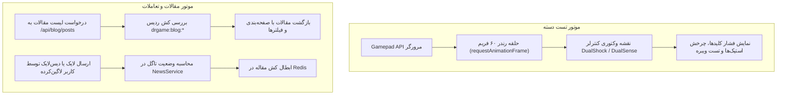

<div dir="rtl" lang="fa">

# 🛠️ دستورالعمل اجرایی گام هفتم: ابزارهای گیمینگ و سیستم وبلاگ (07-tools-and-blog)

> **شماره گام:** ۰۷  
> **عنوان مرحله:** پیاده‌سازی هاب ابزارها (تست دسته پلی‌استیشن و راهنمای جیلبریک کنسول)، و ماژول کامل وبلاگ، اخبار و مقالات آموزشی  
> **وابستگی‌ها:** گام‌های ۰۱، ۰۲ و ۰۳  
> **مرجع سیاست‌ها:** `agent/development-policy.md` (بخش‌های ۲ و ۸) و `build.md` (بخش‌های ۲.۵ و ۲.۷)  

---

## ۱. اهداف و نیازمندی‌های عملکردی (Functional Requirements & Overview)

در این مرحله دو بخش کلیدی از تجربه کاربری گیمرها در پلتفرم دکتر گیم توسعه داده می‌شود:
1. **هاب ابزارهای گیمینگ (Gaming Tools Hub - `/tools`):**
   - **ابزار آنلاین تست سلامت دسته (Gamepad Tester - `/tools/gamepad`):**
     - تست کامل کلیدهای دسته‌های پلی‌استیشن ۴ و ۵ (ضربدر، دایره، مثلث، مربع، کلیدهای جهتی D-Pad، بامپرها، تریگرهای آنالوگ L2 و R2 با درصد فشار).
     - تست دریفت شوکرهای چپ و راست (Analog Stick Drift & Circularity Error).
     - تست موتورهای لرزش دوگانه دسته (Vibration Feedback).
     - بهینه‌سازی و مدرن‌سازی سورس موجود در `source/gamapad-test/GameDr/rep/gamepad/` در قالب یک کامپوننت غنی React/Next.js.
   - **سامانه راهنمای جیلبریک کنسول (PS Jailbreak Hub - `/tools/jailbreak`):**
     - راهنمای گام‌به‌گام تصویری جیلبریک کنسول‌های PS4 و PS5.
     - کاربر DNS اختصاصی سرور دکتر گیم را در تنظیمات شبکه کنسول وارد کرده و از بخش User's Guide وارد این صفحه می‌شود.
     - دکمه بزرگ **«جیلبریک (Jailbreak)»** که با کلیک روی آن پی‌لود مربوط به فریمور دستگاه اجرا شده و پیام موفقیت دریافت می‌شود.
2. **سیستم جامع مجله و وبلاگ گیمینگ (Blog & News Engine):**
   - پایگاه داده مقالات، دسته‌بندی‌ها (آموزش، اخبار روز، نقد و بررسی) و برچسب‌ها.
   - فیلتربار پیشرفته بر اساس دسته‌بندی، مقالات جدید و داغ‌ترین‌ها.
   - نمایش کارت‌های عمودی با نسبت ابعاد **۵ در ۶** به صورت گرید ۳ ستونه (شامل عکس مقاله، عنوان، تگ‌ها، تاریخ شمسی، ۵۰ کاراکتر اول متن و دکمه مطالعه).
   - صفحه اختصاصی مطالعه مقاله (`/blog/[id]`) با متن فرمت‌شده مارک‌داون، تصاویر، و دکمه‌های تاگل لایک سبز و دیس‌لایک قرمز با آمار زنده آرا.
   - تغذیه خودکار سکشن «۵ بلاگ برتر آموزشی» در صفحه اصلی پلتفرم.

---

## ۲. منطق معماری و جریان داده وبلاگ و تست دسته (Data Pipelines)



---

## ۳. الگوهای کد و تعاریف مدل‌ها (Code Examples & Patterns)

### ۳.۱. مدل‌های ماژول News و Blog (`backend/app/modules/news/models.py`):
```python
from datetime import datetime
from sqlalchemy import String, Boolean, DateTime, Integer, Text
from sqlalchemy.orm import Mapped, mapped_column
from app.core.database import Base

class BlogCategory(Base):
    __tablename__ = "blog_categories"

    id: Mapped[int] = mapped_column(Integer, primary_key=True, index=True)
    name_fa: Mapped[str] = mapped_column(String(100), nullable=False)
    name_en: Mapped[str] = mapped_column(String(100), nullable=False)
    slug: Mapped[str] = mapped_column(String(100), unique=True, index=True, nullable=False)

class BlogPost(Base):
    __tablename__ = "blog_posts"

    id: Mapped[int] = mapped_column(Integer, primary_key=True, index=True)
    title_fa: Mapped[str] = mapped_column(String(250), nullable=False)
    title_en: Mapped[str] = mapped_column(String(250), nullable=False)
    slug: Mapped[str] = mapped_column(String(250), unique=True, index=True, nullable=False)
    category_id: Mapped[int] = mapped_column(Integer, index=True, nullable=False)
    
    content_fa: Mapped[str] = mapped_column(Text, nullable=False)
    content_en: Mapped[str | None] = mapped_column(Text, nullable=True)
    cover_image_url: Mapped[str] = mapped_column(String(500), nullable=False)
    author_name: Mapped[str] = mapped_column(String(100), default="تیم تحریریه دکتر گیم")
    reading_time_min: Mapped[int] = mapped_column(Integer, default=5)
    
    likes_count: Mapped[int] = mapped_column(Integer, default=0, index=True)
    dislikes_count: Mapped[int] = mapped_column(Integer, default=0)
    views_count: Mapped[int] = mapped_column(Integer, default=0)
    
    is_published: Mapped[bool] = mapped_column(Boolean, default=True, index=True)
    created_at: Mapped[datetime] = mapped_column(DateTime, default=datetime.utcnow, index=True)

class BlogInteraction(Base):
    __tablename__ = "blog_interactions"

    id: Mapped[int] = mapped_column(Integer, primary_key=True, index=True)
    post_id: Mapped[int] = mapped_column(Integer, index=True, nullable=False)
    user_id: Mapped[int] = mapped_column(Integer, index=True, nullable=False)
    interaction_type: Mapped[str] = mapped_column(String(20), nullable=False)  # "like", "dislike"
    created_at: Mapped[datetime] = mapped_column(DateTime, default=datetime.utcnow)
```

---

## ۴. آدرس‌دهی دقیق فایل‌ها (Explicit File Paths)

### فایل‌های جدید که باید ایجاد شوند (New Files):
- **ماژول News در بک‌اند:**
  - `backend/app/modules/news/__init__.py`
  - `backend/app/modules/news/models.py`: تعریف جداول `blog_categories`, `blog_posts`, `blog_interactions`.
  - `backend/app/modules/news/schemas.py`: DTOهای لیست مقالات، جزئیات مقاله و اکشن لایک/دیس‌لایک.
  - `backend/app/modules/news/services.py`: لاجیک واکشی مقالات با فیلتر دسته‌بندی و داغ‌ترین‌ها، و تاگل لایک/دیس‌لایک.
  - `backend/app/modules/news/router.py`: اندپوینت‌های عمومی (`GET /api/blog/posts`, `GET /api/blog/posts/{id}`, `POST /api/blog/posts/{id}/like`, `POST /api/blog/posts/{id}/dislike`, `GET /api/blog/categories`).
  - `backend/app/modules/news/tests/__init__.py`
  - `backend/app/modules/news/tests/test_services.py`
  - `backend/app/modules/news/tests/test_router.py`
- **مایگریشن دیتابیس:**
  - اسکریپت مایگریشن Alembic برای جداول مقالات و دسته‌بندی‌ها در `backend/alembic/versions/`.
- **فرانت‌اند:**
  - `frontend/src/types/blog.ts`: تعاریف اینترفیس‌های مقالات و دسته‌بندی‌ها.
  - `frontend/src/components/tools/GamepadVisualizer.tsx`: کامپوننت وکتوری دسته با پشتیبانی کامل از دکمه‌ها، استیک‌ها و لرزش بر پایه `source/gamapad-test/`.
  - `frontend/src/components/blog/BlogCard.tsx`: کارت مقاله با نسبت ۵ در ۶، ۵۰ کاراکتر اول متن، و تاریخ انتشار.
  - `frontend/src/components/blog/BlogFilterSidebar.tsx`: فیلتربار دسته‌بندی‌ها و مقالات داغ.
  - `frontend/src/app/(store)/tools/page.tsx`: صفحه هاب ابزارها با دو کارت بزرگ تست دسته و جیلبریک.
  - `frontend/src/app/(store)/tools/gamepad/page.tsx`: صفحه تعاملی تست سلامت دسته.
  - `frontend/src/app/(store)/tools/jailbreak/page.tsx`: صفحه آموزش و اجرای جیلبریک کنسول.
  - `frontend/src/app/(store)/blog/page.tsx`: صفحه کاتالوگ مقالات با گرید ۳ ستونه.
  - `frontend/src/app/(store)/blog/[id]/page.tsx`: صفحه مطالعه کامل مقاله با دکمه‌های لایک/دیس‌لایک.

### فایل‌های موجود که ویرایش می‌شوند (Modified Files):
- `backend/app/main.py`: رجیستر روتر `news`.
- `backend/alembic/env.py`: معرفی مدل‌های ماژول `news`.
- `frontend/src/components/home/TutorialBlogsSection.tsx`: اتصال سکشن آموزشی صفحه اصلی به داده‌های واقعی `GET /api/blog/posts?category=tutorial`.

</div>
