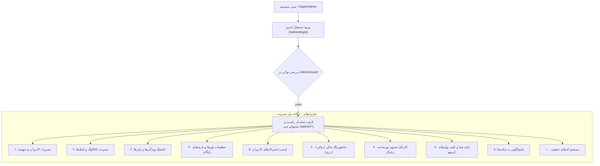

<div dir="rtl" lang="fa">

# 🛡️ دستورالعمل اجرایی گام هشتم: پنل مدیریت کلان و ایزوله سیستم (08-admin-panel)

> **شماره گام:** ۰۸  
> **عنوان مرحله:** پیاده‌سازی پنل مدیریت کلان ایزوله، احراز هویت مستقل مدیران، مدیریت کاربران، بازی‌ها، امور مالی دوگانه، تایید تسویه‌حساب‌ها و تیکتینگ  
> **وابستگی‌ها:** گام‌های ۰۱ تا ۰۷  
> **مرجع سیاست‌ها:** `agent/development-policy.md` (بخش‌های ۲ و ۸) و `build.md` (بخش‌های ۱.۳ و ۴)  

---

## ۱. اهداف و نیازمندی‌های عملکردی (Functional Requirements & Overview)

در این مرحله، مرکز فرماندهی و مدیریت کلان پلتفرم دکتر گیم در یک دامنه کاملاً ایزوله و امن توسعه داده می‌شود:
1. **جداسازی کامل احراز هویت و پایگاه داده مدیران (Admin Boundary Isolation):**
   - ایجاد جدول کاملاً مجزا به نام `admins` در پایگاه داده مستقل از جدول `users`.
   - توکن‌های JWT و اندپوینت‌های ورود مستقل (`/api/admin/auth/login`) با گاردهای امنیتی ویژه ادمین.
2. **مدیریت کاربران و پرونده دیجیتال (User Management & Dossier):**
   - فهرست کاربران با فیلتر داشتن/نداشتن اشتراک فعال، جستجوی نام/ایمیل/موبایل، و تغییر وضعیت فعال/غیرفعال.
   - **مودال پرونده کاربر:** مشاهده سوابق خرید، تاریخچه تراکنش‌های کیف پول رفرال، کد رفرال، و **امکان افزایش یا کاهش دستی حجم سهمیه کاربر توسط ادمین**.
3. **مدیریت کاتالوگ بازی‌ها و ویژگی‌های داینامیک (Games & Taxonomy CRUD):**
   - افزودن، ویرایش و حذف بازی‌ها، آپلود تصاویر کاور/بنر و مدیریت ۵ لینک دانلود (دیتا، DLC، زیرنویس، دوبله، چیت).
   - ماژول پیکربندی ویژگی‌های داینامیک (ژانرها، پلتفرم‌ها و تگ‌های دو نفره).
4. **مدیریت پلن‌ها و بازی‌های پلن رایگان (Subscriptions & Free Tier):**
   - ویرایش قیمت، حجم و ویژگی‌های پلن‌های ۴گانه.
   - انتخاب، افزودن و حذف داینامیک ۵ بازی مجاز در اشتراک رایگان.
5. **پایش امور مالی و پرداخت‌ها (Financial Monitoring - فقط خواندنی):**
   - کارتابل مانیتورینگ بدون امکان ویرایش دستی جهت شفافیت و امنیت مالی.
   - تفکیک کامل پرداخت‌های ریالی (درگاه‌های داخلی) و پرداخت‌های ارزی (کاربران بین‌المللی) به همراه سرجمع درآمدها و فیلترهای تاریخی.
6. **کارتابل تسویه رفرال و تایید حساب‌های بانکی/کریپتو (Referral Payouts & Approvals):**
   - بررسی شماره شبا و آدرس کیف پول‌های کریپتو (USDT) ثبت‌شده توسط کاربران و تغییر وضعیت به «فعال».
   - بررسی درخواست‌های برداشت وجه از کیف پول، تایید یا رد درخواست و ثبت لینک فیش واریزی.
7. **پاسخ‌گویی به تیکت‌های پشتیبانی (Support Tickets):**
   - کارتابل پیام‌های پشتیبانی با فیلتر وضعیت (در انتظار پاسخ، پاسخ داده شده، بسته شده) و مودال چت دوطرفه.
8. **موتور مدیریت کدهای تخفیف (Discount Codes CRUD):**
   - تعریف کدهای تخفیف با درصد، سقف مبلغ، تاریخ انقضا، محدودیت تعداد استفاده و تخصیص به کاربران خاص.

---

## ۲. ساختار چیدمان و امنیت پنل مدیریت (Admin Architecture)



---

## ۳. الگوهای کد و تعاریف مدل‌ها (Code Examples & Patterns)

### ۳.۱. مدل جدول ادمین‌ها (`backend/app/modules/auth/admin_models.py`):
```python
from datetime import datetime
from sqlalchemy import String, Boolean, DateTime, Integer
from sqlalchemy.orm import Mapped, mapped_column
from app.core.database import Base

class AdminUser(Base):
    __tablename__ = "admins"

    id: Mapped[int] = mapped_column(Integer, primary_key=True, index=True)
    username: Mapped[str] = mapped_column(String(50), unique=True, index=True, nullable=False)
    email: Mapped[str] = mapped_column(String(255), unique=True, index=True, nullable=False)
    password_hash: Mapped[str] = mapped_column(String(255), nullable=False)
    role: Mapped[str] = mapped_column(String(30), default="superadmin", nullable=False)  # "superadmin", "support", "editor"
    is_active: Mapped[bool] = mapped_column(Boolean, default=True, nullable=False)
    created_at: Mapped[datetime] = mapped_column(DateTime, default=datetime.utcnow)
```

### ۳.۲. گارد دسترسی ادمین (`backend/app/core/admin_dependencies.py`):
```python
from fastapi import Depends, HTTPException, status
from fastapi.security import HTTPBearer, HTTPAuthorizationCredentials
from app.core.security import decode_jwt_token
from app.core.database import get_db
from sqlalchemy.ext.asyncio import AsyncSession
from sqlalchemy import select
from app.modules.auth.admin_models import AdminUser

security = HTTPBearer()

async def get_current_admin(
    credentials: HTTPAuthorizationCredentials = Depends(security),
    db: AsyncSession = Depends(get_db)
) -> AdminUser:
    token = credentials.credentials
    payload = decode_jwt_token(token)
    if not payload or payload.get("type") != "admin":
        raise HTTPException(status_code=status.HTTP_401_UNAUTHORIZED, detail="توکن ادمین نامعتبر است.")
    
    admin_id = payload.get("sub")
    query = select(AdminUser).where(AdminUser.id == int(admin_id), AdminUser.is_active == True)
    result = await db.execute(query)
    admin = result.scalar_one_or_none()
    
    if not admin:
        raise HTTPException(status_code=status.HTTP_403_FORBIDDEN, detail="دسترسی غیرمجاز به پنل مدیریت.")
    return admin
```

---

## ۴. آدرس‌دهی دقیق فایل‌ها (Explicit File Paths)

### فایل‌های جدید که باید ایجاد شوند (New Files):
- **بک‌اند مدیریت:**
  - `backend/app/modules/admin/__init__.py`
  - `backend/app/modules/auth/admin_models.py`: تعریف جدول `admins`.
  - `backend/app/modules/admin/schemas.py`: DTOهای ورود ادمین، ویرایش سهمیه کاربر، تایید تسویه و تخفیف‌ها.
  - `backend/app/modules/admin/services.py`: لاجیک احراز هویت ادمین، گزارشات مالی، تنظیم دستی سهمیه و تایید حساب‌ها.
  - `backend/app/modules/admin/router.py`: مجموعه روت‌های کامل ادمین با پیشوند `/api/admin/*`.
  - `backend/app/core/admin_dependencies.py`: گارد دسترسی `get_current_admin`.
  - `backend/app/modules/admin/tests/__init__.py`
  - `backend/app/modules/admin/tests/test_services.py`
  - `backend/app/modules/admin/tests/test_router.py`
- **مایگریشن دیتابیس:**
  - اسکریپت مایگریشن Alembic برای جدول `admins` و ساخت سوپراَدمین پیش‌فرض اولیه (Seed Admin).
- **فرانت‌اند پنل مدیریت:**
  - `frontend/src/app/(admin)/layout.tsx`: لایوت اختصاصی پنل ادمین با سایدبار راست جمع‌شونده و احراز هویت محافظت‌شده.
  - `frontend/src/app/(admin)/admin/login/page.tsx`: صفحه لاگین مستقل ادمین.
  - `frontend/src/app/(admin)/admin/dashboard/page.tsx`: صفحه داشبورد خلاصه آمار، درآمدها و کاربران.
  - `frontend/src/app/(admin)/admin/users/page.tsx`: جدول کاربران، فیلترها و مودال ویرایش سهمیه.
  - `frontend/src/app/(admin)/admin/games/page.tsx`: مدیریت کاتالوگ بازی‌ها و آپلود عکس/لینک.
  - `frontend/src/app/(admin)/admin/subscriptions/page.tsx`: تنظیمات پلن‌ها و تعیین بازی‌های رایگان.
  - `frontend/src/app/(admin)/admin/finance/page.tsx`: مانیتورینگ مالی تفکیک‌شده ریالی و ارزی.
  - `frontend/src/app/(admin)/admin/payouts/page.tsx`: کارتابل تایید/رد درخواست‌های تسویه رفرال.
  - `frontend/src/app/(admin)/admin/bank-accounts/page.tsx`: کارتابل تایید شماره شبا و ولت‌های کریپتو.
  - `frontend/src/app/(admin)/admin/tickets/page.tsx`: پاسخ‌گویی به تیکت‌های کاربران.
  - `frontend/src/app/(admin)/admin/discounts/page.tsx`: سیستم ایجاد و مدیریت کدهای تخفیف.

### فایل‌های موجود که ویرایش می‌شوند (Modified Files):
- `backend/app/main.py`: رجیستر روتر جامع ادمین.
- `backend/alembic/env.py`: معرفی مدل `AdminUser`.

</div>
