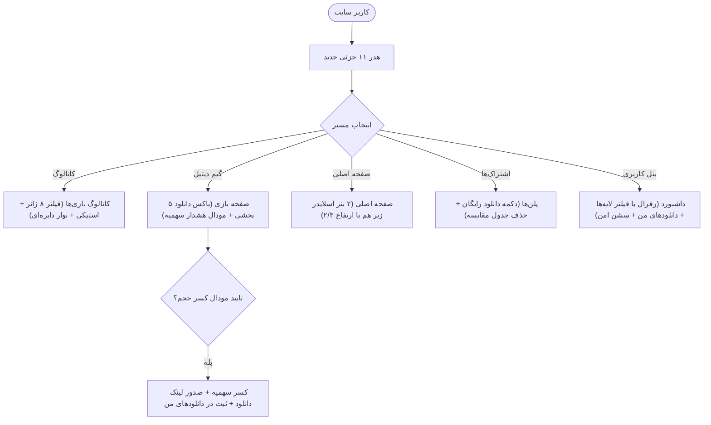

<div dir="rtl" lang="fa">

# 🎨 دستورالعمل اجرایی گام نهم: بازطراحی و ارتقای جامع رابط کاربری (09-ui-ux-enhancements)

> **شماره گام:** ۰۹  
> **عنوان مرحله:** بازطراحی هدر ۱۱ جزئی، کاتالوگ با فیلترهای استیکی و نوار دایره‌ای، باکس دانلود تفکیک‌شده با مودال کسر حجم، دو بنر اسلایدر صفحه اول، مرکز رفرال کاربری و ادمین، تاریخچه دانلودها، نشست‌های محافظت‌شده و راهنمای کنترلر پلی‌استیشن  
> **وابستگی‌ها:** گام‌های ۰۱ تا ۰۸  
> **مرجع سیاست‌ها:** `agent/development-policy.md` (بخش‌های ۲ و ۶) و `steps_9_to_11_spec.md`  

---

> [!IMPORTANT]
> **قانون الزام پیش از کدنویسی هر بخش رابط کاربری (UI Pre-Implementation Approval):**
> هنگام ورود به پیاده‌سازی هر بخش از تغییرات UI در استپ ۹، مجری موظف است قبل از پیاده‌سازی کد، یک **نمونه توصیفی ساخت‌یافته یا ماک‌آپ تصویری** به کاربر ارائه نموده و پس از تایید بصری کاربر اقدام به پیاده‌سازی نهایی نماید.

---

## ۱. اهداف و نیازمندی‌های عملکردی (Functional Requirements & Overview)

این مرحله به ارتقای تجربه بصری، ناوبری حرفه‌ای و رفع کاستی‌های رابط کاربری در سراسر وب‌سایت دکتر گیم اختصاص دارد:

1. **بازطراحی نوار هدر اصلی با ترتیب ۱۱ جزئی از چپ به راست:**
   - ترتیب چیدمان المان‌ها:
     1. دکمه لاگین/ثبت‌نام یا آیکون آدمک کاربری (بدون نوشته).
     2. آیکون سبد خرید همراه با هاور «به‌زودی».
     3. آیکون نوتیفیکیشن با پاپ‌آپ کشویی کنار آن (نمایش اعلان‌های مشاهده‌نشده و دکمه «مشاهده بیشتر»).
     4. آیکون تغییر زبان شکیل و کاملاً مفهومی.
     5. تایتل/بج اشتراک فعال (با رنگ سطح اشتراک: طلایی، نقره‌ای، برنزی) یا دکمه «خرید اشتراک».
     6. لوگوی دکتر گیم در مرکز (صرفاً لوگو، بدون لینک).
     7. آیکون مقالات (`/blog`).
     8. آیکون ابزار (`/tools`).
     9. آیکون دانلودها (هدایت مستقیم به `/dashboard/downloads`).
     10. آیکون بازی‌ها (`/games`).
     11. آیکون خانه (`/`).

2. **بهبودهای تعاملی کاتالوگ بازی‌ها (`/games`):**
   - **فیلتر ۸ ژانر اصلی:** اکشن، ماجراجویی، نقش‌آفرینی، شوتر، استراتژی، مسابقه‌ای، ورزشی، معمایی در بالای لیست، و باقی ژانرها در دراپ‌داون «بیشتر...».
   - **سایدبار پلتفرم‌ها:** حذف متون طولانی و نمایش صرفاً آیکون‌های کنسولی (PS5, PS4, Xbox, Switch, PC) با اندازه بزرگ‌تر و وضوح بالا.
   - **نوار دایره‌ای مصرف سهمیه:** نمایش حجم باقیمانده و کل اشتراک در کنار اینپوت جستجو به صورت یک Circular Progress Bar جذاب.
   - **اسکرول مستقل استیکی (Sticky Controls):** فیکس ماندن فیلتربار، سرچ‌بار و نمایشگر حجم در بالای صفحه هنگام اسکرول بازی‌ها.
   - **فیلتر پله‌ای حجم دیتا:** ایجاد ۵ الی ۶ پله کلیکی (۱۰GB، ۳۰GB، ۵۰GB، ۸۰GB، ۱۲۰GB) در کنار اسلایدر حجم.

3. **صفحه جزئیات بازی (`/games/[id]`):**
   - حذف نوشته‌های دکمه لایک و دیس‌لایک و نمایش صرفاً آیکون لایک و دیس‌لایک به همراه شمارنده.
   - درج تگ‌های ژانر و وضعیت چندنفره (تک‌نفره، دونفره، کوآپ) در تگ‌های بالای تایتل.
   - **باکس دانلود تفکیک‌شده ۵ بخشی:** دیتای خود بازی، چیت، DLC، زیرنویس فارسی، دوبله فارسی.
   - **مودال هشدار و کسر سهمیه:** نمایش پیام سلب مسئولیت قبل از صدور لینک دانلود («لینک اختصاصی در حال تولید است، حجم فایل بلافاصله کسر می‌شود و عملیات غیرقابل بازگشت است») با دکمه تایید.

4. **صفحه اشتراک‌ها (`/subscriptions`):**
   - دکمه «دانلود رایگان» روی کارت اشتراک رایگان برای هدایت به کاتالوگ بازی‌ها با اعمال فیلتر بازی‌های رایگان.
   - حذف کامل جدول مقایسه اشتراک‌ها در پایین صفحه.
   - سوئیچ انتخاب دوره‌های ۱ ماهه، ۳ ماهه و ۶ ماهه.

5. **صفحه اصلی (`/`):**
   - تبدیل بنر بالای سایت به **دو بنر افقی زیر هم** با ارتفاع دو سوم بنر قبلی.
   - هر دو بنر به صورت اسلایدر ورق‌خورنده (Carousel) با قابلیت چرخش خودکار و کلیدهای کنترل اسلاید.

6. **سیستم رفرال در پنل کاربری (`/dashboard/referral`):**
   - افزودن دراپ‌داون فیلتر لایه‌ها در کنار استتس‌ها (پیش‌فرض روی لایه ۱).
   - باکس کامل قوانین، شرایط و فرمول محاسبه درآمد رفرال به همراه متن حقوقی سلب مسئولیت مسدودی حساب.

7. **صفحه دانلودهای کاربر در پنل کاربری (`/dashboard/downloads`):**
   - ایجاد صفحه تاریخچه دانلودها شامل پوستر، نام بازی، نوع فایل دانلود شده، حجم فایل، تاریخ و ساعت، و لینک به صفحه گیم دیتیل.

8. **مدیریت نشست‌های دستگاه (`/dashboard/security`):**
   - نمایش نشان‌های متمایز «نشست اصلی (Primary)» و «نشست فعلی (Current Device)».
   - غیرفعال‌سازی دکمه حذف برای نشست اصلی و نشست فعلی.

9. **نوار راهنمای کنترلر پلی‌استیشن:**
   - شناسایی User-Agent مرورگر کنسول PS4/PS5 و نمایش نوار راهنمای دکمه‌های کنترلر پین شده در پایین صفحه.

10. **پاپ‌آپ انتخاب زبان بر اساس IP:**
    - نمایش مودال در اولین ورود برای انتخاب بین زبان بومی کشور و انگلیسی.

11. **پنل مدیریت ادمین (`/admin/*`):**
    - مدیریت محتوای دو بنر اسلایدر صفحه اصلی در `/admin/banners`.
    - مدیریت اشتراک‌ها در ۳ کتگوری زمانی ۱، ۳ و ۶ ماهه در `/admin/subscriptions`.
    - ورود دستی لینک‌های دانلود ۵ گانه و تعیین سطح اشتراک مجاز هر فایل در ادیتور بازی‌ها (`/admin/games`).
    - مانیتورینگ زنجیره رفرال با ۵ شاخص مالی و لاگ‌ها، به همراه دکمه هاید کردن (Hide/Unhide) کاربر در `/admin/referrals`.

---

## ۲. دیاگرام جریان تجربه کاربری (User Experience Flow)



---

## ۳. الگوهای کامپوننت و ساختار کد (Code Architecture & Patterns)

### ۳.۱. کامپوننت مودال هشدار دانلود قبل از کسر سهمیه (`frontend/src/components/games/DownloadConfirmModal.tsx`):
```tsx
'use client';

import React from 'react';
import { AlertTriangle, Download, X } from 'lucide-react';

interface DownloadConfirmModalProps {
  isOpen: boolean;
  onClose: () => void;
  onConfirm: () => void;
  fileTitle: string;
  fileType: string;
  fileSizeGb: number;
  loading: boolean;
}

export default function DownloadConfirmModal({
  isOpen,
  onClose,
  onConfirm,
  fileTitle,
  fileType,
  fileSizeGb,
  loading,
}: DownloadConfirmModalProps) {
  if (!isOpen) return null;

  return (
    <div className="fixed inset-0 z-50 flex items-center justify-center p-4 bg-black/80 backdrop-blur-md">
      <div className="w-full max-w-md bg-[#0c1017] border border-amber-500/30 rounded-3xl p-6 shadow-2xl space-y-4">
        <div className="flex items-center justify-between border-b border-white/5 pb-3">
          <div className="flex items-center gap-2 text-amber-400 font-bold text-sm">
            <AlertTriangle className="w-5 h-5 shrink-0" />
            <span>هشدار کسر سهمیه دانلود</span>
          </div>
          <button onClick={onClose} className="text-slate-400 hover:text-white">
            <X className="w-5 h-5" />
          </button>
        </div>

        <div className="space-y-3 text-xs text-slate-300 leading-relaxed">
          <p>
            شما در حال صدور لینک برای فایل <strong className="text-white">«{fileTitle}»</strong> ({fileType}) با حجم{' '}
            <strong className="text-amber-400 font-roboto">{fileSizeGb} GB</strong> هستید.
          </p>
          <div className="p-3 rounded-2xl bg-amber-500/10 border border-amber-500/20 text-amber-200 text-[11px]">
            ⚠️ <strong>توجه مهم:</strong> به محض تایید، حجم این فایل بلافاصله از سهمیه فعال اشتراک شما کسر خواهد شد
            (حتی اگر دانلود را آغاز نکنید). این عملیات غیرقابل بازگشت است.
          </div>
        </div>

        <div className="flex items-center justify-end gap-2 pt-3 border-t border-white/5">
          <button
            onClick={onClose}
            disabled={loading}
            className="px-4 py-2 rounded-xl bg-slate-800 hover:bg-slate-700 text-slate-300 text-xs transition-colors"
          >
            انصراف
          </button>
          <button
            onClick={onConfirm}
            disabled={loading}
            className="px-5 py-2 rounded-xl bg-gradient-to-r from-amber-500 to-yellow-500 hover:from-amber-400 hover:to-yellow-400 text-slate-950 font-bold text-xs flex items-center gap-2 shadow-lg shadow-amber-950/40 transition-all"
          >
            {loading ? 'در حال صدور لینک...' : 'تایید و صدور لینک دانلود'}
          </button>
        </div>
      </div>
    </div>
  );
}
```

### ۳.۲. چیدمان نوار هدر جدید ۱۱ جزئی (`frontend/src/components/layout/Header.tsx`):
```tsx
// چیدمان هدر دسکتاپ از چپ به راست:
// ۱. دکمه پروفایل/ورود (آیکون آدمک بدون متن در حالت لاگین)
// ۲. سبد خرید (هاور به‌زودی)
// ۳. زنگوله اعلان با دراپ‌داون کشویی + «مشاهده بیشتر»
// ۴. سوئیچ زبان
// ۵. نشان/بج اشتراک فعال یا «خرید اشتراک»
// ۶. لوگوی دکتر گیم در مرکز (صرفاً عکس، بدون لینک)
// ۷. مقالات (/blog)
// ۸. ابزار (/tools)
// ۹. دانلودها (/dashboard/downloads)
// ۱۰. بازی‌ها (/games)
// ۱۱. خانه (/)
```

---

## ۴. آدرس‌دهی دقیق فایل‌ها (Explicit File Paths)

### فایل‌های جدید که باید ایجاد شوند (New Files):
- `frontend/src/components/games/DownloadConfirmModal.tsx`: مودال هشدار صریح کسر حجم قبل از صدور لینک.
- `frontend/src/components/games/CircularQuotaWidget.tsx`: ویجت پیشرفت دایره‌ای حجم سهمیه در بالای کاتالوگ.
- `frontend/src/components/layout/NotificationDropdown.tsx`: پاپ‌آپ کشویی اعلان‌های خوانده نشده در هدر.
- `frontend/src/components/layout/PlayStationControllerBar.tsx`: نوار راهنمای کلیدهای کنترلر برای یوزر ایجنت کنسول.
- `frontend/src/components/layout/GeoLanguageModal.tsx`: مودال انتخاب زبان اولیه بر اساس آی‌پی.
- `frontend/src/components/home/DoubleHeroBanners.tsx`: کامپوننت دو بنر اسلایدر زیر هم با ارتفاع ۲/۳.
- `frontend/src/app/(store)/dashboard/downloads/page.tsx`: صفحه تاریخچه دانلودهای کاربر.
- `frontend/src/app/(admin)/admin/banners/page.tsx`: صفحه مدیریت بنرهای صفحه اصلی در پنل ادمین.
- `frontend/src/app/(admin)/admin/referrals/page.tsx`: صفحه مانیتورینگ زنجیره رفرال و قابلیت هاید در پنل ادمین.

### فایل‌های موجود که ویرایش می‌شوند (Modified Files):
- `frontend/src/components/layout/Header.tsx`: بازطراحی ۱۱ المان از چپ به راست و ادغام نوتیف و بج اشتراک.
- `frontend/src/app/(store)/games/page.tsx`: فیلتر ۸ ژانر، سایدبار آیکونی، استیکی کردن نوارها، فیلتر پله‌ای حجم و نوار دایره‌ای سهمیه.
- `frontend/src/app/(store)/games/[id]/page.tsx`: باکس دانلود ۵ گانه، مودال هشدار، حذف متن لایک/دیس‌لایک و تگ‌های چندنفره.
- `frontend/src/app/(store)/subscriptions/page.tsx`: دکمه دانلود رایگان، حذف جدول مقایسه و سوئیچ ۳ دوره زمانی.
- `frontend/src/app/(store)/page.tsx`: ادغام کامپوننت دو بنر اسلایدر دو سوم.
- `frontend/src/app/(store)/dashboard/referral/page.tsx`: دراپ‌داون فیلتر لایه‌ها، باکس قوانین و سلب مسئولیت حقوقی.
- `frontend/src/app/(store)/dashboard/security/page.tsx`: علامت‌گذاری نشست اصلی و فعلی و ممانعت از حذف.
- `frontend/src/app/(admin)/admin/games/page.tsx`: فیلدهای ورود ۵ نوع فایل دانلود و تیک زدن اشتراک‌های مجاز.
- `frontend/src/app/(admin)/admin/subscriptions/page.tsx`: دسته‌بندی ۳ دوره زمانی و ادیتور فیلدها.

</div>
