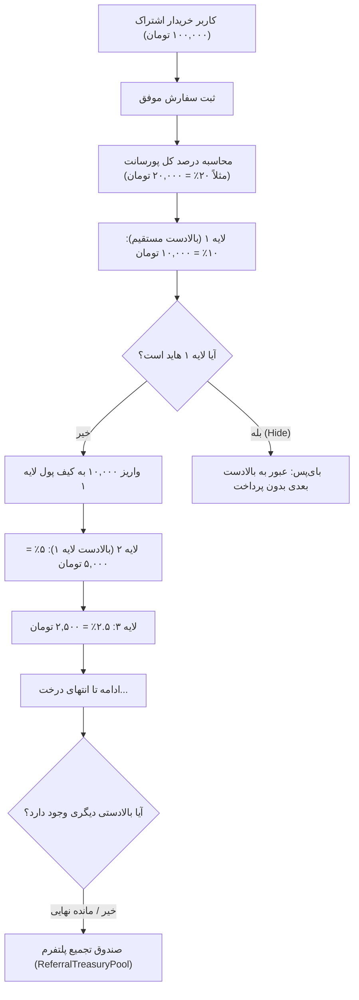

<div dir="rtl" lang="fa">

# ⚙️ دستورالعمل اجرایی گام دهم: هسته عملکردی، منطق تجاری و مدل‌های دیتابیس (10-backend-core-and-logic)

> **شماره گام:** ۱۰  
> **عنوان مرحله:** بازنگری سیستم پورسانت رفرال نصف‌شونده نامحدود و صندوق پلتفرم، احراز هویت حساب بانکی و OTP، مدل و سرویس دانلود ۵ بخشی با کسر بلادرنگ سهمیه، محافظت از نشست‌های امنیتی، بازنگری اشتراک‌های ۳ دوره‌ای، رفع باگ پلن رایگان و جاب اعلانات هوشمند  
> **وابستگی‌ها:** گام‌های ۰۱ تا ۰۸ و توسعه هماهنگ با گام ۰۹  
> **مرجع سیاست‌ها:** `agent/development-policy.md` (بخش‌های ۲، ۳ و ۴) و `steps_9_to_11_spec.md`  

---

## ۱. اهداف و نیازمندی‌های عملکردی (Functional Requirements & Overview)

این مرحله شاهرگ پردازشی و محاسباتی پلتفرم است و زیرساخت کلیه عملیات‌های جدید را در بک‌اند FastAPI فراهم می‌سازد:

1. **الگوریتم پورسانت رفرال نصف‌شونده با لایه‌های نامحدود (Infinite Halving Chain):**
   - درصد پایه پورسانت توسط ادمین در تنظیمات تعیین می‌شود (`referral_base_commission_percent` مثلاً ۲۰٪).
   - توزیع پورسانت در طول درخت معرف به صورت نصف شونده انجام می‌گیرد:
     - لایه ۱ بالادست مستقیم: $10\%$
     - لایه ۲: $5\%$
     - لایه ۳: $2.5\%$
     - لایه ۴: $1.25\%$
     - لایه $n$: تا هر چند لایه که بالادستی فعال در زنجیره وجود داشته باشد.
2. **صندوق تجمیع باقیمانده پلتفرم (`ReferralTreasuryPool`):**
   - هر مقدار از کل درصد پورسانت که به دلیل اتمام زنجیره بالادستی‌ها یا محاسبات کسری تقسیم نشود، مستقیماً به حسابی تحت عنوان صندوق پلتفرم واریز می‌شود.
   - ادمین می‌تواند موجودی این صندوق را مشاهده، برداشت، صفر یا جهت جوایز اختصاص دهد.
3. **لاجیک هاید کردن کاربر در زنجیره رفرال (Pass-through Bypass):**
   - فیلد `is_referral_hidden: bool` در مدل `User`.
   - کاربری که توسط ادمین هاید شده، در زنجیره رفرال مانند یک گره نامرئی عمل می‌کند؛ کاربر بالادستی و پایین‌دستی او موقتاً به عنوان رفرال مستقیم یکدیگر به هم متصل می‌شوند بدون اینکه رابطه اصلی در دیتابیس حذف شود. با فعال‌سازی مجدد توسط ادمین، کاربر به موقعیت خود بازمی‌گردد.
4. **احراز هویت شماره حساب، کد ملی، شماره تلفن و تایید دو مرحله‌ای (OTP):**
   - برای ثبت شماره حساب تسویه رفرال، دریافت شماره شبا، شماره کارت، کد ملی و شماره موبایل الزامی است.
   - ارسال OTP برای تایید شماره موبایل؛ *طبق توافق، در فاز تست کد OTP تولید شده مستقیماً در پاسخ API یا لاگ کنسول چاپ می‌شود.*
   - پیاده‌سازی متد ماک `verify_national_identity(national_code, phone, iban)` که بررسی تطابق هویت سه‌گانه را شبیه‌سازی کرده و فعلاً تایید خودکار می‌دهد تا بعداً به سامانه شاهکار متصل شود.
5. **ساختار دیتابیسی دانلود تفکیک‌شده و کسر بلادرنگ سهمیه:**
   - مدل `GameDownloadFile` با انواع فایل: `data` (دیتای بازی)، `cheat` (چیت)، `dlc` (بسته الحاقی)، `subtitle` (زیرنویس)، `dubbing` (دوبله).
   - فیلد `allowed_tiers`: آرایه‌ای از سطوح مجاز اشتراک که به صورت دستی توسط ادمین در پنل برای هر فایل تیک زده می‌شود.
   - اندپوینت صدور لینک اختصاصی (`POST /api/games/{id}/downloads/{file_id}/generate`): بررسی اشتراک مجاز، کسر آنی از `UserQuota`، ثبت رکورد در `UserDownloadHistory` و تولید لینک اختصاصی.
   - اندپوینت دریافت تاریخچه دانلودهای کاربر (`GET /api/users/me/downloads`).
6. **محافظت از نشست‌های امنیتی دستگاه (Session Security):**
   - تفکیک نشست اصلی (`is_primary: bool`) و نشست جاری بر اساس توکن فعال.
   - مسدودسازی هرگونه درخواست حذف برای نشست اصلی یا نشست جاری با خطای ۴۰۳.
7. **بازنگری مدل اشتراک‌ها و رفع باگ پلن رایگان:**
   - دسته‌بندی پلن‌ها بر اساس دوره زمانی (`1_month`, `3_months`, `6_months`) و سطح اشتراک.
   - رفع باگ افزودن بازی در پلن رایگان در متد `set_free_tier_games` و خواندن داینامیک بازی‌ها از جدول `FreeTierAllowedGame`.
8. **جاب اعلان دوره‌ای انقضای اشتراک (Reminder Cron Job):**
   - اسکریپت/تسک زمان‌بندی شده برای شناسایی کاربرانی که تا ۳ روز دیگر اشتراکشان منقضی می‌شود یا کمتر از ۱۰٪ حجم سهمیه‌شان باقی مانده و صدور اعلان در `user_notifications`.
9. **مدل و اندپوینت‌های مدیریت بنرهای دوگانه صفحه اصلی:**
   - مدل `HomeBanner` با موقعیت (`position: 1 | 2`)، تصویر، عنوان، لینک و ترتیب نمایش، به همراه روت‌های CRUD ادمین و روت عمومی دریافت بنرها.

---

## ۲. دیاگرام جریان محاسباتی رفرال و صندوق پلتفرم (Referral Architecture)



---

## ۳. الگوهای کد و تعاریف مدل‌ها (Code Examples & Schemas)

### ۳.۱. مدل فایل‌های تفکیک‌شده دانلود بازی (`backend/app/modules/games/models.py`):
```python
class GameDownloadFile(Base):
    __tablename__ = "game_download_files"

    id: Mapped[int] = mapped_column(Integer, primary_key=True, index=True)
    game_id: Mapped[int] = mapped_column(Integer, index=True, nullable=False)
    file_type: Mapped[str] = mapped_column(String(20), index=True, nullable=False)  # "data", "cheat", "dlc", "subtitle", "dubbing"
    title: Mapped[str] = mapped_column(String(150), nullable=False)
    file_size_gb: Mapped[float] = mapped_column(Float, default=0.0, nullable=False)
    download_url: Mapped[str] = mapped_column(String(1000), nullable=False)
    allowed_tiers: Mapped[list] = mapped_column(JSON, default=lambda: ["gold", "silver", "bronze"])
    is_active: Mapped[bool] = mapped_column(Boolean, default=True, nullable=False)
    created_at: Mapped[datetime] = mapped_column(DateTime(timezone=True), default=lambda: datetime.now(timezone.utc))

class UserDownloadHistory(Base):
    __tablename__ = "user_download_history"

    id: Mapped[int] = mapped_column(Integer, primary_key=True, index=True)
    user_id: Mapped[int] = mapped_column(Integer, index=True, nullable=False)
    game_id: Mapped[int] = mapped_column(Integer, index=True, nullable=False)
    file_id: Mapped[int] = mapped_column(Integer, index=True, nullable=False)
    file_type: Mapped[str] = mapped_column(String(20), nullable=False)
    file_title: Mapped[str] = mapped_column(String(150), nullable=False)
    file_size_gb: Mapped[float] = mapped_column(Float, nullable=False)
    downloaded_at: Mapped[datetime] = mapped_column(DateTime(timezone=True), default=lambda: datetime.now(timezone.utc), index=True)
```

### ۳.۲. الگوریتم تنصیف نامحدود پورسانت رفرال (`backend/app/modules/wallet/services.py`):
```python
async def distribute_referral_commission(db: AsyncSession, buyer_id: int, order_amount_toman: int):
    # دریافت درصد پایه از تنظیمات سیستم
    base_percent = await get_system_config(db, "referral_base_commission_percent", default=20.0)
    total_commission_budget = (order_amount_toman * base_percent) / 100.0
    distributed_sum = 0.0

    current_user_id = buyer_id
    current_layer = 1
    current_fraction = 0.5  # 50% لایه اول، 25% لایه دوم، 12.5% لایه سوم...

    while True:
        # واکشی معرف بالادست
        chain = (await db.execute(select(ReferralChain).where(ReferralChain.referred_id == current_user_id))).scalar_one_or_none()
        if not chain:
            break

        referrer_id = chain.referrer_id
        referrer = (await db.execute(select(User).where(User.id == referrer_id))).scalar_one_or_none()
        if not referrer:
            break

        # بررسی هاید بودن رفرال کاربر
        if getattr(referrer, "is_referral_hidden", False):
            # اگر هاید باشد، این کاربر را رد کرده و به بالادستی او می‌رویم
            current_user_id = referrer_id
            continue

        commission_amount = total_commission_budget * current_fraction
        if commission_amount < 1.0:  # حداقل مبلغ مجاز برای ثبت
            break

        # واریز به کیف پول معرف
        await credit_user_wallet(db, user_id=referrer_id, amount=commission_amount, source="referral", layer=current_layer)
        distributed_sum += commission_amount

        # آماده‌سازی لایه بعد
        current_fraction /= 2.0
        current_layer += 1
        current_user_id = referrer_id

    # واریز باقیمانده به صندوق پلتفرم
    leftover_amount = total_commission_budget - distributed_sum
    if leftover_amount > 0:
        await credit_treasury_pool(db, amount=leftover_amount, reason=f"مانده پورسانت سفارش خرید کاربر {buyer_id}")

    await db.commit()
```

---

## ۴. آدرس‌دهی دقیق فایل‌ها (Explicit File Paths)

### فایل‌های جدید که باید ایجاد شوند (New Files):
- `backend/app/modules/wallet/treasury_models.py`: مدل صندوق پلتفرم `ReferralTreasuryPool` و لاگ‌های آن.
- `backend/app/modules/games/download_models.py`: مدل‌های `GameDownloadFile` و `UserDownloadHistory`.
- `backend/app/modules/home/banner_models.py`: مدل `HomeBanner` جهت اسلایدرهای دوگانه.
- `backend/app/modules/home/router.py`: اندپوینت‌های CRUD بنرهای صفحه اصلی.
- `backend/app/modules/auth/identity_service.py`: ماژول انطباق هویت سه‌گانه و سرویس تایید OTP تستی.
- `backend/app/core/cron/expiry_reminder.py`: جاب بررسی انقضای ۳ روزه اشتراک یا ۱۰٪ حجم باقیمانده.
- `backend/app/modules/wallet/tests/test_infinite_referral.py`: تست واحد الگوریتم نصف‌شونده و صندوق پلتفرم.
- `backend/app/modules/games/tests/test_multifile_downloads.py`: تست واحد صدور لینک و کسر بلادرنگ سهمیه.

### فایل‌های موجود که ویرایش می‌شوند (Modified Files):
- `backend/app/modules/users/models.py`: افزودن `is_referral_hidden` به جدول `users` و `is_primary` به جدول `user_sessions`.
- `backend/app/modules/wallet/models.py`: افزودن `national_code` و `phone` به جدول `settlement_accounts`.
- `backend/app/modules/wallet/services.py`: بازنویسی الگوریتم تنصیف نامحدود و واریز به صندوق پلتفرم.
- `backend/app/modules/wallet/router.py`: افزودن روت‌های OTP و احراز هویت حساب بانکی.
- `backend/app/modules/games/services.py`: لاجیک تولید لینک ۵ بخشی و کسر سهمیه.
- `backend/app/modules/games/router.py`: روت صدور لینک دانلود و دریافت تاریخچه دانلودهای کاربر.
- `backend/app/modules/subscriptions/services.py`: رفع باگ افزودن بازی به پلن رایگان و ساختار ۳ دوره‌ای.
- `backend/app/modules/admin/router.py` و `services.py`: مدیریت صندوق پلتفرم، مانیتورینگ رفرال و هاید کردن کاربر.
- `backend/app/main.py`: رجیستر روتر بنرها و ثبت اسکریپت جاب اعلان.

</div>
