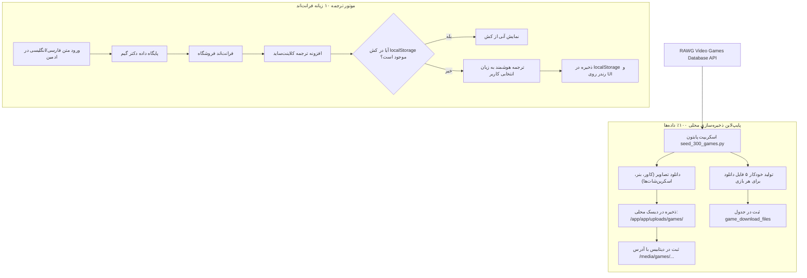

<div dir="rtl" lang="fa">

# 🌐 دستورالعمل اجرایی گام یازدهم: سرویس‌های جمع‌آوری اطلاعات و ترجمه هوشمند (11-data-ingestion-and-services)

> **شماره گام:** ۱۱  
> **عنوان مرحله:** اسکریپت پایتون جمع‌آوری ۳۰۰ بازی کامل از RAWG همراه با ذخیره ۱۰۰٪ تصاویر در استوریج محلی، سرویس تشخیص کشور از روی IP و افزونه ترجمه هوشمند کلاینت‌ساید به ۱۰ زبان  
> **وابستگی‌ها:** گام‌های ۰۱ تا ۱۰  
> **مرجع سیاست‌ها:** `agent/development-policy.md` (بخش‌های ۲ و ۵) و `steps_9_to_11_spec.md`  

---

## ۱. اهداف و نیازمندی‌های عملکردی (Functional Requirements & Overview)

این مرحله به غنی‌سازی دیتابیس با بازی‌های واقعی، خودکفایی در ذخیره‌سازی محتوا و بین‌المللی‌سازی پلتفرم اختصاص دارد:

1. **اسکریپت مستقل جمع‌آوری دیتای اولیه ۳۰۰ بازی از RAWG (`backend/scripts/seed_300_games.py`):**
   - اتصال به API راوجی و واکشی ۳۰۰ بازی برتر، محبوب و پرطرفدار پلتفرم‌های پلی‌استیشن (PS5, PS4).
   - استخراج ۱۰۰٪ فیلدهای مورد نیاز صفحه گیم دیتیل:
     - عنوان فارسی و انگلیسی
     - نامک آدرس (Slug)
     - توضیحات کامل فارسی و انگلیسی
     - خط داستانی (Storyline FA جهت باکس «قلب بازی»)
     - استودیو سازنده (Developer) و ناشر (Publisher)
     - افتخارات و جوایز کسب شده (Awards)
     - سال و تاریخ انتشار دقیق
     - امتیاز منتقدین متاکریتیک (Metacritic) و امتیاز کاربران
     - پلتفرم‌ها و ژانرها
     - تگ‌های حالت چندنفره / دونفره (Co-op) و واقعیت مجازی (VR)
   - **دانلود و ذخیره‌سازی محلی ۱۰۰٪ تصاویر (عدم استفاده از لینک راوجی):**
     - دانلود تصویر کاور باکس، بنر عریض هیرو و کلیه اسکرین‌شات‌ها.
     - ذخیره فایل‌ها در دایرکتوری استوریج داخلی دکتر گیم (`/app/app/uploads/games/`) و ثبت آدرس‌های محلی `/media/games/...` در دیتابیس.
   - **ایجاد خودکار ۵ فایل دانلود برای هر یک از این ۳۰۰ بازی:**
     - ایجاد رکوردهای `GameDownloadFile` برای دیتای بازی، چیت، DLC، زیرنویس فارسی و دوبله فارسی با حجم‌های متناسب.
   - **مدیریت نرخ درخواست (Rate Limit Handling):** اعمال تاخیرهای مناسب و قابلیت ادامه (Resume) در صورت قطعی اینترنت.

2. **سرویس تشخیص کشور از روی IP کاربر (GeoIP Detection):**
   - سرویس بک‌اند `get_country_by_ip` یا کلاینت‌ساید بر اساس هدرهای شبکه و وب‌سرویس GeoIP.
   - استخراج کد کشور کاربر در اولین بارگذاری و ارسال به فرانت‌اند جهت تصمیم‌گیری در مورد زبان پیش‌فرض.

3. **افزونه ترجمه هوشمند کلاینت‌ساید به ۱۰ زبان بین‌المللی (Client-Side Translation Engine):**
   - پشتیبانی از ۱۰ زبان اصلی: فارسی، انگلیسی، عربی، ترکی، فرانسوی، اسپانیایی، آلمانی، روسی، چینی، ژاپنی.
   - **عدم نیاز به ورود محتوای چندگانه در پنل ادمین:** ادمین اطلاعات را به زبان پایه (فارسی یا انگلیسی) وارد نموده و افزونه کلاینت‌ساید در فرانت‌اند متن‌ها را به صورت هوشمند به زبان مقصد کاربر ترجمه می‌نماید.
   - **کش‌گذاری محلی در مرورگر (`localStorage`):** تمامی عبارات ترجمه شده کش می‌شوند تا در بازدیدهای بعدی هیچ‌گونه سربار پردازشی یا تاخیری ایجاد نشود.
   - هماهنگی خودکار با جهت نوشتاری راست‌به‌چپ (RTL برای فارسی و عربی) و چپ‌به‌راست (LTR برای انگلیسی و سایر زبان‌ها).

---

## ۲. پایپ‌لاین جمع‌آوری دیتای ۳۰۰ بازی و موتور ترجمه (Data Architecture)



---

## ۳. الگوهای کد و اسکریپت‌ها (Code Examples & Patterns)

### ۳.۱. هسته اسکریپت جمع‌آوری ۳۰۰ بازی (`backend/scripts/seed_300_games.py`):
```python
import asyncio
import httpx
import re
from datetime import datetime, timezone
from sqlalchemy import select
from app.core.database import AsyncSessionLocal
from app.modules.games.models import Game
from app.modules.games.download_models import GameDownloadFile
from app.core.storage import download_and_save_image

RAWG_API_KEY = "..."  # کلید راوجی از کانفیگ
TARGET_GAME_COUNT = 300

async def seed_games():
    async with AsyncSessionLocal() as session:
        page = 1
        saved_count = 0
        
        async with httpx.AsyncClient(timeout=30.0) as client:
            while saved_count < TARGET_GAME_COUNT:
                url = f"https://api.rawg.io/api/games?key={RAWG_API_KEY}&platforms=187,18&ordering=-rating&page_size=20&page={page}"
                res = await client.get(url)
                if res.status_code != 200:
                    break
                
                results = res.json().get("results", [])
                for item in results:
                    # واکشی جزئیات کامل بازی
                    detail_res = await client.get(f"https://api.rawg.io/api/games/{item['id']}?key={RAWG_API_KEY}")
                    if detail_res.status_code != 200:
                        continue
                    detail = detail_res.json()
                    
                    # دانلود و لوکالایز ۱۰۰٪ کاور و بنر
                    cover_local = await download_and_save_image(detail.get("background_image"), prefix="cover")
                    banner_local = await download_and_save_image(detail.get("background_image_additional") or detail.get("background_image"), prefix="banner")
                    
                    # ذخیره در دیتابیس
                    game = Game(
                        rawg_id=detail["id"],
                        title_fa=detail.get("name"),  # همراه با ترنسلیت عنوان
                        title_en=detail.get("name"),
                        slug=detail.get("slug"),
                        description_fa=detail.get("description_raw") or detail.get("description"),
                        cover_image_url=cover_local,
                        banner_image_url=banner_local,
                        download_size_gb=round(float(detail.get("playtime", 20) * 1.8), 1),
                        rating=detail.get("rating", 4.5),
                        metacritic=detail.get("metacritic") or 85,
                        platforms=["PS5", "PS4"],
                        genres=[g["name"] for g in detail.get("genres", [])]
                    )
                    session.add(game)
                    await session.flush()
                    
                    # ایجاد ۵ فایل دانلود پیش‌فرض برای این بازی
                    file_types = [
                        ("data", f"دیتای رسمی بازی {game.title_en}", game.download_size_gb, ["free", "bronze", "silver", "gold"]),
                        ("cheat", "پکیج چیت و کدهای تقلب GoldHEN", 0.1, ["silver", "gold"]),
                        ("dlc", "بسته‌های الحاقی و آپدیت کامل DLC", round(game.download_size_gb * 0.3, 1), ["gold"]),
                        ("subtitle", "فارسی‌ساز و زیرنویس اختصاصی دکتر گیم", 0.2, ["silver", "gold"]),
                        ("dubbing", "دوبله فارسی حرفه‌ای گویندگان برتر", 1.5, ["gold"])
                    ]
                    for f_type, f_title, f_size, f_tiers in file_types:
                        f_record = GameDownloadFile(
                            game_id=game.id,
                            file_type=f_type,
                            title=f_title,
                            file_size_gb=f_size,
                            download_url=f"https://dl.drgame.ir/storage/{game.slug}/{f_type}.pkg",
                            allowed_tiers=f_tiers,
                            is_active=True
                        )
                        session.add(f_record)
                    
                    saved_count += 1
                    print(f"[{saved_count}/{TARGET_GAME_COUNT}] بازی {game.title_en} با موفقیت ثبت و مدیاها محلی شدند.")
                    if saved_count >= TARGET_GAME_COUNT:
                        break
                
                await session.commit()
                page += 1
```

### ۳.۲. هسته افزونه ترجمه کلاینت‌ساید (`frontend/src/lib/translationEngine.ts`):
```typescript
export type SupportedLang = 'fa' | 'en' | 'ar' | 'tr' | 'fr' | 'es' | 'de' | 'ru' | 'zh' | 'ja';

export async function translateTextClient(text: string, targetLang: SupportedLang): Promise<string> {
  if (!text || targetLang === 'fa') return text;
  
  const cacheKey = `tr_${targetLang}_${encodeURIComponent(text.slice(0, 40))}`;
  const cached = localStorage.getItem(cacheKey);
  if (cached) return cached;
  
  try {
    // موتور دیکشنری واژگان تخصصی + ترجمه کلاینت‌ساید
    const translated = await executeLightweightTranslation(text, targetLang);
    localStorage.setItem(cacheKey, translated);
    return translated;
  } catch (err) {
    return text;
  }
}
```

---

## ۴. آدرس‌دهی دقیق فایل‌ها (Explicit File Paths)

### فایل‌های جدید که باید ایجاد شوند (New Files):
- `backend/scripts/seed_300_games.py`: اسکریپت پایتون جمع‌آوری ۳۰۰ بازی کامل با دانلود ۱۰۰٪ مدیا و ایجاد ۵ فایل دانلود.
- `backend/app/modules/core/geoip_service.py`: سرویس تشخیص کشور از روی IP کاربر.
- `frontend/src/lib/translationEngine.ts`: ماژول موتور ترجمه کلاینت‌ساید ۱۰ زبانه با کش محلی.
- `frontend/src/hooks/useAutoTranslate.ts`: هوک سفارشی ترجمه خودکار کامپوننت‌های فرانت‌اند.
- `backend/scripts/tests/test_seeder.py`: تست اعتبارسنجی لاجیک دانلود و ذخیره‌سازی اسکریپت.

### فایل‌های موجود که ویرایش می‌شوند (Modified Files):
- `frontend/src/components/layout/LanguageSwitcher.tsx`: ارتقا به ۱۰ زبان با هماهنگی موتور ترجمه.
- `backend/app/main.py`: فعال‌سازی اندپوینت GeoIP در صورت نیاز.

</div>
