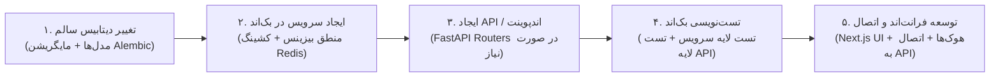

<div dir="rtl" lang="fa">

# 📜 سند راهبرد و سیاست کلی توسعه پلتفرم دکتر گیم (DrGame-Ecommerce Development Policy)

> **عنوان سند:** سیاست‌ها، استانداردها، اصول فنی و معماری کلان پلتفرم فروشگاهی و محتوایی دکتر گیم (DrGame-Ecommerce)  
> **نگارش:** نسخه ۱.۰ (معماری ماژولار مونو‌لیت دامنه‌محور با فرانت‌اند Next.js و بک‌اند FastAPI)  
> **مخاطب:** تیم توسعه، معماران نرم‌افزار و ایجنت‌های هوش مصنوعی (AI Coding Agents)  
> **محل قرارگیری:** `agent/development-policy.md`

---

## ۱. چشم‌انداز، فلسفه و اصول بنیادین

پلتفرم **دکتر گیم (DrGame-Ecommerce)** یک پلتفرم تحت وب پیشرفته با استانداردهای در سطح کنسول پلی‌استیشن (PlayStation Store Experience) است که برای ارائه، مدیریت سهمیه دانلود، همگام‌سازی بازی‌های روز از دیتابیس بین‌المللی RAWG، مدیریت پلن‌های اشتراک حجمی و تعاملات گیمیفای‌شده گیمرها طراحی شده است.

این سند چارچوب‌های فنی قطعی، معماری کدبیس، استانداردهای طراحی و خطوط قرمز توسعه را تعیین می‌کند تا پلتفرم با **بالاترین سرعت پاسخ‌دهی (زیر ۵۰ میلی‌ثانیه با لایه کشینگ ردیس)، انیمیشن‌های روان و چشم‌نواز (Cosmic Purple Aesthetic)، سازگاری بی‌نقص از موبایل ۳۲۰ پیکسلی تا تلویزیون‌های ۶۰ اینچ 4K (استاندارد 10-Foot UI) و پایداری کانتینری** توسعه یابد.

### اصول کلیدی و خطوط قرمز توسعه:
1. **معماری ماژولار بک‌اند (Modular Monolith ready for Microservices):** بک‌اند باید با **FastAPI (Python 3.12)** و به صورت ماژول‌های کاملاً ایزوله تجاری در پوشه `backend/app/modules/` سازماندهی شود. هر ماژول تمام لایه‌های اختصاصی خود (`models.py`, `schemas.py`, `services.py`, `router.py`, `tests/`) را در بر می‌گیرد تا در آینده امکان تفکیک به سرویس مستقل مهیا باشد.
2. **مرز طلایی ماژول‌ها و ممنوعیت رابطه مستقیم Foreign Key:** هیچ جدولی در یک ماژول حق ندارد رابطه مستقیم ORM (`relationship`) با جدول ماژول دیگر برقرار کند. ارجاعات صرفاً از طریق شناسه خام (`user_id: int`، `game_id: int`، `subscription_id: int`) ثبت شده و ارتباطات داده‌ای بین ماژولی منحصراً از طریق توابع سرویس انجام می‌پذیرد.
3. **کشینگ تهاجمی با Redis (High-Performance In-Memory Layer):** داده‌های پرخوانش مانند فهرست کاتالوگ بازی‌ها، جزئیات بازی‌های RAWG، وضعیت سهمیه کاربر (`quota`)، سشن‌های فعال و ماتریس دسترسی باید با کش توزیع‌شده Redis با سیاست ابطال فعال (Explicit Invalidation) مدیریت شوند.
4. **فرانت‌اند مدرن Next.js 14+ (App Router):** لایه کاربری با **Next.js (App Router)**، **TypeScript** و سیستم طراحی مدرن بنفش کهکشانی (**Cosmic Purple Theme**) توسعه می‌یابد تا رندرینگ سمت سرور (SSR) بهینه برای بازی‌ها، سئو قوی، مدیریت کش ترکیبی و لودینگ آنی فراهم گردد.
5. **استاندارد رابط کاربری ۱۰ فوتی و کنترلر (10-Foot UI & Gamepad Navigation):** سایت علاوه بر ریسپانسیو بودن روی موبایل، تبلت و لپ‌تاپ، باید روی تلویزیون‌های بزرگ و مرورگر کنسول PS4/PS5 بدون موس و کیبورد، صرفاً با دکمه‌های جهتی (D-Pad / Gamepad) و استایل‌های واضح `:focus-visible` با بزرگ‌نمایی `scale(1.05)` و درخشش نئونی کهکشانی به طور کامل قابل ناوبری باشد.
6. **سیاست قطعی اجرای صرفاً کانتینری (Strict Docker-Only Policy):** پلتفرم دکتر گیم ۱۰۰٪ بر پایه Docker و Docker Compose اجرا می‌شود. اجرای مستقیم سرویس‌های بک‌اند (Uvicorn, Alembic, Pytest) یا فرانت‌اند (Next.js, npm, tsc) روی سیستم‌عامل میزبان (Host) اکیداً ممنوع است.
7. **پوشش تست خودکار ۱۰۰ درصدی با Pytest:** برای تمامی سرویس‌ها، روترها و موتورهای منطقی بک‌اند (محاسبه سهمیه، اشتراک، اتصال RAWG، احراز هویت) تست‌های خودکار Pytest تدوین شده و شرط پیشروی به مراحل بعدی، قبولی ۱۰۰٪ آزمون‌هاست.
8. **توسعه متوالی گام‌به‌گام و چرخه پنج‌مرحله‌ای فیچرها (Sequential Delivery & 5-Step Feature Pipeline):** توسعه هر فیچر و قابلیت جدید، الزاماً و بدون استثنا از خط‌لوله ۵ مرحله‌ای (تغییر دیتابیس سالم ➔ ایجاد سرویس بک‌اند با کش Redis ➔ ایجاد API/اندپوینت در صورت نیاز ➔ تست‌نویسی دو لایه سرویس و API با Pytest ➔ توسعه فرانت‌اند و اتصال به بک‌اند) پیروی می‌کند و بر اساس ساختار پوشه‌های `xx-step-name` در دایرکتوری `agent/` پیش می‌رود.

---

## ۲. معماری بک‌اند: مونو‌لیت ماژولار دامنه‌محور (Modular Monolith)

### ۲.۱ ساختار دایرکتوری بک‌اند
ساختار ریشه بک‌اند به صورت زیر مهندسی شده است:

```
backend/app/
├── core/                           ← هسته مرکزی مشترک (زیرساخت بدون منطق بیزینس)
│   ├── config.py                   ← لود تنظیمات از .env با pydantic-settings
│   ├── database.py                 ← اتصال ناهمگام به PostgreSQL 16 (SQLAlchemy 2.0 Async)
│   ├── redis_client.py             ← کلاینت متمرکز ناهمگام Redis (redis.asyncio)
│   ├── exceptions.py               ← کلاس‌های استثنای ساختاریافته (AppException Hierarchy)
│   ├── security.py                 ← توابع رمزنگاری رمز عبور (Bcrypt) و توکن‌های JWT (HS256)
│   ├── dependencies.py             ← وابستگی‌های احراز هویت، گارد دسترسی و لیمیت‌ها
│   ├── jalali.py                   ← مبدل و توابع زمان و تاریخ جلالی/شمسی
│   └── pagination.py               ← شِماها و هلپرهای صفحه‌بندی استاندارد
├── modules/                        ← ماژول‌های کاملاً ایزوله تجاری
│   ├── auth/                       ← ماژول احراز هویت (OTP، ایمیل، JWT، مدیریت سشن)
│   ├── users/                      ← ماژول پروفایل کاربران، سطوح و تنظیمات شخصی
│   ├── games/                      ← ماژول کاتالوگ بازی‌ها، جزئیات، پلتفرم‌ها و فایل‌ها
│   ├── rawg_sync/                  ← موتور واکشی عمیق و همگام‌سازی زمان‌بندی‌شده از RAWG API
│   ├── subscriptions/              ← ماژول پلن‌های اشتراک (رایگان، برنز، نقره‌ای، طلایی) و سهمیه
│   ├── quota/                      ← موتور محاسبه و کسر دقیق حجم دانلود دیتای بازی‌ها
│   ├── gamification/               ← سیستم XP، سطوح کاربری، دستاوردها (Achievements) و استریک
│   ├── wallet/                     ← کیف پول گیمر، تاریخچه تراکنش‌ها و درگاه پرداخت
│   ├── reviews/                    ← سیستم نقد، امتیازدهی و نظرات کاربران بر بازی‌ها
│   ├── notifications/              ← مرکز اعلان‌ها، دسته‌بندی و اعلان‌های سیستمی
│   └── news/                       ← هاب مقالات، اخبار بازی‌ها و تریلرها
├── tasks/                          ← جاب‌های زمان‌بندی‌شده (APScheduler)
│   ├── scheduler.py                ← راه‌اندازی و مدیریت جاب‌های کرون درون‌پروسسی
│   └── rawg_cron.py                ← کرون‌جاب همگام‌سازی ساعتی با RAWG
└── main.py                         ← نقطه ورود FastAPI، میدل‌ورها، هندلر استثناها و روترها
```

### ۲.۲ ساختار استاندارد هر ماژول تجاری
هر یک از ماژول‌های پوشه `backend/app/modules/<module_name>/` باید دقیقاً دارای معماری ۵ لایه زیر باشد:

```
<module_name>/
├── __init__.py
├── models.py                       ← مدل‌های پایگاه داده SQLAlchemy مرتبط با همین دامنه
├── schemas.py                      ← مدل‌های اعتبارسنجی ورودی/خروجی Pydantic V2 (DTO)
├── services.py                     ← کل منطق تجاری، کوئری‌های دیتابیس و مدیریت کش ردیس
├── router.py                       ← روت‌های HTTP FastAPI، تزریق وابستگی و کدهای وضعیت
└── tests/                          ← آزمون‌های خودکار ماژول
    ├── __init__.py
    ├── conftest.py                 ← فیکسچرهای محلی ماژول
    ├── test_services.py            ← تست واحد بیزینس لاجیک
    └── test_router.py              ← تست یکپارچگی اندپوینت‌ها با کلاینت ناهمگام
```

### ۲.۳ قانون ایزولاسیون مرز ماژول‌ها (Module Boundary Isolation)
- **ممنوعیت استفاده از Relationship میان ماژول‌ها:** رابطه مستقیم ORM بین موجودیت‌های دو ماژول مختلف مجاز نیست.
- **تبادل صرفاً با شناسه خام (Raw ID):** به عنوان مثال در ماژول `reviews`، فیلد شناسه بازی `game_id: int` و شناسه کاربر `user_id: int` ذخیره می‌شود.
- **استفاده از سرویس رابط برای واکشی داده ماژول دیگر:** در صورت نیاز به اطلاعات کاربر در بررسی نظرات، تابع `users_service.get_user_summary(user_id)` فراخوانی می‌گردد و مستقیماً به جدول کاربران کوئری زده نمی‌شود.

---

## ۳. سیاست بهره‌گیری از Redis و لایه کشینگ با کارایی بالا (High-Performance Caching)

برای دستیابی به زمان پاسخ‌دهی زیر ۵۰ میلی‌ثانیه، استراتژی کشینگ به صورت زیر اعمال می‌شود:

```mermaid
graph TD
    Client["درخواست کلاینت (Web / Console / Mobile)"] --> Router["روتر FastAPI"]
    Router --> AuthGuard["بررسی توکن JWT"]
    AuthGuard --> FastCache["بررسی کلید در Redis"]
    
    subgraph DataPipeline ["مسیر واکشی داده"]
        FastCache -->|Cache Hit (موجود)| FastReturn["بازگشت آنی داده کش‌شده (< 15ms)"]
        FastCache -->|Cache Miss (ناموجود)| DBQuery["استعلام از PostgreSQL 16"]
        DBQuery --> SetCache["ذخیره در Redis با کلید استاندارد و TTL"]
        SetCache --> FastReturn
    end
```

### ۳.۱ کلیدهای استاندارد در Redis:
1. **کارت‌ها و دسته‌بندی‌های بازی (`drgame:games:catalog:{query_hash}`):** TTL برابر با ۳۰ دقیقه؛ به محض آپدیت یا اضافه شدن بازی باطل می‌شود.
2. **جزئیات عمیق بازی (`drgame:game:{id}`):** اطلاعات کامل، جوایز، استودیو و مشخصات RAWG؛ TTL برابر با ۲ ساعت.
3. **وضعیت سهمیه و اشتراک کاربر (`drgame:user:{user_id}:quota`):** سهمیه کل، حجم مصرف‌شده و پلن فعال؛ با هر بار دانلود یا بازگشایی بازی آپدیت و ابطال می‌شود.
4. **سشن و بلک‌لیست توکن‌ها (`drgame:auth:blacklist:{jti}`):** مدیریت خروج امن از حساب کاربری بدون نیاز به کوئری سنگین دیتابیس.
5. **ماتریس پلن‌های اشتراک (`drgame:subscriptions:tiers`):** اطلاعات ۴ پلن (رایگان، برنز، نقره‌ای، طلایی)؛ TTL برابر با ۱ روز.

### ۳.۲ سیاست ابطال فعال کش (Explicit Cache Invalidation):
هر متد اصلاح‌کننده داده (`create`, `update`, `delete`, `deduct_quota`) در لایه `services.py` موظف است پس از نهایی‌سازی تراکنش در پایگاه داده، کلیدهای کش مرتبط را بلافاصله حذف کند (`await redis_client.delete(key)` یا استفاده از پترن‌زدایی با `scan_iter`).

---

## ۴. معماری فرانت‌اند: Next.js (App Router) و سیستم طراحی کهکشانی

فرانت‌اند با **Next.js 14+**، **Tailwind CSS**، **Radix UI/shadcn** و **Framer Motion** بر اساس زبان طراحی بنفش کهکشانی (**Cosmic Purple Accents**) پیاده‌سازی می‌گردد.

### ۴.۱ ساختار دایرکتوری فرانت‌اند
```
frontend/
├── public/
│   ├── logo.png                    ← لوگوی اصلی دکتر گیم (PNG با رزولوشن بالا)
│   ├── logo-motion.mp4             ← انیمیشن ویدیویی لوگوموشن
│   ├── fonts/                      ← فونت‌های وب Vazirmatn و Inter
│   └── patterns/                   ← وکتور پترن نمادهای پلی‌استیشن (مثلث، دایره، ضربدر، مربع)
├── src/
│   ├── app/                        ← ساختار App Router
│   │   ├── (store)/                ← صفحات عمومی فروشگاه
│   │   │   ├── page.tsx            ← صفحه اصلی (Hero Banner, Carousels, Trending)
│   │   │   ├── games/
│   │   │   │   ├── page.tsx        ← کاتالوگ جامع بازی‌ها با فیلتر پیشرفته
│   │   │   │   └── [id]/page.tsx   ← صفحه جزئیات بازی (چیدمان ۳ کارته و سهمیه)
│   │   │   ├── subscriptions/page.tsx ← صفحه پلن‌های ۴ گانه اشتراک و کد تخفیف
│   │   │   └── news/
│   │   │       ├── page.tsx        ← مجله و اخبار گیمینگ
│   │   │       └── [id]/page.tsx   ← جزئیات خبر
│   │   ├── (dashboard)/            ← داشبورد کاربری محافظت‌شده
│   │   │   ├── layout.tsx          ← لایوت اختصاصی داشبورد
│   │   │   ├── profile/page.tsx    ← صفحه پروفایل، کارت‌های ۶گانه و پلتفرم‌ها
│   │   │   ├── achievements/page.tsx ← صفحه دستاوردها با نمودار دونات پیشرفت
│   │   │   ├── transactions/page.tsx ← تاریخچه تراکنش‌ها و شارژ کیف پول
│   │   │   ├── notifications/page.tsx ← مرکز اعلان‌ها و تب‌های دسته‌بندی
│   │   │   └── reviews/page.tsx    ← نظرات ثبت‌شده کاربر
│   │   ├── (auth)/                 ← احراز هویت
│   │   │   ├── login/page.tsx      ← مودال / صفحه ورود و ثبت نام شیشه‌ای
│   │   │   └── callback/page.tsx   ← کال‌بک ورود با سرویس‌های دیگر
│   │   ├── layout.tsx              ← لایوت ریشه، تم دوگانه، فونت، هدر سراسری، فوتر
│   │   ├── not-found.tsx           ← صفحه ۴۰۴ گیمینگ
│   │   └── globals.css             ← متغیرهای CSS تم دارک/لایت، گرادینت‌ها و کلاس‌های شیشه‌ای
│   ├── components/                 ← کامپوننت‌های ماژولار و قابل استفاده مجدد
│   │   ├── common/                 ← دکمه‌ها، ورودی‌ها، مدال‌ها، بج‌ها، کارت‌های شیشه‌ای
│   │   ├── layout/                 ← هدر بالا، نوار جستجو، ویجت سهمیه (Quota Pill)، فوتر، نوار ناوبری موبایل
│   │   ├── games/                  ← کارت بازی، گرید بازی‌ها، پنل فیلتر پیشرفته، چیدمان ۳ کارته جزئیات
│   │   ├── subscriptions/          ← کارت‌های ۴ پلن اشتراک، ماشین‌حساب سهمیه، بخش کد تخفیف
│   │   ├── gamification/           ← نوار XP، نشان‌های دستاورد، نمودار دونات پیشرفت
│   │   └── tv/                     ← کنترلر ناوبری فضایی با گیم‌پد و D-Pad برای استاندارد 10-Foot UI
│   ├── hooks/                      ← هوک‌های اختصاصی (useGamepadNavigation, useQuota, useTheme)
│   ├── lib/                        ← کلاینت API ناهمگام (Fetch wrapper)، کش و ابزارهای کمکی
│   ├── stores/                     ← مدیریت وضعیت کلاینت با Zustand (سهمیه، فیلترها، سبد، زبان)
│   └── types/                      ← تعاریف تایپ TypeScript برای بازی‌ها، اشتراک و کاربران
```

### ۴.۲ سیستم طراحی: رنگ‌ها و استایل کهکشانی (Cosmic Purple Design Tokens)
- **تم تاریک پیش‌فرض (Dark OLED):**
  - پس‌زمینه اصلی: `#070709` (مشکی فضایی بسیار عمیق)
  - پس‌زمینه کارت‌ها: `#101116` با شفافیت `80%` و افکت `backdrop-filter: blur(16px)`
  - رنگ مرزها: `rgba(255, 255, 255, 0.07)`
- **تم روشن (Light Mode):**
  - پس‌زمینه اصلی: `#F8F9FA`
  - پس‌زمینه کارت‌ها: `#FFFFFF`
  - رنگ مرزها: `rgba(0, 0, 0, 0.08)`
- **رنگ‌های تاکید کهکشانی (Cosmic Accents - مشترک در هر دو تم):**
  - بنفش اصلی: `#7C3AED` (Primary Cosmic Purple)
  - بنفش نئونی هاور: `#A855F7` (Nebula Violet)
  - ایندیگو عمیق: `#4C1D95` (Deep Galaxy Indigo)
  - گرادینت کهکشانی دکمه‌ها: `linear-gradient(135deg, #6D28D9 0%, #A855F7 50%, #EC4899 100%)`
  - درخشش نئونی فوکوس و وضعیت فعال: `0 0 20px rgba(139, 92, 246, 0.45)`
- **رنگ پلن‌ها و وضعیت:**
  - رایگان: `#94A3B8` / `#CBD5E1`
  - برنز: `#CD7F32` / `#D97706`
  - نقره‌ای: `#E2E8F0` / `#94A3B8`
  - طلایی: `#FBBF24` / `#F59E0B`
  - تایید/موفق: `#10B981` (Emerald)
  - هشدار/حجم: `#F59E0B` (Amber)
  - خطا/حذف: `#EF4444` (Rose)

### ۴.۳ دارایی‌های گرافیکی اجباری و وکتورهای کنسولی (Mandatory Assets):
ایجنت موظف است منحصراً از فایل‌های اختصاصی زیر که در ریشه پروژه و پوشه `frontend/public/` قرار گرفته‌اند استفاده کند:
1. **پترن پس‌زمینه سراسری سایت:** فایل وکتور `bg-pattern-dark.svg` با شفافیت ملایم در لایوت ریشه سراسر صفحات.
2. **لوگوی رسمی برند دکتر گیم:** فایل تصویر `logo.png` در هدر، فوتر، مودال‌ها، صفحه ورود و تگ‌های Favicon/OpenGraph.
3. **آیکون‌های وکتور کنسول‌ها و پلتفرم‌ها:**
   - پلی‌استیشن ۵: فایل وکتور `ps5.svg`
   - پلی‌استیشن ۴: فایل وکتور `ps4.svg`
   - واقعیت مجازی پی‌اس‌وی‌آر ۲: فایل وکتور `psvr2.svg`
   - مایکروسافت ایکس‌باکس: فایل وکتور `xbox360.svg`
   - نینتندو سوییچ: فایل وکتور `switch.svg`
4. **طرح کاراکترهای کنسولی سونی:** فایل `121.png` و `1131.png` برای آواتارها و بنرهای هیرو کاربری.

---

## ۵. سیاست استاندارد تلویزیون‌های ۶۰ اینچ و ناوبری با کنترلر (10-Foot UI Policy)

کاربران کنسول‌های پلی‌استیشن ۴ و ۵ و دارندگان تلویزیون‌های هوشمند بزرگ (اندروید TV و مرورگر کنسول) باید بتوانند کل وب‌سایت را بدون موس و کیبورد، صرفاً با دسته‌های DualShock 4 یا DualSense (و دکمه‌های جهتی ریموت کنترل) پیمایش کنند:
1. **مقیاس‌پذیری اندازه‌ها (Fluid Rem & VW):** در رزولوشن‌های `1920px` تا `3840px`، اندازه فونت‌ها و فواصل به صورت خودکار مقیاس می‌یابند.
2. **فوکوس واضح و درخشان (High-Contrast Focus State):** با فشردن کلیدهای جهت‌نما یا شوکر دسته، آیتم فعال بزرگ شده (`transform: scale(1.05)` همراه با `transition: 0.2s cubic-bezier(...)`) و دارای کادر بنفش نئونی ۲ پیکسلی با افکت درخشش (`box-shadow: 0 0 25px rgba(168, 85, 247, 0.6)`) می‌شود.
3. **پیمایش خودکار (Auto-Scroll into View):** المانی که فوکوس را دریافت می‌کند، به آرامی و روان به مرکز نمایشگر اسکرول می‌شود تا کاربر روی مبل احساس راحتی کامل داشته باشد.

---

## ۶. موتور همگام‌سازی RAWG API و غنی‌سازی داده‌ها (RAWG Sync Engine)

1. **زمان‌بندی کرون ساعتی (`0 * * * *`):** سرویس بک‌اند هر ساعت با کتابخانه `APScheduler` و قفل توزیع‌شده ردیس، جدیدترین بازی‌های پلی‌استیشن (`platforms=187,18,16,15,27`) را با مرتب‌سازی `ordering=-added,-released` استعلام می‌کند.
2. **واکشی عمیق (Deep Fetch):** اطلاعات جزئی شامل توضیحات خام، اسکرین‌شات‌ها، تریلرها، استودیو سازنده و جوایز دریافت شده و در دیتابیس لوکال ذخیره می‌گردند.
3. **لایه ترجمه و غنی‌سازی متادیتا (Data Enrichment Layer):** داده‌های فنی تکمیلی از جمله پشتیبانی از ویژگی‌های کنسول (مانند فیدبک لمسی DualSense)، داستان روان بازی، دسته‌بندی فایل‌های PKG کپی‌خور و افتخارات استودیو غنی‌سازی می‌شوند. فیلدهای خالی بدون به هم ریختن UI عبارت استاندارد «ثبت نشده است» یا «جایزه‌ای ثبت نشده است» را دریافت می‌کنند.

---

## ۷. سیستم سهمیه دانلود (Quota Engine) و پلن‌های ۴ گانه

سامانه باید مصرف دیتای بازی‌ها را با دقت بایت و گیگابایت مدیریت کند:
1. **پلن رایگان (Free Tier):** دسترسی نامحدود به ۵ بازی ثابت (`Watch Dogs 2`, `GTA V`, `Rocket League`, `Mortal Kombat 11`, `Brawlhalla`).
2. **پلن برنز (Bronze Tier):** ۵۰۰ گیگابایت سهمیه دانلود ماهیانه با سقف سرعت ۲۰ مگابیت (پلتفرم‌های PS4 و PS5).
3. **پلن نقره‌ای (Silver Tier):** ۱ ترابایت (۱۰۰۰ گیگابایت) سهمیه با سرعت ۲۰ مگابیت، دسترسی به بازی‌های PS2, PS3, PS4, PS5 و پشتیبانی از خرید زیرنویس و DLC.
4. **پلن طلایی (Gold Tier):** ۲.۲ ترابایت (۲۲۰۰ گیگابایت) سهمیه با حداکثر سرعت ۴۰ مگابیت، دسترسی به تمام پلتفرم‌ها (از جمله رترو و Nintendo)، تم‌ها و DLCها به همراه درخشش ویژه کاربری.
5. **ویجت کپسولی هدر (Quota Pill):** حجم باقیمانده لحظه‌ای در تمام صفحات در هدر به کاربر نشان داده می‌شود (مثلاً `420 GB / 1 TB`) و با رسیدن به صفر، هشدارهای لازم برای ارتقا صادر می‌گردد.

---

## ۸. سیاست تست‌های خودکار با Pytest و تضمین کیفیت

کیفیت و عملکرد بدون خطای سیستم با آزمون‌های مداوم تضمین می‌گردد:
1. **تست‌های واحد سرویس (Unit Tests):** منطق کسر سهمیه، اعتبارسنجی پلن‌ها، محاسبه امتیاز XP و لول‌آپ، اتصال و ساختار داده‌های RAWG.
2. **تست‌های یکپارچگی اندپوینت‌ها (Integration Tests):** بررسی تمامی روترهای FastAPI با کلاینت ناهمگام `httpx.AsyncClient` و اطمینان از خروجی‌های 200, 201, 400, 401, 403, 404, 422.
3. **شرط عدم شکست:** هیچ مرحله‌ای بدون اجرای ۱۰۰٪ موفق تست‌های Pytest و بیلد بدون خطای Next.js (`npm run build`) تایید نخواهد شد.

---

## ۹. سیاست قطعی محیط کانتینری و ممنوعیت اجرای محلی (Strict Docker-Only Environment Policy)

پلتفرم دکتر گیم منحصراً بر پایه داکر توسعه و مستقر می‌شود. معماری شامل کانتینرهای زیر است:
- `backend`: سرویس FastAPI (Python 3.12-slim) با اتصال به دیتابیس و ردیس
- `frontend`: سرویس Next.js 14 (Node 20-alpine)
- `db`: پایگاه داده PostgreSQL 16-alpine
- `cache`: حافظه پرسرعت Redis 7-alpine

### دستورات مرجع و مجاز جهت اجرا در داکر:
```bash
# ۱. اجرای کامل آزمون‌های خودکار Pytest در کانتینر بک‌اند:
docker compose -f docker-compose.dev.yml run --rm backend pytest -v

# ۲. اجرای مایگریشن‌های Alembic پایگاه داده:
docker compose -f docker-compose.dev.yml run --rm backend alembic upgrade head
docker compose -f docker-compose.dev.yml run --rm backend alembic check

# ۳. بررسی تایپ‌اسکریپت و لینتر فرانت‌اند:
docker compose -f docker-compose.dev.yml run --rm frontend npx tsc --noEmit
docker compose -f docker-compose.dev.yml run --rm frontend npm run lint

# ۴. بررسی و اعتبارسنجی بیلد نهایی فرانت‌اند:
docker compose -f docker-compose.dev.yml run --rm frontend npm run build

# ۵. راه‌اندازی و اجرای کل کانتینرها:
docker compose -f docker-compose.dev.yml up -d --build
```

---

## ۱۰. چرخه استاندارد و اجباری توسعه فیچرها (Feature Development Lifecycle)

هر ویژگی، قابلیت یا فیچر جدیدی که در پلتفرم دکتر گیم تعریف و توسعه داده می‌شود، **الزاماً و بدون استثنا** باید از خط‌لوله (Pipeline) پنج‌مرحله‌ای زیر عبور کند:



### تشریح مراحل پنج‌گانه چرخه توسعه هر فیچر:

1. **مرحله اول: تغییر دیتابیس سالم و استاندارد (Healthy Database Schema & Migration):**
   - ایجاد یا به‌روزرسانی مدل‌های پایگاه داده در `models.py` ماژول مربوطه با رعایت کامل اصل ایزولاسیون و عدم استفاده از Foreign Key میان‌ماژولی.
   - ایجاد اسکریپت مایگریشن Alembic درون کانتینر داکر:
     ```bash
     docker compose -f docker-compose.dev.yml run --rm backend alembic revision --autogenerate -m "feat: add schema for feature"
     ```
   - بازبینی اسکریپت مایگریشن تولیدشده، اطمینان از سلامت ایندکس‌ها و انواع فیلدها، و اجرای مایگریشن:
     ```bash
     docker compose -f docker-compose.dev.yml run --rm backend alembic upgrade head
     docker compose -f docker-compose.dev.yml run --rm backend alembic check
     ```

2. **مرحله دوم: ایجاد و پیاده‌سازی سرویس در بک‌اند (Service Layer & Business Logic):**
   - پیاده‌سازی متدهای منطق تجاری در `services.py` ماژول مربوطه.
   - تعامل امن و بهینه با پایگاه داده از طریق SQLAlchemy 2.0 Async Session.
   - پیاده‌سازی لایه کشینگ Redis با کلیدهای استاندارد (نظیر `drgame:...`) و تضمین سیاست ابطال فعال کش (Explicit Cache Invalidation) در زمان ایجاد، به‌روزرسانی یا حذف داده‌ها.
   - مدیریت ساختاریافته استثناها و پرتاب خطاهای اختصاصی بر پایه `AppException`.

3. **مرحله سوم: ایجاد API یا اندپوینت مدنظر در صورت لزوم (FastAPI Endpoints & Routers):**
   - پیاده‌سازی اندپوینت‌های RESTful در `router.py` ماژول متناظر در صورت نیاز کلاینت یا ماژول‌های دیگر.
   - اعتبارسنجی دقیق داده‌های ورودی و ساختاربندی پاسخ‌های خروجی با DTOهای Pydantic V2 در `schemas.py`.
   - اعمال گاردها و وابستگی‌ها (`dependencies.py`) شامل احراز هویت توکن‌های JWT، دسترسی نقش‌ها یا Rate Limiting.

4. **مرحله چهارم: تست‌نویسی دو لایه جامع بک‌اند (Comprehensive Backend Pytest Suite):**
   - **تست لایه سرویس (`tests/test_services.py`):** آزمون‌های واحد برای توابع بیزینس لاجیک، محاسبه سهمیه، منطق کش ردیس و مدیریت خطاها.
   - **تست لایه API (`tests/test_router.py`):** آزمون‌های یکپارچگی اندپوینت‌ها با کلاینت ناهمگام `httpx.AsyncClient` و پوشش کدهای وضعیت (200, 201, 400, 401, 403, 404, 422).
   - اجرای آزمون‌ها در داکر و شرط اجباری قبولی ۱۰۰٪ آزمون‌ها پیش از ورود به فرانت‌اند:
     ```bash
     docker compose -f docker-compose.dev.yml run --rm backend pytest -v
     ```

5. **مرحله پنجم: توسعه فرانت‌اند و اتصال به بک‌اند (Frontend Development & End-to-End Integration):**
   - توسعه تایپ‌های TypeScript، هوک‌ها، کامپوننت‌های شیشه‌ای و صفحات Next.js بر اساس تم بنفش کهکشانی (Cosmic Purple).
   - اتصال کلاینت فرانت‌اند به اندپوینت‌های بک‌اند، مدیریت حالت‌های Loading، Error، Cache و به‌روزرسانی لحظه‌ای وضعیت (مانند کپسول سهمیه و کیف پول).
   - اعتبارسنجی ناوبری با کنترلر و D-Pad تلویزیون و کنسول طبق استاندارد 10-Foot UI.
   - اعتبارسنجی بیلد فرانت‌اند در داکر:
     ```bash
     docker compose -f docker-compose.dev.yml run --rm frontend npm run build
     ```

---

## ۱۱. ساختار مراحل توسعه در پوشه `agent/` (Sequential Step Structure)

برای هدایت خودکار، منظم و قدم‌به‌قدم توسعه توسط ایجنت‌های هوش مصنوعی (AI Agents)، کلیه مراحل و گام‌های توسعه در پوشه `agent/` به صورت پوشه‌های مجزا با الگوی نام‌گذاری **`xx-step-name`** تفکیک می‌شوند (برای مثال `01-initial-setup`، `02-auth-module` و ...):

```
agent/
├── development-policy.md           ← این سند (سیاست‌های جامع و کلان پروژه)
├── 01-step-name/                   ← پوشه مرحله توسعه
│   ├── instructions.md             ← مستند فنی و نقشه راه مرحله
│   └── tasks.md                    ← چک‌لیست تسک‌های مرحله با چک‌باکس
├── 02-step-name/
│   ├── instructions.md
│   └── tasks.md
└── ...
```

### ۱۱.۱ الزامات و ساختار فایل `instructions.md`:
این فایل به عنوان **مرجع و نقشه راه فنی (Technical Specification)** برای آن گام مشخص عمل می‌کند و باید شامل ۴ بخش کلیدی زیر باشد:
1. **توضیحات عملکردی و اهداف (Functional Requirements & Overview):** تشریح دقیق ویژگی‌هایی که در این گام اضافه می‌شوند و سناریوهای کاربری.
2. **منطق الگوریتمی و جریان داده (Algorithmic Logic & Data Flow):** فرمول‌ها، دیاگرام‌های گردش کار، لاجیک محاسباتی و جزئیات تبادل اطلاعات.
3. **نمونه کدها و الگوهای معماری (Code Examples & Patterns):** نمونه کدهای مرجع برای مدل‌ها، سرویس‌ها، روترها، شِماها، کامپوننت‌های فرانت‌اند و فیکسچرهای تست.
4. **آدرس‌دهی دقیق فایل‌ها (Explicit File Paths):** مشخص کردن شفاف و بدون ابهام:
   - **فایل‌های جدید (New Files):** مسیر دقیق و نام فایل‌هایی که باید از پایه ایجاد شوند.
   - **فایل‌های ویرایشی (Modified Files):** مسیر دقیق فایل‌های موجود که باید ویرایش شوند همراه با تشریح تغییرات مورد نیاز.

### ۱۱.۲ الزامات و ساختار فایل `tasks.md`:
این فایل به عنوان **چک‌لیست عملیاتی و زنده (Live Operational Checklist)** برای ایجنت هوش مصنوعی عمل می‌کند:
1. **ترتیب دقیق و خطی تسک‌ها:** تسک‌ها باید به ترتیب اولویت و منطبق بر چرخه پنج‌مرحله‌ای توسعه لیست شوند.
2. **فرمت استاندارد چک‌باکس مارک‌داون:** کلیه تسک‌ها در ابتدا با چک‌باکس خالی (`- [ ]`) تعریف می‌شوند.
3. **الزام قطعی به‌روزرسانی بلادرنگ چک‌باکس‌ها:** ایجنت هوش مصنوعی **موظف است بلافاصله پس از اجرای موفقیت‌آمیز هر تسک**، فایل `tasks.md` همان استپ را باز کرده و وضعیت آن تسک را با علامت زدن چک‌باکس (`- [x]`) به‌روزرسانی کند. ایجنت حق ندارد چندین تسک را انجام دهد بدون اینکه وضعیت آن‌ها را در `tasks.md` ثبت کرده باشد.

---

## ۱۲. سیستم گزارش‌گیری جامع در پوشه `reports/` (Progress & Delivery Reports)

در ریشه پروژه، پوشه `reports/` برای مستندسازی تجمیعی پیشرفت مراحل و ارائه گزارش‌های دوره‌ای ایجاد شده است:

```
reports/
├── 01.md                           ← گزارش اتمام استپ‌های اولیه / فاز اول
├── 02.md                           ← گزارش فاز دوم
└── ...
```

### استانداردها و قوانین گزارش‌گیری:
1. **زمان ایجاد گزارش:** پس از تکمیل موفقیت‌آمیز هر چند استپ متوالی (یا در پایان یک فاز یا مایل‌استون اصلی)، یک فایل گزارش به صورت شماره‌گذاری دو رقمی (`xx.md`) در پوشه `reports/` ایجاد می‌گردد.
2. **ساختار محتوایی هر گزارش (`reports/xx.md`):**
   - **شناسه گزارش و گام‌های پوشش‌داده‌شده:** شماره گزارش، استپ‌های مرتبط و تاریخ تکمیل.
   - **خلاصه دستاوردها و فیچرهای تکمیل‌شده:** جزئیات کامل قابلیت‌های اضافه شده به سیستم.
   - **لیست فایل‌های تغییریافته و ایجادشده:** فهرست فایل‌ها به تفکیک بک‌اند، دیتابیس و فرانت‌اند.
   - **نتایج تست‌ها و تضمین کیفیت:** نتایج اجرای تست‌های Pytest بک‌اند، بیلد فرانت‌اند و بررسی لینتر در کانتینر داکر.
   - **چالش‌ها، تصمیمات فنی و راهکارها:** تصمیمات معماری و نحوه رفع موانع فنی.
   - **گام‌ها و اولویت‌های بعدی:** معرفی مرحله بعدی بر اساس نقشه راه پروژه.

---

## ۱۳. چک‌لیست نهایی پایبندی ایجنت‌ها به خطوط قرمز (Agent Compliance Checklist)

پیش از اعلام خاتمه هر تسک یا مرحله، ایجنت موظف است موارد زیر را اعتبارسنجی کند:
- [ ] چرخه پنج‌مرحله‌ای توسعه فیچر (دیتابیس سالم ➔ سرویس بک‌اند ➔ اندپوینت ➔ تست دولایه ➔ فرانت‌اند و اتصال) کاملاً رعایت شده است.
- [ ] تمام دستورات منحصراً درون کانتینرهای Docker اجرا شده‌اند (هیچ دستوری مستقیم روی سیستم‌عامل میزبان اجرا نشده است).
- [ ] تمامی تست‌های خودکار Pytest با ۱۰۰٪ قبولی اجرا شده‌اند.
- [ ] هیچ رابطه Foreign Key مستقیمی میان ماژول‌های بک‌اند ایجاد نشده است.
- [ ] وضعیت تمام تسک‌های انجام‌شده در `tasks.md` با علامت `- [x]` به‌روزرسانی شده است.
- [ ] در صورت تکمیل چند استپ یا فاز، گزارش متناظر در `reports/xx.md` ثبت شده است.

</div>

