<div dir="rtl" lang="fa">

# 📖 راهنمای جامع فاز ۱: راه‌اندازی زیرساخت، معماری پایه‌ای و سیستم طراحی کهکشانی (Foundation & Cosmic Design System)

> **کد مرحله:** `STEP-01`  
> **عنوان فاز:** راه‌اندازی زیرساخت کانتینری، اسکلت ماژولار بک‌اند و فرانت‌اند، سیستم طراحی بنفش کهکشانی، دارایی‌های برندینگ و چیدمان سراسری چندپلتفرمه  
> **فایل تسک‌ها:** [tasks.md](tasks.md)  
> **سند بالادستی مرجع:** [development-policy.md](../development-policy.md) و [code_artifact.md](../../code_artifact.md)

---

## ۱. اهداف و مأموریت این مرحله

هدف از گام نخست پروژه دکتر گیم، ایجاد یک **پایه‌ریزی مستحکم، استاندارد و آماده مقیاس** برای کل پلتفرم است تا توسعه فازهای بعدی (کاتالوگ بازی‌ها، اتصال RAWG، اشتراک‌ها و گیمیفیکیشن) بر روی بستر نرم‌افزاری و بصری پایدار بنا شود:

```mermaid
graph LR
    subgraph S1 ["گام ۱: هسته زیرساخت"]
        DockerEnv["محیط کانتینری Docker"]
        BackendCore["هسته FastAPI + DB + Redis"]
        FrontendCore["اسکلت Next.js 14 App Router"]
    end
    
    subgraph S2 ["سیستم طراحی و برندینگ"]
        BrandAssets["لوگو و لوگوموشن"]
        CosmicTheme["تم بنفش کهکشانی Dark/Light"]
        PSPattern["پترن پس‌زمینه پلی‌استیشن"]
    end

    subgraph S3 ["چیدمان سراسری و تعامل"]
        GlobalHeader["هدر سراسری + Quota Pill"]
        MultiDevice["ریسپانسیو موبایل تا تلویزیون ۶۰ اینچ"]
        SpatialNav["ناوبری کنترلر کنسول 10-Foot UI"]
    end

    S1 --> S2 --> S3
```



### خروجی‌های ملموس فاز ۱:
1. **زیرساخت چندکانتینری کامل:** فایل‌های `docker-compose.dev.yml` و `docker-compose.prod.yml` با سرویس‌های `backend` (FastAPI)، `frontend` (Next.js)، `db` (PostgreSQL 16) و `cache` (Redis 7).
2. **هسته مرکزی بک‌اند (`backend/app/core/`):** اتصال ناهمگام به دیتابیس با SQLAlchemy 2.0، کلاینت کش Redis با متدهای اختصاصی، توابع JWT و هش Bcrypt، کلاس‌های خطای استاندارد و مبدل تاریخ جلالی.
3. **پایگاه داده و مدل‌های اولیه:** جداول کاربران (`users`)، پرونده و آمار گیمر (`user_profiles`)، پلن‌های اشتراک (`subscription_tiers`)، سهمیه و اشتراک کاربر (`user_subscriptions`) و تنظیمات سامانه به همراه نخستین مایگریشن تمیز Alembic.
4. **سیستم طراحی بنفش کهکشانی (Cosmic Purple Design Tokens):** پیاده‌سازی متغیرهای CSS و پیکربندی Tailwind CSS برای دارک مود OLED مشکی فضایی (`#070709`) و لایت مود (`#F8F9FA`)، همراه با استایل‌های شیشه‌ای (Glassmorphism Blur) و افکت درخشش نئونی (Cosmic Glow).
5. **یکپارچه‌سازی دارایی‌های برند (Branding Assets):** قرارگیری فایل‌های `logo.png` و `logo-motion.mp4` در فرانت‌اند و ساخت کامپوننت‌های رندر لوگو و پخش‌کننده لوگوموشن (اسپلش اسکرین و بنر هدر).
6. **هدر سراسری و ناوبری چندپلتفرمه:**
   - نمایش لوگوی با درخشش بنفش و پیوندهای اصلی
   - ویجت اختصاصی حجم باقیمانده کپسولی (**Quota Pill Widget**) با مقدار اولیه `GB 0 / 0 GB`
   - نوار جستجوی کپسولی Live Search
   - دکمه تغییر تم (خورشید/ماه) و سوییچ دوجهته زبان (`فارسی / English` با پشتیبانی کامل RTL/LTR)
   - آواتار کاربری و استاتوس
7. **استاندارد رابط کاربری ۱۰ فوتی تلویزیون (10-Foot UI & Gamepad Focus):** استایل‌های مقیاس‌پذیر برای نمایشگرهای بزرگ تا ۶۰ اینچ، پشتیبانی از حرکت فوکوس با D-Pad و کنترلر با بزرگ‌نمایی `scale(1.05)` و کادر نئونی بنفش.

---

## ۲. مشخصات و استانداردهای طراحی کهکشانی (برگرفته از `code_artifact.md`)

### ۲.۱ پالت رنگی دقیق (Design Tokens)

#### حالت تاریک (Dark Mode - پیش‌فرض سامانه)
* `bg-primary`: `#070709` (مشکی عمیق فضایی)
* `bg-secondary`: `#101116` با شفافیت `80%` و فیلتر `backdrop-filter: blur(16px)`
* `bg-tertiary`: `#181920` (بخش‌های برجسته داخل کارت‌ها)
* `text-primary`: `#FFFFFF`
* `text-secondary`: `#9496A1`
* `text-muted`: `#5A5D6A`
* `border-subtle`: `rgba(255, 255, 255, 0.07)`

#### حالت روشن (Light Mode)
* `bg-primary`: `#F8F9FA`
* `bg-secondary`: `#FFFFFF`
* `bg-tertiary`: `#F1F3F5`
* `text-primary`: `#0B0C10`
* `text-secondary`: `#495057`
* `border-subtle`: `rgba(0, 0, 0, 0.08)`

#### رنگ‌های تاکید کهکشانی (Cosmic Accents)
* `cosmic-primary`: `#7C3AED` (بنفش اصلی)
* `cosmic-light`: `#A855F7` (بنفش روشن هاور و نئون)
* `cosmic-dark`: `#4C1D95` (ایندیگو عمیق برای پس‌زمینه‌ها و سایه‌ها)
* `cosmic-gradient`: `linear-gradient(135deg, #6D28D9 0%, #A855F7 50%, #EC4899 100%)`
* `cosmic-glow`: `0 0 20px rgba(139, 92, 246, 0.45)`

#### رنگ‌های وضعیت و سطوح اشتراک
* `tier-free`: `#94A3B8`
* `tier-bronze`: `#CD7F32` / `#D97706`
* `tier-silver`: `#E2E8F0` / `#94A3B8`
* `tier-gold`: `#FBBF24` / `#F59E0B`
* `status-success`: `#10B981` (سبز زمردی)
* `status-warning`: `#F59E0B` (نارنجی کهربایی)
* `status-danger`: `#EF4444` (قرمز)

### ۲.۲ تایپوگرافی و جهت متن (RTL / LTR)
- **فونت فارسی:** `Vazirmatn` (لود شده محلی با فرمت‌های WOFF2 در اوزان ۳۰۰، ۴۰۰، ۵۰۰، ۶۰۰، ۷۰۰، ۸۰۰).
- **فونت انگلیسی:** `Inter` یا `Plus Jakarta Sans` برای کدهای فنی، اعداد انگلیسی، نام بازی‌ها و استودیوها.
- **پشتیبانی دو جهته:** لایوت ریشه از `dir="rtl"` در زبان فارسی و `dir="ltr"` در زبان انگلیسی پشتیبانی کرده و با کلاس‌های منطقی Tailwind مانند `ms-*`, `me-*`, `start-*`, `end-*` طراحی می‌شود.

### ۲.۳ پترن پس‌زمینه پلی‌استیشن (PlayStation Vector Background)
یک پترن پس‌زمینه SVG به صورت نیمه‌شفاف (`opacity: 0.03` در حالت دارک، `0.02` در حالت لایت) شامل نمادهای نمادین دسته پلی‌استیشن ($\triangle, \bigcirc, \times, \square$) و ستاره‌های ریز در کل بدنه صفحات قرار می‌گیرد.

---

## ۳. دارایی‌های برندینگ و نحوه پیاده‌سازی (Logo & Logo-Motion)

کاربر دو فایل کلیدی برند را تحویل داده است:
1. `logo.png` (فایل PNG شفاف با ابعاد 704x355)
2. `logo-motion.mp4` (انیمیشن موشن‌گرافیک رسمی دکتر گیم)

### ساختار پیاده‌سازی در فرانت‌اند:
- **مسیر قرارگیری:** کپی به `frontend/public/logo.png` و `frontend/public/logo-motion.mp4`.
- **کامپوننت `Logo` (`frontend/src/components/common/Logo.tsx`):** رندر بهینه با درخشش ملایم بنفش در هدر (`height: 40px` در دسکتاپ، `32px` در موبایل).
- **کامپوننت `LogoMotionModal` یا `IntroSplash` (`frontend/src/components/common/LogoMotion.tsx`):**
  - امکان نمایش لوگوموشن در اولین ورود کاربر با دکمه رد کردن (Skip).
  - استفاده از تگ استاندارد `<video autoPlay muted playsInline loop>` با کنترلر نرم و فید شدن به صفحه اصلی.

---

## ۴. استراتژی چنددستگاهی (Multi-Device Strategy: 320px تا 60-Inch 4K)

| اندازه صفحه | بازه رزولوشن | ویژگی‌های کلیدی چیدمان |
|---|---|---|
| **موبایل** | `320px - 767px` | هدر فشرده، نوار ناوبری پایین صفحه (Bottom Navigation Bar) با دسترسی سریع به خانه، بازی‌ها، سهمیه و پروفایل |
| **تبلت** | `768px - 1023px` | سایدبار دراور جمع‌شونده، هدر نیمه‌کامل، گرید ۳ ستونه |
| **دسکتاپ** | `1024px - 1919px` | هدر کامل با ویجت Quota Pill عریض، نوار سرچ لایو، منوی ناوبری افقی |
| **تلویزیون ۶۰ اینچ و کنسول** | `1920px - 3840px` | استاندارد **10-Foot UI**؛ ابعاد نسبی با `rem`، سایه و کادر نئونی بنفش واضح در فوکوس، حرکت با کیبورد و D-Pad دسته PS4/PS5 |

### الگوریتم ناوبری گیم‌پد (10-Foot UI Spatial Navigation):
در فایل `frontend/src/hooks/useGamepadNavigation.ts` هوکی اختصاصی ایجاد می‌شود که ایونت‌های `keydown` (کلیدهای جهت‌نما ArrowUp, ArrowDown, ArrowLeft, ArrowRight و Enter) و همچنین ایونت‌های دسته بازی با استاندارد `navigator.getGamepads()` را شنود می‌کند و المان‌های تعاملی دارای اتریبیوت `data-nav-item="true"` را فوکوس می‌نماید.

---

## ۵. مدل‌های اولیه دیتابیس بک‌اند (SQLAlchemy 2.0 Async)

در این مرحله، جداول بنیادین هویت، سهمیه و سطوح سیستم طراحی می‌شوند:

### ۵.۱ مدل کاربران و پروفایل (`backend/app/modules/users/models.py`)
```python
class User(Base):
    __tablename__ = "users"

    id: Mapped[int] = mapped_column(primary_key=True, index=True)
    email: Mapped[str] = mapped_column(String(255), unique=True, index=True, nullable=False)
    username: Mapped[str] = mapped_column(String(50), unique=True, index=True, nullable=False)
    hashed_password: Mapped[str] = mapped_column(String(255), nullable=False)
    is_active: Mapped[bool] = mapped_column(Boolean, default=True)
    is_superuser: Mapped[bool] = mapped_column(Boolean, default=False)
    created_at: Mapped[datetime] = mapped_column(DateTime(timezone=True), default=datetime.utcnow)
    updated_at: Mapped[datetime] = mapped_column(DateTime(timezone=True), default=datetime.utcnow, onupdate=datetime.utcnow)

class UserProfile(Base):
    __tablename__ = "user_profiles"

    id: Mapped[int] = mapped_column(primary_key=True, index=True)
    user_id: Mapped[int] = mapped_column(Integer, unique=True, index=True, nullable=False)
    display_name: Mapped[str | None] = mapped_column(String(100), nullable=True)
    avatar_url: Mapped[str | None] = mapped_column(String(500), nullable=True)
    bio: Mapped[str | None] = mapped_column(String(300), nullable=True)
    gamer_tag: Mapped[str | None] = mapped_column(String(50), nullable=True)
    
    # متغیرهای گیمیفیکیشن
    xp: Mapped[int] = mapped_column(Integer, default=0)
    level: Mapped[int] = mapped_column(Integer, default=1)
    total_playtime_hours: Mapped[int] = mapped_column(Integer, default=0)
    streak_days: Mapped[int] = mapped_column(Integer, default=0)
    
    # کیف پول ریالی
    wallet_balance: Mapped[Decimal] = mapped_column(Numeric(15, 0), default=0)
    created_at: Mapped[datetime] = mapped_column(DateTime(timezone=True), default=datetime.utcnow)
```

### ۵.۲ مدل پلن‌های اشتراک و سهمیه (`backend/app/modules/subscriptions/models.py`)
```python
class SubscriptionTier(Base):
    __tablename__ = "subscription_tiers"

    id: Mapped[int] = mapped_column(primary_key=True, index=True)
    name: Mapped[str] = mapped_column(String(50), unique=True, nullable=False) # Free, Bronze, Silver, Gold
    slug: Mapped[str] = mapped_column(String(50), unique=True, nullable=False)
    description: Mapped[str | None] = mapped_column(Text, nullable=True)
    price: Mapped[Decimal] = mapped_column(Numeric(15, 0), default=0) # تومان برای ۳۰ روز
    duration_days: Mapped[int] = mapped_column(Integer, default=30)
    quota_bytes: Mapped[int] = mapped_column(BigInteger, default=0) # بایت سهمیه (مثلاً 500GB یا 1TB یا 2.2TB)
    max_download_speed_mbps: Mapped[int] = mapped_column(Integer, default=20)
    allowed_platforms: Mapped[list[str]] = mapped_column(JSON, default=list) # ["PS4", "PS5"]
    features: Mapped[list[str]] = mapped_column(JSON, default=list)
    limitations: Mapped[list[str]] = mapped_column(JSON, default=list)
    is_active: Mapped[bool] = mapped_column(Boolean, default=True)

class UserSubscription(Base):
    __tablename__ = "user_subscriptions"

    id: Mapped[int] = mapped_column(primary_key=True, index=True)
    user_id: Mapped[int] = mapped_column(Integer, index=True, nullable=False)
    tier_id: Mapped[int] = mapped_column(Integer, index=True, nullable=False)
    starts_at: Mapped[datetime] = mapped_column(DateTime(timezone=True), default=datetime.utcnow)
    expires_at: Mapped[datetime] = mapped_column(DateTime(timezone=True), nullable=False)
    total_quota_bytes: Mapped[int] = mapped_column(BigInteger, nullable=False)
    used_quota_bytes: Mapped[int] = mapped_column(BigInteger, default=0)
    is_active: Mapped[bool] = mapped_column(Boolean, default=True)
```

---

## ۶. روترها و اندپوینت‌های اولیه بک‌اند (FastAPI)

در این فاز اندپوینت‌های بنیادین برای سلامت سیستم، وضعیت سهمیه کاربر و پیکربندی‌های کلاینت آماده می‌شوند:

| متد | مسیر | شرح |
|---|---|---|
| `GET` | `/health` | وضعیت سلامت کلی سرور، اتصال دیتابیس PostgreSQL و Redis |
| `GET` | `/api/v1/system/settings` | دریافت تنظیمات عمومی پلتفرم، تم‌های فعال و لیست پلتفرم‌های مجاز |
| `GET` | `/api/v1/subscriptions/tiers` | لیست ۴ پلن اشتراک فعال به همراه سهمیه و امکانات |
| `GET` | `/api/v1/quota/status` | بازگرداندن سهمیه جاری کلاینت (برای هدر سراسری `Quota Pill`) |
| `POST` | `/api/v1/auth/login` | لاگین با نام‌کاربری/ایمیل و رمز عبور (صدور Access Token و Refresh Token) |
| `GET` | `/api/v1/auth/me` | دریافت اطلاعات کاربری و سطح کاربر جاری |

---

## ۷. ساختار فرانت‌اند Next.js و کامپوننت‌های این فاز

### ۷.۱ هدر سراسری (`frontend/src/components/layout/Header.tsx`)
شامل بخش‌های:
1. **راست:** کامپوننت لوگو با افکت بنفش نئونی + لینک‌های ناوبری اصلی (`خانه`, `فروشگاه / بازی‌ها`, `اشتراک‌ها`, `اخبار`, `اعلان‌ها`).
2. **مرکز:** نوار جستجوی کپسولی شیشه‌ای با ایکون ذره‌بین و پلیس‌هولدر فارسی.
3. **چپ:**
   - ویجت سهمیه حجم (**Quota Pill**): مستطیل گوشه‌گرد با گرادینت ظریف بنفش و آیکون هارد دیسک/دانلود (`GB 0` یا `420 GB / 1 TB`).
   - کلید جابجایی تم تاریک/روشن (`ThemeToggle`).
   - کلید جابجایی زبان (`LanguageSwitcher`).
   - پروفایل کاربر با نشانگر سطح کاربری.

### ۷.۲ نوار ناوبری پایین صفحه موبایل (`frontend/src/components/layout/MobileBottomNav.tsx`)
شامل ۴ آیتم اصلی با آیکون‌های متناسب با تم بنفش کهکشانی:
- خانه (Home)
- بازی‌ها (Store)
- سهمیه و اشتراک (Subscription)
- پروفایل (Profile)

### ۷.۳ اسکلت صفحه اصلی (`frontend/src/app/(store)/page.tsx`)
اسکلت لندینگ با نمایش یک هیروبنر گیمینگ، بنر اطلاع‌رسانی سهمیه و پلن‌ها، لوگوموشن پیش‌نمایش و اسکلت بخش‌های بازی‌های جدید.

---

## ۸. چک‌لیست آزمون‌ها و معیارهای پذیرش (Acceptance Criteria)

برای تایید این مرحله، الزامات زیر باید به طور کامل برآورده شوند:
1. **داکر:** اجرای دستور `docker compose -f docker-compose.dev.yml up -d` تمام سرویس‌های `backend`, `frontend`, `db`, `cache` را بدون ارور بالا بیاورد.
2. **تست‌های بک‌اند:** اجرای `docker compose -f docker-compose.dev.yml run --rm backend pytest` با موفقیت ۱۰۰٪ تمام تست‌های زیرساخت و احراز هویت را پاس کند.
3. **فرانت‌اند:** اجرای دستور `docker compose -f docker-compose.dev.yml run --rm frontend npm run build` بدون هیچ خطای تایپ‌اسکریپت و لینت تمام صفحات را بیلد کند.
4. **برندینگ:** لوگو و لوگوموشن در فرانت‌اند بارگذاری شده و استایل‌های بنفش کهکشانی در هر دو تم دارک و لایت بدون نقص نمایش داده شوند.
5. **ناوبری:** هدر سراسری، ویجت سهمیه حجم و سوییچ زبان/تم روی موبایل، تبلت، لپ‌تاپ و تلویزیون روان و کارآمد باشد.

</div>
