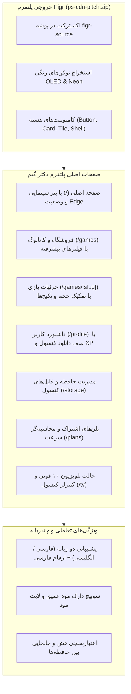

# 📖 راهنمای جامع فاز ۲: پیاده‌سازی سیستم طراحی Figr، صفحات اصلی و ماژول مدیریت حافظه و فایل‌های کنسول

> **کد مرحله:** `STEP-02`  
> **عنوان فاز:** استخراج و انطباق پلتفرم طراحی Figr (`ps-cdn-pitch.zip`)، راه‌اندازی صفحات اصلی، کاتالوگ فروشگاه، جزئیات بازی، داشبورد کاربر و فایل منیجر ذخیره‌سازی کنسول و هارد اکسترنال USB  
> **فایل تسک‌ها:** [tasks.md](tasks.md)  
> **سند بالادستی مرجع:** [development-policy.md](../development-policy.md) و پروژه خروجی [ps-cdn-pitch.zip](../../figr-source/)

---

## ۱. هدف و چشم‌انداز فاز ۲

بر اساس بازخورد کارفرما، استایل بصری پلتفرم به‌طور کامل بر اساس خروجی استاندارد دریافتی از پلتفرم Figr تحت پکیج `ps-cdn-pitch.zip` یکپارچه شد. در این فاز، کلیه توکن‌های رنگی، کامپوننت‌های تعاملی، تایپوگرافی، چیدمان‌ها و صفحات اختصاصی به معماری مدرن **Next.js 14 App Router** منتقل شده و با هویت بصری «دکتر گیم» (DrGame) پیوند خوردند.

---

## ۲. ساختار صفحات پیاده‌سازی‌شده

### ۲.۱ صفحه اصلی (Home - `/`)
- **Hero Banner سینمایی:** نمایش بازی ویژه (God of War) با گرادیان مشکی OLED، بج‌های پلتفرم و برچسب مالکیت در کتابخانه PSN.
- **نوار وضعیت نود لبه تهران ۱ (Tehran-1 Edge Node):** نمایش پینگ لحظه‌ای (۱۱ میلی‌ثانیه)، سرعت نود (۱۹.۶ مگابیت) در مقایسه با سرعت ۳.۱ مگابیتی پیش‌فرض اینترنت بین‌الملل، و وضعیت کشینگ بازی‌ها.
- **ردیف بازی‌های آماده دانلود از کتابخانه:** دسترسی سریع به بازی‌های موجود در اکانت کاربر بدون نیاز به خرید مجدد.
- **ویترین‌های پویا:** بازی‌های ترند، عناوین تازه اضافه‌شده با پشتیبانی از اسلایدر افقی و رندر پوسترها.

### ۲.۲ صفحه فروشگاه و کاتالوگ (Storefront Catalog - `/games`)
- **فیلتر پلتفرم:** سوییچ بین همه پلتفرم‌ها، اختصاصی PS5 و عناوین PS4.
- **فیلتر سبک (Genre):** اکشن، نقش‌آفرینی (RPG)، جهان‌باز، شوتر، ماجراجویی، ورزشی و داستانی.
- **فیلتر وضعیت مالکیت:** همه بازی‌ها، بازی‌های موجود در کتابخانه من (Owned)، بازی‌های رایگان (Free to Play).
- **مرتب‌سازی هوشمند:** بیشترین امتیاز متاکریتیک (Metascore)، سال انتشار، بیشترین و کمترین حجم دانلود.
- **نوار جستجوی کپسولی با پیش‌نمایش درجا.**

### ۲.۳ صفحه جزئیات بازی (Game Details - `/games/[slug]`)
- **والپیپر ۴K پس‌زمینه با افکت محوشدگی سینمایی.**
- **پنل وضعیت مالکیت و سهمیه:** نمایش دکمه «ارسال مستقیم به کنسول PS5» برای بازی‌های تحت مالکیت و دکمه خرید برای سایر عناوین.
- **باکس سهمیه و محاسبه‌گر زمان دانلود:** محاسبه دقیق زمان دانلود با شبکه دکتر گیم در مقایسه با اینترنت بین‌الملل.
- **شبکه سه‌گانه اطلاعات بازی:**
  1. استودیو سازنده، جوایز معتبر (Game of the Year) و نمره متاکریتیک.
  2. ویژگی‌های فنی: 60FPS، صدای سه‌بعدی Tempest 3D، بازخورد لمسی دسته DualSense و زمان بارگذاری فوق‌سریع.
  3. روایت داستان بازی با تایپوگرافی فارسی استاندارد.
- **فهرست فایل‌های نصبی و پکیج‌ها:** تفکیک دیتای پایه (Base Game PKG)، آپدیت‌ها، دی‌ال‌سی‌ها و پکیج‌های زیرنویس فارسی.
- **عناوین پیشنهادی و مشابه.**

### ۲.۴ داشبورد کاربر و کتابخانه (User Dashboard - `/profile`)
- **کاور هدر با پترن اشکال اختصاصی پلی‌استیشن (مربع، مثلث، دایره، ضربدر).**
- **پروفایل گیمر:** آواتار، سطح کاربر (Level 28)، نوار پیشرفت XP، شناسه متصل PSN (`arman_rhm`) و بج پلن نقره‌ای.
- **ردیف ۶ کارت آمار کلیدی:** سهمیه باقیمانده، سرعت دانلود، روزهای باقیمانده تا تمدید، تعداد بازی‌های کتابخانه، حجم کل دانلود شده و تروفی‌های کسب‌شده.
- **صف دانلود زنده کنسول PS5 (Live Download Queue):** نمایش دانلود در حال اجرای بازی‌ها با نوار پیشرفت زنده، سرعت لحظه‌ای و زمان تخمینی باقیمانده.
- **تاریخچه آخرین دانلودها و تحویل به کنسول:** جدول شفاف با نمایش زمان دقیق، حجم و وضعیت موفقیت.
- **کارت هدایت به فایل منیجر کنسول:** دسترسی مستقیم با یک کلیک به مدیریت حافظه‌ها.

### ۲.۵ صفحه مدیریت حافظه و فایل‌های کنسول (Console Storage & File Manager - `/storage`)
مطابق الزامات ابلاغی کارفرما، این صفحه برای سازماندهی کامل فضاهای ذخیره‌سازی کنسول پلی‌استیشن طراحی شده است:
1. **کارت‌های مانیتورینگ سخت‌افزاری با گیج‌های مصرف:**
   - **حافظه داخلی کنسول PS5 (Internal SSD):** ۶۶۷.۲ گیگابایت کل / ۵۱۲.۴ گیگ مصرفی / ۱۵۴.۸ گیگ آزاد — فایل‌سیستم اختصاصی PSFS با سرعت ۵,۵۰۰ مگابایت بر ثانیه.
   - **حافظه ارتقا یافته M.2 NVMe:** ۲ ترابایت کل / ۱,۴۲۰ گیگ مصرفی / ۵۸۰ گیگ آزاد (Samsung 980 Pro).
   - **هارد اکسترنال USB (Extended Storage):** ۴ ترابایت کل / ۲,۷۸۰ گیگ مصرفی / ۱,۲۲۰ گیگ آزاد (WD Black USB 3.2).
2. **اکسپلورر پکیج‌های بازی (PKG Manager Table):**
   - جدول پیشرفته با نام فایل PKG، عنوان بازی و تصویر بندانگشتی، پلتفرم (PS5/PS4)، نوع پکیج (دیتای بازی، آپدیت، زیرنویس فارسی، DLC)، نسخه فایل و حجم دقیق به گیگابایت.
   - نمایش وضعیت سلامت فایل بر اساس هش SHA-256 سرور لبه CDN.
   - **عملیات جابجایی آنی بین حافظه‌ها:** امکان انتقال فایل با یک کلیک بین SSD داخلی، حافظه M.2 و هارد اکسترنال USB با محاسبه مجدد و زنده ظرفیت درایوها.
   - قابلیت بررسی سلامت گروهی و حذف امن فایل‌ها.

### ۲.۶ صفحات مکمل یکپارچه
- **پلن‌های سرعت و سهمیه (`/plans`):** کارت‌های شفاف پلن رایگان (بدون سقف برای بازی‌های Free-to-Play)، برنز (۵۰۰ گیگ)، نقره‌ای (۱ ترابایت) و طلایی (۲.۲ ترابایت) به همراه مقایسه سرعت و فرم اعمال کد تخفیف.
- **حالت تلویزیون و دسته بازی ۱۰ فوتی (`/tv`):** طراحی اختصاصی برای نمایش روی تلویزیون‌های بزرگ و هدایت از طریق کلیدهای جهتی کیبورد یا کنترلر با راهنمای دکمه‌های دوئل‌سنس ($\times, \bigcirc, \triangle, \square$).

---

## ۳. سیستم طراحی و متغیرهای بصری (Design Tokens)

کلیه رنگ‌ها و مقادیر برگرفته از پروژه Figr در فایل `globals.css` و `tailwind.config.ts` به عنوان توکن‌های سراسری ثبت شدند:

| توکن طراحی | مقدار دارک مود (OLED) | مقدار لایت مود | کاربرد |
| :--- | :--- | :--- | :--- |
| `--bg` | `#070709` | `#f5f5f7` | پس‌زمینه اصلی صفحه |
| `--surface` | `#111116` | `#ffffff` | کارت‌ها و پنل‌های سطح اول |
| `--surface-2` | `#181820` | `#f0f0f4` | سطوح ثانویه، دکمه‌های خنثی |
| `--surface-3` | `#22222d` | `#e4e4eb` | کادرهای فوکوس و تراک نوارهای پیشرفت |
| `--accent` | `#7028e4` | `#6020c8` | بنفش ارغوانی کهکشانی اصلی |
| `--accent-2` | `#9353f4` | `#813eed` | بنفش روشن هایلایت و فوکوس |
| `--pink` | `#e53b82` | `#d82b72` | مکمل گرادیان دکمه‌های پرایمری |
| `--psn` | `#0070d1` | `#0064bc` | آبی رسمی پلی‌استیشن |
| `--gold` | `#e6a817` | `#c88e08` | هایلایت پلن طلایی و پیشنهادات ویژه |
| `--success` | `#22c55e` | `#16a34a` | وضعیت دانلود، تایید هش و فایل سالم |

---

## ۴. چک‌لیست اعتبارسنجی کیفی
- [x] اجرای موفقیت‌آمیز `npm run build` و خروج کد 0 بدون هیچ خطای تایپ‌اسکریپت یا لینت.
- [x] تست صحت رندر تمامی مسیرها: `/`, `/games`, `/games/[slug]`, `/profile`, `/storage`, `/plans`, `/tv`.
- [x] رعایت استانداردهای فارسی‌سازی، ارقام فارسی (`toFaDigits`) و دوجهته بودن کامل (`dir="rtl"` و `dir="ltr"`).
- [x] یکپارچگی نشان برند «دکتر گیم» با هویت بصری استایل Figr.

