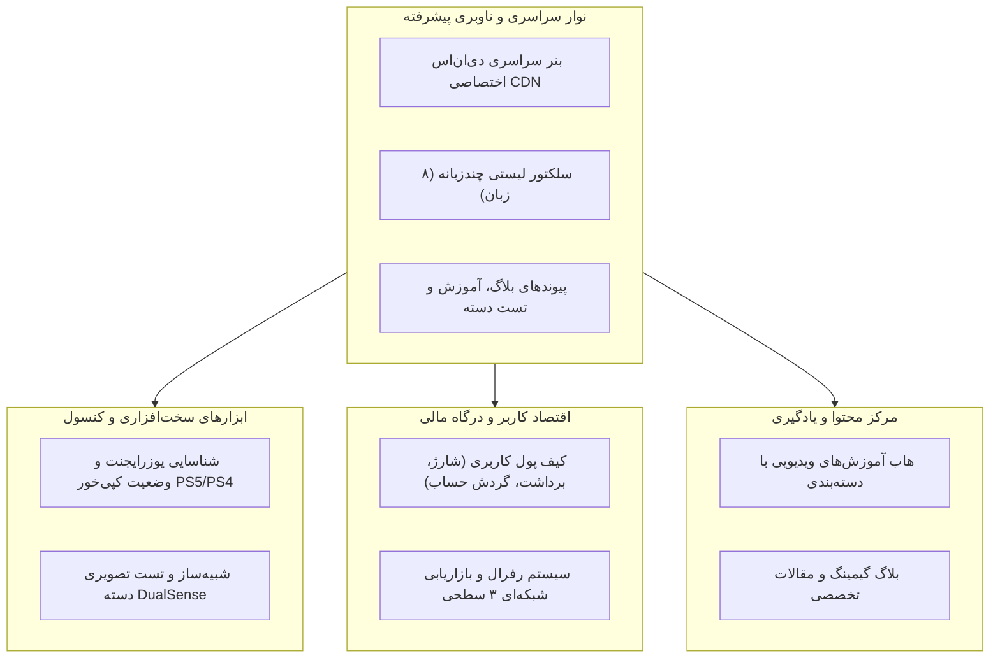

# 📖 راهنمای جامع فاز ۳: نوار هشدار دی‌ان‌اس، سیستم رفرال و کیف پول، تشخیص فریمور کنسول، آموزش‌های ویدیویی، بلاگ و تست دسته

> **کد مرحله:** `STEP-03`  
> **عنوان فاز:** پیاده‌سازی بنر سراسری DNS، سیستم انتخاب چندزبانه لیستی، پایش یوزرایجنت و کپی‌خور بودن کنسول، ماژول رفرال و بازاریابی شبکه‌ای ۳ سطحی، کیف پول کاربری، هاب ویدیوهای آموزشی، بلاگ مقالات گیمینگ و رابط کاربری شبیه‌ساز تست دسته DualSense  
> **فایل تسک‌ها:** [tasks.md](tasks.md)  
> **سند بالادستی مرجع:** [development-policy.md](../development-policy.md) و توافقات نیازمندی‌های اعلامی کاربر

---

## ۱. اهداف و مأموریت فاز ۳

در این مرحله، پلتفرم دکتر گیم از یک فروشگاه و کاتالوگ ساده فراتر رفته و به یک **اکوسیستم جامع خدمات نرم‌افزاری کنسول‌های پلی‌استیشن** تبدیل می‌شود. هدف پیاده‌سازی سرویس‌ها و ابزارهای موردنیاز کاربران کنسول، سیستم‌های درآمدزایی مشارکتی و محتوای آموزشی تعاملی است:

---

## ۲. مشخصات و نیازمندی‌های تفصیلی ماژول‌ها

### ۲.۱ نوار هشدار دی‌ان‌اس بالای سایت (DNS Warning Banner)
- **محل قرارگیری:** بالاترین بخش صفحه (Sticky Top بالای هدر اصلی).
- **پیام هشدار:** تأکید بر لزوم تنظیم DNS اختصاصی دکتر گیم در تنظیمات شبکه کنسول پلی‌استیشن جهت هدایت ترافیک به سمت سرورهای پرسرعت نود تهران ۱ و دانلود بدون افت سرعت.
- **آدرس‌های دی‌ان‌اس:**
  - Primary DNS: `178.22.122.100`
  - Secondary DNS: `185.51.200.2`
- **ابزارها:** دکمه کپی فوری هر آی‌پی با یک کلیک (به همراه بازخورد متنی کپی شد)، دکمه مشاهده راهنمای گام‌به‌گام تنظیم در کنسول، و قابلیت بستن (Dismiss) نوار با حالت ذخیره در سشن.

### ۲.۲ سیستم انتخاب زبان چندزبانه لیستی (Extended Multi-Language Selector)
- جایگزینی تاگل دوتایی فارسی/انگلیسی با منوی دراپ‌داون مدرن و جستجوپذیر.
- پشتیبانی از ۸ زبان کلیدی منطقه و بین‌الملل:
  1. فارسی (Persian) 🇮🇷 — پیش‌فرض با جهت RTL
  2. English (انگلیسی) 🇬🇧 — جهت LTR
  3. العربية (عربی) 🇸🇦 — جهت RTL
  4. Türkçe (ترکی استانبولی) 🇹🇷 — جهت LTR
  5. Русский (روسی) 🇷🇺 — جهت LTR
  6. Deutsch (آلمانی) 🇩🇪 — جهت LTR
  7. Español (اسپانیایی) 🇪🇸 — جهت LTR
  8. Français (فرانسوی) 🇫🇷 — جهت LTR
- هماهنگی خودکار متغیرهای فونت، جهت نوشتار (`dir`) و ترازبندی متن‌ها.

### ۲.۳ پایش یوزرایجنت و وضعیت کپی‌خور بودن کنسول (Console Firmware & Jailbreak Detection)
- استخراج هوشمند مشخصات دستگاه از `navigator.userAgent` (تشخیص مرورگر داخلی کنسول PS5، کنسول PS4 یا دیوایس‌های دیگر).
- ابزار سوییچ و اعتبارسنجی دستی فریمور برای کاربرانی که از طریق PC یا موبایل وارد پنل می‌شوند.
- طبقه‌بندی وضعیت کنسول:
  - **PS5 فریمور ۳.۰۰ تا ۴.۵۱:** برچسب سبز «کپی‌خور سازگار (WebKit / IPv6 Kernel Exploit) — نصب مستقیم فایل‌های دیتای PKG فعال».
  - **PS4 فریمور تا ۹.۰۰ و ۱۱.۰۰:** برچسب سبز «کپی‌خور سازگار (GoldHEN) — نصب دیتای FPKG فعال».
  - **فریمورهای بالاتر و رسمی سونی:** برچسب رسمی «کنسول اورجینال — دانلود دیتا با اکانت رسمی PSN و بالاترین سرعت نود CDN».
- نمایش هشدار عدم آپدیت خودکار فریمور کنسول برای گیمرهای علاقه‌مند به جیلبریک.

### ۲.۴ سیستم رفرال و بازاریابی شبکه‌ای ۳ سطحی (Affiliate & Multi-level Referral)
- **تخفیف کاربر دعوت‌شده:** ۲۰٪ تخفیف روی اولین خرید اشتراک یا پکیج دیتا با استفاده از کد معرف.
- **پورسانت دعوت‌کننده:**
  - **سطح ۱ (دعوت مستقیم):** ۱۰٪ از مبلغ کلیه خریدهای کاربر به عنوان شارژ کیف پول.
  - **سطح ۲ (زیرمجموعه‌های سطح دوم):** ۳٪ از خریدهای کاربران دعوت‌شده توسط دوستان.
  - **سطح ۳ (زیرمجموعه‌های سطح سوم):** ۱٪ از خریدهای لایه سوم.
- **بخش‌های رابط کاربری:**
  - نمایش لینک و کد دعوت اختصاصی (`drgame.ir/ref/arman28`) به همراه دکمه کپی و کد QR.
  - کارت‌های آمار کلیدی در داشبورد (تعداد کل دعوت‌ها، دعوت‌های فعال، درآمد کل، پورسانت آماده برداشت).
  - صفحه تفصیلی رفرال شامل لول‌بندی معرفان (برنز، نقره‌ای، طلایی)، نمودار شاخه‌ای و جدول ریز تراکنش‌ها و زیرمجموعه‌ها.

### ۲.۵ ماژول کیف پول کاربری (User Wallet)
- نمایش موجودی ریالی/تومانی کیف پول.
- امکان شارژ آنلاین سریع از طریق درگاه با انتخاب مبالغ آماده یا دلخواه.
- درخواست تسویه حساب و انتقال به شماره شبا.
- جدول تاریخچه تراکنش‌ها با فیلتر واریز، برداشت، پورسانت رفرال و خرید اشتراک.

### ۲.۶ هاب آموزش‌های ویدیویی (Video Tutorials - `/tutorials`)
- آرشیو ویدیوهای آموزشی با پلیر شیک و مدرن.
- دسته‌بندی موضوعی:
  - آموزش تنظیم DNS و بهینه‌سازی اتصال کنسول
  - راهنمای نصب دیتای بازی (PKG) روی PS5 و PS4
  - پیکربندی و فرمت هارد اکسترنال USB
  - آموزش‌های جیلبریک و اکانت‌های هکی/قانونی
  - رفع ارورهای دیتای خراب (CE-107857-8 و ...)
- متادیتای هر ویدیو: مدت زمان، کیفیت (Full HD / 4K)، سطح دشواری، مدرس و چک‌لیست مراحل.

### ۲.۷ بلاگ مقالات و اخبار گیمینگ (Gaming Blog - `/blog`)
- دسته‌بندی مقالات (اخبار سونی، تحلیل آپدیت فریمور، معرفی بازی‌ها، راهنمای خرید).
- قابلیت جستجوی زنده در مقالات، تگ‌های مرتبط و تخمین زمان مطالعه.
- صفحه اختصاصی مطالعه مقاله (`/blog/[slug]`) با تایپوگرافی چشم‌نواز Vazirmatn، هدینگ‌های استاندارد و اشتراک‌گذاری.

### ۲.۸ رابط کاربری شبیه‌ساز و تست دسته بازی (DualSense Gamepad Tester - `/gamepad-test`)
- پیاده‌سازی نمای شماتیک دو بعدی/شبه‌سه‌بعدی از کنترلر اختصاصی PS5 (DualSense).
- بازخورد بصری فشار دکمه‌ها: D-Pad، دکمه‌های اکشن ($\times, \bigcirc, \triangle, \square$)، بامپرها (L1/R1)، تریگرهای آنالوگ L2/R2، آنالوگ استیک‌های چپ و راست، تاچ‌پد، دکمه‌های هوم و Create/Options.
- نمایش استاتوس وضعیت اتصال (Gamepad API مرورگر یا تست دستی)، درصد باتری دسته و تست سلامت آنالوگ‌ها (Drift Test).

---

## ۳. معماری فایل‌ها و مسیرهای جدید فرانت‌اند

| مسیر (URL) | فایل کامپوننت | توضیحات عملکردی |
| :--- | :--- | :--- |
| بالای تمام صفحات | `src/components/DnsBanner.tsx` | نوار هشدار دی‌ان‌اس اختصاصی با دکمه کپی و پینگ |
| هدر سراسری | `src/components/Shell.tsx` | منوی چندزبانه لیستی ۸ زبانه و پیوندهای ناوبری جدید |
| `/tutorials` | `src/app/tutorials/page.tsx` | هاب ویدیوهای آموزشی دسته‌بندی‌شده و پلیر |
| `/wallet` | `src/app/wallet/page.tsx` | مدیریت کیف پول، افزایش موجودی و تسویه |
| `/referral` | `src/app/referral/page.tsx` | داشبورد رفرال ۳ سطحی، لینک اختصاصی و جدول سودها |
| `/blog` | `src/app/blog/page.tsx` | کاتالوگ و مقالات بلاگ گیمینگ دکتر گیم |
| `/blog/[slug]` | `src/app/blog/[slug]/page.tsx` | صفحه نمایش متن کامل مقاله |
| `/gamepad-test` | `src/app/gamepad-test/page.tsx` | رابط تست دسته DualSense و پایش دریفت آنالوگ |
| `/profile` | `src/app/profile/page.tsx` | اضافه شدن ابزار تشخیص فریمور، رفرال و ویجت کیف پول |

