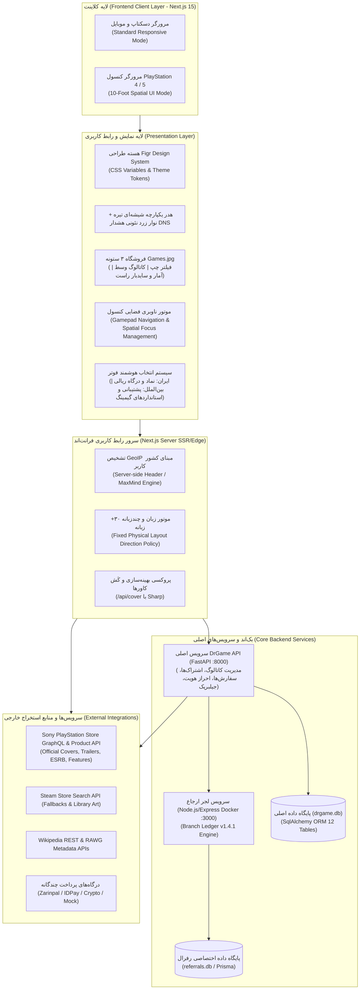

# سند چشم‌انداز، قلمرو و معماری یکپارچه‌سازی گام ۰۴ (Step 04 Overview & Architecture)

این سند مرجع رسمی و بنیادین گام ۰۴ پروژه پلتفرم جامع گیمینگ **DrGame-Ecommerce** است. هدف اصلی این گام، دستیابی به **هم‌ترازی بصری کامل (Visual Alignment)** با طراحی مدرن گیمینگ برگرفته از `sources/figr-source/`، پیاده‌سازی چیدمان فروشگاه طبق `sources/pics/games.jpg`، و تحقق **برابری عملکردی ۱۰۰ درصدی (Full Functional Parity)** با امکانات و موتور جمع‌آوری داده وب‌سایت مرجع `sources/GameDr-Website-Source/` است، ضمن اینکه سیستم پیشرفته ارجاع و پاداش چندسطحی (Branch Ledger v1.4.1) و قابلیت‌های بومی اختصاصی پلتفرم حفظ و تثبیت می‌گردند.

---

## ۱. جدول نگاشت منابع مرجع کانونیکال (Canonical Workspace Map)

تمامی استنادها و منابع در کلیه مستندات گام ۰۴ منطبق بر اسامی استاندارد جدول زیر می‌باشند:

| مسیر کانونیکال | نقش در پروژه | محدوده کاربرد مجاز | کاربرد غیرمجاز | مسیر واقعی روی دیسک / نکته هماهنگی |
| :--- | :--- | :--- | :--- | :--- |
| `sources/` | پوشه ریشه کلیه مستندات و سورس‌های مرجع | فقط به عنوان محفظه والد | نوشتن کد یا ایجاد تغییرات | `sources/` |
| `sources/figr-source/` | **مرجع حقیقت بصری (Visual Source of Truth)** | کلیه توکن‌های طراحی، پالت رنگ، تایپوگرافی، فاصله‌ها، شعاع‌ها، سایه‌ها، آناتومی کارت‌های بازی، بنر پروفایل کاربر | پیاده‌سازی منطق و کارکردها | `sources/figr-source/` (شامل فایل کلیدی `styles.css`) |
| `sources/GameDr-Website-Source/` | **مرجع حقیقت کارکردی (Functional Source of Truth)** | قابلیت‌ها، سیاهه صفحات و مسیرها، فیلدهای داده، جریان‌ها، هاور کارت بازی، جزئیات بازی، آواتارهای آماده، تب‌های پنل، منطق جمع‌آوری کاتالوگ بازی، و **تنها استثنای بصری: پس‌زمینه اختصاصی صفحه اصلی** | استایل‌دهی عمومی و سیستم طراحی (به دلیل ضعف استایل عمومی) | `sources/GameDr-Website-Source/` |
| `sources/pics/` | تصاویر الهام‌بخش چیدمان | ساختار صفحات و موقعیت عناصر | پیاده‌سازی عملکرد | `sources/pics/` (شامل ۱۱ تصویر مرجع) |
| `sources/pics/games.jpg` | **مرجع دقیق چیدمان صفحه فروشگاه (Shop Page)** | موقعیت بلاک‌ها، فیلترهای پیشرفته سمت چپ، نوار بالایی، کارت‌ها و ستون سمت راست | عملکرد و منطق بک‌اند | `sources/pics/games.jpg` (همراه با تصویر کلوزآپ `photo_2026-10-20_10-47-25.jpg`) |
| `sources/referral-management-app-docker/` | **سرویس ارجاع و افیلیت لجر شاخه‌ای** | داده‌ها، فرمول‌ها و APIهای سیستم معرفی و پورسانت شبکه | امکانات غیرمرتبط با رفرال | `sources/referral-management-app-docker/` (پورت سرویس `:3000`) |
| `sources/SYSTEM-PROPOSAL-FA.md` | سند مشخصات فنی سیستم رفرال | قوانین Branch Ledger v1.4.1، سهم ۲۱٪، فشرده‌سازی شبکه، دوره تعلیق و پورسانت | — | `sources/SYSTEM-PROPOSAL-FA.md` (واقع در ریشه `sources/`) |
| `sources/gamepad-test/` | **ابزار تست پیشرفته گیم‌پد و دسته‌های بازی** | منطق، کدهای فریم‌ورک و کنترلرهای WebHID/Gamepad API | استایل و ظاهر بصری (باید کاملاً با توکن‌های `figr-source` بازنویسی شود) | روی دیسک با نام `sources/gamapad-test/` ذخیره شده است (`sources/gamapad-test/GameDr/rep/gamepad/`) |

> **قانون اولویت‌بندی در تعارضات (Conflict Resolution Precedence):**
> ۱. **سبک بصری (Visual Style):** همیشه `sources/figr-source/` بر تمام مراجع حاکم است.
> ۲. **چیدمان و ترکیب صفحه (Layout/Composition):** مراجع تصویری `sources/pics/` (به‌ویژه `games.jpg` برای فروشگاه) اولویت دارند.
> ۳. **عملکرد، داده و رفتار (Functionality/Data):** سورس `sources/GameDr-Website-Source/` اولویت دارد.
> ۴. **سیستم معرفی و پورسانت (Referral):** سند `sources/SYSTEM-PROPOSAL-FA.md` و داکر سرویس رفرال حاکم مطلق هستند.
> ۵. **منطق تست دسته (Gamepad Logic):** کد موجود در `sources/gamepad-test/` (و `gamepad-tester.js`).
> ۶. **رفتار موجود پروژه فعلی (Existing Codebase):** ساختار Next.js و مدل‌های داده مستقر مستند و حفظ شده و ارتقا می‌یابند.

---

## ۲. دیاگرام معماری سامانه (System Architecture Diagram)

---

## ۳. فهرست کامل مسیرها و صفحات پلتفرم (Full Route Inventory)

تمامی صفحات پلتفرم به صورت کامل در گام ۰۴ به تکامل ساختاری و انطباق کامل می‌رسند:

| مسیر (Route) | نام فارسی صفحه | فایل مسئول در کد | وضعیت و تغییرات گام ۰۴ | مرجع استناد |
| :--- | :--- | :--- | :--- | :--- |
| `/` | صفحه اصلی (Home) | `frontend/src/app/page.tsx` | اعمال پس‌زمینه اختصاصی SVG و Marquee گِیم‌دکتر، کارت خلاصه رفرال در صدر، ۲ اسلات بنر تبلیغاتی، کاروسل‌ها و دسته‌بندی‌های کامل | `GameDr` (lines 76-134, 527-589) + `figr-source` |
| `/shop` | فروشگاه بازی‌ها (Shop) | `frontend/src/app/shop/page.tsx` | چیدمان ۳ ستونه اختصاصی: سایدبار فیلترهای پیشرفته در سمت چپ فیزیکی، شبکه ۳ کارتی در وسط، سایدبار اطلاعات و تاپ ۵ در سمت راست | `sources/pics/games.jpg` + `photo_2026-10-20_10-47-25.jpg` |
| `/shop/[slug]` | جزئیات بازی (Game Detail) | `frontend/src/app/shop/[slug]/page.tsx` | پس‌زمینه هاله داینامیک رنگی (Ambient Wash)، دکمه اسکرول نرم دانلود، ۳ تب مشخصات پلی‌استیشن، گالری تریلر و باکس مصرف سهمیه اشتراک | `GameDr` (`game.js`, `game.html`) + `photo_2026-10-20_10-49-01.jpg` |
| `/subscriptions` | پلن‌های اشتراک (Plans) | `frontend/src/app/subscriptions/page.tsx` | ۴ سطح اشتراک (رایگان، برنزی، نقره‌ای، طلایی)، کارت‌های استایل نئونی `figr-source`، جدول تفصیلی مقایسه امکانات با آیکون‌های مجزا | `figr-source` + `photo_2026-10-20_10-48-59.jpg` |
| `/checkout` | تسویه‌حساب (Checkout) | `frontend/src/app/checkout/page.tsx` | محاسبه داینامیک تخفیف (کوپن + ۵٪ رفرال)، لایه انتزاعی درگاه، اسلات‌های رزرو پرداخت ریالی و رمزارز | کد جاری فرانت و بک‌اند (`routes.py` lines 253-337) |
| `/jailbreak` | مرجع جیلبریک و هک (Jailbreak) | `frontend/src/app/jailbreak/page.tsx` | ماتریس سازگاری نسخه‌ها، ارسال پی‌لود با وب‌سوکت، راهنمای فلش USB و جعبه کپی دی‌ان‌اس منطبق با هدر | `GameDr` (`jailbreak.html`, `jailbreak.js`) |
| `/tools` | هاب ابزارها (Tools Index) | `frontend/src/app/tools/page.tsx` | دسترسی سریع به تستر گیم‌پد و مرجع جیلبریک با طراحی مدرن کارت‌ها | `figr-source` |
| `/tools/gamepad` | تست و عیب‌یابی گیم‌پد (Gamepad Test) | `frontend/src/app/tools/gamepad/page.tsx` | ادغام دوگانه: ۱. تستر سریع نیتیو (GameDr) ۲. تستر پیشرفته DualSense (WebHID/Three) با استایل `figr-source` | `sources/gamepad-test/` + `gamepad-tester.js` |
| `/articles` | مقالات و راهنماها (Articles) | `frontend/src/app/articles/page.tsx` | لیست مقالات با سایدبار فیلتر دسته‌بندی در سمت راست فیزیکی، کارت‌های هماهنگ با ظاهر بازی‌ها | `figr-source` |
| `/articles/[slug]` | مطالعه مقاله (Article View) | `frontend/src/app/articles/[slug]/page.tsx` | قالب استاندارد وبلاگ گیمینگ با تایپوگرافی Vazirmatn، زمان مطالعه، نویسنده و بنر هدر | `figr-source` |
| `/panel` | پنل کاربری (User Panel) | `frontend/src/app/panel/page.tsx` | هدر با کاور تزیینی و ۲۰ آواتار پلی‌استیشن، سایدبار ۷ تب اصلی شامل تب اختصاصی ارجاع و درآمد (Branch Ledger) | `GameDr` (`wallet.js`) + `avatar-catalog.js` + `SYSTEM-PROPOSAL-FA.md` |
| `/auth` | ورود و ثبت‌نام (Authentication) | `frontend/src/app/auth/page.tsx` | فرم شیشه‌ای احراز هویت با شماره موبایل / ایمیل و کد تایید یکبار مصرف (OTP) | `figr-source` |
| `/admin` | پنل مدیریت سامانه (Admin Dashboard) | `frontend/src/app/admin/page.tsx` | داشبورد مدیریت کاتالوگ با استخراج خودکار از PS Store، تیکت‌ها، امور مالی، بنرها، تنظیمات DNS و فوتر | تفکیک کامل مرز احراز هویت ادمین |
| `/admin/login` | ورود مدیریت (Admin Login) | `frontend/src/app/admin/login/page.tsx` | فرم ورود امن و مجزا برای دسترسی راهبران ارشد سامانه | تفکیک کامل امنیتی |

---

## ۴. جدول تصمیمات تأیید شده کاربر (Resolved Questions & Author Alignment Table)

بر مبنای استعلام‌های انجام شده با پروتکل بند ۱۱ پرامپت ارشد، تمامی ابهامات کلیدی رفع و پاسخ قطعی دریافت گردید:

| شناسه تصمیم | عنوان سوال / موضوع | پاسخ قطعی و راهکار مهندسی مصوب | سند و بخش مرتبط در گام ۰۴ |
| :--- | :--- | :--- | :--- |
| **A1** | نام‌گذاری پوشه تست گیم‌پد روی دیسک | در متون، مستندات و کدهای پروژه از نام استاندارد کانونیکال `sources/gamepad-test/` استفاده شود، و در جدول نگاشت قید شود که این پوشه در فایل‌سیستم فعلی با املای `sources/gamapad-test/` قرار دارد. | `00-overview.md` (بخش ۱)، `06-tools-jailbreak-gamepad-and-articles.md` |
| **A2** | ساختار تب رفرال در پنل کاربری | تب «معرفی و درآمد (رفرال)» به عنوان یکی از تب‌های رسمی سایدبار پنل کاربری، مستقیماً بر مبنای منطق Branch Ledger v1.4.1 شامل کارت موجودی قابل برداشت و در تعلیق، کد دعوت، وضعیت ۵٪ تخفیف ولکام، جدول پورسانت سطوح و فرم درخواست تسویه شبا پیاده‌سازی می‌گردد. | `07-user-and-admin-panels.md` (بخش پنل کاربری) |
| **A3** | معماری صفحه تست گیم‌پد (`/tools/gamepad`) | هر دو حالت پشتیبانی می‌شوند: ۱. حالت تستر سریع (پیاده‌سازی نیتیو ری‌اکتی از کد ۲۶۷ خطی `gamepad-tester.js` سورس GameDr). ۲. حالت تستر پیشرفته دسته‌های DualSense/PS5 با موتور فیزیکی و فریم‌ورک `sources/gamepad-test/`، بازطراحی شده با توکن‌های `figr-source`. | `06-tools-jailbreak-gamepad-and-articles.md` |
| **A4** | نحوه بهره‌برداری از تصاویر پوشه `sources/pics/` | تصویر `games.jpg` (و عکس مکمل `10-47-25.jpg`) به عنوان مرجع دقیق چیدمان صفحه فروشگاه، و تصاویر `10-48-59.jpg` و `10-49-01.jpg` به عنوان رفرنس صفحات اشتراک و بازی لحاظ می‌شوند. سایر تصاویر صرفاً الهام‌بخش ترکیب بصری بوده و فیچرهای خارج از اسکوپ (مانند لاگین اپل/استیم یا لول‌آپ) اضافه نخواهند شد. | `03-home-and-shop-pages.md`، `04-game-detail-and-catalog-collection.md` |

---

## ۵. واژه‌نامه فنی اصطلاحات اختصاصی (Domain Glossary)

- **Branch Ledger v1.4.1:** مدل حسابداری پورسانت ارجاع که در آن ۲۱٪ از مبلغ کل خرید سهم شبکه معرفین بوده و به صورت تصاعد هندسی معکوس (نصف شدن در هر سطح: ۱۰.۵٪، ۵.۲۵٪، ۲.۶۲۵٪ و ...) بین نیاکان دارای اشتراک فعال تقسیم می‌شود.
- **Fixed Physical Layout Direction:** سیاست سخت‌گیرانه چیدمان که بر اساس آن موقعیت قرارگیری سایدبارها و بلوک‌های اصلی صفحه بر مبنای چپ و راست فیزیکی تعریف شده و هرگز با تغییر زبان سایت آینه‌ای (Mirror) نمی‌شود.
- **Ambient Cover Color Wash:** تکنیک استخراج رنگ‌های مسلط کاور بازی از طریق Canvas API و انتشار آن به صورت هاله‌های نوری محو در بک‌گراند صفحه جزئیات بازی.
- **PlayStation 10-Foot UI Mode:** حالت کاربری اختصاصی بهینه‌سازی شده برای مشاهده روی تلویزیون از فاصله ۳ متری با مقیاس فونت ۱.۲۵ برابر، رینگ فوکوس نئونی، حاشیه ایمن ۵٪ و کنترل کامل از طریق D-Pad دسته بازی.
- **GeoIP Dual Footer Engine:** سیستم تشخیص خودکار موقعیت مکانی کاربر از روی هدرهای معتبر شبکه، جهت سوئیچ خودکار بین فوتر نماددار ایران و فوتر استاندارد بین‌المللی.

