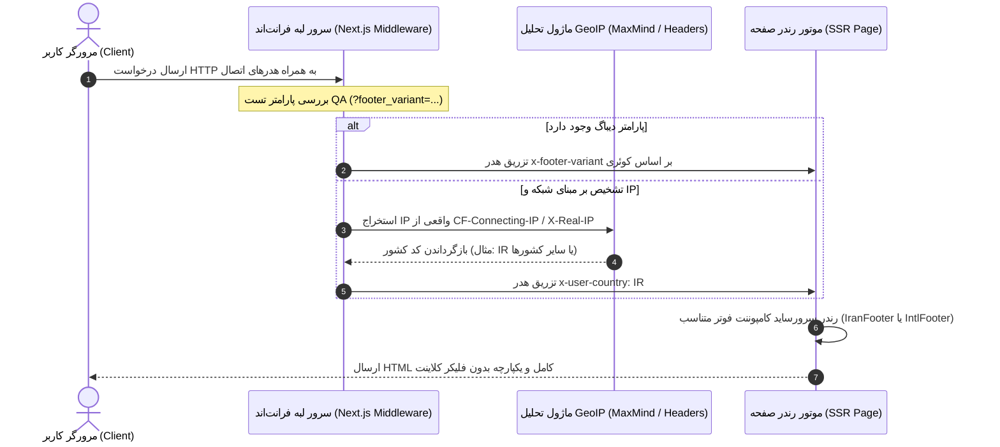

<div dir="rtl" align="right">

# مشخصات فنی هدر، نوار زرد نئونی DNS و سیستم دوگانه فوتر بر مبنای GeoIP (Header, DNS Warning Bar & GeoIP Footers)

این سند مرجع پیاده‌سازی دقیق کامپوننت هدر یکپارچه، نوار هشدار نئونی DNS، و موتور سرور‌ساید تفکیک هوشمند فوتر ایران و بین‌الملل را بر اساس نیازمندی‌های بندهای ۷.۱ و ۷.۲ پرامپت ارشد تدوین می‌نماید.

---

## ۱. هدر یکپارچه و چیدمان فیزیکی ۸ گانه (Unified Header Specification)

هدر اصلی پلتفرم با استناد به سورس `sources/figr-source/styles.css` و تصمیم `OD-1`، دارای پس‌زمینه سالید و مجزا از بدنه صفحه با متغیر `--bg-secondary` (`#151722`) همراه با مرز پایینی نیمه‌شفاف `rgba(255, 255, 255, 0.08)` و ارتفاع ثابت `70px` (`--topbar-height`) می‌باشد.

### ۱.۱. ترتیب فیزیکی اقلام ۸ گانه (از چپ به راست فیزیکی - Left to Right)

چیدمان افقی هدر در تمامی ۳۰ زبان سایت دقیقاً از چپ به راست فیزیکی به ترتیب زیر است:

```
[۱. لوگو و برند]  [۲. بازی‌ها]  [۳. ابزارها]  [۴. مقالات]  [۵. خرید / نام اشتراک فعال]  [۶. زنگوله اعلان‌ها]  [۷. سبد خرید (تولتیپ)]  [۸. پنل کاربری / ورود]
```

| شماره فیزیکی | آیتم و المان | آیکون انتخابی (`lucide-react`) | برچسب پیش‌فرض فارسی / وضعیت نمایشی | کلید i18n | رفتار و لینک مقصد |
| :---: | :--- | :--- | :--- | :--- | :--- |
| **۱** | لوگو و خانه | — (تصویر وکتور برند) | «دکتر گیم» (DrGame) | `nav.home` | کلیک هدایت می‌کند به صفحه اصلی `/` |
| **۲** | کاتالوگ بازی‌ها | `Gamepad2` | «بازی‌ها» | `nav.games` | هدایت به فروشگاه `/shop` |
| **۳** | ابزارهای تخصصی | `Wrench` | «ابزارها» | `nav.tools` | هدایت به هاب ابزارها `/tools` |
| **۴** | اخبار و مقالات | `BookOpen` | «مقالات» | `nav.articles` | هدایت به وبلاگ `/articles` |
| **۵** | دکمه اشتراک فعال / خرید | `Crown` | در کاربر مهمان: «خرید اشتراک» (دکمه نارنجی نئونی). در کاربر لاگین: «اشتراک طلایی» (بج درخشان همراه با نمایش سهمیه) | `nav.subscribe` یا `nav.active_plan` | هدایت به `/subscriptions` (کاربر عادی) یا تب سهمیه در `/panel` |
| **۶** | زنگوله اعلان‌ها | `Bell` | نشانگر عددی قرمز نئونی (Badge) در صورت وجود پیام خوانده نشده | `nav.notifications` | باز شدن دراپ‌داون لیست اعلان‌های اخیر کاربر |
| **۷** | سبد خرید غیرفعال | `ShoppingCart` | آیکون کم‌رنگ شده همراه با تولتیپ هاور: «به‌زودی» | `nav.cart_coming_soon` | غیرقابل کلیک (Disabled)؛ نمایش تولتیپ هنگام ماوس‌اور |
| **۸** | ورود / پنل کاربری | `User` | کاربر مهمان: «ورود / عضویت». کاربر احراز هویت شده: نام کاربر + آواتار کاراکتر پلی‌استیشن | `nav.auth_login` یا `nav.user_panel` | هدایت به `/auth` یا دراپ‌داون پروفایل پنل `/panel` |

---

## ۲. نوار زرد نئونی هشدار تنظیم DNS کنسول (Neon Yellow DNS Warning Bar)

به منظور رفع خطاهای دانلود و تحریم‌های شبکه پلی‌استیشن و بر اساس نیازمندی بند ۷.۱، یک نوار هشدار نئونی در بالاترین موقعیت صفحه (Sticky بالای هدر) قرار می‌گیرد:

### ۲.۱. مشخصات ظاهری و مقادیر شبکه
- **رنگ پس‌زمینه نئونی:** زرد گرم نئونی پرکنتراست `--accent-yellow` (`#eab308` یا `#facc15`).
- **رنگ متن و آیکون‌ها:** مشکی عمیق سورمه‌ای `--bg-primary` (`#0f1016`) برای تضمین بالاترین ضریب کنتراست خوانایی.
- **مقادیر DNS پلتفرم:**
  - **دی‌ان‌اس اصلی (Primary DNS):** `178.22.122.100` (همراه با دکمه کپی فوری).
  - **دی‌ان‌اس کمکی (Secondary DNS):** `185.51.200.2` (همراه با دکمه کپی فوری).
- **دکمه بستن نوار (`OD-9`):** دکمه ضربدر `"×"` در سمت راست فیزیکی نوار قرار دارد. در صورت کلیک کاربر، نوار بسته شده و وضعیت آن در `sessionStorage` ذخیره می‌گردد تا در طول همان سشن مرورگر مزاحم کاربر نشود.
- **تنظیم‌پذیری از پنل ادمین:** فعال/غیرفعال بودن، متن پیام، و IPهای دی‌ان‌اس مستقیماً از طریق جدول `SiteSetting` در بک‌اند مدیریت می‌شوند.

```tsx
// نمونه کامپوننت نوار دی‌ان‌اس (TopBanner.tsx)
<div className="bg-[#eab308] text-[#0f1016] px-4 py-2 text-xs md:text-sm font-bold flex items-center justify-between shadow-md">
  <div className="flex items-center gap-2">
    <ShieldAlert className="w-4 h-4 text-[#0f1016]" />
    <span>جهت دور زدن تحریم و افزایش سرعت دانلود کنسول، DNS اختصاصی دکتر گیم را تنظیم کنید:</span>
    <code className="bg-[#0f1016]/10 px-2 py-0.5 rounded font-mono">178.22.122.100</code>
    <button onClick={() => copyDNS('178.22.122.100')} title="کپی DNS"><Copy className="w-3.5 h-3.5" /></button>
    <code className="bg-[#0f1016]/10 px-2 py-0.5 rounded font-mono">185.51.200.2</code>
    <button onClick={() => copyDNS('185.51.200.2')} title="کپی DNS کمکی"><Copy className="w-3.5 h-3.5" /></button>
  </div>
  <button onClick={handleDismiss} className="p-1 hover:bg-black/10 rounded" aria-label="بستن هشدار">×</button>
</div>
```

---

## ۳. سیستم هوشمند دوگانه فوتر مبتنی بر GeoIP (GeoIP-Driven Dual Footer Engine)

برای برآورده‌سازی الزامات قانونی و پرداخت داخل کشور در کنار تجربه استاندارد بین‌المللی گیمینگ، سیستم نمایش فوتر به دو قالب مستقل تقسیم شده و به صورت **سرور‌ساید (Server-Side Rendering)** بدون پرش بصری (Hydration Mismatch) رندر می‌گردد.

### ۳.۱. معماری تشخیص موقعیت مکانی (GeoIP Detection Architecture)



### ۳.۲. سیاست‌های فنی اتصال و خطایابی
۱. **استخراج ایمن IP:** با توجه به قرارگیری فرانت‌اند پشت ریورس‌پروکسی معتبر، اولویت استخراج به ترتیب از هدرهای `CF-Connecting-IP`، سپس `X-Real-IP` و در نهایت اولین آدرس در `X-Forwarded-For` انجام می‌پذیرد.
۲. **روش تشخیص منبع GeoIP (`OD-12`):** استفاده از دیتابیس لوکال MaxMind GeoLite2-Country (`.mmdb`) درون کانتینر داکر فرانت‌اند جهت سرعت زیر ۱ میلی‌ثانیه‌ای و استقلال کامل از سرویس‌های تحریمی خارجی.
۳. **سیاست پیش‌فرض در صورت عدم تشخیص (`OD-8`):** در صورت خطای دیتابیس یا IPهای خصوصی (Localhost)، بر مبنای زبان جاری کاربر تصمیم‌گیری می‌شود (اگر زبان کاربر فارسی باشد، فوتر ایران و در غیر این صورت فوتر بین‌الملل رندر می‌گردد).
۴. **قابلیت بازنویسی تست تضمین کیفیت (QA Override):** در محیط‌های توسعه و برای کاربران ادمین، ارسال کوئری استرینگ `?footer_variant=iran` یا `?footer_variant=intl` نوع فوتر را فارغ از IP تغییر می‌دهد.

---

## ۴. مشخصات محتوایی دو قالب فوتر (Footer Variants Specification)

### ۴.۱. فوتر ویژه کاربران داخل ایران (Iran Footer)
- **اسلات اختصاصی ای‌نماد (Enamad Slot):** باکسی استاندارد با ابعاد `120x120` پیکسل جهت بارگذاری نماد اعتماد الکترونیکی و ستاره‌های تاییدیه.
- **لوگوی درگاه‌های پرداخت شتابی:** آیکون‌های استاندارد درگاه‌های زرین‌پال، زیبال، آی‌دی‌پی و بانک‌های طرف قرارداد.
- **اطلاعات تماس و حقوقی:** شماره تماس پشتیبانی تلفنی، ساعات کاری، آدرس پستی دفتر مرکزی و لینک‌های مجوز نشر برخط رسانه‌های دیجیتال.
- **ستون‌های دسترسی سریع:** قوانین و مقررات اشتراک، آموزش تنظیم DNS، راهنمای جیلبریک کنسول، ثبت تیکت پشتیبانی.
- **کپی‌رایت:** «کلیه حقوق مادی و معنوی متعلق به پلتفرم دکتر گیم می‌باشد.»

### ۴.۲. فوتر بین‌المللی گیمینگ (International Footer - طبق چک‌لیست `OD-2`)
- **نشان‌های پلتفرم‌های کنسولی:** لوگوهای وکتور PlayStation 5, PlayStation 4, Xbox Series X/S, Nintendo Switch, PC Master Race.
- **درگاه‌های پرداخت بین‌المللی (Placeholders):** نشان‌های Visa, MasterCard, PayPal, Crypto (Bitcoin, USDT).
- **لینک‌های کامیونیتی و شبکه‌های اجتماعی:** دیسکورد اختصاصی گیمرها، ساب‌ردیت، توییتر (X)، یوتیوب و کانال تلگرام.
- **سوییچر پیشرفته زبان و منطقه:** منوی کشویی انتخاب ۳۰+ زبان با پرچم کشورها و جهت متن اختصاصی.
- **نشان‌های کپی‌رایت بین‌المللی و امنیت:** آیکون‌های DMCA Protected, SSL 256-Bit Encryption, Cloudflare Security.
- **بیانیه گیمینگ مسئولانه (Responsible Gaming):** پیام کوتاه هشدار رده‌بندی سنی بازی‌ها منطبق بر استانداردهای ESRB و PEGI.

</div>
