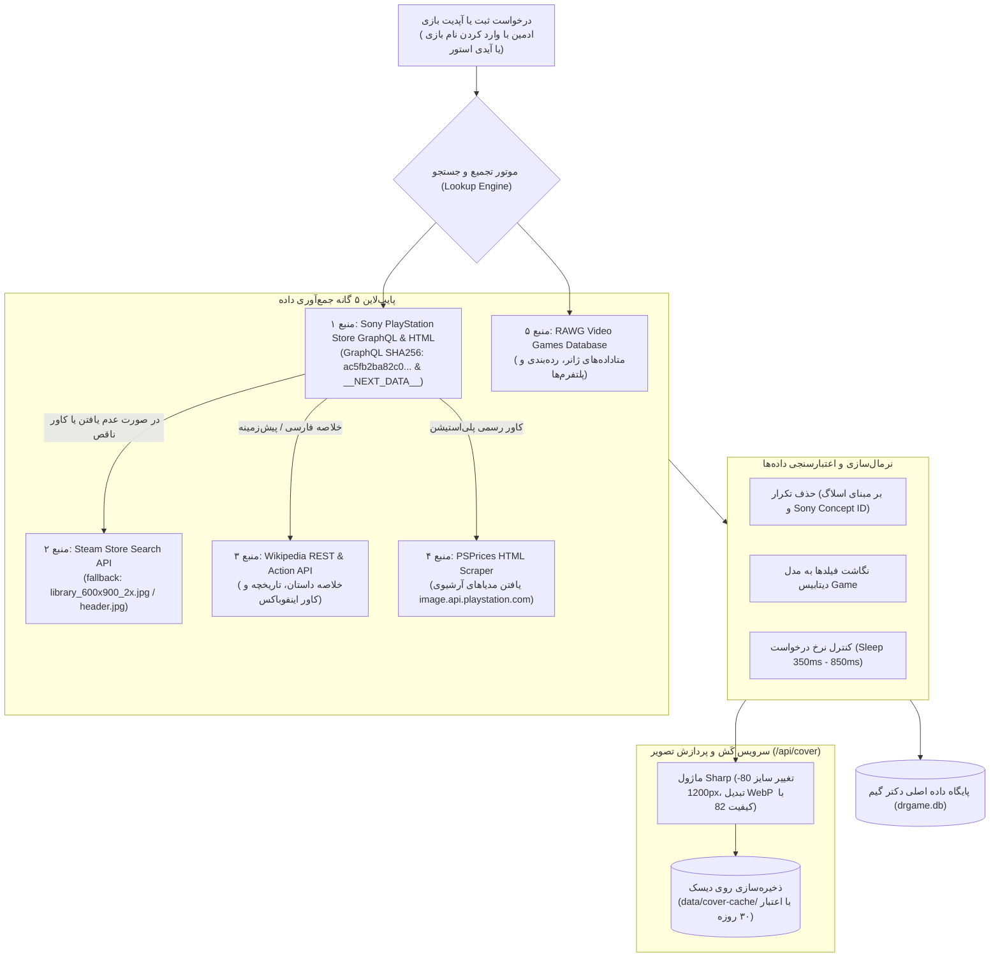

<div dir="rtl" align="right">

# مشخصات صفحه جزئیات بازی و موتور جمع‌آوری کاتالوگ (Game Detail & Catalog Collection Engine)

این سند مرجع پیاده‌سازی صفحه تفصیلی بازی (`/shop/[slug]`) با رفتار اختصاصی اسکرول نرم دکمه دانلود، کارت‌های سه‌گانه پروفایل پلی‌استیشن و هاله رنگی نئونی، همراه با مستندسازی فنی معماری موتور ۵ منبعی استخراج خودکار کاتالوگ بازی‌ها از وب‌سایت‌های مرجع (Sony Store, Steam, Wikipedia, PSPrices, RAWG) منطبق بر بندهای ۷.۵ و ۷.۱۳ پرامپت ارشد می‌باشد.

---

## ۱. مشخصات صفحه جزئیات بازی (Game Detail Page - برگرفته از سورس GameDr و تصویر `photo_2026-10-20_10-49-01.jpg`)

صفحه نمایش بازی در مسیر `frontend/src/app/shop/[slug]/page.tsx` پیاده‌سازی می‌گردد.

### ۱.۱. قوانین انتخاب تصویر بنر هیرو و استخراج هاله رنگی (Hero Art & Ambient Color Wash)
- **قوانین انتخاب بنر هیرو:**
  - اولویت ۱: فیلد `heroUrl` استخراج‌شده از استور پلی‌استیشن با رزولوشن حداقل `1920x1080` و نسبت ابعاد `16:9`.
  - اولویت ۲: اولین اسکرین‌شات باکیفیت از آرایه `screenshots[0]`.
  - اولویت جایگزین (Fallback): تصویر کاور بازی با فیلتر بلور شدید (`filter: blur(48px) scale(1.2)`) و ماسک گرادینت تیره.
- **تکنیک استخراج هاله رنگی (Ambient Cover Color Wash):**
  - تابع `sampleCoverColor` از طریق یک المان موقت Canvas نامرئی، رنگ‌های مسلط کاور بازی را به صورت مقادیر RGB استخراج کرده و سه متغیر CSS ریشه `--game-wash-1`, `--game-wash-2`, `--game-wash-3` را تنظیم می‌کند تا در پس‌زمینه کارت اصلی و هدر صفحه، یک درخشش نئونی هماهنگ با تم بصری همان بازی ایجاد شود.

### ۱.۲. کارت هیرو و رفتار کلیک دکمه دانلود (Top Hero Card & Download Smooth-Scroll)
- **کارت هیرو بالای صفحه:**
  - پوستر عمودی بازی با عرض ثابت `240px` در سمت چپ فیزیکی کارت.
  - عنوان اصلی انگلیسی، عنوان فارسی، پلتفرم‌ها (PS5, PS4)، رده‌بندی سنی ESRB، ریجن دیسک، آخرین ورژن دیتا، حجم کل فایل‌ها به گیگابایت.
  - امتیاز رسمی متاکریتیک و امتیاز کاربران (ستاره طلایی).
  - دکمه نشان کردن (Wishlist)، دکمه‌های واکنش لایک/دیس‌لایک.
  - **دکمه اصلی دانلود بازی («دانلود بازی»):** دکمه برجسته نارنجی نئونی.
- **رفتار فنی اسکرول نرم دکمه دانلود (الزام بند ۷.۵):**
  - کلیک روی این دکمه موجب هدایت ناگهانی یا پرش صفحه نمی‌شود؛ بلکه به وسیله متد `window.scrollTo` با انیمیشن کاملاً نرم (`behavior: 'smooth'`) صفحه را به موقعیت بلاک دانلود (`#game-files-section`) با در نظر گرفتن آفست منفی هدر چسبنده (`scroll-margin-top: 96px`) اسکرول می‌کند.
  - پس از اتمام اسکرول، فوکوس کیبورد و اسکرین‌ریدر بلافاصله به اولین دکمه بازگشایی/دانلود فایل در آن سکشن منتقل می‌گردد.

```typescript
// پیاده‌سازی رفتار اسکرول دکمه دانلود
const handleScrollToDownload = () => {
  const target = document.getElementById('game-files-section');
  if (target) {
    target.scrollIntoView({ behavior: 'smooth', block: 'start' });
    const primaryDownloadBtn = target.querySelector<HTMLButtonElement>('button[data-action="download-primary"]');
    setTimeout(() => primaryDownloadBtn?.focus(), 600);
  }
};
```

### ۱.۳. کارت‌های سه‌گانه اطلاعاتی پلی‌استیشن (Three PlayStation Profile Cards)
بر مبنای سورس `sources/GameDr-Website-Source/website/public/pages/game.js`، سه کارت تفکیک‌شده با مرزهای شیشه‌ای نمایش داده می‌شوند:
۱. **کارت اول: «قلب بازی — داستان و سرگذشت» (`Story & Lore`):** روایت کامل داستان، پیش‌زمینه کاراکترها و چکیده دنیای بازی.
۲. **کارت دوم: «ویژگی‌ها و قابلیت‌های فنی بازی» (`Game Features`):**
   - پشتیبانی از تریگرهای تطبیق‌پذیر (Adaptive Triggers) و لرزش هپتیک دسته DualSense کنسول PS5.
   - بهره‌مندی از صدای سه‌بعدی (3D Audio) و بهبود گرافیکی ویژه PS5 Pro.
   - تعداد بازیکنان تک‌نفره، پشتیبانی از بازی چندنفره آنلاین (نیاز به اشتراک)، و قابلیت Co-op محلی.
   - رده‌بندی سنی رسمی (ESRB/PEGI)، مدت زمان تخمینی گیم‌پلی اصلی و تکمیل ۱۰۰٪ بازی.
۳. **کارت سوم: «جوایز، ناشر و استودیو» (`Studio & Awards`):** نام استودیوی سازنده، کمپانی ناشر جهانی، تاریخ عرضه، امتیاز منتقدان و نامزدی‌های جوایز The Game Awards.

### ۱.۴. بخش دانلود، کسر سهمیه و گزارش خرابی
- **باکس فایل‌ها (`#game-files-section`):** لیست پارت‌های دانلود (پارت‌های ۲ یا ۴ گیگابایتی) همراه با لینک مستقیم، سرور کمکی و چک‌سام SHA256 جهت صحت دانلود.
- **کسر سهمیه اشتراک:** بررسی پلن کاربر؛ در صورت داشتن سهمیه کافی، حجم بازی از سهمیه ماهانه کسر و لینک‌ها آزاد می‌شوند (`POST /api/store/buy-file`). برای کاربران بدون اشتراک، دکمه ارتقا به اشتراک طلایی نمایش داده می‌شود.
- **مودال گزارش خرابی (`#report-modal`):** فرم گزارش خرابی لینک با ارسال نوع خطا (لینک خراب، پسورد نادرست، خطای نصب) به `POST /api/reports`.

---

## ۲. موتور استخراج و جمع‌آوری خودکار کاتالوگ بازی‌ها (Game Catalog Collection Engine)

این بخش معماری و منطق کامل ماژول‌های `lookup.js`، `fetch-store-details.js`، `fetch-covers-psprices.js` و `fetch-covers-rawg.js` موجود در سورس GameDr را تشریح می‌نماید.



### ۲.۱. جزئیات پروتکل ۵ منبع جمع‌آوری
۱. **پلی‌استیشن استور (Sony GraphQL & Next.js Scraper):**
   - اتصال به اندپوینت رسمی GraphQL سونی با شناسه کوئری هش‌شده `ac5fb2ba82c0d19290fb56cde3ed3ef3cadec1ed4fc8fc6d2bc6bc22c622b181`.
   - استخراج متاداده‌های JSON-LD و شیء حافظه آپولو (`__NEXT_DATA__`): آدرس کاور با رزولوشن اصلی (`MASTER` و `GAMEHUB_COVER_ART`)، بنر هیرو افقی عریض، گالری اسکرین‌شات‌ها (تا ۶ عکس باکیفیت)، تریلر رسمی ویدیویی MP4، رده‌بندی سنی ESRB، ویژگی‌های سخت‌افزاری کنسول و تعداد بازیکنان.
۲. **استیم استور (Steam API Fallback):**
   - در صورت ناقص بودن مدیا یا بازی‌های چندپلتفرمه، استعلام از `store.steampowered.com/api/storesearch/?term=<q>&l=english&cc=US` انجام و بنر با ابعاد عمودی `library_600x900_2x.jpg` استخراج می‌گردد.
۳. **ویکی‌پدیا (Wikipedia REST API):**
   - استعلام از `en.wikipedia.org/api/rest_v1/page/summary/<title>` جهت دریافت چکیده داستان، استودیوی سازنده و تاریخ انتشار رسمی.
۴. **سایت پی‌اس‌پرایسز (PSPrices HTML Scraper):**
   - اسکرپ اختصاصی `psprices.com/region-us/search/?q=<q>` با اعمال تاخیر `850ms` جهت دریافت کاورهای اورجینال از سرور سونی (`image.api.playstation.com`).
۵. **دیتابیس راوگ (RAWG API):**
   - فراخوانی `api.rawg.io/api/games` جهت دریافت برچسب‌های دقیق دسته‌بندی و سازگاری کنترلرها با ریت‌لیمیت `350ms`.

### ۲.۲. سرویس پروکسی و بهینه‌سازی تصاویر (`/api/cover`)
برای جلوگیری از شکستن لینک‌های خارجی، رفع مشکلات تحریم سونی و کاهش حجم تبادل داده:
- **دامنه مجاز میزبان‌ها (Whitelisted Hosts):** تنها دامنه‌های رسمی `image.api.playstation.com`, `gmedia.playstation.com`, `shared.akamai.steamstatic.com`, `cdn.cloudflare.steamstatic.com`, `steamcdn-a.akamaihd.net`, `cdn2.steamgriddb.com`, `images.igdb.com`, `media.rawg.io`, `upload.wikimedia.org` مجاز به دریافت هستند.
- **پردازش و فشرده‌سازی با کتابخانه Sharp:** تمامی تصاویر ورودی به فرمت مدرن WebP با کیفیت `82` تبدیل شده و عرض آن‌ها بین `80` تا `1200` پیکسل بر اساس نیاز کلاینت ریسایز می‌شود.
- **کَش دائمی روی دیسک:** تصاویر پردازش‌شده در پوشه سرور `data/cover-cache/` ذخیره شده و با هدر `Cache-Control: public, max-age=2592000` (۳۰ روز) به کلاینت پاسخ داده می‌شوند.

</div>
