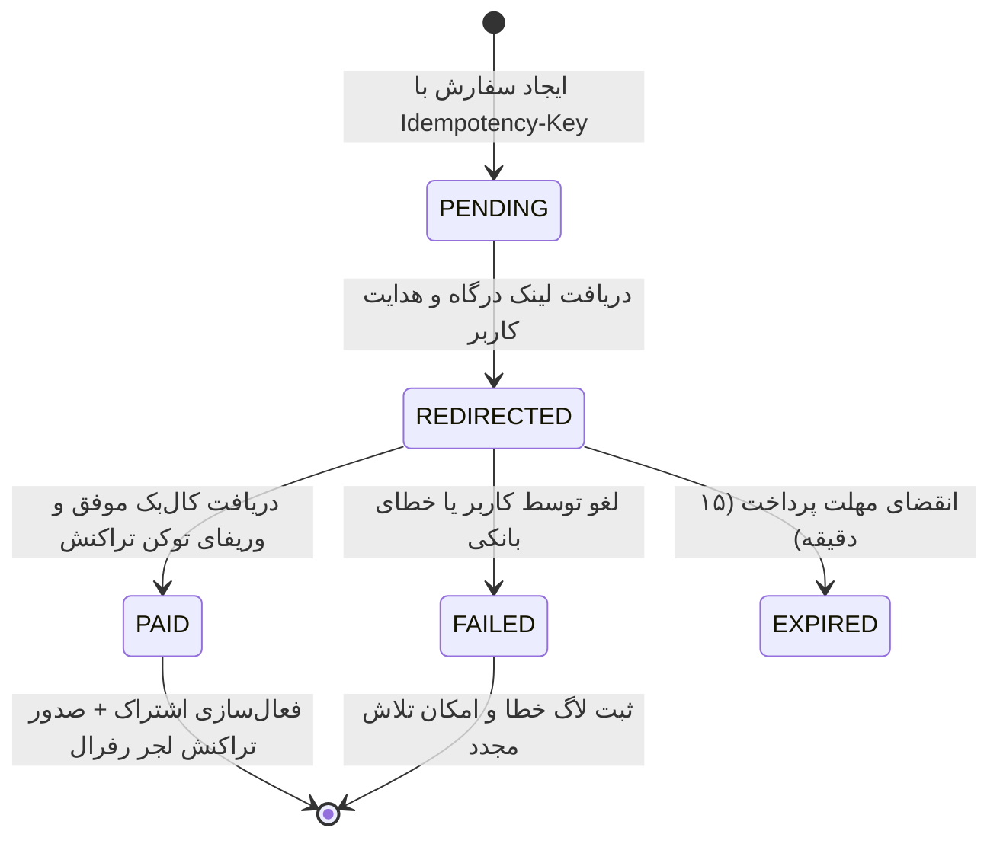

<div dir="rtl" align="right">

# مشخصات پلن‌های اشتراک، تسویه‌حساب و اسلات‌های رزرو پرداخت و نمادها (Subscriptions, Checkout & Payment Placeholders)

این سند مرجع بازطراحی بصری و ارتقای صفحه اشتراک‌ها (`/subscriptions`)، مستندسازی دقیق رفتار وضع موجود و تکامل صفحه تسویه‌حساب (`/checkout`) منطبق بر قاعده R12، طراحی لایه انتزاعی درگاه‌های پرداخت، و تدوین اسلات‌های رزرو گام بعدی برای درگاه‌های ریالی، کریپتو و نمادهای اعتماد بر اساس بندهای ۷.۶ و ۷.۱۴ پرامپت ارشد می‌باشد.

---

## ۱. سطوح ۴ گانه اشتراک و جدول مقایسه امکانات (Subscription Tiers & Comparison Table)

صفحه اشتراک‌ها (`frontend/src/app/subscriptions/page.tsx`) با وفاداری به ساختار سورس `sources/GameDr-Website-Source/website/public/pages/subscriptions.js` و تصویر `photo_2026-10-20_10-48-59.jpg` و با استایل نئونی `sources/figr-source/` پیاده‌سازی می‌گردد.

### ۱.۱. مشخصات سطوح ۴ گانه اشتراک

| سطح اشتراک | شناسه سیستمی | هزینه ماهانه (تومان) | سهمیه ترافیک دانلود | اولویت صف سرور | خدمات و دسترسی اختصاصی |
| :--- | :--- | :--- | :--- | :--- | :--- |
| **رایگان** | `free` | ۰ (رایگان) | ۰ گیگابایت | صف عادی | دسترسی نامحدود به بازی‌های لیست Free Plan، مقالات و ابزارها |
| **برنزی** | `bronze` | ۶۹۸,۰۰۰ | ۵۰۰ گیگابایت | صف استاندارد | دسترسی کامل به بازی‌های نسل ۸، لینک‌های مستقیم پرسرعت، پشتیبانی تیکتی |
| **نقره‌ای** | `silver` | ۱,۱۹۸,۰۰۰ | ۱,۰۲۴ گیگابایت (۱ ترابایت) | صف اولویت‌دار | کلیه بازی‌های PS4 و PS5، آپدیت‌های روزانه دیتا، پشتیبانی تلگرام |
| **طلایی** (پیشنهادی) | `gold` | ۲,۹۸۸,۰۰۰ | ۲,۲۵۲.۸ گیگابایت (۲.۲ ترابایت) | صف VIP بدون لیمیت | دسترسی اختصاصی به دیتای نایاب و زیرنویس‌های فارسی، پشتیبانی ۲۴ ساعته واتس‌اپ و تلفنی |

### ۱.۲. جدول تفصیلی مقایسه قابلیت‌ها (Feature Matrix)
جدول مقایسه‌ای زیر کارت‌ها، با ردیف‌های متناوب با پس‌زمینه شیشه‌ای و آیکون‌های وکتور `Check` (سبز نئونی) و `X` (خاکستری تیره) ویژگی‌های فنی را مقایسه می‌کند:
- حجم ترافیک ماهانه مجاز (۰ / ۵۰۰GB / 1TB / 2.2TB)
- تعداد دانلود همزمان مجاز (۱ / ۳ / ۵ / نامحدود)
- سرعت دانلود سرور (محدود / استاندارد / پرسرعت / حداکثر پهنای باند سرور اختصاصی)
- دسترسی به دیتای بازی‌های هک‌شده جیلبریک (تنها پلن‌های برنزی، نقره‌ای و طلایی)
- دسترسی به پچ‌های زیرنویس فارسی اختصاصی دکتر گیم (ویژه پلن‌های نقره‌ای و طلایی)
- اولویت در بررسی تیکت‌های پشتیبانی و خطاهای دیتا (عادی / ۱۲ ساعته / ۴ ساعته / آنی)

---

## ۲. مستندسازی رفتار جاری تسویه‌حساب و اعمال تغییرات (Rule R12: Checkout Flow Evolution)

### ۲.۱. مستندسازی رفتار دقیق وضع موجود در سورس کد (Current Behavior from Existing Code)
مطابق با بررسی سورس جاری در `frontend/src/app/checkout/page.tsx` و اندپوینت‌های بک‌اند در `backend/app/api/routes.py` (خطوط ۲۵۳ تا ۳۳۷):
۱. **انتخاب پلن:** کاربر با کلیک روی هر پلن در صفحه اشتراک‌ها، به آدرس `/checkout?plan=<plan_id>` منتقل می‌شود.
۲. **دریافت اطلاعات و قیمت پایه:** فرانت‌اند با فراخوانی `GET /api/plans` مشخصات پلن انتخاب‌شده (`basePrice`) را استخراج می‌کند.
۳. **انتخاب درگاه پرداخت:** کاربر یکی از دو درگاه رادیویی زرین‌پال (`zarinpal`) یا آی‌دی‌پی (`idpay`) را انتخاب می‌کند.
۴. **کد تخفیف:** کاربر می‌تواند کد تخفیف وارد کند؛ با ارسال درخواست `POST /api/discounts/validate` با بدنه `{ code, plan_id }`، پاسخ شامل درصد تخفیف (`discount_percent`) دریافت می‌شود.
۵. **تخفیف ولکام ۵٪ رفرال:** در صورتی که کاربر توسط فرد دیگری دعوت شده باشد (`user.referred_by_id != null`) و هنوز از تخفیف اولیه خود استفاده نکرده باشد (`!user.welcome_discount_used`)، تخفیف ۵ درصدی خوش‌آمدگویی به صورت خودکار اعمال می‌شود.
۶. **محاسبه داینامیک مبلغ نهایی:**
   - `discountAmount = Math.round((basePrice * discountPercent) / 100)`
   - `finalPrice = Math.max(0, basePrice - discountAmount)`
۷. **تکمیل خرید ماک (Mock Checkout):** با کلیک روی دکمه «پرداخت و فعال‌سازی»، درخواست `POST /api/subscriptions/checkout` ارسال می‌شود. بک‌اند یک رکورد در جدول `Order` با وضعیت `status="paid"` و حالت `payment_mode="mock"` ثبت کرده، فیلدهای `active_plan_id`، انقضای ۳۰ روزه (`plan_expires_at`) و سهمیه دانلود (`download_quota_bytes`) کاربر را در دیتابیس آپدیت نموده، یک رکورد در `QuotaLedger` اضافه کرده، و وب‌هویک رفرال را به سرویس داکر `POST http://referral:3000/api/events/purchase` مخابره می‌کند.

### ۲.۲. تغییرات و بهبودهای گام ۰۴ (What Changes & What is Kept)
- **موارد حفظ‌شده (KEEP):** مدل داده‌ای Order و QuotaLedger، قوانین محاسبه ۵٪ ولکام و اعمال کوپن، ارسال وب‌هویک به سرویس رفرال و فعال‌سازی ۳۰ روزه اشتراک دقیقاً حفظ می‌گردند.
- **موارد اصلاح‌شده (EDIT):** بازطراحی کامل استایل بصری صفحه تسویه‌حساب با توکن‌های شیشه‌ای و کارت‌های `figr-source`، نمایش تفکیک‌شده مالیات بر ارزش افزوده و تخفیف‌ها در فاکتور نئونی، و افزودن لایه امنیتی ماک (`OD-10`).
- **موارد افزوده‌شده (ADD):** پیاده‌سازی لایه انتزاعی ارائه‌دهندگان درگاه پرداخت (`PaymentProvider`) و اسلات‌های رزرو پرداخت رمزارز و نمادهای اعتماد.

---

## ۳. لایه انتزاعی درگاه‌های پرداخت (Payment Provider Abstraction Layer)

برای امکان اتصال بی‌دردسر درگاه‌های بانکی واقعی شاپرک و درگاه‌های ارز دیجیتال در مراحل بعدی، معماری درگاه‌ها بر مبنای اینترفیس زیر انتزاع می‌یابد:



```typescript
// backend/app/services/payment/base.py
export interface PaymentInitiationResult {
  paymentUrl: string;
  authority: string;
  trackingCode?: string;
}

export interface PaymentVerificationResult {
  success: boolean;
  refId: string;
  cardPanMasked?: string;
  amount: number;
}

export interface PaymentProvider {
  id: string; // 'zarinpal' | 'zibal' | 'nowpayments' | 'mock'
  initiatePayment(order: Order, callbackUrl: string): Promise<PaymentInitiationResult>;
  verifyCallback(params: Record<string, any>, order: Order): Promise<PaymentVerificationResult>;
}
```

> **فلگ امنیتی پرداخت آزمایشی (`OD-10`):** متغیر محیطی `ALLOW_MOCK_PAYMENTS=true` تنها در محیط توسعه (`NODE_ENV === 'development'`) معتبر است. در محیط پروداکشن، این فلگ به صورت پیش‌فرض غیرفعال (`false`) بوده و سیستم از انجام هرگونه پرداخت فرضی بدون اتصال به درگاه واقعی جلوگیری می‌کند.

---

## ۴. اسلات‌های رزرو برای گام بعدی (Placeholders for Next Step - بند ۷.۱۴)

در گام ۰۴، المان‌ها و کانتینرهای زیر در کد تعبیه شده و بدون ایجاد شکست بصری، آماده دریافت منطق گام بعدی هستند:

۱. **اسلات درگاه‌های پرداخت ریالی شتاب:**
   - کانتینر رادیویی شکیل با آیکون‌های رسمی درگاه‌های شاپرکی (زرین‌پال، زیبال، سداد).
   - ابعاد آیکون درگاه: `48x32` پیکسل با مرز `--border-light` و افکت درخشش هاور.
۲. **اسلات درگاه پرداخت بین‌المللی رمزارز (Crypto Payments):**
   - باکس رزرو اختصاصی با پشتیبانی از شبکه‌های تتر (USDT TRC20)، بیت‌کوین و اتریوم.
   - جایگاه تایمر معکوس ۱۵ دقیقه‌ای قفل نرخ ارز و فیلد آدرس کیف پول متنی به همراه QR Code با اندازه `180x180` پیکسل.
۳. **اسلات ای‌نماد و رسانه‌های دیجیتال در فوتر:**
   - کانتینر استاندارد با ابعاد ثابت `120x120` پیکسل با شناسه المان `#enamad-verification-slot` که در محیط توسعه یک پلیس‌هولدر با استایل گیمینگ محو با نشان ستاره‌های نماد اعتماد الکترونیکی نمایش می‌دهد و در پروداکشن اسکریپت رسمی روی آن سوار می‌شود.

</div>
