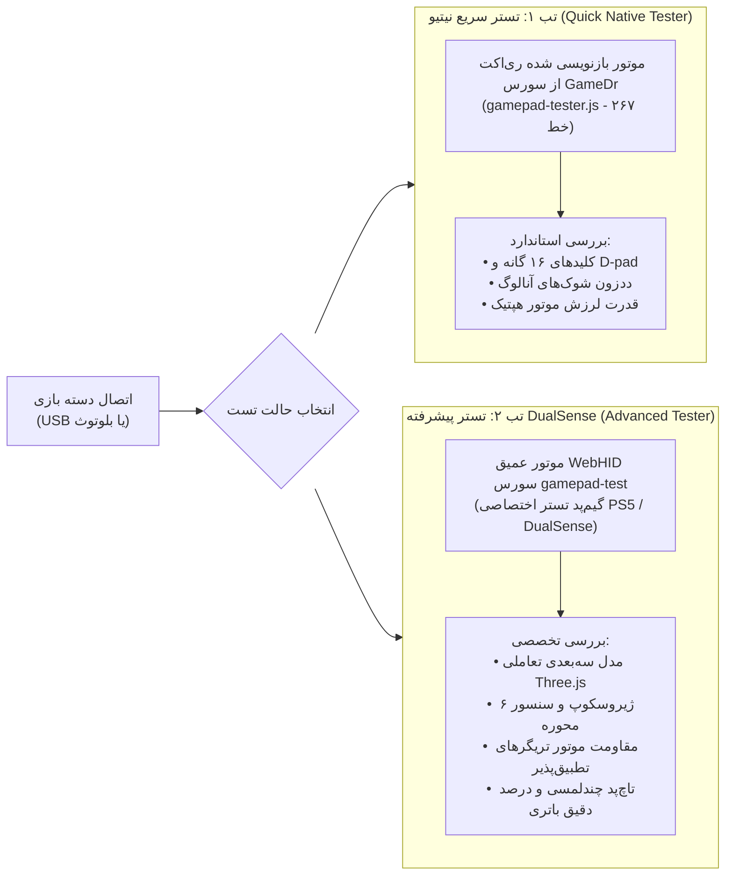

# مشخصات ابزارهای جیلبریک، تستر دوگانه گیم‌پد و بخش مقالات (Tools, Dual Gamepad Tester & Articles)

این سند مرجع پیاده‌سازی صفحه پایگاه جیلبریک (`/jailbreak`)، تستر دوگانه گیم‌پد (`/tools/gamepad`) با معماری مصوب A3، و بخش مقالات گیمینگ (`/articles`) با سایدبار فیلتر فیزیکی سمت راست را بر مبنای نیازمندی‌های بندهای ۷.۷ و ۷.۸ تدوین می‌نماید.

---

## ۱. پایگاه تخصصی جیلبریک و هک کنسول‌ها (Jailbreak Hub - `/jailbreak`)

صفحه مرجع جیلبریک بر مبنای سورس `sources/GameDr-Website-Source/website/public/jailbreak.html` و ماژول `jailbreak.js` پیاده‌سازی شده و خدمات زیر را ارائه می‌دهد:

### ۱.۱. ماتریس جامع سازگاری فریم‌ورک‌ها (Firmware Compatibility Matrix)
جدولی تعاملی از تمامی نگارش‌های فریم‌ورک کنسول‌های نسل هشتم و نهم سونی با قابلیت فیلتر سریع:

| پلتفرم | نسخه فریم‌ورک (Firmware) | وضعیت سازگاری هک | ابزار اکسپلویت | پایداری (Stability) | روش فعال‌سازی |
| :--- | :--- | :--- | :--- | :--- | :--- |
| **PS4** | `5.05` / `6.72` / `7.02` | پایدار و کامل | GoldHEN | ۱۰۰٪ (بسیار بالا) | مرورگر وب با وب‌کیت کش آفلاین |
| **PS4** | `9.00` | محبوب‌ترین نگارش | GoldHEN v2.4 | ۹۸٪ | وب‌کیت + فلش مموری اکسپلویت `exfathax` |
| **PS4** | `11.00` | فریم‌ورک‌های جدید | PPPwn C++ | ۹۰٪ | اتصال با کابل LAN و پکت‌های PPPoE |
| **PS5** | `3.00` تا `4.51` | اکسپلویت کامل کِرانچی | etaHEN / PS5-Kstuff | ۹۵٪ | اکسپلویت کِرنل IPv6 UMTX |
| **PS5** | `5.00` به بالا | در حال بررسی / ناسازگار | — | ۰٪ | غیرقابل جیلبریک در حال حاضر |

### ۱.۲. ارسال‌کننده پی‌لود تحت وب‌سوکت (WebSocket Payload Sender)
ابزار تعبیه‌شده در صفحه جهت ارسال مستقیم پی‌لودهای باینری (GoldHEN, Linux Loader, FTP Server, Dumpers) به کنسول متصل به شبکه محلی:
- کلاینت جاوااسکریپت با باز کردن سوکت TCP روی پورت `ws://<console_ip>:9020` یا `:9021`، فایل باینری انتخابی را استریم کرده و اعلان نتیجه ارسال (موفق یا خطا) را به صورت توست نئونی نمایش می‌دهد.

### ۱.۳. راهنمای تصویری آماده‌سازی فلش USB و جعبه کپی دی‌ان‌اس (DNS Setup Tutorial)
- **راهنمای گام‌به‌گام فلش مموری:** فرمت‌بندی با استاندارد exFAT، دانلود ایمیج `exfathax.img` و رایت روی درایو USB با ابزار Rufus یا Win32DiskImager.
- **جعبه تنظیم دی‌ان‌اس منطبق با نوار هدر:** باکسی متمایز با کادر زرد نئونی که آدرس‌های دی‌ان‌اس اختصاصی ضدآپدیت و ضدتحریم دکتر گیم را با دکمه‌های کپی تک‌کلیک در اختیار کاربر قرار می‌دهد:
  - دی‌ان‌اس اولیه: `178.22.122.100` (ضد ره‌گیری تله‌متری سونی و رفع فیلترینگ)
  - دی‌ان‌اس ثانویه: `185.51.200.2` (سرور پشتیبان با لیتنسی پایین)
  - راهنمای تنظیم در منوی کنسول: `Settings -> Network -> Set Up Internet Connection -> Custom -> DNS: Manual`.

---

## ۲. تستر جامع دوگانه گیم‌پد و کنترلرها (Dual Gamepad Tester - `/tools/gamepad`)

مطابق با تصمیم تأییدشده **A3**، صفحه تست دسته در مسیر `frontend/src/app/tools/gamepad/page.tsx` به صورت یک هاب دو زبانه (دو تب مجزا) با استایل مدرن و توکن‌های بصری `sources/figr-source/styles.css` بازطراحی و پیاده‌سازی می‌گردد.

### ۲.۱. تب ۱: تستر سریع نیتیو (Quick Tester - بر پایه سورس GameDr)
- **منبع کد:** بازنویسی کامل و بدون وابستگی کد ۲۶۷ خطی `sources/GameDr-Website-Source/website/public/pages/gamepad-tester.js` به صورت کامپوننت React/TypeScript.
- **امکانات:**
  - تشخیص آنی از طریق Gamepad API مرورگر (Vendor ID, Product ID, نوع کنترلر).
  - نمایش بصری و آنی فشرده‌شدن دکمه‌های ۱۶ گانه با تغییر رنگ نئونی فیروزه‌ای/نارنجی.
  - نمایش موقعیت دقیق شوک‌های آنالوگ چپ و راست در کادر دایره‌ای با بردار حرکتی و اندازه‌گیری دقیق دریفت (Drift Testing) و محدوده خطای مرکز (Deadzone Error Percentage).
  - سنجش فشار تریگرهای آنالوگ L2 و R2 از مقدار `0.0` تا `1.0`.
  - اجرای تست ویبره موتورهای رامبل چپ و راست با الگوهای پالسی متفاوت.

### ۲.۲. تب ۲: تستر پیشرفته DualSense و WebHID (بر پایه سورس `gamepad-test`)
- **منبع کد و استایل:** برگرفته از منطق و کدهای فیزیکی `sources/gamepad-test/` (شامل پوشه سورس `sources/gamapad-test/GameDr/rep/gamepad/`، اسکریپت `gamepad-repatch.py` و فایل‌های Three.js/Pixi.js).
- **بازطراحی بصری ۱۰۰٪ با توکن‌های `figr-source`:** تمامی رنگ‌های قدیمی سورس و پوسته‌های سبز و مشکی حذف شده و با متغیرهای نئونی `--bg-card`، `--accent-cyan` و کادرهای شیشه‌ای پلتفرم دکتر گیم یکپارچه می‌شوند.
- **قابلیت‌های پیشرفته WebHID:**
  - خواندن داده‌های خام فریم‌ورک DualSense مستقیماً از طریق رابط WebHID مرورگر.
  - نمایش مدل سه‌بعدی کنترلر که متناسب با حرکات ژیروسکوپ و شتاب‌سنج (IMU) در دست کاربر می‌چرخد.
  - کالیبراسیون و ارسال دستورات شبیه‌سازی مقاومت فیزیکی به تریگرهای تطبیق‌پذیر (Adaptive Triggers Force Simulation).
  - صفحه لمسی تاچ‌پد با قابلیت ردگیری دو انگشت همزمان (Multi-touch Canvas).
  - نمایش دقیق درصد شارژ باتری و وضعیت جک صوتی ۳.۵ میلی‌متری.

---

## ۳. بخش مقالات و اخبار دنیای گیم (Gaming Articles & Blog)

بخش مقالات در دو صفحه فهرست (`frontend/src/app/articles/page.tsx`) و صفحه اختصاصی مطالعه مقاله (`frontend/src/app/articles/[slug]/page.tsx`) پیاده‌سازی می‌گردد.

### ۳.۱. سیاست چیدمان سایدبار مقالات (Right Sidebar Layout)
مطابق با الزامات سخت‌گیرانه بند ۷.۸ و سیاست چیدمان فیزیکی ثابت (Section 6.1)، سایدبار دسته‌بندی مقالات **در تمامی زبان‌ها (حتی زبان‌های LTR نظیر انگلیسی)** به صورت ثابت در **سمت راست فیزیکی (Physical Right)** قرار می‌گیرد:
- **عرض سایدبار راست:** `300px` ثابت.
- **محتویات سایدبار راست فیزیکی:**
  ۱. جعبه جستجوی مقالات و اخبار.
  ۲. لیست دسته‌بندی‌های موضوعی با نشان تعداد مقالات:
     - `اخبار دنیای گیم` (Gaming News)
     - `راهنما و ترفندهای کنسول` (Console Guides & Tips)
     - `آموزش‌های تخصصی جیلبریک` (Jailbreak Tutorials)
     - `نقد و بررسی تخصصی بازی‌ها` (Game Reviews)
     - `سخت‌افزار و لوازم جانبی` (Hardware & Accessories)
  ۳. ابر برچسب‌های پربازدید (Popular Tags Cloud) نظیر `#PS5_Pro`، `#GoldHEN`، `#DualSense`، `#GTA_VI`.
  ۴. داغ‌ترین مقالات هفته (Most Read Articles) با تصاویر بندانگشتی و تاریخ انتشار.

### ۳.۲. صفحه اختصاصی مطالعه مقاله (`/articles/[slug]`)
- هدر مقاله شامل تگ موضوعی، تاریخ انتشار شمسی/میلادی، نویسنده، و بج زمان تخمینی مطالعه (مانند «مطالعه در ۶ دقیقه»).
- تصویر اصلی شاخص با نسبت `16:9` و افکت هاله نئونی در پس‌زمینه.
- بدنه متن مقاله با تایپوگرافی چشم‌نواز Vazirmatn، هدینگ‌های پرکنتراست، کدهای اسکریپت با هایلایت نحوی و جداول مقایسه‌ای.
- کاروسل انتهای مقاله: «مقالات و راهنماهای مرتبط».

