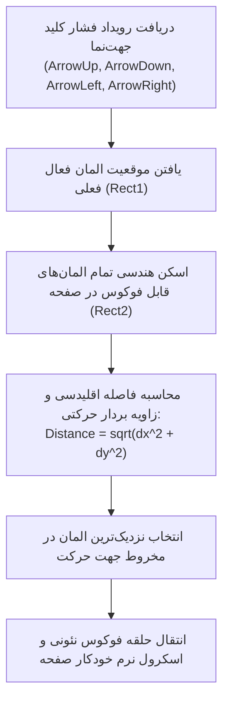

<div dir="rtl" align="right">

# مشخصات حالت اختصاصی کنسول پلی‌استیشن و ناوبری ۱۰ فوتی (PlayStation 10-Foot Mode & Spatial Navigation)

این سند مرجع پیاده‌سازی تجربه کاربری ۱۰ فوتی اختصاصی تلویزیون (10-Foot TV Experience) و موتور ناوبری فضایی با دسته کنسول‌های PlayStation 4 و PlayStation 5 را بر اساس بند ۷.۱۱ پرامپت ارشد تدوین می‌نماید.

---

## ۱. تشخیص خودکار و سوییچ دستی حالت کنسول (Auto-Detection & Manual Switch)

پلتفرم دکتر گیم به گونه‌ای مهندسی شده است که هنگام باز شدن در مرورگر کنسول‌های سونی، به صورت بلادرنگ به حالت تلویزیونی تغییر ماهیت دهد.

### ۱.۱. رجکس تشخیص User-Agent کنسول‌های نسل ۸ و ۹ سونی
مطابق با سورس `sources/GameDr-Website-Source/website/public/wallet.js` (خط ۲۹۸)، الگوهای رسمی مرورگر وب‌کیت پلی‌استیشن اعتبارسنجی می‌شوند:

```typescript
// regex تشخیص قطعی کنسول‌های سونی
export const PS_CONSOLE_UA_REGEX = /PlayStation\s*(?:;\s*PlayStation)?\s*(5|4)[\/ ]?([\d.-]*)/i;

export function isPlayStationBrowser(userAgent: string): { isPS: boolean; version?: 'PS4' | 'PS5' } {
  const match = userAgent.match(PS_CONSOLE_UA_REGEX);
  if (!match) return { isPS: false };
  return { isPS: true, version: match[1] === '5' ? 'PS5' : 'PS4' };
}
```

*نمونه رشته‌های UA واقعی ثبت‌شده:*
- **PlayStation 5:** `Mozilla/5.0 (PlayStation; PlayStation 5/2.26) AppleWebKit/605.1.15 (KHTML, like Gecko) Version/13.0 Safari/605.1.15`
- **PlayStation 4:** `Mozilla/5.0 (PlayStation 4 9.00) AppleWebKit/605.1.15 (KHTML, like Gecko)`

### ۱.۲. قابلیت سوئیچ دستی (`OD-11`)
یک کلید دیسکریت در منوی دسترسی سریع یا فوتر با برچسب «حالت کنسول (10-Foot Mode)» تعبیه می‌شود که به کاربر اجازه می‌دهد روی کامپیوتر یا تلویزیون هوشمند نیز این رابط را دستی فعال کند. وضعیت در کوکی `ps_mode_forced=true` ثبت می‌گردد.

---

## ۲. توکن‌های لایه نمایش ۱۰ فوتی تلویزیون (10-Foot UI Tokens)

هنگامی که کلاس `playstation-mode` به تگ `<html>` تزریق می‌شود، متغیرهای بصری زیر فعال می‌گردند:

| توکن / تنظیم بصری | مقدار در حالت وب عادی | مقدار در حالت کنسول (PS Mode) | هدف و ضرورت |
| :--- | :--- | :--- | :--- |
| **ضریب مقیاس فونت (Font Scale)** | `1.0` (پایه 16px) | `1.25x` (پایه 20px، عناوین تا 36px) | خوانایی بی‌نقص متون از فاصله ۲.۵ تا ۴ متری تلویزیون |
| **حاشیه امن تصویر (Overscan Padding)** | `0px` | `padding: 4.5vh 5vw;` | جلوگیری از بریده‌شدن لبه‌های صفحه در تلویزیون‌های قدیمی بدون Just Scan |
| **حلقه فوکوس نئونی (Focus Ring)** | `2px solid transparent` | `3px solid #ff5722` با هاله `0 0 20px rgba(255,87,34,0.6)` | تشخیص آنی و چشمگیر المان دارای فوکوس در صفحه |
| **کرسر ماوس (Mouse Cursor)** | `cursor: auto;` | `cursor: none !important;` | پنهان‌سازی نشانگر مجازی ماوس کنسول و اتکای ۱۰۰٪ به فوکوس |
| **کاهش لگ انیمیشن** | انیمیشن‌های سنگین | تقلیل ترنزیشن‌ها به `120ms` | سازگاری با پردازش سبک‌تر مرورگر وب‌کیت کنسول |

---

## ۳. موتور ناوبری فضایی دسته و مدیریت فوکوس (Spatial Navigation Engine)

ناوبری در حالت کنسول بدون اشاره‌گر ماوس و کاملاً توسط کلیدهای جهتی (D-Pad) و آنالوگ دسته انجام می‌شود.



### اصول کلیدی موتور ناوبری:
۱. **تله فوکوس در مودال‌ها (Focus Trap):** با باز شدن هر پنجره پاپ‌آپ، مودال، یا سایدبار فیلتر، کلیدهای جهتی در داخل همان محفظه قفل شده و از پرش ناخواسته فوکوس به لایه‌های زیرین جلوگیری می‌شود.
۲. **تعامل با کارت بازی:**
   - با قرارگیری فوکوس روی هر کارت بازی به مدت `400ms` (یا فشردن کلید `△`)، پیش‌نمایش ویدیویی تریلر/اسکرین‌شات به صورت خودکار لود می‌شود.
   - فشردن دکمه `✕` روی کارت مستقیماً صفحه جزئیات بازی را باز می‌کند.
۳. **رفتار اختصاصی دکمه دانلود:** در صفحه جزئیات بازی، با فوکوس روی دکمه «دانلود بازی» و زدن کلید `✕`، صفحه به صورت خودکار به بخش فایل‌ها اسکرول شده و فوکوس به اولین پارت دانلود منتقل می‌شود.

---

## ۴. نوار راهنمای نمادهای دسته (Docked Action Bar) و جدول کلیدهای صفحات

در پایین صفحه نمایش تلویزیون، یک نوار باریک شیشه‌ای شامل گلیف‌های برداری SVG اختصاصی قرار دارد که عملکردهای جاری را به کاربر یادآوری می‌کند:

```
[ ✕ انتخاب ]    [ ○ بازگشت ]    [ □ فیلترها / جستجو ]    [ △ پیش‌نمایش ویدیو ]    [ L1 / R1 تغییر تب ]    [ OPTIONS منو ]
```

### ۴.۱. جدول نگاشت عملکرد کلیدهای دسته در صفحات مختلف (Per-Page Controller Action Map)

| صفحه / مسیر | کلید `✕` (Cross) | کلید `○` (Circle) | کلید `□` (Square) | کلید `△` (Triangle) | کلیدهای `L1` / `R1` | کلید `OPTIONS` |
| :--- | :--- | :--- | :--- | :--- | :--- | :--- |
| **صفحه اصلی (`/`)** | ورود به بازی انتخابی / دکمه | خروج از مودال فعال | فوکوس فوری روی نوار سرچ هدر | پیش‌نمایش تریلر بازی فوکوس‌شده | پرش بین ریل‌های افقی محتوا | باز کردن منوی همبرگری هدر |
| **فروشگاه (`/shop`)** | باز کردن بازی / انتخاب فیلتر | پاکسازی آخرین فیلتر | باز و بسته کردن سایدبار فیلتر چپ | پیش‌نمایش هاور کارت بازی | حرکت سریع بین صفحات صفحه‌بندی | تغییر نحوه مرتب‌سازی کاتالوگ |
| **جزئیات بازی (`/shop/[slug]`)** | اسکرول به دانلود / پخش مدیا | بازگشت به فروشگاه | باز کردن فرم گزارش خرابی | پخش تمام‌صفحه تریلر رسمی | سوییچ بین ۳ کارت مشخصات سونی | افزودن/حذف از لیست علاقه‌مندی |
| **اشتراک‌ها (`/subscriptions`)** | انتخاب و ورود به تسویه | بازگشت به صفحه قبل | فوکوس روی جدول مقایسه امکانات | — | حرکت بین ۴ کارت اشتراک | راهنمای ترافیک و سهمیه |
| **تسویه‌حساب (`/checkout`)** | تایید پرداخت و درگاه | لغو و بازگشت به سبد | فوکوس روی فیلد کد تخفیف | مشاهده جزئیات فاکتور | تغییر درگاه پرداختی انتخابی | شرایط و قوانین خرید |
| **پایگاه جیلبریک (`/jailbreak`)** | تست و ارسال وب‌سوکت پی‌لود | بازگشت | فیلتر سریع نسخه فریم‌ورک | کپی آدرس DNS اختصاصی | پرش بین تب‌های راهنما | دانلود پکیج فلش اکسپلویت |
| **تستر گیم‌پد (`/tools/gamepad`)** | تست دکمه و تایید ویبره | خروج از ابزار | کالیبراسیون مجدد کنترلر | سوئیچ به حالت تستر پیشرفته | سوییچ بین دو تب تستر سریع/پیشرفته | صفر کردن ددزون شوک‌ها |
| **مقالات (`/articles`)** | باز کردن مقاله فوکوس‌شده | بازگشت | فوکوس روی سایدبار دسته‌بندی راست | — | پرش به صفحه بعد مقالات | اشتراک‌گذاری لینک مقاله |
| **پنل کاربری (`/panel`)** | انتخاب عملیات و ثبت فرم | بازگشت | کپی کد معرف رفرال | انتخاب آواتار کاراکتر | جابجایی بین ۷ تب سایدبار پنل | خروج از حساب کاربری |

</div>
