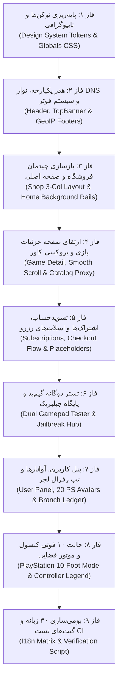

<div dir="rtl" align="right">

# دستورالعمل جامع اجرایی و راهنمای پیاده‌سازی گام ۰۴ (Step 04 Implementation Instructions)

این سند نقشه راه و راهنمای عملیاتی قطعی برای توسعه‌دهنده (یا ایجنت هوش مصنوعی بعدی) جهت پیاده‌سازی تغییرات گام ۰۴ است. هرگونه ویرایش، ایجاد، حذف و تثبیت کد در مخزن باید دقیقاً بر مبنای شناسه‌های یکتا و مراحل تدوین‌شده در این سند صورت پذیرد.

---

## ۱. ترتیب و وابستگی مراحل اجرایی (Execution Dependency Order)



---

## ۲. سیاهه آیتم‌های افزودنی (ADD Inventory)

### `ADD-TOKENS-01`
- **مسیر هدف:** `frontend/src/app/globals.css`
- **شرح تغییر:** افزودن تمامی متغیرهای رنگی، پس‌زمینه‌ها، نئون‌ها و فواصل استخراج‌شده از `sources/figr-source/styles.css` (`--bg-primary: #0f1016`، `--bg-card: #181a27`، `--accent-orange: #ff5722` و غیره).
- **روش اجرا:** درج بلوک `:root` در بالای فایل `globals.css` به همراه کلاس‌های کمکی درخشش نئونی و پترن پس‌زمینه گیم‌دکتر.
- **تایید:** کامپایل فرانت‌اند و اعمال متغیرها در متغیرهای CSS مرورگر.

### `ADD-DNS-01`
- **مسیر هدف:** `frontend/src/components/TopBanner.tsx`
- **شرح تغییر:** پیاده‌سازی کامپوننت نوار هشدار نئونی زرد DNS در بالای هدر شامل نمایشگر IPهای `178.22.122.100` و `185.51.200.2`، دکمه‌های کپی تک‌کلیک و کلید بستن با ذخیره در `sessionStorage`.
- **روش اجرا:** استفاده از آیکون `ShieldAlert` و ایجاد ترنزیشن ناپدید شدن.

### `ADD-GEO-01`
- **مسیر هدف:** `frontend/src/middleware.ts`
- **شرح تغییر:** ایجاد میدلور سرور جهت استخراج کشور کاربر از هدرهای اتصال (`CF-Connecting-IP` / `X-Real-IP`) و پشتیبانی از پارامتر تست `?footer_variant=iran|intl`.
- **روش اجرا:** خواندن هدر و تزریق `x-user-country: IR` به هدرهای درخواست صفحه.

### `ADD-FTR-01`
- **مسیر هدف:** `frontend/src/components/FooterSelector.tsx` و `frontend/src/components/IranFooter.tsx` و `IntlFooter.tsx`
- **شرح تغییر:** تفکیک سرورساید فوتر به دو قالب مجزای ایران (شامل ای‌نماد و درگاه‌ها) و بین‌المللی (شامل کنسول‌ها و کردیت‌کارت‌ها).
- **روش اجرا:** کامپوننت سروری که هدر `x-user-country` را بررسی و فوتر مناسب را بدون فلیکر کلاینت رندر می‌کند.

### `ADD-HME-01`
- **مسیر هدف:** `frontend/src/components/HomeReferralSummary.tsx`
- **شرح تغییر:** ایجاد کارت متمایز خلاصه وضعیت رفرال و درآمد در بالاترین بخش صفحه اصلی برای کاربران لاگین‌شده.
- **روش اجرا:** استعلام از وب‌سرویس رفرال و نمایش موجودی قابل برداشت و لینک دعوت.

### `ADD-HME-02`
- **مسیر هدف:** `frontend/src/components/HomeBannerSlots.tsx`
- **شرح تغییر:** ایجاد دو اسلات بنر افقی پیش از بخش بازی‌ها (اسلات ۱ ثابت برای جیلبریک، اسلات ۲ پویا برای ادمین).

### `ADD-SHP-02`
- **مسیر هدف:** `frontend/src/components/ShopFiltersSidebar.tsx` و `ShopRightSidebar.tsx`
- **شرح تغییر:** ساخت سایدبار چپ فیلترهای پیشرفته (پلتفرم‌ها، ژانرها، وضعیت و اسلایدر امتیاز) و سایدبار راست اطلاعاتی بر مبنای `games.jpg`.

### `ADD-GDT-02`
- **مسیر هدف:** `frontend/src/components/PlayStationFeatureCards.tsx`
- **شرح تغییر:** پیاده‌سازی ۳ کارت اطلاعاتی بازی (داستان، ویژگی‌های دوئل‌سنس و مشخصات استودیو).

### `ADD-CAT-01`
- **مسیر هدف:** `backend/app/services/scraper/catalog_service.py` و `frontend/src/app/api/cover/route.ts`
- **شرح تغییر:** پیاده‌سازی موتور استخراج داده از استور سونی و استیم و ایجاد اندپوینت بهینه‌سازی و کَش کاورها با کتابخانه Sharp.

### `ADD-PLC-01`
- **مسیر هدف:** `frontend/src/components/PaymentPlaceholders.tsx`
- **شرح تغییر:** ایجاد کانتینرهای رزرو استاندارد برای درگاه‌های ریالی، درگاه کریپتو با شمارنده، و ای‌نماد فوتر.

### `ADD-JLB-01`
- **مسیر هدف:** `frontend/src/components/JailbreakPayloadSender.tsx`
- **شرح تغییر:** کامپوننت وب‌سوکت ارسال پی‌لود به پورت‌های ۹۰۲۰ و ۹۰۲۱ کنسول در شبکه محلی به همراه جعبه دی‌ان‌اس هماهنگ با هدر.

### `ADD-GPD-02`
- **مسیر هدف:** `frontend/src/components/AdvancedDualSenseTester.tsx`
- **شرح تغییر:** انتقال و مدرن‌سازی لاجیک WebHID و سه‌بعدی سورس `gamepad-test` با پالت رنگی `figr-source`.

### `ADD-USR-REF`
- **مسیر هدف:** `frontend/src/components/panel/ReferralTab.tsx`
- **شرح تغییر:** پیاده‌سازی تب هفتم پنل کاربری منطبق بر Branch Ledger شامل کارت‌های موجودی، جدول سطوح و فرم درخواست تسویه شبا.

### `ADD-PSM-01`
- **مسیر هدف:** `frontend/src/components/PlayStationModeProvider.tsx` و `PlayStationGlyph.tsx`
- **شرح تغییر:** توسعه موتور ناوبری فضایی ۱۰ فوتی، تشخیص اتوماتیک UA کنسول سونی و نوار اکشن پایین صفحه.

### `ADD-I18-01`
- **مسیر هدف:** `scripts/verify-i18n.js` و ترجمه‌های اولیه موج اول در `frontend/src/locales/`
- **شرح تغییر:** اسکریپت تست عدم وجود کلید مفقوده در فایل‌های چندزبانه و افزودن آلمانی و فرانسوی به زبان‌های موجود.

---

## ۳. سیاهه آیتم‌های اصلاحی (EDIT Inventory)

### `EDIT-HDR-01`
- **مسیر هدف:** `frontend/src/components/Header.tsx`
- **شرح تغییر:** بازطراحی هدر با پس‌زمینه شیشه‌ای تیره سورمه‌ای، ارتفاع ۷۰ پیکسل، و چیدمان ۸ گانه فیزیکی چپ‌به‌راست (شامل لوگو، بازی‌ها، ابزارها، مقالات، اشتراک فعال، اعلان‌ها، سبد خرید با تولتیپ «به‌زودی» و پروفایل کاربر).
- **لنگر کد قبل:** هدر ساده پیشین با چیدمان دینامیک.
- **لنگر کد بعد:** استراکچر منعطف با کلاس‌های فیزیکی مشخص و کنترل وضعیت اشتراک فعال کاربر.

### `EDIT-SHP-01`
- **مسیر هدف:** `frontend/src/app/shop/page.tsx`
- **شرح تغییر:** تبدیل صفحه به چیدمان ۳ ستونه فیزیکی: فیلترها در سمت چپ فیزیکی (`280px`)، کاتالوگ ۳ کارته در وسط (`1fr`)، و سایدبار برترین‌ها در سمت راست (`300px`) با ثبات موقعیت در تمام زبان‌ها.

### `EDIT-GDT-01`
- **مسیر هدف:** `frontend/src/app/shop/[slug]/page.tsx`
- **شرح تغییر:** افزودن اکشن اسکرول نرم (`smooth scroll`) به دکمه دانلود هیرو با هدایت به `#game-files-section` و انتقال فوکوس به اولین دکمه دانلود، همراه با افکت هاله رنگی نئونی پس‌زمینه.

### `EDIT-SUB-01`
- **مسیر هدف:** `frontend/src/app/subscriptions/page.tsx`
- **شرح تغییر:** اعمال پالت نئونی `figr-source` روی کارت‌های ۴ سطح اشتراک و ایجاد جدول تفصیلی مقایسه قابلیت‌ها منطبق با تصویر `10-48-59.jpg`.

### `EDIT-CHK-01`
- **مسیر هدف:** `frontend/src/app/checkout/page.tsx`
- **شرح تغییر:** حفظ منطق قیمت‌گذاری و رفرال ۵٪ و کدهای تخفیف، و بازطراحی ظاهر فرم تسویه‌حساب با استایل نئونی و افزودن محدودیت ایمنی پرداخت ماک (`OD-10`).

### `EDIT-GPD-01`
- **مسیر هدف:** `frontend/src/app/tools/gamepad/page.tsx`
- **شرح تغییر:** تبدیل صفحه تست دسته به دو تب تعاملی: تب تستر سریع (ری‌اکت نیتیو) و تب تستر پیشرفته DualSense (طراحی نو با `figr-source`).

### `EDIT-ART-01`
- **مسیر هدف:** `frontend/src/app/articles/page.tsx`
- **شرح تغییر:** تثبیت سایدبار فیلتر دسته‌بندی مقالات در سمت راست فیزیکی صفحه در تمامی زبان‌ها و به‌روزرسانی کارت مقالات با متغیرهای نئونی.

### `EDIT-USR-01`
- **مسیر هدف:** `frontend/src/app/panel/page.tsx`
- **شرح تغییر:** افزودن بنر کاور بالای پروفایل، مودال انتخاب ۲۰ آواتار کاراکترهای کنسول، و تب هفتم رفرال لجر.

### `EDIT-ADM-01`
- **مسیر هدف:** `frontend/src/app/admin/page.tsx`
- **شرح تغییر:** تکمیل ماژول‌های ادمین شامل تنظیمات نوار زرد DNS، مدیریت اسلات بنر ۲، تایید تسویه‌های رفرال شبا و مسدودسازی دسترسی در مرورگر کنسول.

---

## ۴. سیاهه آیتم‌های حذفی (REMOVE Inventory)

### `REMOVE-LEGACY-01`
- **مسیر هدف:** `frontend/src/app/globals.css` و استایل‌های درون‌خطی
- **شرح تغییر:** حذف استایل‌ها و رنگ‌های سبز قدیمی سورس تست دسته و کدهای CSS متفرقه ناهماهنگ با تم نئونی تاریک `sources/figr-source/styles.css`.

### `REMOVE-DIRECT-CDN-01`
- **مسیر هدف:** کامپوننت‌های فرانت‌اند
- **شرح تغییر:** حذف لود مستقیم تصاویر کاور از دامنه‌های مسدود سونی و جایگزینی ۱۰۰ درصدی با مسیر داخلی کَش و پردازش تصویر `/api/cover?url=...`.

---

## ۵. سیاهه آیتم‌های تثبیت‌شده و حفظ‌شونده (KEEP Inventory)

### `KEEP-CORE-MODELS-01`
- **مسیر هدف:** `backend/app/models/entities.py`
- **شرح تثبیت:** ساختار و روابط ۱۲ جدول اصلی دیتابیس (User, Game, GameFile, SubscriptionPlan, DiscountCode, Order, Purchase, QuotaLedger, JailbreakRow, Article, Ticket, SiteSetting) بدون تخریب حفظ شده و فیلدهای لازم بدون تداخل افزوده می‌شوند.

### `KEEP-REFERRAL-DOCKER-01`
- **مسیر هدف:** `sources/referral-management-app-docker/` و سرویس پورت `:3000`
- **شرح تثبیت:** منطق رفرال لجر شاخه‌ای v1.4.1، قوانین سهم ۲۱٪، وب‌هویک رخدادهای خرید و ساختار محاسبه دیتابیس رفرال دقیقاً طبق قرارداد تثبیت شده باقی می‌ماند.

### `KEEP-AUTH-SECURITY-01`
- **مسیر هدف:** `backend/app/services/auth.py` و `frontend/src/lib/auth-context.tsx`
- **شرح تثبیت:** سشن‌های JWT امن و تفکیک هویتی کاربران عادی از نشست‌های مدیران سامانه حفظ می‌گردد.

---

## ۶. اقدامات اعتبارسنجی و دستورالعمل بازگشت به عقب (Verification & Rollback)

- **دستور اعتبارسنجی ساخت فرانت‌اند:**
  ```bash
  cd frontend && npm run build
  ```
- **دستور اجرای گیت صحت ترجمه‌های چندزبانه:**
  ```bash
  node scripts/verify-i18n.js
  ```
- **تست سلامت سرویس‌های داکر:**
  ```bash
  docker compose ps
  ```
- **رویه بازگشت به عقب (Rollback Procedure):** در صورت بروز خطا در مرحله کامپایل یا شکست تست‌های بصری، تمامی تغییرات اعمال‌شده در هر فاز از طریق گیت ریورت شده و فایل‌های قبل از اعمال با برچسب شاخه حفظ می‌گردند.

</div>
