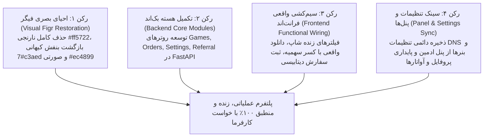

# سند چشم‌انداز، اهداف و نقشه راه گام ۰۵ (Step 05 Overview & Master Roadmap)
**پروژه:** وب‌سایت فروشگاهی و پلتفرم دانلود دیتای بازی‌های کنسولی دکتر گیم (DrGame-Ecommerce)  
**عنوان گام:** **احیای کامل هویت بصری فیگر و تبدیل ماک‌های نمایشی به سامانه واقعی، متصل و عملیاتی**  
**مسیر مستندات:** `agent/step-05-full-functional-wiring-and-figr-restoration/`

---

## ۱. هدف و چرایی گام ۰۵ (Purpose & Rationale)

در گام ۰۴، حجم وسیعی از پوسته‌های گرافیکی و کدهای فرانت‌اند با موفقیت بیلد شدند، اما ممیزی عمیق پروژه (گزارش `reports/04.md`) آشکار کرد که:
1. **هویت بصری فیگر مخدوش شده بود:** رنگ اصلی سایت با یک توهم فنی به نارنجی (`#ff5722`) تغییر یافته بود، در حالی که هویت بصری تاییدشده فیگر، **بنفش کیهانی (`#7c3aed`) و نئون صورتی (`#ec4899`) بر بستر تاریک OLED (`#070709`)** است.
2. **بیش از ۵۵٪ قابلیت‌ها صرفاً نمایشی (Mock) بودند:**
   - فیلترهای پیشرفته فروشگاه هیچ اتصالی به صفحه نداشتند و کلیک روی آن‌ها هیچ تاثیری روی لیست بازی‌ها نداشت.
   - دکمه‌های دانلود بازی‌ها فاقد رویداد کلیک یا تولید لینک دانلود بودند و پارت‌ها استاتیک بودند.
   - تسویه‌حساب سفارش‌ها فقط با یک تایمر ۱.۲ ثانیه‌ای شبیه‌سازی می‌شد و هیچ سفارشی در دیتابیس ثبت نمی‌شد و سهمیه‌ای افزوده نمی‌گردید.
   - تنظیمات بنر و DNS در پنل ادمین و فرم تسویه رفرال شبا در پنل کاربری در هیچ دیتابیسی ذخیره نمی‌شدند.
   - بک‌اند تنها دارای ماژول‌های احراز هویت و سهمیه بود و هیچ روتری برای بازی‌ها، سفارش‌ها یا تنظیمات سایت نداشت.

> **ماموریت گام ۰۵:** تبدیل پلتفرم از یک «پوسته نمایشی زیبا» به یک «سامانه زنده، پویا، متصل به دیتابیس، کاملاً کاربردی و از نظر بصری ۱۰۰٪ وفادار به طراحی فیگر».

---

## ۲. ارکان چهارگانه تحول در گام ۰۵ (The Four Pillars)

---

## ۳. نقشه ساختار مستندات گام ۰۵ (Documentation Suite Map)

مستندات گام ۰۵ به شرح زیر تفکیک و تدوین شده‌اند:

| شماره سند | نام فایل | محتوا و رسالت سند |
| :---: | :--- | :--- |
| **۰۰** | `00-overview.md` | سند حاضر؛ چشم‌انداز، تحلیل وضع موجود، اهداف و نقشه راه کلی |
| **۰۱** | `01-figr-visual-restoration-and-tokens.md` | سیستم طراحی، اصلاح توکن‌های CSS و Tailwind، استایل گلیف‌ها و بازگشت بنفش کیهانی |
| **۰۲** | `02-backend-api-architecture.md` | معماری دیتابیس و اندپوینت‌های FastAPI برای بازی‌ها، سفارشات، تنظیمات و رفرال |
| **۰۳** | `03-shop-filtering-and-download-engine.md` | اتصال دوسویه فیلترهای فروشگاه، واکشی زنده بازی‌ها و انجین دانلود و کسر ترافیک |
| **۰۴** | `04-checkout-flow-and-database-orders.md` | اعتبارسنجی کدهای تخفیف از دیتابیس، ثبت سفارش واقعی و شارژ آنی سهمیه کاربر |
| **۰۵** | `05-site-settings-and-admin-sync.md` | سیستم ذخیره پویا و خواندن زنده نوار زرد DNS و اسلات بنر ۲ میان ادمین و کلاینت |
| **۰۶** | `06-user-panel-and-referral-ledger.md` | ذخیره دائمی مشخصات و آواتار پروفایل و اتصال فرم تسویه شبا به لجر مالی |
| **—** | `instructions.md` | دستورالعمل دقیق اجرایی شامل سیاهه کامل آیتم‌های ADD / EDIT / REMOVE / KEEP |
| **—** | `tasks.md` | سیاهه تسک‌های فازبندی‌شده با گیت‌های تست و شرایط قبولی (Acceptance Gates) |

---

## ۴. ترتیب اولویت اجرایی گام ۰۵ (Execution Phasing)

1. **فاز ۱ (پایه بصری):** اصلاح `globals.css` و `tailwind.config.ts` و حذف تمامی کلاس‌های نارنجی.
2. **فاز ۲ (ماژول‌های بک‌اند):** پیاده‌سازی مدل‌ها، روترها و سرویس‌های `games`, `orders`, `settings` در بک‌اند.
3. **فاز ۳ (فروشگاه و دانلود):** سیم‌کشی استیت فیلترها و اضافه کردن لاجیک دانلود با کنترل سهمیه.
4. **فاز ۴ (تسویه‌حساب و سفارشات):** اتصال فرم چک‌اوت به اندپوینت‌های ثبت سفارش و کوپن تخفیف.
5. **فاز ۵ (پنل ادمین و نوار DNS):** خواندن داینامیک تنظیمات سایت در هدر و صفحه اصلی و امکان ویرایش از ادمین.
6. **فاز ۶ (پنل کاربری و آواتارها):** پایداری دیتابیسی تغییرات مشخصات کاربری و درخواست‌های شبا.
7. **فاز ۷ (اعتبارسنجی و تست یکپارچگی):** اجرای بیلد فرانت‌اند، تست تست‌های بک‌اند و راستی‌آزمایی کارکردها.

