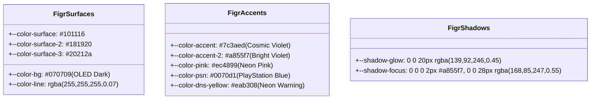

<div dir="rtl" lang="fa">

# سند سیستم طراحی و احیای هویت بصری فیگر (Visual Figr Restoration & Design System)
**پروژه:** وب‌سایت فروشگاهی دکتر گیم (DrGame-Ecommerce)  
**سند شماره:** `01` | **گام:** ۰۵  
**مرجع استایلینگ:** `sources/figr-source/index.css` (منبع قطعی حقیقت بصری)

---

## ۱. علت بازنگری و خطای پیشین (The Remediation Mandate)

در گام ۰۴، ایجنت قبلی با استناد به فایلی موهوم به نام `styles.css`، رنگ پایه کل پلتفرم را به نارنجی (`#ff5722`) تغییر داده بود. این اقدام، هویت لوکس، تیره و کیهانی فیگر (`sources/figr-source/`) که در گام ۰۲ مورد تایید کارفرما قرار گرفته بود را مخدوش ساخت.

در این سند، تمامی توکن‌های رنگی، متغیرهای CSS، کانفیگ Tailwind و کلاس‌های کامپوننت‌ها به **پالت بنفش کیهانی (Cosmic Violet) و نئون صورتی فیگر** بازگردانده می‌شوند.

---

## ۲. توکن‌های استاندارد و قطعی طراحی (Canonical Design Tokens)

برگرفته مستقیم از سورس قطعی `sources/figr-source/index.css`:



### ۲.۱. جدول مقایسه‌ای تغییرات توکن‌ها (Before vs After)

| نام متغیر CSS | مقدار اشتباه در گام ۰۴ (حذف شود) | مقدار استاندارد فیگر در گام ۰۵ (اعمال شود) | کاربرد و رفتار معنایی در رابط کاربری |
| :--- | :--- | :--- | :--- |
| `--color-bg` | `#0f1016` (سرمه‌ای مات) | `#070709` (مشکی OLED عمیق) | پس‌زمینه سراسری تمام صفحات و بدنه سایت |
| `--color-surface` | `#151722` | `#101116` | پس‌زمینه کارت‌های اصلی، هدر و سایدبارها |
| `--color-surface-2` | `#181a27` | `#181920` | پس‌زمینه ثانویه، المان‌های شناور و ریل‌ها |
| `--color-accent` | `#ff5722` (نارنجی اشتباه) | `#7c3aed` (بنفش کیهانی فیگر) | دکمه‌های اصلی فراخوان (CTA)، هاور لینک‌ها، بردر اکتیو |
| `--color-accent-2` | `#ff7043` | `#a855f7` (بنفش نئونی روشن) | حالت هاور دکمه‌ها، هایلایت‌های ظریف و نشانگر فوکوس |
| `--color-pink` | تعریف نشده بود | `#ec4899` (صورتی نئونی) | بج‌های ویژه، تخفیف‌های آتشین و بج‌های کنسول |
| `--color-dns-yellow`| `#eab308` | `#eab308` (حفظ شود) | رنگ هشدار نوار سراسری DNS بالای هدر |
| `--shadow-glow` | `shadow-orange` | `0 0 20px rgba(139, 92, 246, 0.45)` | هاله نوری نئونی بنفش پشت دکمه‌های اصلی و کارت‌ها |

---

## ۳. اصلاح کد در `frontend/src/app/globals.css`

بلوک `:root` در بالای فایل استایل به صورت زیر بازنویسی می‌گردد:

```css
@layer base {
  :root {
    /* 1. Surfaces (OLED Dark Palette from sources/figr-source/index.css) */
    --color-bg: #070709;
    --color-surface: #101116;
    --color-surface-2: #181920;
    --color-surface-3: #20212a;
    --color-fg: #ffffff;
    --color-fg-2: #9496a1;
    --color-muted: #5a5d6a;
    --color-line: rgba(255, 255, 255, 0.07);
    --color-line-strong: rgba(255, 255, 255, 0.14);
    --color-scrim: rgba(7, 7, 9, 0.72);

    /* 2. Cosmic Violet & Neon Accents */
    --color-accent: #7c3aed;
    --color-accent-2: #a855f7;
    --color-accent-deep: #4c1d95;
    --color-accent-soft: rgba(124, 58, 237, 0.14);
    --color-pink: #ec4899;
    --color-on-accent: #ffffff;

    /* 3. PlayStation Identity & Status */
    --color-psn: #0070d1;
    --color-dns-yellow: #eab308;
    --color-success: #10b981;
    --color-warning: #f59e0b;
    --color-danger: #ef4444;

    /* 4. Tiers */
    --color-bronze: #d97706;
    --color-silver: #94a3b8;
    --color-gold: #fbbf24;

    /* 5. Radii & Glow Shadows */
    --radius-sm: 8px;
    --radius-md: 12px;
    --radius-lg: 16px;
    --radius-xl: 20px;
    --radius-2xl: 24px;

    --shadow-glow: 0 0 20px rgba(139, 92, 246, 0.45);
    --shadow-glow-sm: 0 0 12px rgba(139, 92, 246, 0.35);
    --shadow-focus: 0 0 0 2px #a855f7, 0 0 28px rgba(168, 85, 247, 0.55);
    --shadow-card: 0 1px 0 rgba(255, 255, 255, 0.04) inset, 0 8px 24px rgba(0, 0, 0, 0.35);

    --topbar-height: 70px;
  }
}
```

---

## ۴. پاکسازی کلاس‌های نارنجی در کامپوننت‌ها (Component Color Purge)

در تمامی فایل‌های زیر، کلاس‌های نارنجی (`bg-orange-600`, `text-orange-400`, `border-orange-500`, `shadow-orange-500`) با پالت بنفش کیهانی جایگزین می‌شوند:

1. `frontend/src/components/Header.tsx`
2. `frontend/src/components/HomeReferralSummary.tsx`
3. `frontend/src/components/HomeBannerSlots.tsx`
4. `frontend/src/components/GameCard.tsx`
5. `frontend/src/app/shop/page.tsx` و `ShopFiltersSidebar.tsx` و `ShopRightSidebar.tsx`
6. `frontend/src/app/shop/[slug]/page.tsx` (دکمه‌های دانلود و باکس فایل‌ها)
7. `frontend/src/app/subscriptions/page.tsx` و `checkout/page.tsx`
8. `frontend/src/app/panel/page.tsx` و `AvatarSelectorModal.tsx` و `ReferralTab.tsx`
9. `frontend/src/app/admin/page.tsx`

> **استثنای مهم:** نوار هشدار دی‌ان‌اس ([TopBanner.tsx](file:///home/tida/Desktop/Projects/DrGame-Eccomerce/frontend/src/components/TopBanner.tsx)) و باکس‌های مرتبط با DNS به طور صریح طبق بند ۷.۱ پرامپت ارشد، **زرد نئونی (`#eab308`)** باقی می‌مانند تا هشدار آن غیرقابل چشم‌پوشی باشد.

---

## ۵. چک‌لیست اعتبارسنجی بصری (Visual Acceptance Gate)
- [ ] هیچ اثر و کلاسی از `--accent-orange` در `globals.css` باقی نمانده باشد.
- [ ] تمامی دکمه‌های فراخوان اصلی با بنفش کیهانی (`#7c3aed`) و افکت درخشش (`shadow-[0_0_20px_rgba(124,58,237,0.4)]`) رندر شوند.
- [ ] بردرهای هاور کارت‌ها دارای نور بنفش نئونی باشند.
- [ ] نوار DNS همچنان زرد نئونی متمایز و درخشان باشد.

</div>
