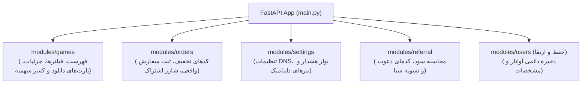

<div dir="rtl" lang="fa">

# سند معماری وب‌سرویس‌ها و ماژول‌های بک‌اند (Backend API Architecture & Modules)
**پروژه:** وب‌سایت فروشگاهی دکتر گیم (DrGame-Ecommerce)  
**سند شماره:** `02` | **گام:** ۰۵  
**محیط اجرا:** FastAPI + SQLAlchemy 2.0 (Async) + PostgreSQL 16 + Redis 7

---

## ۱. تحلیل شکاف فنی بک‌اند (Backend Reality Gap Analysis)

در گام ۰۴، فایل [backend/app/main.py](file:///home/tida/Desktop/Projects/DrGame-Eccomerce/backend/app/main.py) تنها شامل ۳ روتر بود:
```python
from app.modules.quota.router import router as quota_router
from app.modules.subscriptions.router import router as subscriptions_router
from app.modules.users.router import router as auth_router
```
به دلیل نبود ماژول‌های اساسی بازی‌ها، سفارشات و تنظیمات، فرانت‌اند مجبور به استفاده از داده‌های هاردکدشده در `frontend/src/lib/data.ts` شده بود.

در گام ۰۵، **۴ ماژول حیاتی جدید** در ساختار بک‌اند توسعه یافته و به `main.py` ملحق می‌شوند:



---

## ۲. ماژول کاتالوگ بازی‌ها و انجین دانلود (`app.modules.games`)

### ۲.۱. مدل‌های دیتابیس (SQLAlchemy Models)
فایل: `backend/app/modules/games/models.py`

```python
from sqlalchemy import Column, String, Integer, Float, Boolean, ForeignKey, Text, DateTime, func
from sqlalchemy.orm import relationship
from app.core.database import Base

class Game(Base):
    __tablename__ = "games"

    id = Column(Integer, primary_key=True, index=True)
    slug = Column(String(120), unique=True, index=True, nullable=False)
    title = Column(String(200), nullable=False, index=True)
    studio = Column(String(150), nullable=False)
    genre_fa = Column(String(100), nullable=False)
    genre_en = Column(String(100), nullable=False)
    platforms = Column(String(50), nullable=False) # e.g. "PS5,PS4"
    size_gb = Column(Float, nullable=False)
    metacritic = Column(Integer, default=0)
    year = Column(Integer, nullable=False)
    image = Column(String(500), nullable=False)
    description = Column(Text, nullable=True)
    is_featured = Column(Boolean, default=False)
    created_at = Column(DateTime(timezone=True), server_default=func.now())

    files = relationship("GameFile", back_populates="game", cascade="all, delete-orphan")

class GameFile(Base):
    __tablename__ = "game_files"

    id = Column(Integer, primary_key=True, index=True)
    game_id = Column(Integer, ForeignKey("games.id", ondelete="CASCADE"), nullable=False)
    part_name = Column(String(150), nullable=False)
    part_number = Column(Integer, default=1)
    size_gb = Column(Float, nullable=False)
    sha256 = Column(String(64), nullable=True)
    download_url = Column(String(500), nullable=False)
    is_active = Column(Boolean, default=True)

    game = relationship("Game", back_populates="files")
```

### ۲.۲. اندپوینت‌های روتر بازی‌ها (`/api/v1/games`)
فایل: `backend/app/modules/games/router.py`

| متد | مسیر URL | شرح کارکرد | پارامترها و ورودی‌ها |
| :---: | :--- | :--- | :--- |
| `GET` | `/api/v1/games` | دریافت لیست فیلترشده بازی‌ها | `platforms`, `genre`, `search`, `min_score`, `sort`, `page`, `limit` |
| `GET` | `/api/v1/games/{slug}` | دریافت اطلاعات تفصیلی بازی | `slug` از مسیر |
| `POST`| `/api/v1/games/{slug}/download/{part_id}` | بررسی سهمیه کاربر، کسر حجم و تولید لینک دانلود مستقیم | نیازمند احراز هویت توکن JWT کاربر |

---

## ۳. ماژول تسویه‌حساب و سفارشات (`app.modules.orders`)

### ۳.۱. مدل‌های دیتابیس
فایل: `backend/app/modules/orders/models.py`

```python
from sqlalchemy import Column, String, Integer, Float, Boolean, ForeignKey, DateTime, func
from app.core.database import Base

class DiscountCode(Base):
    __tablename__ = "discount_codes"

    id = Column(Integer, primary_key=True, index=True)
    code = Column(String(50), unique=True, index=True, nullable=False)
    discount_percent = Column(Integer, nullable=False)
    max_uses = Column(Integer, default=100)
    current_uses = Column(Integer, default=0)
    is_active = Column(Boolean, default=True)
    expires_at = Column(DateTime(timezone=True), nullable=True)

class Order(Base):
    __tablename__ = "orders"

    id = Column(Integer, primary_key=True, index=True)
    user_id = Column(Integer, ForeignKey("users.id"), nullable=False)
    plan_id = Column(String(50), nullable=False)
    tracking_code = Column(String(60), unique=True, nullable=False)
    amount = Column(Integer, nullable=False)
    discount_amount = Column(Integer, default=0)
    final_price = Column(Integer, nullable=False)
    gateway = Column(String(50), default="mock")
    status = Column(String(30), default="PAID") # PENDING, PAID, FAILED
    created_at = Column(DateTime(timezone=True), server_default=func.now())
```

### ۳.۲. اندپوینت‌های روتر سفارشات (`/api/v1/orders`)
فایل: `backend/app/modules/orders/router.py`

- `POST /api/v1/orders/validate-coupon`: اعتبارسنجی دیتابیسی کد تخفیف، بررسی تاریخ انقضا و تعداد استفاده مجاز.
- `POST /api/v1/orders/checkout`:
  1. ثبت رکورد سفارش در جدول `orders`.
  2. شبیه‌سازی ایمن پرداخت (یا اتصال درگاه).
  3. به‌روزرسانی جدول `UserSubscription` به پلن خریداری‌شده.
  4. شارژ سهمیه ترافیک حساب کاربر (`quota_bytes`) به میزان گیگابایت پلن در جدول `users`.
  5. بازگرداندن شماره پیگیری اختصاصی و جزئیات فاکتور.

---

## ۴. ماژول تنظیمات سایت و پنل ادمین (`app.modules.settings`)

### ۴.۱. مدل دیتابیس
فایل: `backend/app/modules/settings/models.py`

```python
from sqlalchemy import Column, String, JSON, DateTime, func
from app.core.database import Base

class SiteSetting(Base):
    __tablename__ = "site_settings"

    key = Column(String(100), primary_key=True, index=True)
    value = Column(JSON, nullable=False)
    updated_at = Column(DateTime(timezone=True), server_default=func.now(), onupdate=func.now())
```

### ۴.۲. اندپوینت‌های روتر تنظیمات (`/api/v1/settings`)
- `GET /api/v1/settings/public`: واکشی آی‌پی‌های فعال DNS اولیه و ثانویه، متن هشدار نوار هدر و اطلاعات بنر اسلات ۲. (دسترسی عمومی بدون لاگین)
- `PUT /api/v1/settings/dns`: ذخیره آی‌پی‌های جدید DNS و پیام هشدار در دیتابیس. (مخصوص ادمین)
- `PUT /api/v1/settings/banners`: ذخیره اطلاعات و لینک اسلات بنر ۲ در دیتابیس. (مخصوص ادمین)

---

## ۵. ثبت روترها در `backend/app/main.py`

```python
# الحاق روترهای جدید در backend/app/main.py:
from app.modules.games.router import router as games_router
from app.modules.orders.router import router as orders_router
from app.modules.settings.router import router as settings_router
from app.modules.referral.router import router as referral_router

app.include_router(games_router, prefix="/api/v1")
app.include_router(orders_router, prefix="/api/v1")
app.include_router(settings_router, prefix="/api/v1")
app.include_router(referral_router, prefix="/api/v1")
```

---

## ۶. چک‌لیست اعتبارسنجی بک‌اند (Backend Verification Gate)
- [ ] اجرای موفق مایگریشن یا ایجاد جداول `games`, `game_files`, `orders`, `discount_codes`, `site_settings`.
- [ ] صحت پاسخ اندپوینت `GET /api/v1/games` با کوئری فیلتر پلتفرم و ژانر.
- [ ] تست موفق ثبت سفارش و شارژ سهمیه کاربر در `POST /api/v1/orders/checkout`.
- [ ] تست ذخیره و خواندن تنظیمات DNS از دیتابیس در `PUT /api/v1/settings/dns`.

</div>
