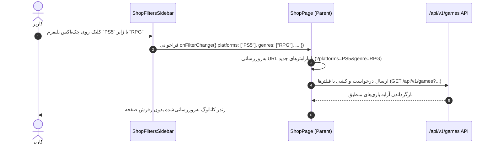
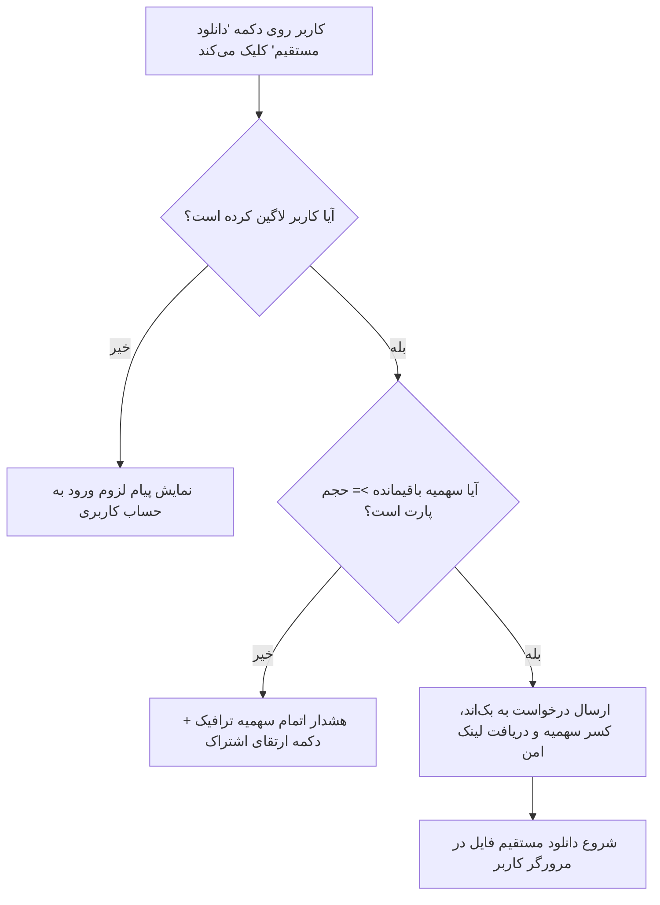

<div dir="rtl" lang="fa">

# سند اتصال فیلترهای فروشگاه و موتور هوشمند دانلود (Shop Filtering & Download Engine)
**پروژه:** وب‌سایت فروشگاهی دکتر گیم (DrGame-Ecommerce)  
**سند شماره:** `03` | **گام:** ۰۵  
**فایل‌های هدف:** `frontend/src/app/shop/page.tsx` و `ShopFiltersSidebar.tsx` و `shop/[slug]/page.tsx`

---

## ۱. عارضه‌یابی وضعیت فعلی (The Problem Statement)

در گام ۰۴:
1. کامپوننت [ShopFiltersSidebar.tsx](file:///home/tida/Desktop/Projects/DrGame-Eccomerce/frontend/src/components/ShopFiltersSidebar.tsx) هیچ رویدادی را به صفحه اصلی فروشگاه مخابره نمی‌کرد؛ در نتیجه تیک زدن پلتفرم‌ها (PS5, PS4)، ژانرها (اکشن، نقش‌آفرینی) و اسلایدر امتیاز، هیچ تغییری در کاتالوگ بازی‌ها ایجاد نمی‌کرد.
2. در صفحه جزئیات بازی [shop/[slug]/page.tsx](file:///home/tida/Desktop/Projects/DrGame-Eccomerce/frontend/src/app/shop/%5Bslug%5D/page.tsx)، دکمه‌های دانلود پارت‌ها فاقد رویداد `onClick` بودند و کلیک روی آن‌ها هیچ واکنشی در مرورگر ثبت نمی‌کرد.

---

## ۲. معماری اتصال فیلترهای فروشگاه (Shop Filters Full Wiring)



### ۲.۱. بازنویسی اینترفیس و رویدادهای `ShopFiltersSidebar.tsx`
در فایل `ShopFiltersSidebar.tsx`، اینترفیس فیلترها تعریف شده و با هر تغییر در استیت، تابع والد فراخوانی می‌شود:

```tsx
export interface FilterState {
  platforms: string[];
  genres: string[];
  mode: string;
  status: string;
  minScore: number;
}

interface ShopFiltersSidebarProps {
  totalResults?: number;
  initialFilters?: FilterState;
  onFilterChange: (filters: FilterState) => void;
}
```
هر کلیک روی توابع `togglePlatform` و `toggleGenre` و تغییر اسلایدر `minScore` فوراً آبجکت فیلتر جدید را به `onFilterChange` ارسال می‌کند.

### ۲.۲. دریافت فیلترها و واکشی در `shop/page.tsx`
در [shop/page.tsx](file:///home/tida/Desktop/Projects/DrGame-Eccomerce/frontend/src/app/shop/page.tsx):
- استیت `filters` نگهداری می‌شود.
- هوک `useEffect` با تغییر فیلترها، درخواست واکشی را به اندپوینت `/api/v1/games` ارسال می‌کند (همراه با Fallback هوشمند کلاینت‌ساید به آرایه لوکال در صورت قطعی اینترنت سرور).
- تعداد نتایج یافته‌شده (`totalResults`) به صورت زنده در بالای سایدبار به‌روزرسانی می‌شود.

---

## ۳. انجین هوشمند دانلود بازی‌ها و کنترل سهمیه (Download Engine & Quota Protection)

### ۳.۱. دیاگرام منطق بررسی سهمیه پیش از دانلود


### ۳.۲. پیاده‌سازی رویداد کلیک در `shop/[slug]/page.tsx`
در فایل صفحه جزئیات بازی، تابع `handleDownloadPart` به دکمه‌های دانلود پارت متصل می‌شود:

```tsx
const handleDownloadPart = async (part: FilePart) => {
  // ۱. بررسی وضعیت ورود
  if (!user) {
    toast.error("جهت دانلود دیتای بازی، ابتدا وارد حساب کاربری خود شوید.");
    router.push("/auth");
    return;
  }

  // ۲. بررسی سهمیه دانلود
  const userQuotaGb = user.quotaLeftGb || 0;
  if (userQuotaGb < part.sizeGb) {
    setShowQuotaModal(true); // باز شدن مودال ارتقای اشتراک
    return;
  }

  // ۳. فراخوانی API دانلود و کسر ترافیک
  try {
    setIsDownloading(part.partNumber);
    const res = await api.post(`/api/v1/games/${slug}/download/${part.id}`);
    
    // کسر سهمیه در فرانت‌اند
    updateLocalQuota(part.sizeGb);
    toast.success(`دانلود ${part.partName} آغاز شد. ${part.sizeGb} گیگابایت از سهمیه کسر گردید.`);
    
    // ایجاد لینک موقت و شروع دانلود در مرورگر
    const downloadAnchor = document.createElement("a");
    downloadAnchor.href = res.data.downloadUrl;
    downloadAnchor.download = `${currentGame.slug}-${part.partName}.pkg`;
    document.body.appendChild(downloadAnchor);
    downloadAnchor.click();
    document.body.removeChild(downloadAnchor);
  } catch (err: any) {
    toast.error(err.response?.data?.message || "خطا در تولید لینک مستقیم دانلود.");
  } finally {
    setIsDownloading(null);
  }
};
```

---

## ۴. چک‌لیست اعتبارسنجی فروشگاه و دانلود
- [ ] با تیک زدن پلتفرم "PS5"، بازی‌های بدون نسخه PS5 بلافاصله از فهرست پنهان شوند.
- [ ] با جابجا کردن اسلایدر حداقل امتیاز، بازی‌های زیر آن امتیاز فیلتر شوند.
- [ ] کلیک روی دانلود پارت در صورت نبود سهمیه، مودال ارتقای اشتراک را باز کند.
- [ ] کلیک روی دانلود در صورت وجود سهمیه، لینک مستقیم را فراخوانی کرده و سهمیه باقیمانده را کاهش دهد.

</div>
