<div dir="rtl" lang="fa">

# سند تسویه‌حساب واقعی، کدهای تخفیف و ثبت سفارشات در دیتابیس (Checkout Flow & DB Orders)
**پروژه:** وب‌سایت فروشگاهی دکتر گیم (DrGame-Ecommerce)  
**سند شماره:** `04` | **گام:** ۰۵  
**فایل‌های هدف:** `frontend/src/app/checkout/page.tsx` و `backend/app/modules/orders/`

---

## ۱. عارضه‌یابی وضعیت فعلی تسویه‌حساب (Current Checkout Flaws)

در گام ۰۴:
1. کدهای تخفیف با شرط سخت‌افزاری `if (couponCode === "DRGAME10")` درون فایل جاوااسکریپت فرانت‌اند هاردکد شده بودند.
2. کلیک روی دکمه «پرداخت و فعال‌سازی اشتراک» فقط یک تابع تایمر `setTimeout(1200)` بود که بدون هیچگونه تماس با سرور، متغیر موقت `paymentSuccess = true` را ست می‌کرد.
3. با رفرش صفحه یا مراجعه به پنل کاربری، هیچ سفارشی وجود نداشت و سهمیه دانلود کاربر هیچ تغییری نمی‌کرد.

---

## ۲. چرخه حیات کامل سفارش واقعی در گام ۰۵ (Real Order Lifecycle)

```mermaid
sequenceDiagram
    autonumber
    actor User as کاربر
    participant UI as صفحه تسویه‌حساب (Checkout UI)
    participant API as روتر سفارشات (/api/v1/orders)
    participant DB as دیتابیس PostgreSQL

    User->>UI: ورود کد تخفیف "VIP2026" و کلیک روی اعمال
    UI->>API: POST /api/v1/orders/validate-coupon { code: "VIP2026" }
    API->>DB: کوئری در جدول discount_codes (بررسی انقضا و سقف استفاده)
    DB-->>API: کد معتبر است (تخفیف ۲۰٪)
    API-->>UI: { valid: true, percent: 20 }
    UI->>UI: بازنگری آنی فاکتور و کاهش مبلغ نهایی

    User->>UI: انتخاب درگاه شاپرک/ماک و کلیک روی دکمه "پرداخت"
    UI->>API: POST /api/v1/orders/checkout { plan_id: "silver", gateway: "zarinpal", coupon: "VIP2026" }
    
    rect rgb(20, 25, 40)
        Note over API,DB: تراکنش اتمیک دیتابیس (Atomic Transaction)
        API->>DB: درج رکورد در جدول orders (تولید tracking_code یکتا)
        API->>DB: به‌روزرسانی یا ایجاد اشتراک کاربر در user_subscriptions
        API->>DB: افزایش حجم مجاز کاربر به میزان ۱۰۲۴ گیگابایت در جدول users
        API->>DB: افزایش شمارنده استفاده کد تخفیف در discount_codes
    end

    API-->>UI: { success: true, tracking_code: "TRK-98341209", quota_added_gb: 1024 }
    UI->>UI: نمایش صفحه فاکتور سبز با شماره پیگیری واقعی دیتابیس
    UI->>User: هدایت به کاتالوگ با سهمیه دانلود شارژشده
```



---

## ۳. اصلاح کد اعتبارسنجی تخفیف در `checkout/page.tsx`

```tsx
const handleApplyCoupon = async (e: React.FormEvent) => {
  e.preventDefault();
  if (!couponCode.trim()) return;

  setIsCheckingCoupon(true);
  try {
    const res = await api.post("/api/v1/orders/validate-coupon", {
      code: couponCode.trim(),
    });
    
    setCouponDiscountPercent(res.data.discount_percent);
    setCouponApplied(true);
    toast.success(`کد تخفیف ${res.data.discount_percent}٪ با موفقیت اعمال گردید.`);
  } catch (err: any) {
    toast.error(err.response?.data?.message || "کد تخفیف وارد شده معتبر نمی‌باشد یا منقضی شده است.");
    setCouponApplied(false);
    setCouponDiscountPercent(0);
  } finally {
    setIsCheckingCoupon(false);
  }
};
```

---

## ۴. اصلاح تابع پرداخت و ثبت سفارش دیتابیسی

```tsx
const handlePay = async () => {
  setIsProcessing(true);
  try {
    const payload = {
      plan_id: planId,
      gateway: selectedGateway,
      coupon_code: couponApplied ? couponCode.trim() : null,
    };

    const res = await api.post("/api/v1/orders/checkout", payload);
    
    // دریافت اطلاعات تراکنش واقعی از سرور
    setOrderResult({
      trackingCode: res.data.tracking_code,
      planName: res.data.plan_name,
      amountPaid: res.data.final_price,
      quotaAddedGb: res.data.quota_added_gb,
    });

    // به‌روزرسانی استیت کاربری سهمیه در سراسر اپلیکیشن
    refreshUserProfile();
    setPaymentSuccess(true);
  } catch (err: any) {
    toast.error(err.response?.data?.message || "خطا در پردازش تراکنش و ثبت سفارش.");
  } finally {
    setIsProcessing(false);
  }
};
```

---

## ۵. چک‌لیست اعتبارسنجی تسویه‌حساب
- [ ] ورود کد تخفیف ناموجود در دیتابیس با خطای صریح سرور رد شود.
- [ ] پس از کلیک روی پرداخت، یک ردیف جدید با شناسه پیگیری یکتا در جدول `orders` ایجاد گردد.
- [ ] سهمیه دانلود حساب کاربر در هدر و دیتابیس فوراً شارژ شود.
- [ ] با رفرش صفحه یا ورود مجدد به پنل، سفارش ثبت‌شده در تاریخچه سفارشات قابل مشاهده باشد.

</div>
