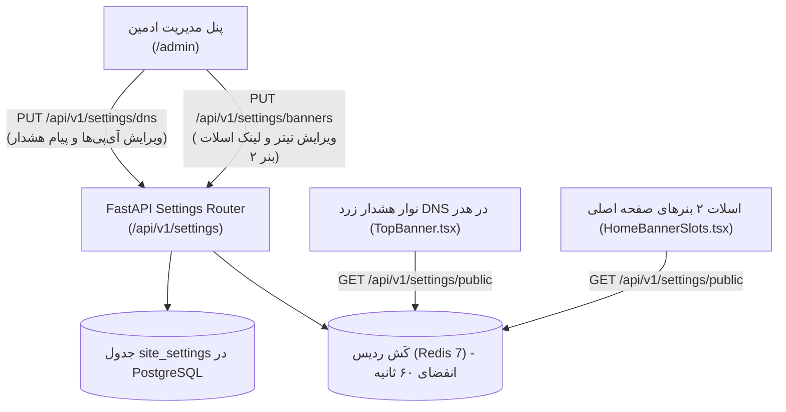

<div dir="rtl" lang="fa">

# سند سینک زنده تنظیمات سایت و پنل ادمین (Site Settings & Admin Sync)
**پروژه:** وب‌سایت فروشگاهی دکتر گیم (DrGame-Ecommerce)  
**سند شماره:** `05` | **گام:** ۰۵  
**فایل‌های هدف:** `frontend/src/app/admin/page.tsx`, `TopBanner.tsx`, `HomeBannerSlots.tsx` و `backend/app/modules/settings/`

---

## ۱. عارضه‌یابی وضعیت فعلی (The Problem Statement)

در گام ۰۴:
1. در پنل ادمین [admin/page.tsx](file:///home/tida/Desktop/Projects/DrGame-Eccomerce/frontend/src/app/admin/page.tsx)، دکمه‌های ذخیره تنظیمات DNS و بنر ۲ فقط یک تابع محلی با تاخیر ۲ ثانیه‌ای بودند:
   ```tsx
   const handleSaveDNS = (e: React.FormEvent) => {
     e.preventDefault();
     setDnsSaved(true);
     setTimeout(() => setDnsSaved(false), 2000); // هیچ اتصالی به سرور وجود نداشت!
   };
   ```
2. کامپوننت نوار هشدار زرد DNS در بالای هدر ([TopBanner.tsx](file:///home/tida/Desktop/Projects/DrGame-Eccomerce/frontend/src/components/TopBanner.tsx)) و اسلات‌های بنر در صفحه اصلی ([HomeBannerSlots.tsx](file:///home/tida/Desktop/Projects/DrGame-Eccomerce/frontend/src/components/HomeBannerSlots.tsx)) مقادیر خود را به صورت متن هاردکدشده داخل سورس نمایش می‌دادند و هیچ اتصالی به دیتابیس نداشتند.

---

## ۲. معماری تنظیمات یکپارچه و زنده (Dynamic Settings Architecture)



---

## ۳. ساختار داده‌های ذخیره‌شده در جدول `site_settings`

### ۳.۱. رکورد تنظیمات دی‌ان‌اس (`key = "dns_banner"`):
```json
{
  "is_active": true,
  "primary_dns": "178.22.122.100",
  "secondary_dns": "185.51.200.2",
  "message_fa": "جهت رفع محدودیت‌های کنسول و دانلود پرسرعت، DNS اختصاصی دکتر گیم را تنظیم فرمایید:",
  "message_en": "Set DrGame high-speed dedicated DNS on your PlayStation console to bypass restrictions:"
}
```

### ۳.۲. رکورد اسلات بنر ۲ (`key = "home_banner_slot_2"`):
```json
{
  "is_active": true,
  "badge_fa": "جشنواره ویژه اشتراک‌ها",
  "badge_en": "Special Promotion",
  "title_fa": "اشتراک طلایی با ترافیک نامحدود و ۳۵٪ تخفیف ولکام",
  "title_en": "Gold VIP Tier with Unlimited Quota and 35% Welcome Discount",
  "description_fa": "دسترسی مستقیم و نامحدود به کاتالوگ ۵ ترابایتی بازی‌های کپی‌خور PS4 و PS5.",
  "description_en": "Unlimited direct access to 5TB curated PS4/PS5 jailbreak games catalog.",
  "target_url": "/subscriptions",
  "cta_text_fa": "خرید اشتراک طلایی",
  "cta_text_en": "Upgrade to Gold"
}
```

---

## ۴. اصلاح کدهای فرانت‌اند جهت سینک زنده

### ۴.۱. ذخیره واقعی توسط ادمین در `admin/page.tsx`
```tsx
const handleSaveDNS = async (e: React.FormEvent) => {
  e.preventDefault();
  setIsSavingDns(true);
  try {
    await api.put("/api/v1/settings/dns", {
      is_active: dnsActive,
      primary_dns: dnsPrimary,
      secondary_dns: dnsSecondary,
      message_fa: dnsMsg,
    });
    toast.success("تنظیمات نوار DNS با موفقیت در دیتابیس ذخیره و در سراسر سایت اعمال شد.");
    setDnsSaved(true);
  } catch (err: any) {
    toast.error("خطا در ذخیره تنظیمات DNS در سرور.");
  } finally {
    setIsSavingDns(false);
  }
};
```

### ۴.۲. خواندن داینامیک در `TopBanner.tsx`
در کامپوننت نوار هدر، هوک واکشی تنظیمات عمومی تعبیه می‌شود:
```tsx
useEffect(() => {
  api.get("/api/v1/settings/public")
    .then((res) => {
      if (res.data.dns_banner) {
        setDnsConfig(res.data.dns_banner);
      }
    })
    .catch(() => {
      // در صورت بروز خطای شبکه، مقادیر پیش‌فرض امن نمایش داده می‌شوند
    });
}, []);
```

---

## ۵. چک‌لیست اعتبارسنجی سینک تنظیمات
- [ ] با تغییر آی‌پی دی‌ان‌اس اولیه در پنل ادمین (مثلاً به `10.20.30.40`) و کلیک روی ذخیره، نوار هشدار زرد رنگ بالای سایت در تمام تب‌ها آی‌پی جدید را نمایش دهد.
- [ ] با تغییر تیتر بنر ۲ در پنل ادمین، صفحه اصلی تیتر جدید را بدون تغییر سورس‌کد لود کند.
- [ ] در صورت غیرفعال کردن سوییچ نوار DNS توسط ادمین، نوار زرد رنگ از بالای هدر مخفی گردد.

</div>
