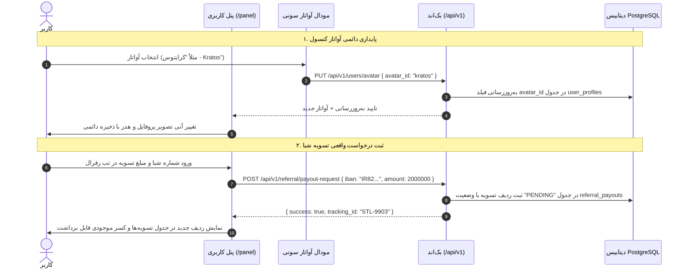

<div dir="rtl" lang="fa">

# سند پایداری پنل کاربری، آواتارها و لجر تسویه شبا (User Panel, Avatars & Referral Ledger)
**پروژه:** وب‌سایت فروشگاهی دکتر گیم (DrGame-Ecommerce)  
**سند شماره:** `06` | **گام:** ۰۵  
**فایل‌های هدف:** `frontend/src/app/panel/page.tsx`, `AvatarSelectorModal.tsx`, `ReferralTab.tsx` و `backend/app/modules/users/`

---

## ۱. عارضه‌یابی پنل کاربری در گام ۰۴ (Current User Panel Flaws)

در گام ۰۴:
1. دکمه «ذخیره تغییرات پروفایل» فاقد رویداد `onClick` بود و فیلدهای ورودی فقط با `defaultValue` ایستا پر شده بودند.
2. انتخاب آواتار از مودال ۲۰ کاراکتر پلی‌استیشن فقط استیت محلی صفحه را تغییر می‌داد و با رفرش صفحه از بین می‌رفت، زیرا در پروفایل کاربر در دیتابیس ثبت نمی‌شد.
3. در تب رفرال، ارسال فرم تسویه حساب شبا صرفاً با یک تابع `setTimeout(1000)` شبیه‌سازی می‌شد و در هیچ لجر یا کارتابل ادمینی ثبت نمی‌گردید.
4. تب سوابق سفارشات (`orders`) یک بلوک استاتیک هاردکدشده در JSX بود.

---

## ۲. معماری عملیاتی پنل کاربری در گام ۰۵ (Functional Architecture)



---

## ۳. پیاده‌سازی ذخیره مشخصات پروفایل و آواتار

### ۳.۱. اتصال دکمه ذخیره پروفایل در `panel/page.tsx`
```tsx
const handleSaveProfile = async (e: React.FormEvent) => {
  e.preventDefault();
  setIsSavingProfile(true);
  try {
    await api.put("/api/v1/users/profile", {
      full_name: profileForm.name,
      psn_id: profileForm.psnId,
      mobile: profileForm.mobile,
      email: profileForm.email,
    });
    toast.success("مشخصات کاربری شما با موفقیت به‌روزرسانی شد.");
    refreshUserProfile();
  } catch (err: any) {
    toast.error(err.response?.data?.message || "خطا در ذخیره مشخصات کاربری.");
  } finally {
    setIsSavingProfile(false);
  }
};
```

### ۳.۲. ذخیره آواتار کنسول در `AvatarSelectorModal.tsx`
```tsx
const handleSelectCharacter = async (char: PSCharacterAvatar) => {
  try {
    await api.put("/api/v1/users/avatar", { avatar_id: char.id });
    onSelect(char);
    toast.success(`آواتار ${char.nameFa} برای حساب شما ثبت گردید.`);
    onClose();
  } catch (err) {
    toast.error("خطا در ثبت آواتار در سرور.");
  }
};
```

---

## ۴. ثبت درخواست تسویه شبا در `ReferralTab.tsx`

```tsx
const handleWithdrawalSubmit = async (e: React.FormEvent) => {
  e.preventDefault();
  if (!iban.startsWith("IR") || iban.length !== 26) {
    toast.error("شماره شبا باید با IR آغاز شده و دقیقا ۲۶ کاراکتر باشد.");
    return;
  }

  setSubmitting(true);
  try {
    const res = await api.post("/api/v1/referral/payout-request", {
      iban: iban.trim(),
      account_holder: accountHolder.trim(),
      amount: parseInt(amount, 10),
    });

    toast.success(`درخواست تسویه با کد پیگیری ${res.data.tracking_id} ثبت شد.`);
    // افزودن رکورد جدید به جدول تسویه‌ها
    setSettlements((prev) => [res.data.settlement, ...prev]);
    setSubmitted(true);
  } catch (err: any) {
    toast.error(err.response?.data?.message || "خطا در ثبت درخواست تسویه.");
  } finally {
    setSubmitting(false);
  }
};
```

---

## ۵. چک‌لیست اعتبارسنجی پنل کاربری
- [ ] ویرایش نام و شناسه PSN با کلیک روی ذخیره در سرور ثبت شود و با رفرش باقی بماند.
- [ ] با انتخاب آواتار سونی، آواتار بلافاصله در هدر و کارت کاور ذخیره و لود گردد.
- [ ] ثبت درخواست تسویه شبا با کد پیگیری ثبت شده و در کارتابل پرداخت پنل ادمین ظاهر شود.
- [ ] سوابق سفارشات مستقیماً از اندپوینت `/api/v1/orders/my-orders` خوانده شوند.

</div>
