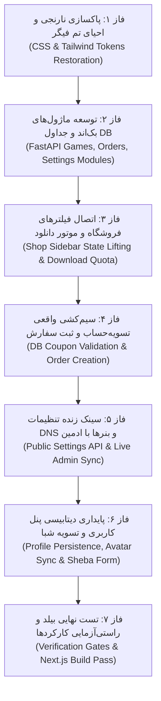

<div dir="rtl" lang="fa">

# دستورالعمل اجرایی و سیاهه قطعی تغییرات گام ۰۵ (Step 05 Implementation Instructions)
**پروژه:** وب‌سایت فروشگاهی دکتر گیم (DrGame-Ecommerce)  
**سند اجرایی جامع:** نقشه راه دقیق عملیاتی، گام‌به‌گام و شناسه‌دار برای توسعه‌دهنده  
**مسیر هدف:** کل مخزن (`frontend/` و `backend/`)

---

## ۱. ترتیب و وابستگی مراحل اجرایی (Execution Dependency Order)



---

## ۲. سیاهه آیتم‌های افزودنی (ADD Inventory)

### `ADD-MOD-GAMES-01`
- **مسیر فایل‌ها:**  
  - `backend/app/modules/games/models.py`
  - `backend/app/modules/games/schemas.py`
  - `backend/app/modules/games/services.py`
  - `backend/app/modules/games/router.py`
- **هدف:** ایجاد ماژول کاتالوگ بازی‌ها و پارت‌های دانلود در دیتابیس با پشتیبانی از فیلتر پلتفرم، ژانر، امتیاز، صفحه‌بندی و اندپوینت کسر سهمیه دانلود.
- **محتوا:** کلاس‌های `Game` و `GameFile`، متدهای کوئری async و اندپوینت‌های `/api/v1/games`.
- **روش اجرا:** ساخت پوشه `backend/app/modules/games` و درج کدهای مدل و روتر طبق سند `02`.

### `ADD-MOD-ORDERS-01`
- **مسیر فایل‌ها:**  
  - `backend/app/modules/orders/models.py`
  - `backend/app/modules/orders/schemas.py`
  - `backend/app/modules/orders/services.py`
  - `backend/app/modules/orders/router.py`
- **هدف:** ایجاد ماژول سفارشات و کدهای تخفیف دیتابیسی.
- **محتوا:** کلاس‌های `Order` و `DiscountCode`، لاجیک اعتبارسنجی انقضا و سقف استفاده، ثبت سفارش اتمیک، به‌روزرسانی جدول `UserSubscription` و شارژ سهمیه کاربر.
- **روش اجرا:** ساخت پوشه `backend/app/modules/orders` و درج کدهای مربوطه.

### `ADD-MOD-SETTINGS-01`
- **مسیر فایل‌ها:**  
  - `backend/app/modules/settings/models.py`
  - `backend/app/modules/settings/schemas.py`
  - `backend/app/modules/settings/services.py`
  - `backend/app/modules/settings/router.py`
- **هدف:** ماژول تنظیمات سراسری دیتابیس جهت نگهداری پویا و سینک زنده آی‌پی‌های نوار هشدار زرد DNS و اسلات بنر ۲ صفحه اصلی.
- **محتوا:** کلاس `SiteSetting`، کَش Redis، اندپوینت عمومی `GET /api/v1/settings/public` و اندپوینت‌های ادمین `PUT /api/v1/settings/dns` و `PUT /api/v1/settings/banners`.

### `ADD-API-CLIENT-01`
- **مسیر فایل:** `frontend/src/lib/api.ts`
- **هدف:** کلاینت واحد ارتباط با API بک‌اند بر پایه `fetch` یا `axios` همراه با تزریق خودکار توکن احراز هویت JWT و مدیریت خطاهای شبکه.

---

## ۳. سیاهه آیتم‌های اصلاحی (EDIT Inventory)

### `EDIT-CSS-TOKENS-01`
- **مسیر هدف:** `frontend/src/app/globals.css`
- **لنگر تغییر:** بلوک `:root` در بالای فایل
- **شرح قبل:** وجود متغیرهای نارنجی جعلی مانند `--accent-orange: #ff5722` و `--color-accent: #ff5722`.
- **شرح بعد:** بازگرداندن مقادیر رسمی فیگر: `--color-accent: #7c3aed;`, `--color-accent-2: #a855f7;`, `--color-pink: #ec4899;`, `--shadow-glow: 0 0 20px rgba(139, 92, 246, 0.45);`.
- **چرا:** احیای ۱۰۰٪ هویت بصری کیهانی و مدرن فیگر مطابق دستور کارفرما.

### `EDIT-MAIN-ROUTER-01`
- **مسیر هدف:** `backend/app/main.py`
- **لنگر تغییر:** خطوط ایمپورت و `app.include_router`
- **شرح تغییر:** اضافه کردن روترهای جدید `games_router`, `orders_router`, `settings_router` به اپلیکیشن FastAPI.

### `EDIT-SHOP-FILTERS-01`
- **مسیر هدف:** `frontend/src/components/ShopFiltersSidebar.tsx`
- **لنگر تغییر:** اینترفیس پراپس و توابع `togglePlatform`, `toggleGenre`, `setMinScore`
- **شرح تغییر:** ارسال آنی استیت جدید فیلترها به تابع والد `onFilterChange`.

### `EDIT-SHOP-PAGE-01`
- **مسیر هدف:** `frontend/src/app/shop/page.tsx`
- **لنگر تغییر:** خط ۸۳ و فراخوانی کامپوننت سایدبار و هوک واکشی بازی‌ها
- **شرح تغییر:** پاس دادن هندلر تغییر فیلترها به `ShopFiltersSidebar` و واکشی زنده بازی‌های فیلترشده از سرور همراه با پشتیبانی از کش کلاینت.

### `EDIT-DOWNLOAD-BTN-01`
- **مسیر هدف:** `frontend/src/app/shop/[slug]/page.tsx`
- **لنگر تغییر:** خط ۲۴۸ تا ۲۵۶ (دکمه‌های دانلود پارت)
- **شرح تغییر:** افزودن رویداد `onClick={() => handleDownloadPart(item)}` با کنترل سهمیه کاربر، نمایش مودال ارتقا در صورت کمبود ترافیک، و کسر حجم و شروع دانلود.

### `EDIT-CHECKOUT-API-01`
- **مسیر هدف:** `frontend/src/app/checkout/page.tsx`
- **لنگر تغییر:** توابع `handleApplyCoupon` و `handlePay`
- **شرح تغییر:** حذف تایمر فیک و شروط هاردکدشده؛ فراخوانی API اعتبارسنجی تخفیف و ثبت سفارش واقعی در دیتابیس و شارژ سهمیه کاربر.

### `EDIT-TOP-BANNER-01`
- **مسیر هدف:** `frontend/src/components/TopBanner.tsx`
- **لنگر تغییر:** استیت و متغیرهای آی‌پی دی‌ان‌اس
- **شرح تغییر:** واکشی آی‌پی‌ها و متن هشدار از اندپوینت عمومی تنظیمات (`/api/v1/settings/public`).

### `EDIT-HOME-BANNERS-01`
- **مسیر هدف:** `frontend/src/components/HomeBannerSlots.tsx`
- **لنگر تغییر:** رندر اسلات بنر ۲
- **شرح تغییر:** خواندن تیتر، لینک و بج بنر ۲ از تنظیمات پویا به جای لینک استاتیک هاردکدشده.

### `EDIT-ADMIN-PANEL-01`
- **مسیر هدف:** `frontend/src/app/admin/page.tsx`
- **لنگر تغییر:** توابع `handleSaveDNS` و `handleSaveBanner`
- **شرح تغییر:** ارسال درخواست‌های واقعی `PUT /api/v1/settings/dns` و `PUT /api/v1/settings/banners` جهت ذخیره دائمی در جدول دیتابیس.

### `EDIT-USER-PANEL-01`
- **مسیر هدف:** `frontend/src/app/panel/page.tsx` و `AvatarSelectorModal.tsx` و `ReferralTab.tsx`
- **لنگر تغییر:** دکمه ذخیره پروفایل، انتخاب آواتار سونی و فرم تسویه شبا
- **شرح تغییر:** اتصال واقعی به سرور جهت ذخیره پایدار مشخصات، ذخیره آواتار در پروفایل و ثبت درخواست تسویه در دیتابیس.

---

## ۴. سیاهه آیتم‌های حذفی (REMOVE Inventory)

### `REMOVE-ORANGE-CLASSES-01`
- **مسیر هدف:** کلیه کامپوننت‌های فرانت‌اند
- **شرح حذف:** پاکسازی تمامی کلاس‌های نارنجی (`bg-orange-600`, `text-orange-400`, `border-orange-500`, `shadow-orange-500`) و جایگزینی با کلاس‌های بنفش کیهانی (`bg-purple-600`, `text-purple-400`, `border-purple-500/30`, `shadow-purple-500/25`) یا توکن‌های معنایی `--color-accent`.

### `REMOVE-STATIC-COUPONS-01`
- **مسیر هدف:** `frontend/src/app/checkout/page.tsx`
- **شرح حذف:** حذف بلوک شروط هاردکدشده `if (couponCode === "DRGAME10")`.

---

## ۵. سیاهه آیتم‌های حفظ‌شونده (KEEP Inventory)

### `KEEP-PLAYSTATION-MODE-01`
- **مسیر هدف:** `frontend/src/components/PlayStationModeProvider.tsx`, `PlayStationActionBar.tsx`, `PlayStationGlyph.tsx`, `spatial-nav.ts`
- **شرح تثبیت:** موتور ناوبری ۱۰ فوتی و راهنمای کلیدهای کنترلر سونی کاملاً پایدار بوده و دست‌نخورده حفظ می‌گردد.

### `KEEP-GEOIP-FOOTERS-01`
- **مسیر هدف:** `frontend/src/components/FooterSelector.tsx`, `IranFooter.tsx`, `IntlFooter.tsx`, `middleware.ts`
- **شرح تثبیت:** معماری سرورساید تفکیک فوتر ایران و بین‌الملل بدون تغییر حفظ می‌شود.

### `KEEP-GAMEPAD-TEST-01`
- **مسیر هدف:** `frontend/src/components/QuickGamepadTester.tsx`, `AdvancedDualSenseTester.tsx`
- **شرح تثبیت:** تستر دوگانه گیم‌پد و تست هپتیک DualSense حفظ می‌شود.

### `KEEP-I18N-SYSTEM-01`
- **مسیر هدف:** `frontend/src/locales/` و `scripts/verify-i18n.js`
- **شرح تثبیت:** فایل‌های چندزبانه و اسکریپت تست عدم وجود کلید مفقوده حفظ می‌گردد.

---

## ۶. اقدامات اعتبارسنجی و دستورالعمل تست (Verification Gates)

1. **اعتبارسنجی بیلد فرانت‌اند:**
   ```bash
   cd frontend && npm run build
   ```
2. **اعتبارسنجی تست‌های بک‌اند:**
   ```bash
   docker exec -it drgame-backend-dev pytest
   ```
3. **اعتبارسنجی سلامت کانتینرها:**
   ```bash
   docker compose -f docker-compose.dev.yml ps
   ```

</div>
