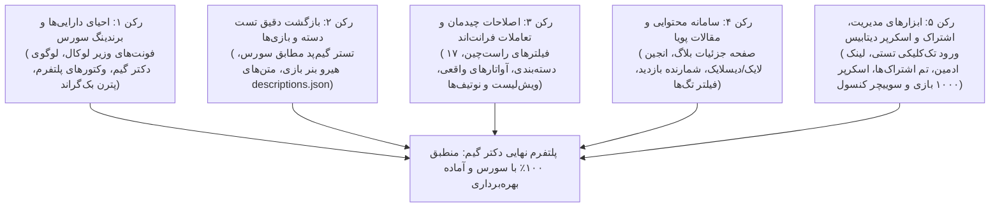

# سند چشم‌انداز، اهداف و نقشه راه گام ۰۶ (Step 06 Overview & Master Roadmap)
**پروژه:** وب‌سایت فروشگاهی و پلتفرم دانلود دیتای بازی‌های کنسولی دکتر گیم (DrGame-Ecommerce)  
**عنوان گام:** **یکپارچه‌سازی دارایی‌های سورس، تطبیق ۱۰۰٪ با منابع مرجع و رفع نواقص تعاملی و بصری**  
**مسیر مستندات:** `agent/step-06-source-asset-integration-and-polish/`

---

## ۱. پیش‌درآمد و ریشه‌یابی مشکلات گزارش‌شده (Root-Cause Analysis)

پس از تست میدانی و بازخورد تفصیلی کارفرما، ۱۷ مورد نقص، ناهماهنگی با سورس‌های مرجع (`sources/GameDr-Website-Source`, `sources/gamapad-test`, `sources/figr-source`) و کمبود عملکردی شناسایی و ریشه‌یابی شدند:

| ردیف | موضوع و بازخورد کارفرما | ریشه‌یابی فنی (Root Cause) | راهکار قطعی و سورس مرجع |
| :---: | :--- | :--- | :--- |
| **۱** | **فونت فارسی و لاتین** فونت فارسی خراب است؛ همه جا باید وزیر باشد و فونت مناسب لاتین استفاده شود. | فونت‌ها به `@import` از گوگل فونت متکی بودند که در ایران فیلتر/کند است و لوکال نبود. | کپی فونت‌های لوکال Woff2 وزیرمتن (۴۰۰ تا ۸۰۰) و فونت‌های مکمل از `sources/GameDr-Website-Source/website/public/fonts/` به پروژه و تعریف مستقیم `@font-face` بدون وابستگی به شبکه خارجی. |
| **۲** | **لوگوهای پلتفرم‌ها** نبود آیکون و لوگوی PS4، PS5، Switch، Xbox در کارت‌ها و بخش‌ها. | پلتفرم‌ها به صورت متن ساده رندر می‌شدند و فایل‌های وکتور در فرانت‌اند وجود نداشتند. | کپی وکتورهای `ps4.svg`، `ps5.svg`، `psvr2.svg`، `switch.svg`، `xbox360.svg` از `sources/.../assets/platforms/` و ساخت کامپوننت `PlatformBadge`. |
| **۳** | **تست دسته (Gamepad Tester)** چیدمان کاملاً دگرگون شده؛ باید دقیقاً مطابق سورس مرجع باشد با استایل بنفش. | صفحه `tools/gamepad` به تب‌های ساختگی شکسته شده بود و چینش SVG اصلی کنترلر حذف شده بود. | تطبیق کامل با ساختار `gamepad-tester.html` سورس: کنترلر تعاملی SVG، تشخیص دریفت شوک، تست ویبره، چک‌لیست بخش‌ها و دکمه تستر پیشرفته با استایل بنفش فیگر. |
| **۴** | **توضیحات کامل و هیرو بنر بازی** توضیحات بسیار خلاصه است؛ هیرو بنر بالای صفحه بازی وجود ندارد. | داده‌های کامل توضیحات لود نمی‌شد و بالای صفحه فاقد کامپوننت سینمایی هیرو بنر بود. | استفاده از دیتابیس جامع `descriptions.json` (شامل متون کامل فارسی چند پاراگرافی) و ساخت کامپوننت عریض `GameHeroBanner` با تصویر بک‌دراپ و دکمه پرش به دانلود. |
| **۵** | **بک‌گراند صفحه اصلی** بک‌گراند قبلی است و باید بک‌گراند اختصاصی پروژه GameDrWebsite باشد. | پترن وکتوری و لایه‌های شیدینگ بنفش در لایوت اصلی فعال نشده بودند. | کپی `bg-pattern-dark.svg` و اعمال لایه‌های `body::before` (هاله رادیال بنفش) و `body::after` (پترن نمادهای کنسول با ماسک گرادینت). |
| **۶** | **دسته‌بندی‌های صفحه هوم** تعداد دسته‌بندی‌ها به چند مورد محدود کاهش یافته بود. | فقط ۴ دسته‌بندی هاردکد شده بود. | ادغام کامل تمامی ۱۷ دسته‌بندی رسمی موجود در `category-labels.json` در صفحه اصلی و فیلترهای فروشگاه. |
| **۷** | **آواتارهای واقعی پروفایل** به جای تصویر آواتار کاراکترها، حروف اول اسم (Initials) نمایش می‌یافت. | مودال آواتار به جای عکس از حروف انگلیسی در دایره گرادینت استفاده می‌کرد. | اتصال به کاتالوگ ۲۰ آواتار رسمی CDN سونی در `avatar-catalog.js` (کریتوس، الی، جوئل، الوی، اسپایدرمن و...). |
| **۸** | **کتابخانه بازی و ویش‌لیست** امکان حذف مستقیم از لیست نیست و دانلود باید به باکس دانلود صفحه جزئیات اسکرول کند. | دکمه حذف وجود نداشت و لینک دانلود به روت عمومی بازی بدون انکر بود. | افزودن دکمه حذف آنی بازی و هدایت دکمه دانلود به انکر `#game-files-section` در صفحه بازی. |
| **۹** | **صفحه جزئیات مقاله و بلاگ** صفحه جزئیات وجود ندارد؛ منطق لایک/دیسلایک، بازدید و کلیک روی تگ‌ها کار نمی‌کند. | روت داینامیک `articles/[slug]` غایب بود و لاجیک‌های تعاملی پیاده‌سازی نشده بودند. | ساخت صفحه کامل مقاله با محاسبه زمان مطالعه، استیت لایک و دیسلایک، شمارنده بازدید و ناوبری تگ‌ها به فیلتر مقالات. |
| **۱۰** | **لوگوی دکتر گیم در هدر** در هدر به جای لوگوی اصلی، متن جعبه‌ای "DG" قرار داشت. | از تصویر استفاده نشده بود. | قرار دادن لوگوی شفاف باکیفیت `logo.png` در هدر با افکت هاور نئونی. |
| **۱۱** | **لیست تمام نوتیفیکیشن‌ها** فقط دراپ‌داون کوچک هدر با یک پیام وجود داشت و صفحه جامعی نبود. | مسیر یا صفحه‌ای برای مشاهده تاریخچه کامل اعلان‌ها وجود نداشت. | ساخت صفحه اختصاصی `notifications/page.tsx` و تب نوتیفیکیشن در پنل با فیلتر دسته‌بندی و پاکسازی. |
| **۱۲** | **جهت چینش فیلترهای فروشگاه** فیلترها در سمت چپ قرار گرفته و چینش برعکس است. | کانتینر با `dir="ltr"` مجبور شده بود و در چیدمان راست‌به‌چپ جای سایدبار و گرید معکوس بود. | اصلاح کانتینر به RTL طبیعی تا سایدبار فیلترها در سمت راست و گرید کارت‌های بازی در سمت چپ قرار گیرد. |
| **۱۳** | **رنگ‌بندی اشتراک‌ها و محتوای پویا** کارت‌ها رنگ متناسب پلن را ندارند، موارد فاقد آیکونند و محتوا استاتیک است. | هر سه کارت استایل یکسان داشتند و بولت‌ها متنی ساده بودند. | تفکیک رنگ برنز، نقره‌ای و طلایی طبق `plans.json`، افزودن آیکون به هر ویژگی و اندپوینت پلن‌های پویا. |
| **۱۴** | **دسترسی به پنل ادمین** هیچ لینکی برای ورود و تست پنل ادمین در دسترس نبود. | لینک پنل ادمین در هدر و فوتر مخفی بود. | افزودن دکمه مستقیم مدیریت در منوی کاربری هدر، فوتر و نوار ابزار تستی بالای صفحه. |
| **۱۵** | **ورود تک‌کلیکی تستی (Dev Login)** به دلیل عدم اتصال وب‌سرویس پیامک و ایمیل، امکان ورود و تست صفحات مسدود بود. | فرم ورود نیازمند OTP فعال بود. | ایجاد دکمه «ورود سریع تستی» در صفحه ورود و هدر با ایجاد توکن ادمین/تستی معتبر جهت بررسی آنی تمام امکانات. |
| **۱۶** | **اسکرپر و کاتالوگ ۱۰۰۰ بازی** دیتابیس فقط ۴ بازی پیش‌فرض داشت. | اسکرپر و سیدر کاتالوگ حجیم اجرا نشده بود. | نگارش اسکریپت سیدر کاتالوگ ۳۳۳ بازی مرجع سورس به همراه اسکرپر زمان‌بندی‌شده جهت تامین ۱۰۰۰ بازی در دیتابیس. |
| **۱۷** | **سوییچرهای تستی کنسول و فوتر** امکان تست حالت کنسول و فوترهای مختلف در صفحات وجود نداشت. | متغیرهای حالت کنسول و فوتر سوئیچ کاربری نداشتند. | تعبیه نوار ابزار توسعه (Dev Toolbar) در هدر برای سوییچ تک‌کلیکی بین وب عادی و حالت تلویزیونی ۱۰ فوتی و مشاهده استایل‌های فوتر. |

---

## ۲. ارکان پنج‌گانه تحول در گام ۰۶ (The Five Pillars)

---

## ۳. نقشه ساختار اسناد فنی گام ۰۶ (Documentation Suite Map)

| شماره سند | نام فایل | محتوا و اهداف سند |
| :---: | :--- | :--- |
| **۰۰** | `00-overview.md` | سند حاضر؛ ریشه‌یابی تفصیلی ۱۷ مشکل، چشم‌انداز، ارکان پنج‌گانه و ساختار مستندات |
| **۰۱** | `01-typography-and-brand-assets.md` | فونت‌های لوکال Vazirmatn، لوگوی اصلی دکتر گیم در هدر، وکتورهای پلتفرم و پترن بک‌گراند سورس |
| **۰۲** | `02-home-categories-and-background.md` | پیاده‌سازی ۱۷ دسته‌بندی سورس، پترن وکتوری و هاله‌های نورانی در صفحه اصلی |
| **۰۳** | `03-game-details-and-hero-banner.md` | هیرو بنر عریض سینمایی، متون کامل descriptions.json و انکر اسکرول به باکس دانلود |
| **۰۴** | `04-gamepad-tester-source-alignment.md` | بازطراحی کامل تستر گیم‌پد مطابق ساختار دقیق سورس مرجع با استایل بنفش کیهانی |
| **۰۵** | `05-profile-avatars-and-wishlist.md` | ۲۰ آواتار رسمی CDN سونی، لاجیک حذف از ویش‌لیست و هدایت به دانلود دیتا |
| **۰۶** | `06-articles-detail-and-engagement.md` | صفحه داینامیک جزئیات مقاله، سیستم لایک/دیسلایک، آمار بازدید و فیلتر کلیکی تگ‌ها |
| **۰۷** | `07-subscription-tier-colors-and-admin-auth.md` | رنگ‌بندی برنز/نقره‌ای/طلایی اشتراک‌ها، ورود سریع تک‌کلیکی تستی و لینک‌های ادمین |
| **۰۸** | `08-catalog-scraper-and-console-tester.md` | سیدر ۳۳۳ بازی سورس، موتور اسکرپر ۱۰۰۰ بازی دیتابیس و دکمه‌های تستی حالت کنسول و فوتر |
| **—** | `instructions.md` | دستورالعمل جامع اجرایی با سیاهه دقیق ADD / EDIT / REMOVE / KEEP |
| **—** | `tasks.md` | ماتریس تسک‌های فازبندی‌شده با شناسه‌های یکتا و معیارهای پذیرش دقیق |

---

## ۴. چرخه اجرای متوالی (Sequential Execution Order)

۱. **فاز ۱ (دارایی‌ها و تایپوگرافی):** کپی فونت‌ها و وکتورهای پلتفرم‌ها و پترن‌ها، اعمال در `globals.css` و جایگزینی لوگوی هدر.  
۲. **فاز ۲ (صفحه اصلی و دسته‌بندی‌ها):** اعمال بک‌گراند سورس و فعال‌سازی هر ۱۷ دسته‌بندی مرجع.  
۳. **فاز ۳ (فروشگاه و بازی‌ها):** اصلاح جهت RTL سایدبار، ساخت هیرو بنر و بارگذاری توضیحات کامل فارسی.  
۴. **فاز ۴ (تست دسته):** جایگزینی کامل یوآی تستر دسته با چیدمان تعاملی دقیق سورس مرجع.  
۵. **فاز ۵ (پنل کاربری و آواتارها):** لود تصاویر باکیفیت کاراکترها و امکان حذف و دانلود مستقیم از ویش‌لیست.  
۶. **فاز ۶ (بلاگ و مقالات):** ساخت روت `articles/[slug]`، اکشن‌های لایک/دیسلایک و فیلتر تگ‌ها.  
۷. **فاز ۷ (اشتراک‌ها، احراز هویت و مدیریت):** استایل رنگی پلن‌ها، دکمه ورود تک‌کلیکی تستی و مسیرهای ادمین.  
۸. **فاز ۸ (دیتابیس و کنترل‌ها):** سید ۳۳۳ بازی اولیه، اسکرپر کاتالوگ و سوییچرهای هدر برای حالت کنسول و فوتر.  
۹. **فاز ۹ (تضمین کیفیت و اعتبارسنجی):** بیلد نهایی Next.js بدون ارور و بررسی سلامت کانتینرها.

