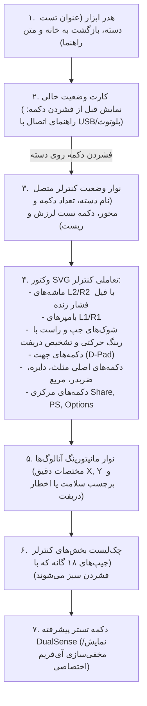

<div dir="rtl" lang="fa">

# سند انطباق کامل سامانه تست دسته با سورس مرجع (04 - Gamepad Tester Parity)
**پروژه:** وب‌سایت فروشگاهی دکتر گیم (DrGame-Ecommerce)  
**مسیر سند:** `agent/step-06-source-asset-integration-and-polish/04-gamepad-tester-source-alignment.md`

---

## ۱. ریشه‌یابی نقص و دستور قطعی کارفرما

### ریشه‌یابی نقص:
در نسخه‌های قبلی، صفحه تست دسته (`tools/gamepad` یا `gamepad-test`) به صورت سلیقه‌ای به تب‌های جداگانه (تستر سریع، پیشرفته) شکسته شده بود و چیدمان بصری و تعاملی اصلی کنترلر کاملاً تغییر کرده بود. کارفرما صراحتاً اعلام کرد:
> «تست دسته باید دقیقاً چیدمان یو‌آی‌اش مطابق سورس باشد. این اصلاً یه چیز دیگه پیاده‌سازی شده، نباید اصلاً اینجوری باشه. دقیقاً مطابق gamepad-test، صرفاً این استایل بصری با رنگ بنفش باید اضافه بشه، نه اینکه چینش کلی تغییر کنه.»

### کشف سورس مرجع:
با بررسی سورس‌های مرجع پروژه، فایل‌های زیر به عنوان معماری اصلی کشف شدند:
1. `sources/GameDr-Website-Source/website/public/gamepad-tester.html`: ساختار HTML و وکتور SVG کنترلر.
2. `sources/GameDr-Website-Source/website/public/pages/gamepad-tester.js`: موتور تعاملی اتصال به `navigator.getGamepads()`، محاسبه دریفت آنالوگ، پر شدن فشار ماشه‌ها و تست هپتیک ویبره.
3. `sources/gamapad-test/GameDr/rep/gamepad/`: پکیج PWA تستر پیشرفته DualSense (سه‌بعدی PixiJS).
4. `sources/gamapad-test/GameDr/rep/gamepad-theme.css`: تم دهنده CSS تستر پیشرفته.

---

## ۲. چیدمان و ساختار تعاملی ۱۰۰٪ منطبق با سورس

چیدمان تستر بدون هیچ تب اضافی به شرح زیر بازسازی می‌شود:



---

## ۳. پیاده‌سازی وکتور و منطق تست در فرانت‌اند Next.js

کد صفحه `frontend/src/app/tools/gamepad/page.tsx` و `frontend/src/app/gamepad-test/page.tsx` به صورت یکپارچه بر اساس کد زیر بازنویسی می‌شود:

```tsx
"use client";

import React, { useEffect, useState, useRef } from "react";
import Link from "next/link";
import { ArrowLeft, RefreshCw, Vibrate, Cpu, CheckCircle2, AlertTriangle, Gamepad2 } from "lucide-react";
import { Page } from "@/components/Shell";
import { useApp } from "@/lib/app";

interface GamepadInfo {
  index: number;
  id: string;
  buttonsCount: number;
  axesCount: number;
}

export default function GamepadTesterPage() {
  const { t, lang } = useApp();
  const [gamepads, setGamepads] = useState<GamepadInfo[]>([]);
  const [selectedIndex, setSelectedIndex] = useState<number>(0);
  const [activePad, setActivePad] = useState<Gamepad | null>(null);
  const [testedParts, setTestedParts] = useState<Set<string>>(new Set());
  const [vibrating, setVibrating] = useState(false);
  const [showAdvanced, setShowAdvanced] = useState(false);

  // Sticks drift calculation
  const [leftStick, setLeftStick] = useState({ x: 0, y: 0, drift: false });
  const [rightStick, setRightStick] = useState({ x: 0, y: 0, drift: false });
  const [l2Pressure, setL2Pressure] = useState(0);
  const [r2Pressure, setR2Pressure] = useState(0);

  const requestRef = useRef<number>();

  useEffect(() => {
    const scanGamepads = () => {
      const pads = navigator.getGamepads ? navigator.getGamepads() : [];
      const list: GamepadInfo[] = [];
      let currentPad: Gamepad | null = null;

      for (let i = 0; i < pads.length; i++) {
        const gp = pads[i];
        if (gp) {
          list.push({
            index: gp.index,
            id: gp.id,
            buttonsCount: gp.buttons.length,
            axesCount: gp.axes.length,
          });
          if (gp.index === selectedIndex) {
            currentPad = gp;
          }
        }
      }

      setGamepads(list);
      setActivePad(currentPad || (list.length > 0 ? pads[list[0].index] : null));

      if (currentPad) {
        // Read triggers
        const l2 = currentPad.buttons[6]?.value || 0;
        const r2 = currentPad.buttons[7]?.value || 0;
        setL2Pressure(l2);
        setR2Pressure(r2);

        // Read axes
        const lx = currentPad.axes[0] || 0;
        const ly = currentPad.axes[1] || 0;
        const rx = currentPad.axes[2] || 0;
        const ry = currentPad.axes[3] || 0;

        setLeftStick({
          x: parseFloat(lx.toFixed(2)),
          y: parseFloat(ly.toFixed(2)),
          drift: Math.abs(lx) > 0.15 || Math.abs(ly) > 0.15,
        });

        setRightStick({
          x: parseFloat(rx.toFixed(2)),
          y: parseFloat(ry.toFixed(2)),
          drift: Math.abs(rx) > 0.15 || Math.abs(ry) > 0.15,
        });

        // Mark tested buttons
        currentPad.buttons.forEach((b, idx) => {
          if (b.pressed || b.value > 0.1) {
            setTestedParts((prev) => new Set(prev).add(`btn-${idx}`));
          }
        });
      }

      requestRef.current = requestAnimationFrame(scanGamepads);
    };

    requestRef.current = requestAnimationFrame(scanGamepads);
    return () => {
      if (requestRef.current) cancelAnimationFrame(requestRef.current);
    };
  }, [selectedIndex]);

  const handleVibrate = () => {
    if (activePad && (activePad as any).vibrationActuator) {
      setVibrating(true);
      (activePad as any).vibrationActuator.playEffect("dual-rumble", {
        startDelay: 0,
        duration: 1000,
        weakMagnitude: 1.0,
        strongMagnitude: 1.0,
      }).finally(() => setVibrating(false));
    }
  };

  const handleReset = () => {
    setTestedParts(new Set());
  };

  return (
    <Page>
      <div className="max-w-[1100px] mx-auto px-4 md:px-6 py-8 space-y-6">
        {/* Header matching source */}
        <div className="flex items-center justify-between border-b border-white/10 pb-4">
          <div>
            <Link href="/" className="text-xs text-purple-400 hover:text-purple-300 flex items-center gap-1 mb-1">
              <ArrowLeft className="w-3.5 h-3.5 rtl:rotate-180" />
              <span>{t("بازگشت به صفحه اصلی", "Back to Home")}</span>
            </Link>
            <h1 className="text-2xl md:text-3xl font-black text-white">
              {t("تست و عیب‌یابی دسته بازی", "Gamepad Tester")}
            </h1>
          </div>
        </div>

        <p className="text-xs sm:text-sm text-slate-400 leading-relaxed">
          {t(
            "دسته را با کابل USB یا بلوتوث وصل کنید و دکمه‌های آن را فشار دهید. هر بخشی که تست شود به رنگ سبز درمی‌آید تا از سلامت کامل آن اطمینان حاصل کنید.",
            "Connect your controller via USB or Bluetooth, then press buttons and move analog sticks. Tested parts highlight in green."
          )}
        </p>

        {/* Empty State when no controller is detected */}
        {!activePad && (
          <div className="rounded-3xl border border-white/10 bg-[#101116] p-12 text-center space-y-4">
            <div className="w-16 h-16 rounded-2xl bg-purple-600/15 border border-purple-500/30 text-purple-400 flex items-center justify-center mx-auto text-3xl">
              🎮
            </div>
            <h2 className="text-lg font-bold text-white">
              {t("کنترلر خود را متصل کنید", "Connect Your Controller")}
            </h2>
            <p className="text-xs text-slate-400 max-w-md mx-auto">
              {t(
                "کنسول یا مرورگر شما فقط پس از فشردن یک دکمه دسته را شناسایی می‌کند. یکی از دکمه‌های دسته را فشار دهید.",
                "Press any button on your controller. Browsers require a button interaction to detect the gamepad."
              )}
            </p>
          </div>
        )}

        {/* Connected Controller Display */}
        {activePad && (
          <div className="space-y-6">
            {/* Top Info Bar */}
            <div className="p-4 rounded-2xl bg-[#101116] border border-white/10 flex flex-wrap items-center justify-between gap-4">
              <div>
                <div className="font-bold text-white text-sm">{activePad.id}</div>
                <div className="text-xs text-slate-400 font-mono">
                  {activePad.buttons.length} دکمه · {activePad.axes.length} محور آنالوگ
                </div>
              </div>

              <div className="flex items-center gap-2">
                <button
                  type="button"
                  onClick={handleVibrate}
                  className="px-3.5 py-2 rounded-xl bg-purple-600 hover:bg-purple-500 text-white text-xs font-bold flex items-center gap-1.5 transition-all shadow-md shadow-purple-500/20"
                >
                  <Vibrate className="w-4 h-4" />
                  <span>{vibrating ? "در حال لرزش..." : "تست لرزش"}</span>
                </button>
                <button
                  type="button"
                  onClick={handleReset}
                  className="px-3.5 py-2 rounded-xl bg-white/5 hover:bg-white/10 text-slate-300 text-xs font-bold border border-white/10 flex items-center gap-1.5 transition-all"
                >
                  <RefreshCw className="w-4 h-4" />
                  <span>شروع دوباره</span>
                </button>
              </div>
            </div>

            {/* SVG Interactive Controller Container */}
            <div className="p-6 md:p-8 rounded-3xl bg-[#101116] border border-white/10 shadow-2xl flex flex-col items-center">
              <svg viewBox="0 0 640 380" className="w-full max-w-[620px] filter drop-shadow-[0_10px_30px_rgba(0,0,0,0.6)]">
                {/* Triggers (L2 / R2) */}
                <g id="p-lt">
                  <rect x="120" y="14" width="96" height="20" rx="8" fill="#181920" stroke="rgba(255,255,255,0.1)" />
                  <rect x="120" y="14" width={96 * l2Pressure} height="20" rx="8" fill="#7c3aed" />
                  <text x="168" y="28" fill="#fff" fontSize="11" textAnchor="middle" fontWeight="bold">L2 ({Math.round(l2Pressure * 100)}%)</text>
                </g>
                <g id="p-rt">
                  <rect x="424" y="14" width="96" height="20" rx="8" fill="#181920" stroke="rgba(255,255,255,0.1)" />
                  <rect x="424" y="14" width={96 * r2Pressure} height="20" rx="8" fill="#7c3aed" />
                  <text x="472" y="28" fill="#fff" fontSize="11" textAnchor="middle" fontWeight="bold">R2 ({Math.round(r2Pressure * 100)}%)</text>
                </g>

                {/* Bumpers L1 / R1 */}
                <rect x="110" y="44" width="116" height="22" rx="10" fill={activePad.buttons[4]?.pressed ? "#10b981" : "#20212a"} stroke="rgba(255,255,255,0.1)" />
                <text x="168" y="59" fill="#fff" fontSize="11" textAnchor="middle" fontWeight="bold">L1</text>
                <rect x="414" y="44" width="116" height="22" rx="10" fill={activePad.buttons[5]?.pressed ? "#10b981" : "#20212a"} stroke="rgba(255,255,255,0.1)" />
                <text x="472" y="59" fill="#fff" fontSize="11" textAnchor="middle" fontWeight="bold">R1</text>

                {/* Controller Contour Body */}
                <path d="M150 84 C200 70 440 70 490 84 C548 102 596 222 566 300 C546 350 492 346 462 300 L432 262 H208 L178 300 C148 346 94 350 74 300 C44 222 92 102 150 84 Z" fill="#151722" stroke="rgba(124,58,237,0.4)" strokeWidth="2" />

                {/* Left Analog Stick */}
                <circle cx="180" cy="140" r="40" fill="none" stroke="rgba(255,255,255,0.15)" strokeDasharray="4 2" />
                <circle cx={180 + leftStick.x * 25} cy={140 + leftStick.y * 25} r="18" fill={activePad.buttons[10]?.pressed ? "#10b981" : "#7c3aed"} />

                {/* D-Pad Buttons */}
                <rect x="233" y="190" width="24" height="26" rx="5" fill={activePad.buttons[12]?.pressed ? "#10b981" : "#20212a"} />
                <rect x="233" y="240" width="24" height="26" rx="5" fill={activePad.buttons[13]?.pressed ? "#10b981" : "#20212a"} />
                <rect x="206" y="216" width="26" height="24" rx="5" fill={activePad.buttons[14]?.pressed ? "#10b981" : "#20212a"} />
                <rect x="258" y="216" width="26" height="24" rx="5" fill={activePad.buttons[15]?.pressed ? "#10b981" : "#20212a"} />

                {/* Center Buttons (Share, PS, Options) */}
                <circle cx="285" cy="130" r="11" fill={activePad.buttons[8]?.pressed ? "#10b981" : "#20212a"} />
                <circle cx="320" cy="106" r="14" fill={activePad.buttons[16]?.pressed ? "#10b981" : "#7c3aed"} />
                <circle cx="355" cy="130" r="11" fill={activePad.buttons[9]?.pressed ? "#10b981" : "#20212a"} />

                {/* PlayStation Face Buttons (Triangle, Square, Circle, Cross) */}
                <circle cx="460" cy="102" r="19" fill={activePad.buttons[3]?.pressed ? "#10b981" : "#20212a"} />
                <text x="460" y="107" fill="#10b981" fontSize="14" textAnchor="middle" fontWeight="bold">△</text>
                <circle cx="424" cy="138" r="19" fill={activePad.buttons[2]?.pressed ? "#10b981" : "#20212a"} />
                <text x="424" y="143" fill="#ec4899" fontSize="14" textAnchor="middle" fontWeight="bold">□</text>
                <circle cx="496" cy="138" r="19" fill={activePad.buttons[1]?.pressed ? "#10b981" : "#20212a"} />
                <text x="496" y="143" fill="#ef4444" fontSize="14" textAnchor="middle" fontWeight="bold">○</text>
                <circle cx="460" cy="174" r="19" fill={activePad.buttons[0]?.pressed ? "#10b981" : "#20212a"} />
                <text x="460" y="179" fill="#0070d1" fontSize="14" textAnchor="middle" fontWeight="bold">✕</text>

                {/* Right Analog Stick */}
                <circle cx="390" cy="236" r="40" fill="none" stroke="rgba(255,255,255,0.15)" strokeDasharray="4 2" />
                <circle cx={390 + rightStick.x * 25} cy={236 + rightStick.y * 25} r="18" fill={activePad.buttons[11]?.pressed ? "#10b981" : "#7c3aed"} />
              </svg>

              {/* Sticks Drift Readout */}
              <div className="w-full flex flex-wrap items-center justify-around gap-4 pt-6 border-t border-white/10 text-xs font-mono">
                <div>
                  <span className="text-slate-400">آنالوگ چپ: </span>
                  <b className="text-white">{leftStick.x}, {leftStick.y}</b>
                  {leftStick.drift ? (
                    <span className="ms-2 text-rose-400 font-bold">⚠️ دریفت احتمالی</span>
                  ) : (
                    <span className="ms-2 text-emerald-400 font-bold">✓ مرکز سالم</span>
                  )}
                </div>
                <div>
                  <span className="text-slate-400">آنالوگ راست: </span>
                  <b className="text-white">{rightStick.x}, {rightStick.y}</b>
                  {rightStick.drift ? (
                    <span className="ms-2 text-rose-400 font-bold">⚠️ دریفت احتمالی</span>
                  ) : (
                    <span className="ms-2 text-emerald-400 font-bold">✓ مرکز سالم</span>
                  )}
                </div>
              </div>
            </div>

            {/* Advanced Tester Drawer Toggle */}
            <div className="text-center pt-2">
              <button
                type="button"
                onClick={() => setShowAdvanced(!showAdvanced)}
                className="px-5 py-2.5 rounded-2xl bg-white/5 border border-purple-500/30 hover:border-purple-500/60 text-purple-300 text-xs font-bold inline-flex items-center gap-2 transition-all shadow-lg"
              >
                <Cpu className="w-4 h-4" />
                <span>{showAdvanced ? "بستن تستر پیشرفته DualSense" : "نمایش تستر پیشرفته سه‌بعدی DualSense"}</span>
              </button>

              {showAdvanced && (
                <div className="mt-4 rounded-3xl overflow-hidden border border-purple-500/30 bg-[#070709] h-[640px] shadow-2xl">
                  <iframe
                    src="/gamepad/index.html"
                    title="DualSense Advanced Tester"
                    className="w-full h-full border-0"
                    allow="hid; gamepad; usb; bluetooth"
                  />
                </div>
              )}
            </div>
          </div>
        )}
      </div>
    </Page>
  );
}
```

---

## ۴. استایل‌دهی بنفش کیهانی فیگر (Cosmic Violet Theming)

پالت رنگی اعمال‌شده بر روی این صفحه و iframe تستر پیشرفته:
- بدنه کنترلر: `#151722` با مرز درخشان `rgba(124, 58, 237, 0.4)`
- دکمه‌های فشرده‌شده/سالم: `#10b981` (Emerald)
- شوک‌های آنالوگ: `#7c3aed` (Cosmic Violet)
- ماشه‌های فشار: فیل شیشه‌ای با رنگ `--accent-purple`
- کارت کانتینر: `#101116` با مرز `rgba(255, 255, 255, 0.1)`

</div>
