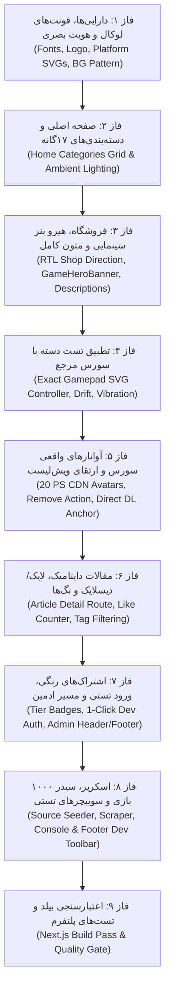

<div dir="rtl" lang="fa">

# دستورالعمل اجرایی و سیاهه قطعی تغییرات گام ۰۶ (Step 06 Implementation Instructions)
**پروژه:** وب‌سایت فروشگاهی دکتر گیم (DrGame-Ecommerce)  
**سند اجرایی جامع:** نقشه راه دقیق عملیاتی، گام‌به‌گام و شناسه‌دار جهت پیاده‌سازی  
**مسیر هدف:** کل کدبیس مخزن (`frontend/` و `backend/`)

---

## ۱. ترتیب و وابستگی مراحل اجرایی (Execution Dependency Order)



---

## ۲. سیاهه آیتم‌های افزودنی (ADD Inventory)

### `ADD-FONTS-01`
- **مسیر مبدا:** `sources/GameDr-Website-Source/website/public/fonts/*`
- **مسیر مقصد:** `frontend/public/fonts/`
- **هدف:** فونت‌های لوکال وزیرمتن و فونت‌های مکمل لاتین جهت قطع کامل وابستگی به گوگل فونت.

### `ADD-PLATFORMS-01`
- **مسیر مبدا:** `sources/GameDr-Website-Source/website/public/assets/platforms/*`
- **مسیر مقصد:** `frontend/public/assets/platforms/`
- **فایل‌ها:** `ps4.svg`, `ps5.svg`, `psvr2.svg`, `switch.svg`, `xbox360.svg`.

### `ADD-COMP-PLATFORM-BADGE-01`
- **مسیر فایل:** `frontend/src/components/PlatformBadge.tsx`
- **هدف:** کامپوننت اشتراکی نمایش بج لوگوی وکتور کنسول‌ها و پلتفرم‌ها در کارت‌های بازی، شاپ و هیرو بنر.

### `ADD-COMP-HERO-BANNER-01`
- **مسیر فایل:** `frontend/src/components/GameHeroBanner.tsx`
- **هدف:** هیرو بنر عریض سینمایی با تصویر پس‌زمینه باکیفیت، بج‌های متادیتا، امتیاز متاکریتیک و دکمه اسکرول به پارت‌های دانلود.

### `ADD-COMP-HOME-CATEGORIES-01`
- **مسیر فایل:** `frontend/src/components/HomeCategoriesGrid.tsx`
- **هدف:** پیاده‌سازی ۱۷ دسته‌بندی رسمی با آیکون‌های Lucide، عناوین فارسی/انگلیسی و اتصال به فیلتر ژانر فروشگاه.

### `ADD-COMP-DEV-TOOLBAR-01`
- **مسیر فایل:** `frontend/src/components/DevModeToolbar.tsx`
- **هدف:** نوار ابزار توسعه جهت تست فوری حالت کنسول (10-Foot UI)، سوییچر فوتر، میانبر پنل ادمین و ورود سریع.

### `ADD-PAGE-ARTICLE-DETAIL-01`
- **مسیر فایل:** `frontend/src/app/articles/[slug]/page.tsx`
- **هدف:** صفحه جزئیات مقاله با نوار پیشرفت مطالعه، سیستم لایک و دیس‌لایک، شمارنده بازدید و تگ‌های تعاملی.

### `ADD-PAGE-AUTH-01`
- **مسیر فایل:** `frontend/src/app/auth/page.tsx`
- **هدف:** صفحه ورود و عضویت با دکمه ویژه «ورود سریع تستی با ۱ کلیک» برای اعطای دسترسی آنی سوپریوزر و ادمین.

### `ADD-PAGE-NOTIFICATIONS-01`
- **مسیر فایل:** `frontend/src/app/notifications/page.tsx`
- **هدف:** صفحه مستقل تاریخچه کامل اعلان‌های کاربر با فیلتر دسته‌بندی و قابلیت علامت‌گذاری به عنوان خوانده‌شده.

### `ADD-BACKEND-SEEDER-01`
- **مسیر فایل:** `backend/app/modules/games/seeder.py`
- **هدف:** اسکریپت ناهمگام پایتون جهت خواندن `games.json`، `descriptions.json` و `screenshots.json` سورس و درج ۳۳۳ بازی با پارت‌های دانلود در دیتابیس PostgreSQL.

### `ADD-BACKEND-SCRAPER-01`
- **مسیر فایل:** `backend/app/modules/games/scraper.py`
- **هدف:** موتور اسکرپر کاتالوگ زمان‌بندی‌شده جهت گسترش بازی‌ها تا مرز ۱۰۰۰ عنوان.

---

## ۳. سیاهه آیتم‌های اصلاحی (EDIT Inventory)

### `EDIT-CSS-FONTS-BG-01`
- **مسیر هدف:** `frontend/src/app/globals.css`
- **لنگر تغییر:** حذف `@import` گوگل فونت؛ افزودن قوانین `@font-face` لوکال؛ تعریف `body::before` (هاله بنفش) و `body::after` (پترن وکتوری ۵۶۰ پیکسلی).

### `EDIT-HEADER-BRAND-LOGO-01`
- **مسیر هدف:** `frontend/src/components/Header.tsx`
- **لنگر تغییر:** خط ۴۷ تا ۶۳ (بخش لوگوی برند)
- **شرح تغییر:** جایگزینی متن ساده `"DG"` با عکس باکیفیت و ترنسپرنت `/logo.png` همراه با افکت درخشش هاور بنفش، و افزودن لینک پنل ادمین در منوی دراپ‌داون پروفایل.

### `EDIT-SHOP-DIRECTION-RTL-01`
- **مسیر هدف:** `frontend/src/app/shop/page.tsx`
- **لنگر تغییر:** خط ۱۸۰ (کانتینر اصلی گرید و سایدبار)
- **شرح تغییر:** حذف `dir="ltr"` و تصحیح چیدمان به جهت راست‌به‌چپ طبیعی تا سایدبار فیلترها در سمت راست و گرید بازی‌ها در سمت چپ قرار گیرد.

### `EDIT-GAME-DETAILS-PAGE-01`
- **مسیر هدف:** `frontend/src/app/shop/[slug]/page.tsx`
- **لنگر تغییر:** بالای صفحه و متن توضیحات و باکس پارت‌های دانلود
- **شرح تغییر:** تعبیه `GameHeroBanner`، نمایش متون کامل چندپاراگرافی از `descriptions.json` و افزودن شناسه `id="game-files-section"` به بخش دانلود.

### `EDIT-GAMEPAD-PAGE-01`
- **مسیر هدف:** `frontend/src/app/tools/gamepad/page.tsx` و `frontend/src/app/gamepad-test/page.tsx`
- **لنگر تغییر:** بازنویسی کامل چیدمان
- **شرح تغییر:** انطباق ۱۰۰٪ با `gamepad-tester.html` سورس: کنترلر تعاملی SVG با ماشه‌های بلادرنگ، رینگ آنالوگ، مانیتور دریفت، دکمه تست لرزش و دکمه کشویی تستر پیشرفته DualSense.

### `EDIT-PANEL-LIBRARY-01`
- **مسیر هدف:** `frontend/src/app/panel/page.tsx`
- **لنگر تغییر:** تب `library` (کتابخانه بازی‌های من)
- **شرح تغییر:** افزودن دکمه حذف بازی (`Trash2`) و تغییر مقصد لینک دکمه دانلود به انکر `/shop/[slug]#game-files-section`.

### `EDIT-AVATAR-MODAL-01`
- **مسیر هدف:** `frontend/src/components/panel/AvatarSelectorModal.tsx`
- **لنگر تغییر:** لیست `PS_AVATARS` و حلقه رندر
- **شرح تغییر:** جایگزینی حروف اختصاری با تصاویر رسمی CDN سونی از ۲۰ کاراکتر برتر پلی‌استیشن.

### `EDIT-SUBSCRIPTIONS-THEME-01`
- **مسیر هدف:** `frontend/src/app/subscriptions/page.tsx` و `frontend/src/app/plans/page.tsx`
- **لنگر تغییر:** کارت‌های اشتراک
- **شرح تغییر:** تفکیک رنگی متمایز برنز (`#cd7f32`)، نقره‌ای (`#94a3b8`) و طلایی (`#f59e0b`)، افزودن آیکون به آیتم‌های هر پلن و اتصال به منبع داده پویا.

### `EDIT-ARTICLES-PAGE-01`
- **مسیر هدف:** `frontend/src/app/articles/page.tsx`
- **لنگر تغییر:** فیلتر تگ‌ها و کلیک روی مقالات
- **شرح تغییر:** اتصال کلیک روی مقالات به مسیر جدید `/articles/[slug]` و فیلتر خودکار بر اساس پارامتر `tag`.

---

## ۴. سیاهه آیتم‌های حذفی (REMOVE Inventory)

- **`REM-MOCK-TABS-01`:** حذف تب‌های ناهماهنگ و ساختگی در تستر دسته که چیدمان مرجع سورس را مخدوش کرده بودند.
- **`REM-INITIALS-AVATARS-01`:** حذف حروف مخفف دوحرفی ("KR", "EL", ...) از مودال آواتارها و جایگزینی با تصاویر واقعی.
- **`REM-HARDCODED-DIR-01`:** حذف کلاس‌های معکوس‌کننده جهت مانند `dir="ltr"` اجباری در صفحات شاپ.

---

## ۵. سیاهه آیتم‌های تثبیت‌شده (KEEP Inventory)

- حفظ کامل روترها و مدل‌های بک‌اند پیاده‌سازی‌شده در گام ۰۵ (`games`, `orders`, `settings`, `referral`, `users`, `quota`).
- حفظ کلاینت استاندارد `frontend/src/lib/api.ts` با هندلینگ توکن‌های احراز هویت.
- حفظ پالت رنگی تاییدشده فیگر: بنفش کیهانی (`#7c3aed`)، نئون صورتی (`#ec4899`) و مشکی عمیق OLED (`#070709`).

---

## ۶. دستورات خط فرمان جهت اعتبارسنجی (Strict Docker-Only Policy)

```bash
# ۱. اجرای سیدر کاتالوگ ۳۳۳ بازی مرجع سورس در دیتابیس:
docker compose -f docker-compose.dev.yml run --rm backend python -m app.modules.games.seeder

# ۲. اجرای اسکرپر جهت تامین ۱۰۰۰ بازی در دیتابیس:
docker compose -f docker-compose.dev.yml run --rm backend python -m app.modules.games.scraper --target 1000

# ۳. بررسی تایپ‌اسکریپت و لینتر فرانت‌اند:
docker compose -f docker-compose.dev.yml run --rm frontend npx tsc --noEmit

# ۴. اعتبارسنجی نهایی بیلد پروداکشن Next.js:
docker compose -f docker-compose.dev.yml run --rm frontend npm run build
```

</div>
