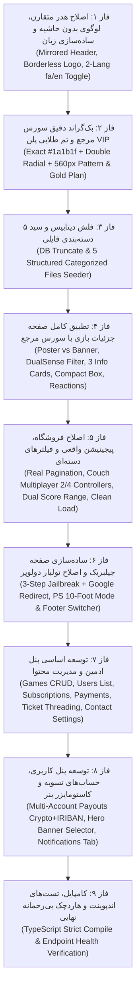

# دستورالعمل اجرایی و سیاهه قطعی تغییرات گام ۰۸ (Step 07 Implementation Instructions)
**پروژه:** وب‌سایت فروشگاهی دکتر گیم (DrGame-Ecommerce)  
**سند اجرایی جامع:** نقشه راه دقیق عملیاتی، گام‌به‌گام و شناسه‌دار جهت پیاده‌سازی اصلاحات اساسی  
**مسیر هدف:** کل کدبیس مخزن (`frontend/` و `backend/`)

---

## ۱. ترتیب و وابستگی مراحل اجرایی (Execution Dependency Order)

---

## ۲. سیاهه آیتم‌های افزودنی (ADD Inventory)

### `ADD-DB-FILES-01`
- **مسیر هدف:** `backend/app/modules/games/seeder.py`
- **هدف:** تولید دقیق و ساختاریافته ۵ فایل مستقل و اختصاصی به ازای هر بازی:
  1. `MAIN_DATA`: دیتای اصلی بازی (`.pkg` با حجم ۲۵ تا ۷۰ گیگابایت)
  2. `SUBTITLE`: زیرنویس فارسی اختصاصی (`.pkg` با حجم ۱۵۰ تا ۲۵۰ مگابایت)
  3. `CHEAT`: فایل چیت، ترینر و سیو ۱۰۰٪ (`.zip` با حجم ۲۵ تا ۵۰ مگابایت)
  4. `DLC`: بسته‌های الحاقی و آپدیت‌ها (`.pkg` با حجم ۸ تا ۱۵ گیگابایت)
  5. `DUBBING`: دوبله فارسی صوتی (`.pkg` با حجم ۱.۲ تا ۳.۵ گیگابایت)

### `ADD-ADMIN-GAMES-MODAL-01`
- **مسیر هدف:** `frontend/src/components/admin/AdminGameModal.tsx`
- **هدف:** مودال جامع ایجاد و ویرایش بازی‌ها در پنل ادمین با امکان تغییر عنوان، اسلاگ، پلتفرم‌ها، امتیاز متا، حجم، استودیو، تصاویر بنر و پوستر، و مدیریت لینک‌های ۵ فایل دانلودی.

### `ADD-ADMIN-SETTINGS-TAB-01`
- **مسیر هدف:** `frontend/src/components/admin/AdminSettingsTab.tsx`
- **هدف:** تب مدیریت اطلاعات تماس (شماره تماس، شناسه تلگرام، پیام اعلان هدر، آدرس DNS کنسول) به همراه ویرایشگر داینامیک تعرفه و خدمات پلن‌های اشتراک.

### `ADD-ADMIN-TICKETS-MODAL-01`
- **مسیر هدف:** `frontend/src/components/admin/AdminTicketDetailModal.tsx`
- **هدف:** مشاهده زنجیره پیام‌های تیکت پشتیبانی و امکان ارسال پاسخ جدید توسط ادمین به صورت ترد تعاملی.

### `ADD-PANEL-PAYOUTS-01`
- **مسیر هدف:** `frontend/src/components/panel/PayoutAccountsManager.tsx`
- **هدف:** امکان افزودن و مدیریت چندین حساب بانکی ریالی (شماره شبا و کارت) و کیف پول‌های رمزارز (تتر TRC-20، TON، BEP-20) برای تسویه حساب درآمد کاربر.

### `ADD-PANEL-HERO-CUSTOMIZER-01`
- **مسیر هدف:** `frontend/src/components/panel/HeroBannerCustomizerModal.tsx`
- **هدف:** انتخاب بنر هیرو پنل کاربری از میان تصاویر برگزیده بازی‌های شاخص سایت.

---

## ۳. سیاهه آیتم‌های ویرایشی (MODIFY Inventory)

### `MOD-HEADER-01`
- **مسیر فایل:** `frontend/src/components/Header.tsx`
- **تغییرات:**
  1. حذف حاشیه (border) از دور لوگو و قرار دادن لوگوی شفاف بدون مرز.
  2. چیدمان آینه‌ای متقارن برای آیتم‌های هدر در جهت RTL (راست به چپ طبیعی).
  3. تبدیل انتخاب‌گر زبان به تاگل ساده دوناحیه‌ای فقط شامل زبان فارسی (`fa`) و انگلیسی (`en`).
  4. اعمال مپینگ تمام زبان‌های راست‌چین به فارسی و چپ‌چین به انگلیسی در هسته کانتکست.

### `MOD-GLOBALS-CSS-01`
- **مسیر فایل:** `frontend/src/app/globals.css`
- **تغییرات:**
  1. اعمال رنگ پس‌زمینه قطعی `#1a1b1f` مطابق سورس `GameDr-Website-Source`.
  2. پیاده‌سازی افکت‌های شبه‌عنصر `body:before` (گرادیان دوگانه رادیال در بالا و پایین) و `body:after` با پترن وکتوری ۵۶۰ پیکسلی `/bg-pattern-dark.svg` و ماسک خطی.
  3. اعمال کلاس‌های حالت پلی‌استیشن (`html.playstation-mode`).

### `MOD-GAME-DETAIL-01`
- **مسیر فایل:** `frontend/src/app/shop/[slug]/page.tsx`
- **تغییرات:**
  1. تفکیک کامل آرت پوستر بازی (Game Poster) از والپیپر عریض پس‌زمینه (Hero Backdrop).
  2. نمایش ویژگی‌های فنی دسته DualSense (هپتیک فیدبک، تریگرهای تطبیق‌پذیر) **تنها و تنها برای بازی‌های دارای پلتفرم PS5**.
  3. پیاده‌سازی ۳ کارت مشخصات پلی‌استیشن: استودیو و افتخارات، ویژگی‌های اجرای بازی و رده‌بندی سنی/متن داستان.
  4. پیاده‌سازی دکمه‌های ری‌اکشن لایک سبز و دیس‌لایک قرمز با شمارنده زنده و ذخیره‌سازی وضعیت رای.
  5. بازطراحی باکس دانلود به صورت کارت جمع‌وجور و نمایش دقیق ۵ بخش تفکیک‌شده فایل‌ها.

### `MOD-SHOP-FILTERS-01`
- **مسیر فایل‌ها:** `frontend/src/app/shop/page.tsx` و `frontend/src/components/ShopFiltersSidebar.tsx`
- **تغییرات:**
  1. مقداردهی اولیه بدون هرگونه فیلتر پیش‌فرض (تمامی چک‌باکس‌ها خاموش، نمایش همه بازی‌ها).
  2. پیاده‌سازی پیجینیشن واقعی مبتنی بر State با اسلایس آرایه بازی‌ها و دکمه‌های صفحه قبل/بعد و شماره صفحات.
  3. نمایش وکتور لوگوی پلتفرم‌های کنسولی (PS5، PS4، Xbox، Switch) در فیلتر پیشرفته سایدبار.
  4. بازتعریف فیلتر چندنفره به حالت دسته‌ای فیزیکی: «۲ نفره (۲ دسته)» و «۴ نفره (۴ دسته)» و حذف «همکاری» و «محلی».
  5. فیلتر دوپارامتری محدوده امتیاز متاکریتیک (حداقل نمره و حداکثر نمره).

### `MOD-JAILBREAK-01`
- **مسیر فایل:** `frontend/src/app/jailbreak/page.tsx`
- **تغییرات:**
  1. ساده‌سازی رادیکال: حذف المان‌های شلوغ و غیرضروری.
  2. باکس راهنمای مختصر ۳ مرحله‌ای (تنظیم DNS روی کنسول -> باز کردن مرورگر کنسول -> کلیک روی دکمه جیلبریک).
  3. دکمه اصلی و برجسته «اجرای جیلبریک» با ریدایرکت مستقیم به `https://google.com`.

### `MOD-ADMIN-PANEL-01`
- **مسیر فایل:** `frontend/src/app/admin/page.tsx`
- **تغییرات:**
  1. پیاده‌سازی کامل CRUD بازی‌ها (افزودن بازی جدید، ویرایش بازی موجود، حذف بازی).
  2. تب مدیریت کاربران با تغییر نقش و وضعیت کاربری.
  3. لیست تراکنش‌ها و پرداخت‌های کاربران.
  4. لیست اشتراک‌های خریداری‌شده فعال.
  5. مرکز پیام‌ها و پاسخ‌دهی به تیکت‌های پشتیبانی.
  6. فرم ویرایش اطلاعات تماس هدر و پیام‌های اطلاع‌رسانی.
  7. ویرایشگر داینامیک پلن‌های اشتراک (قیمت، نام و مزایا).

### `MOD-USER-PANEL-01`
- **مسیر فایل:** `frontend/src/app/panel/page.tsx`
- **تغییرات:**
  1. تب یکپارچه مرکز اعلانات و پیام‌های سیستمی.
  2. ادغام کامپوننت مدیریت حساب‌های تسویه حساب (کارت بانکی/شبا و تتر/کریپتو).
  3. دکمه و مودال انتخاب بنر پروفایل کاربر از میان بازی‌های برتر.

### `MOD-PLANS-PAGE-01`
- **مسیر فایل‌ها:** `frontend/src/app/plans/page.tsx` و `frontend/src/app/subscriptions/page.tsx`
- **تغییرات:**
  1. اعمال تم ویژه و درخشان طلایی برای پلن VIP (حاشیه زرد/طلایی، درخشش امبر).
  2. تنظیم ویژگی سرعت دانلود در تمامی پلن‌های اشتراک به «حداکثر سرعت بدون محدودیت».

### `MOD-DEV-TOOLBAR-01`
- **مسیر فایل:** `frontend/src/components/DevModeToolbar.tsx`
- **تغییرات:**
  1. رفع باگ سوییچ حالت پلی‌استیشن (اتصال مستقیم به `html.playstation-mode` و فونت ۲۰ پیکسلی مخصوص مانیتور و تلویزیون).
  2. افزودن سوییچر فوتر بین نسخه بین‌المللی (`IntlFooter`) و نسخه رسمی ایرانی (`Footer`).

---

## ۴. معیارهای اعتبارسنجی کیفی (Strict Acceptance Criteria)

1. **کیفیت تایپ‌اسکریپت:** دستور `docker exec drgame-frontend-dev npx tsc --noEmit` باید بدون حتی ۱ ارور کامپایل شود.
2. **پاسخ سرور:** تمامی روت‌های وب‌سایت اعم از `/`, `/shop`, `/shop/god-of-war-ragnarok`, `/jailbreak`, `/panel`, `/admin`, `/plans`, `/subscriptions` باید کد وضعیت `200 OK` بازگردانند.
3. **دیتابیس پاک و ساختارمند:** جدول بازی‌ها مجدداً با ۵ نوع فایل مستقل (دیتای اصلی، زیرنویس، چیت، دی‌ال‌سی، دوبله) مقداردهی اولیه شود.
4. **عدم استفاده از ابزار درایور مرورگر:** کلیه تست‌ها و اعتبارسنجی‌ها به صورت هاردچک کدی و بدون فراخوانی ساب‌ایجنت مرورگر انجام پذیرد.

