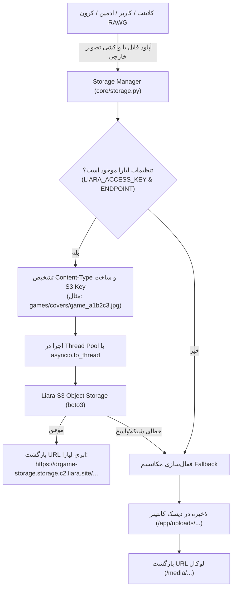

<div dir="rtl" lang="fa">

# 🚀 دستورالعمل اجرایی گام سیزدهم: پیاده‌سازی و یکپارچه‌سازی ابجکت استوریج لیارا (13-liara-object-storage)

> **شماره گام:** ۱۳  
> **عنوان مرحله:** اتصال زیرساخت رسانه و فایل‌های پلتفرم به ابجکت استوریج ابری لیارا (Liara S3 Object Storage)، ارتقای ماژول Storage، ذخیره‌سازی ابری کاورها و بنرها، تولید لینک‌های عمومی و امضاشده (Presigned URLs) و حفظ فال‌بک لوکال  
> **وابستگی‌ها:** گام‌های ۰۱ تا ۱۲  
> **مرجع سیاست‌ها:** `backend/agent/development-policy.md` (بخش‌های ۱، ۲، ۳، ۶ و ۷) و `build.txt` (پایپ‌لاین ذخیره‌سازی رسانه)

---

> [!IMPORTANT]
> **قانون قطعی و تخطی‌ناپذیر توسعه (Strict Backend-Only & Zero Frontend Disruption):**
> ۱. تمامی تغییرات این مرحله منحصراً در لایه بک‌اند (`backend/`) صورت می‌پذیرد. کدبیس فرانت‌اند (`frontend/`) کاملاً فریز (Locked / Read-Only) است و هیچ فایلی در آن ویرایش نخواهد شد.  
> ۲. خروجی آدرس‌های رسانه باید به گونه‌ای باشد که کلاینت فرانت‌اند بدون نیاز به تغییر منطق، تصاویر و فایل‌ها را به صورت مستقیم از URL معتبر (دامنه ابری لیارا یا پروکسی رسانه) دریافت و رندر نماید.

---

## ۱. اهداف و نیازمندی‌های عملکردی (Functional Requirements & Overview)

تا پیش از این مرحله، تصاویر دانلودشده از RAWG، بنرهای هیرو، آواتارها و فایل‌های آپلودی مستقیماً روی دیسک محلی کانتینر (`/app/uploads/`) ذخیره می‌شدند. با توجه به ماهیت ناپایدار (Ephemeral) دیسک کانتینرهای داکر و نیاز به مقیاس‌پذیری افقی، دسترسی سریع، و کاهش بار سرور اصلی، در این گام ذخیره‌سازی فایل‌ها به **سرویس ابجکت استوریج سازگار با S3 لیارا (Liara Object Storage)** منتقل می‌گردد.

### اهداف کلیدی گام سیزدهم:
1. **انتقال ذخیره‌سازی به S3 لیارا:**
   - اتصال بک‌اند به باکت `drgame-storage` با استفاده از کتابخانه استاندارد `boto3`.
   - ذخیره دائمی کلیه تصاویر کاتالوگ بازی‌ها (Covers, Screenshots)، بنرهای هیرو، آواتارهای کاربران و مقالات وبلاگ در فضای ابری.
2. **پایپ‌لاین پردازش ناهمگام و غیرمسدودکننده (Non-blocking Async I/O):**
   - با توجه به اینکه فراخوانی‌های `boto3` به صورت پیش‌فرض Blocking هستند، تمامی تعاملات ورودی/خروجی شبکه با S3 باید از طریق `asyncio.to_thread` اجرا شوند تا Event Loop ناهمگام FastAPI مسدود نگردد.
3. **ساختار پوشه‌بندی و کلیدگذاری منظم در باکت (Namespaced S3 Keys):**
   - سازماندهی استاندارد فایل‌ها در شاخه‌های منطقی: `games/covers/`، `games/screenshots/`، `banners/`، `avatars/`، `articles/` و `attachments/`.
4. **تولید آدرس‌های عمومی دائمی و لینک‌های موقت امضاشده (Presigned URLs):**
   - بازگرداندن URL مستقیم عمومی برای رسانه‌های کاتالوگ و تصاویر عمومی.
   - قابلیت تولید لینک دانلود امضاشده موقت با زمان انقضا (`expires_in`) برای فایل‌های دارای محدودیت سهمیه یا دسترسی اختصاصی.
5. **مکانیسم بازگشت هوشمند به دیسک محلی (Graceful Local Fallback):**
   - در صورت عدم تنظیم کلیدهای لیارا (مثلاً در محیط‌های تست لوکال بدون اینترنت) یا در صورت بروز خطای مقطعی شبکه در ارتباط با لیارا، سیستم به صورت خودکار و بدون پرتاب خطای کرش به ذخیره‌سازی محلی دیسک سوئیچ کند.
6. **اسکریپت انتقال فایل‌های موجود محلی به ابری (Media Migration Utility):**
   - نگارش یک ابزار خط فرمانی جهت آپلود دسته‌جمعی تصاویری که پیش‌تر در پوشه `uploads/` محلی ذخیره شده‌اند به باکت لیارا.

---

## ۲. مشخصات فنی و متغیرهای اتصال به لیارا (Liara S3 Credentials)

مشخصات دسترسی به ابجکت استوریج لیارا طبق اطلاعات ارائه‌شده:

| پارامتر تنظیمات | نام متغیر در `.env` | مقدار / الگو | توضیحات فنی |
| :--- | :--- | :--- | :--- |
| **نام باکت (Bucket)** | `LIARA_BUCKET_NAME` | `drgame-storage` | باکت ایجادشده در کنسول لیارا |
| **اندپوینت سرویس (Endpoint)** | `LIARA_ENDPOINT` | `https://storage.c2.liara.site` | آدرس S3 API بدون اسلش انتهایی |
| **کلید دسترسی (Access Key)** | `LIARA_ACCESS_KEY` | `m9rvoec258l68eek` | کلید احراز هویت درخواست‌های S3 |
| **کلید امنیتی (Secret Key)** | `LIARA_SECRET_KEY` | `fb10fbac-cdd6-4ded-b574-4b297c1c678a` | سکرت کی جهت امضای درخواستی V4 |
| **پیشوند URL عمومی باکت** | `LIARA_PUBLIC_URL` | `https://drgame-storage.storage.c2.liara.site` | آدرس دسترسی مستقیم به اشیاء باکت |

---

## ۳. معماری و جریان داده (Storage Architecture & Data Flow)



---

## ۴. استانداردهای پیاده‌سازی و نمونه‌کدهای مرجع

### ۴.۱. به‌روزرسانی تنظیمات پایه در `backend/app/core/config.py`

```python
# افزودن فیلدهای لیارا به کلاس Settings:
LIARA_ENDPOINT: str = "https://storage.c2.liara.site"
LIARA_BUCKET_NAME: str = "drgame-storage"
LIARA_ACCESS_KEY: str = "m9rvoec258l68eek"
LIARA_SECRET_KEY: str = "fb10fbac-cdd6-4ded-b574-4b297c1c678a"
LIARA_PUBLIC_URL: str | None = None

@property
def S3_PUBLIC_BASE_URL(self) -> str:
    if self.LIARA_PUBLIC_URL:
        return self.LIARA_PUBLIC_URL.rstrip("/")
    # الگوی پیش‌فرض لیارا: https://<bucket-name>.<endpoint-domain>
    endpoint_clean = self.LIARA_ENDPOINT.replace("https://", "").replace("http://", "").strip("/")
    return f"https://{self.LIARA_BUCKET_NAME}.{endpoint_clean}"
```

### ۴.۲. بازنویسی و ارتقای ماژول متمرکز ذخیره‌سازی در `backend/app/core/storage.py`

ماژول `storage.py` باید دارای قابلیت‌های زیر باشد:
1. **سینگلتون کلاینت S3 با Boto3:** مقداردهی کلاینت S3 با نسخه امضای `s3v4` و کش سشن.
2. **فراخوانی ناهمگام:** کلیه متدهای `put_object`, `upload_fileobj`, `delete_object`, `generate_presigned_url` درون `asyncio.to_thread` قرار گیرند.
3. **تعیین دقیق Content-Type:** ارسال `ContentType` متناسب با پسوند فایل (`image/jpeg`, `image/png`, `image/webp`, `image/svg+xml`, `application/pdf`, `application/zip`) تا مرورگرها فایل‌ها را به جای دانلود اجباری، به درستی رندر کنند.
4. **تولید خودکار نام یکتا:** استفاده از `uuid4().hex[:12]` برای جلوگیری از تداخل نام فایل‌ها.

#### نمونه ساختار کلاس `LiaraS3Storage`:
```python
import os
import uuid
import mimetypes
import logging
import asyncio
from typing import Optional, Tuple
import boto3
from botocore.config import Config
from botocore.exceptions import ClientError
from fastapi import UploadFile
import httpx
from app.core.config import settings

logger = logging.getLogger("drgame.storage")

class LiaraS3Storage:
    def __init__(self):
        self.endpoint_url = settings.LIARA_ENDPOINT
        self.bucket_name = settings.LIARA_BUCKET_NAME
        self.access_key = settings.LIARA_ACCESS_KEY
        self.secret_key = settings.LIARA_SECRET_KEY
        self._client = None

    @property
    def is_configured(self) -> bool:
        return bool(self.endpoint_url and self.bucket_name and self.access_key and self.secret_key)

    def _get_client(self):
        if self._client is None and self.is_configured:
            self._client = boto3.client(
                "s3",
                endpoint_url=self.endpoint_url,
                aws_access_key_id=self.access_key,
                aws_secret_access_key=self.secret_key,
                config=Config(signature_version="s3v4"),
                region_name="us-east-1",
            )
        return self._client

    async def upload_bytes(self, data: bytes, key: str, content_type: Optional[str] = None) -> Optional[str]:
        """Uploads raw bytes to Liara S3 in a threadpool and returns the public URL."""
        if not self.is_configured:
            return None

        if not content_type:
            content_type, _ = mimetypes.guess_type(key)
            content_type = content_type or "application/octet-stream"

        def _sync_upload():
            client = self._get_client()
            client.put_object(
                Bucket=self.bucket_name,
                Key=key,
                Body=data,
                ContentType=content_type,
            )
            return f"{settings.S3_PUBLIC_BASE_URL}/{key}"

        try:
            return await asyncio.to_thread(_sync_upload)
        except Exception as e:
            logger.error(f"S3 Upload failed for key {key}: {e}")
            return None

    async def generate_presigned_url(self, key: str, expires_in: int = 3600) -> Optional[str]:
        """Generates a temporary signed download URL for private assets."""
        if not self.is_configured:
            return None

        def _sync_presign():
            client = self._get_client()
            return client.generate_presigned_url(
                "get_object",
                Params={"Bucket": self.bucket_name, "Key": key},
                ExpiresIn=expires_in,
            )

        try:
            return await asyncio.to_thread(_sync_presign)
        except Exception as e:
            logger.error(f"Failed to generate presigned URL for {key}: {e}")
            return None
```

### ۴.۳. ارتقای توابع عمومی `download_and_save_image` و `save_uploaded_file`
- این توابع باید در وهله نخست تلاش کنند فایل را در لیارا آپلود کنند و URL ابری آن را بازگردانند.
- در صورت بروز هرگونه مشکل یا عدم اتصال، بدون ایجاد خطا در فرآیند اصلی برنامه، فایل را در دیسک محلی ذخیره کرده و آدرس `/media/...` را بازگردانند.

---

## ۵. آدرس‌دهی دقیق فایل‌ها (Explicit File Paths)

### ۵.۱. فایل‌های ویرایشی (Modified Files):
1. **`backend/requirements.txt`:**
   - افزودن پکیج‌های `boto3==1.34.131` و `botocore==1.34.131`.
2. **`backend/app/core/config.py`:**
   - افزودن متغیرهای پیکربندی لیارا (`LIARA_ENDPOINT`, `LIARA_BUCKET_NAME`, `LIARA_ACCESS_KEY`, `LIARA_SECRET_KEY`, `LIARA_PUBLIC_URL`) و پراپرتی `S3_PUBLIC_BASE_URL`.
3. **`backend/app/core/storage.py`:**
   - پیاده‌سازی کلاس `LiaraS3Storage`، آپلود ناهمگام با `asyncio.to_thread`، پشتیبانی از Presigned URLs و فال‌بک لوکال.
4. **`.env` و `.env.example`:**
   - درج متغیرهای ابجکت استوریج لیارا همراه با مقادیر واقعی در `.env` و مقادیر نمونه در `.env.example`.
5. **`docker-compose.dev.yml`:**
   - اطمینان از پاس داده شدن متغیرهای جدید `LIARA_*` به کانتینر `backend`.

### ۵.۲. فایل‌های جدید (New Files):
1. **`backend/tests/test_storage.py`:**
   - نگارش آزمون‌های خودکار برای بررسی سلامت متدهای آپلود، بازگشت URL، تولید Presigned URL و تست فال‌بک لوکال.
2. **`backend/scripts/test_liara_connection.py`:**
   - اسکریپت ایزوله خط فرمان برای بررسی فوری صحت اتصال به باکت لیارا، آپلود یک فایل تستی متنی/تصویری و دریافت موفق آن از طریق HTTP.
3. **`backend/scripts/migrate_local_media_to_s3.py`:**
   - اسکریپت اختیاری جهت خواندن فایل‌های موجود در دایرکتوری `/app/uploads/` و همگام‌سازی آن‌ها با باکت لیارا.

---

## ۶. تست‌های خودکار و تضمین کیفیت (Quality Assurance & Pytest)

آزمون‌های این گام باید در کانتینر داکر با دستور زیر اجرا شده و قبولی ۱۰۰٪ دریافت نمایند:

```bash
docker compose -f docker-compose.dev.yml run --rm backend pytest tests/test_storage.py -v
```

سناریوهای تست:
1. تست آپلود بایت‌ها و اعتبارسنجی URL بازگشتی با فرمت لیارا.
2. تست تولید Presigned URL با زمان انقضا و پارامترهای امضا.
3. تست عملکرد سیستم در صورت قطع بودن یا عدم تنظیم کلیدهای S3 (اعتبارسنجی فال‌بک سالم به دیسک محلی).
4. تست آپلود فایل با `UploadFile` فرضی و اعتبارسنجی Content-Type.

</div>
