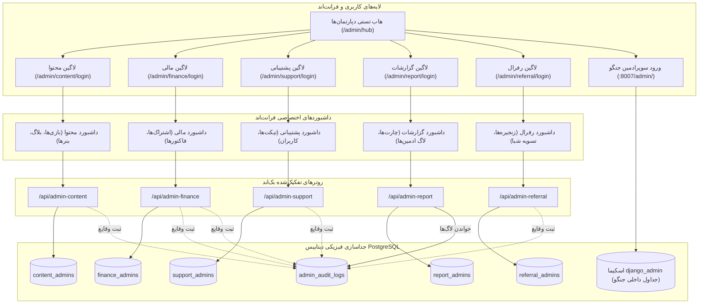

<div dir="rtl" lang="fa">

# 🛠️ دستورالعمل جامع اجرایی گام پانزدهم: بازطراحی ماژولار پنل ادمین (Zero-Trust)، سیستم گزارش‌گیری و چارت‌ها، لاگ فعالیت‌ها، پیاده‌سازی فرانت‌اند و بک‌اند، و استقرار پنل دیتابیسی جنگو روی پورت ۸۰۰۷ (15-admin-panel-overhaul-and-django-service)

> **شماره گام:** ۱۵  
> **عنوان مرحله:** بازطراحی کامل ساختار پنل مدیریت به صورت دپارتمان‌های ایزوله دیتابیسی (۵ جدول مستقل ادمین بدون سوپرادمین در پلتفرم)، سیستم احراز هویت ماژولار و تفکیک توکن‌ها، سطوح دسترسی Read-Only و Full-CRUD، سیستم گزارش‌گیری جامع با چارت‌های آماری، بازرسی لاگ فعالیت مدیران، پیاده‌سازی کامل صفحات فرانت‌اند با هاب تستی ۶گانه، و استقرار پنل دیتابیسی Django با Unfold روی پورت ۸۰۰۷ مشابه الگوی Tida-ERP  
> **وابستگی‌ها:** گام‌های ۰۱ تا ۱۴  
> **مرجع سیاست‌ها:** `backend/agent/development-policy.md`، الگوی معماری `Tida-ERP/admin-panel`، و مصوبات توافق‌شده با کارفرما  

---

> [!IMPORTANT]
> **قوانین و اصول کلیدی معماری گام پانزدهم (Core Architectural Mandates):**
> 1. **ایزولاسیون کامل دیتابیسی ادمین‌ها (Database-Level Zero-Trust):** هیچ جدول واحدی برای ادمین‌ها وجود ندارد. برای ۵ بخش اصلی سامانه، ۵ جدول دیتابیسی مستقل (`content_admins`, `finance_admins`, `support_admins`, `report_admins`, `referral_admins`) تعریف می‌شود. افشا یا دستکاری اطلاعات یک دپارتمان، هیچ اثری بر سایر دپارتمان‌ها ندارد.
> 2. **سوپرادمین منحصراً در پنل جنگو:** در فرانت‌اند و اندپوینت‌های پلتفرم دکتر گیم، هیچ حسابی به عنوان SuperAdmin وجود ندارد. سوپرادمین صرفاً یک کاربر هاردکدشده در فایل محیطی برای پنل دیتابیسی جنگو (پورت ۸۰۰۷) است.
> 3. **سطوح دسترسی دوگانه برای هر دپارتمان:** هر ادمین درون جدول خود یکی از دو سطح دسترسی `READ_ONLY` یا `FULL_CRUD` را دارد. ادمین‌های با دسترسی `FULL_CRUD` می‌توانند سایر ادمین‌های دپارتمان خود را مستقیماً از طریق پنل اضافه/ویرایش/حذف کنند (پایان نیاز به اسکریپت‌های CLI).
> 4. **ثبت و مانیتورینگ دقیق لاگ‌ها (`admin_audit_logs`):** تمامی عملیات حساس تمام دپارتمان‌ها در یک جدول ثبت شده و در پنل اختصاصی ادمین ریپورت قابل مشاهده و فیلتر است.
> 5. **ورود پنهان و مستقل (Security by Obscurity):** هیچ دکمه یا لینک مستقیمی در سایت عمومی به پنل‌های ادمین وجود ندارد. هر دپارتمان آدرس URL لاگین کاملاً مستقل دارد. جهت تست و توسعه، یک صفحه هاب تستی موقت (`/admin/hub`) شامل ۶ کارت دسترسی پیاده‌سازی می‌شود.
> 6. **استقرار سرویس جنگو روی پورت ۸۰۰۷:** مشابه معماری Tida-ERP، یک سرویس مستقل بر پایه `Django` و پوسته مدرن `django-unfold` راست‌چین (RTL) روی پورت ۸۰۰۷ مستقر می‌شود که به دیتابیس مشترک با اسکیمای ایزوله `django_admin` و مدل‌های `managed = False` متصل است.
> 7. **شمول توسعه فرانت‌اند:** در این استپ، علاوه بر بک‌اند و سرویس جنگو، صفحات، کامپوننت‌ها و چارت‌های فرانت‌اند Next.js نیز به صورت کامل و یکپارچه پیاده‌سازی می‌شوند.

---

## ۱. نقشه راه و اهداف کلان گام پانزدهم (Executive Roadmap)



---

## ۲. مدل‌های پایگاه داده و لایه ذخیره‌سازی (Database Architecture & Models)

### ۲.۱. جدول‌های ۵ گانه ادمین‌های دپارتمان‌ها
در فایل `backend/app/modules/admin/models.py`، پنج مدل مستقل ایجاد می‌شوند:

```python
import enum
from datetime import datetime, timezone
from sqlalchemy import String, Boolean, DateTime, Integer, Enum, JSON, ForeignKey, Text
from sqlalchemy.orm import Mapped, mapped_column
from app.core.database import Base

class AdminAccessLevel(str, enum.Enum):
    READ_ONLY = "read_only"
    FULL_CRUD = "full_crud"

# ۱. ادمین‌های مدیریت محتوا
class ContentAdmin(Base):
    __tablename__ = "content_admins"

    id: Mapped[int] = mapped_column(Integer, primary_key=True, index=True)
    username: Mapped[str] = mapped_column(String(60), unique=True, index=True, nullable=False)
    email: Mapped[str] = mapped_column(String(255), unique=True, index=True, nullable=False)
    mobile: Mapped[str] = mapped_column(String(20), nullable=True)
    password_hash: Mapped[str] = mapped_column(String(255), nullable=False)
    full_name: Mapped[str] = mapped_column(String(100), nullable=False)
    access_level: Mapped[AdminAccessLevel] = mapped_column(Enum(AdminAccessLevel), default=AdminAccessLevel.READ_ONLY, nullable=False)
    is_active: Mapped[bool] = mapped_column(Boolean, default=True, nullable=False)
    created_at: Mapped[datetime] = mapped_column(DateTime(timezone=True), default=lambda: datetime.now(timezone.utc))
    last_login_at: Mapped[datetime] = mapped_column(DateTime(timezone=True), nullable=True)
    created_by_admin_id: Mapped[int] = mapped_column(Integer, nullable=True)

# ۲. ادمین‌های امور مالی و اشتراک‌ها
class FinanceAdmin(Base):
    __tablename__ = "finance_admins"

    id: Mapped[int] = mapped_column(Integer, primary_key=True, index=True)
    username: Mapped[str] = mapped_column(String(60), unique=True, index=True, nullable=False)
    email: Mapped[str] = mapped_column(String(255), unique=True, index=True, nullable=False)
    mobile: Mapped[str] = mapped_column(String(20), nullable=True)
    password_hash: Mapped[str] = mapped_column(String(255), nullable=False)
    full_name: Mapped[str] = mapped_column(String(100), nullable=False)
    access_level: Mapped[AdminAccessLevel] = mapped_column(Enum(AdminAccessLevel), default=AdminAccessLevel.READ_ONLY, nullable=False)
    is_active: Mapped[bool] = mapped_column(Boolean, default=True, nullable=False)
    created_at: Mapped[datetime] = mapped_column(DateTime(timezone=True), default=lambda: datetime.now(timezone.utc))
    last_login_at: Mapped[datetime] = mapped_column(DateTime(timezone=True), nullable=True)
    created_by_admin_id: Mapped[int] = mapped_column(Integer, nullable=True)

# ۳. ادمین‌های پشتیبانی و کاربران
class SupportAdmin(Base):
    __tablename__ = "support_admins"

    id: Mapped[int] = mapped_column(Integer, primary_key=True, index=True)
    username: Mapped[str] = mapped_column(String(60), unique=True, index=True, nullable=False)
    email: Mapped[str] = mapped_column(String(255), unique=True, index=True, nullable=False)
    mobile: Mapped[str] = mapped_column(String(20), nullable=True)
    password_hash: Mapped[str] = mapped_column(String(255), nullable=False)
    full_name: Mapped[str] = mapped_column(String(100), nullable=False)
    access_level: Mapped[AdminAccessLevel] = mapped_column(Enum(AdminAccessLevel), default=AdminAccessLevel.READ_ONLY, nullable=False)
    is_active: Mapped[bool] = mapped_column(Boolean, default=True, nullable=False)
    created_at: Mapped[datetime] = mapped_column(DateTime(timezone=True), default=lambda: datetime.now(timezone.utc))
    last_login_at: Mapped[datetime] = mapped_column(DateTime(timezone=True), nullable=True)
    created_by_admin_id: Mapped[int] = mapped_column(Integer, nullable=True)

# ۴. ادمین‌های نظارت و گزارش‌گیری
class ReportAdmin(Base):
    __tablename__ = "report_admins"

    id: Mapped[int] = mapped_column(Integer, primary_key=True, index=True)
    username: Mapped[str] = mapped_column(String(60), unique=True, index=True, nullable=False)
    email: Mapped[str] = mapped_column(String(255), unique=True, index=True, nullable=False)
    mobile: Mapped[str] = mapped_column(String(20), nullable=True)
    password_hash: Mapped[str] = mapped_column(String(255), nullable=False)
    full_name: Mapped[str] = mapped_column(String(100), nullable=False)
    access_level: Mapped[AdminAccessLevel] = mapped_column(Enum(AdminAccessLevel), default=AdminAccessLevel.READ_ONLY, nullable=False)
    is_active: Mapped[bool] = mapped_column(Boolean, default=True, nullable=False)
    created_at: Mapped[datetime] = mapped_column(DateTime(timezone=True), default=lambda: datetime.now(timezone.utc))
    last_login_at: Mapped[datetime] = mapped_column(DateTime(timezone=True), nullable=True)
    created_by_admin_id: Mapped[int] = mapped_column(Integer, nullable=True)

# ۵. ادمین‌های بازاریابی و تسویه‌حساب رفرال
class ReferralAdmin(Base):
    __tablename__ = "referral_admins"

    id: Mapped[int] = mapped_column(Integer, primary_key=True, index=True)
    username: Mapped[str] = mapped_column(String(60), unique=True, index=True, nullable=False)
    email: Mapped[str] = mapped_column(String(255), unique=True, index=True, nullable=False)
    mobile: Mapped[str] = mapped_column(String(20), nullable=True)
    password_hash: Mapped[str] = mapped_column(String(255), nullable=False)
    full_name: Mapped[str] = mapped_column(String(100), nullable=False)
    access_level: Mapped[AdminAccessLevel] = mapped_column(Enum(AdminAccessLevel), default=AdminAccessLevel.READ_ONLY, nullable=False)
    is_active: Mapped[bool] = mapped_column(Boolean, default=True, nullable=False)
    created_at: Mapped[datetime] = mapped_column(DateTime(timezone=True), default=lambda: datetime.now(timezone.utc))
    last_login_at: Mapped[datetime] = mapped_column(DateTime(timezone=True), nullable=True)
    created_by_admin_id: Mapped[int] = mapped_column(Integer, nullable=True)
```

---

### ۲.۲. جدول ثبت لاگ حسابرسی مدیران (`admin_audit_logs`)

```python
class AdminAuditLog(Base):
    __tablename__ = "admin_audit_logs"

    id: Mapped[int] = mapped_column(Integer, primary_key=True, index=True)
    department: Mapped[str] = mapped_column(String(30), index=True, nullable=False)  # content, finance, support, report, referral
    admin_id: Mapped[int] = mapped_column(Integer, index=True, nullable=False)
    admin_username: Mapped[str] = mapped_column(String(60), nullable=False)
    action: Mapped[str] = mapped_column(String(50), index=True, nullable=False)  # CREATE, UPDATE, DELETE, LOGIN, APPROVE_PAYOUT, ...
    target_entity: Mapped[str] = mapped_column(String(100), nullable=True)      # e.g., "Game:12", "User:9", "Payout:3"
    ip_address: Mapped[str] = mapped_column(String(45), nullable=True)
    user_agent: Mapped[str] = mapped_column(String(255), nullable=True)
    details: Mapped[dict] = mapped_column(JSON, default=dict, nullable=False)
    created_at: Mapped[datetime] = mapped_column(DateTime(timezone=True), default=lambda: datetime.now(timezone.utc), index=True)
```

---

## ۳. امنیت، احراز هویت ماژولار و توکن‌های تفکیک‌شده (Security & Authentication)

### ۳.۱. ساختار کلیم‌های توکن JWT
هنگام لاگین هر ادمین در دپارتمان خود، توکن امضاشده صادر می‌شود:
```json
{
  "sub": "content_4",
  "admin_id": 4,
  "admin_scope": "content",
  "username": "ali_content",
  "access_level": "full_crud",
  "exp": 1730000000
}
```

### ۳.۲. دیپندنسی‌های گارد احراز هویت در `backend/app/core/admin_dependencies.py`
برای هر روتر، دیپندنسی اختصاصی پیاده‌سازی می‌شود که ۳ بررسی زیر را انجام می‌دهد:
1. توکن معتبر و فیلد `admin_scope` دقیقاً برابر با دپارتمان روت مورد نظر باشد (در غیر این صورت خطای ۴۰۱).
2. رکورد ادمین از **همان جدول اختصاصی** در دیتابیس فراخوانی شود و وضعیت `is_active == True` باشد.
3. در متدهای عملیاتی (`POST`, `PUT`, `DELETE`, `PATCH`)، فیلد `access_level` برابر با `AdminAccessLevel.FULL_CRUD` باشد (اگر `READ_ONLY` باشد، خطای ۴۰۳ «عدم دسترسی ویرایش» صادر شود).

```python
# نمونه الگوریتم دیپندنسی دپارتمان محتوا:
def require_content_admin(level: AdminAccessLevel = None):
    async def dependency(
        token: str = Depends(oauth2_scheme),
        db: AsyncSession = Depends(get_db)
    ) -> ContentAdmin:
        payload = decode_jwt(token)
        if payload.get("admin_scope") != "content":
            raise HTTPException(status_code=401, detail="توکن مربوط به دپارتمان محتوا نمی‌باشد")
        admin = await db.get(ContentAdmin, payload.get("admin_id"))
        if not admin or not admin.is_active:
            raise HTTPException(status_code=401, detail="حساب ادمین غیرفعال است")
        if level == AdminAccessLevel.FULL_CRUD and admin.access_level != AdminAccessLevel.FULL_CRUD:
            raise HTTPException(status_code=403, detail="دسترسی این حساب کاربری فقط خواندنی (Read-Only) است")
        return admin
    return dependency
```

---

## ۴. مشخصات تفصیلی اندپوینت‌های بک‌اند (File-by-File & Router Specifications)

پوشه روترهای ادمین در `backend/app/modules/admin/routers/` به ۵ فایل تفکیک می‌شود:

### ۴.۱. روت‌های مدیریت محتوا (`content_router.py` - پیشوند: `/api/admin-content`)
- `POST /auth/login`: لاگین ادمین محتوا و صدور توکن با اسکوپ `content`.
- `GET /auth/me`: دریافت مشخصات ادمین لاگین‌شده و سطح دسترسی.
- `GET /staff` & `POST /staff`: مشاهده و ساخت ادمین‌های جدید محتوا (فقط توسط ادمین با سطح `FULL_CRUD`).
- `PUT /staff/{id}` & `DELETE /staff/{id}`: ویرایش سطح دسترسی یا غیرفعال‌سازی ادمین محتوا.
- `GET /games`, `POST /games`, `PUT /games/{id}`, `DELETE /games/{id}`: کاتالوگ، فایل‌های ۵گانه، ژانرها و تخفیف‌ها.
- `POST /games/{id}/upload-media`: آپلود مستقیم کاور/بنر/اسکرین‌شات به Liara S3.
- `GET /blogs`, `POST /blogs`, `PUT /blogs/{id}`, `DELETE /blogs/{id}`: مدیریت مقالات، دسته‌بندی‌ها و اخبار.
- `GET /banners`, `POST /banners`, `PUT /banners/{id}`, `DELETE /banners/{id}`: مدیریت اسلایدرها و تبلیغات.

### ۴.۲. روت‌های امور مالی و اشتراک‌ها (`finance_router.py` - پیشوند: `/api/admin-finance`)
- `POST /auth/login`, `GET /auth/me`: احراز هویت ادمین مالی.
- `GET /staff`, `POST /staff`, `PUT /staff/{id}`, `DELETE /staff/{id}`: مدیریت ادمین‌های مالی.
- `GET /plans`, `PUT /plans/{id}`: قیمت‌گذاری و تنظیمات پلن‌های برنزی، نقره‌ای، طلایی.
- `GET /transactions`: سوابق تراکنش‌ها، پرداخت‌های درگاه شتابی و وضعیت پرداخت.
- `GET /invoices`: صدور و مشاهده فاکتورهای رسمی کاربران.
- `GET /guarantees` & `POST /guarantees/{id}/refund`: مدیریت ضمانت‌های بازگشت وجه و بازپرداخت.
- `POST /users/{id}/grant-subscription`: اعطای دستی اشتراک به کاربر.

### ۴.۳. روت‌های پشتیبانی و کاربران (`support_router.py` - پیشوند: `/api/admin-support`)
- `POST /auth/login`, `GET /auth/me`: احراز هویت ادمین پشتیبانی.
- `GET /staff`, `POST /staff`, `PUT /staff/{id}`, `DELETE /staff/{id}`: مدیریت ادمین‌های پشتیبانی.
- `GET /tickets`: لیست تیکت‌ها با فیلتر وضعیت (`open`, `in_progress`, `closed`) و اولویت.
- `GET /tickets/{id}` & `POST /tickets/{id}/reply`: مشاهده گفتگو و ارسال پاسخ رسمی پشتیبانی.
- `PUT /tickets/{id}/status`: بستن یا بازگشایی مجدد تیکت.
- `GET /users`: لیست کاربران با قابلیت جستجوی نام، موبایل، ایمیل و تاریخچه.
- `GET /users/{id}/dossier`: پرونده جامع گیمر شامل لاگین‌ها، سهمیه دانلود، اشتراک‌های فعال.
- `POST /users/{id}/adjust-quota`: تنظیم یا افزایش دستی سهمیه حجم دانلود کاربر.
- `PUT /users/{id}/status`: مسدودسازی یا فعال‌سازی حساب کاربری متخلف.

### ۴.۴. روت‌های گزارش‌گیری و نظارت (`report_router.py` - پیشوند: `/api/admin-report`)
- `POST /auth/login`, `GET /auth/me`: احراز هویت ادمین گزارشات.
- `GET /staff`, `POST /staff`, `PUT /staff/{id}`, `DELETE /staff/{id}`: مدیریت ادمین‌های ریپورت.
- `GET /summary`: کارت‌های خلاصه‌آمار (مجموع درآمد ماه، کاربران جدید، ترافیک مصرفی، تیکت‌های باز).
- `GET /charts/sales`: نمودار خطی/میله‌ای فروش بر اساس بازه زمانی (روزانه، هفتگی، ماهانه، سالانه).
- `GET /charts/users`: نمودار رشد کاربران و ثبت‌نام‌ها.
- `GET /charts/subscriptions`: پای‌چارت توزیع پلن‌های فعال (برنزی vs نقره‌ای vs طلایی).
- `GET /charts/downloads`: لیست و چارت پردانلودترین بازی‌ها.
- `GET /charts/tickets`: تحلیل میانگین زمان پاسخ‌دهی به تیکت‌ها.
- `GET /audit-logs`: **مشاهده و فیلتر دقیق لاگ فعالیت تمام ادمین‌ها** (بر اساس دپارتمان، نوع اکشن، تاریخ، شناسه ادمین).

### ۴.۵. روت‌های بازاریابی و تسویه‌حساب رفرال (`referral_router.py` - پیشوند: `/api/admin-referral`)
- `POST /auth/login`, `GET /auth/me`: احراز هویت ادمین رفرال.
- `GET /staff`, `POST /staff`, `PUT /staff/{id}`, `DELETE /staff/{id}`: مدیریت ادمین‌های رفرال.
- `GET /chains`: مشاهده درخت زنجیره معرف‌ها و پورسانت‌های ۳ سطحی و معرفی‌شدگان.
- `GET /settlement-accounts`: لیست تمام شماره‌های شبای بانکی ثبت‌شده توسط کاربران.
- `GET /payouts`: لیست درخواست‌های تسویه‌حساب با فیلتر وضعیت (`pending`, `completed`, `rejected`).
- `POST /payouts/{id}/process`: تایید درخواست واریز (با ثبت شماره پیگیری و فیش بانکی) یا رد درخواست با درج علت.

---

## ۵. استقرار پنل دیتابیسی جنگو روی پورت ۸۰۰۷ (Django Service Specification)

مشابه معماری تیدا ERP (`admin-panel/`):

### ۵.۱. معماری سرویس
- دایرکتوری در ریشه پروژه: `/home/tida/Desktop/Projects/DrGame-Eccomerce/admin-panel/`
- پورت دسترسی: **`8007`** (قابل مپ شدن در داکر: `8007:8007`)
- اتصال دیتابیس: اتصال مستقیم به همان کانتینر PostgreSQL با تنظیم `search_path=django_admin,public`.
- اسکیماهای تفکیک‌شده:
  - اسکیمای `django_admin`: برای جداول داخلی جنگو (`auth_user`, `django_admin_log`, `django_session`, `django_content_type`).
  - اسکیمای `public`: تمام جداول دکتر گیم که در جنگو با ویژگی `managed = False` معرفی می‌شوند؛ بنابراین جنگو **هیچ‌گونه تداخلی** با مایگریشن‌های Alembic نخواهد داشت.
- رابط کاربری: کتابخانه **`django-unfold`** با زبان فارسی (`LANGUAGE_CODE = 'fa-ir'`)، تم تاریک و چینش کاملاً راست‌چین (RTL).
- احراز هویت: کاربر سوپرادمین از متغیرهای هاردکدشده در `.env` ساخته می‌شود:
  - `DJANGO_ADMIN_USERNAME=superadmin`
  - `DJANGO_ADMIN_PASSWORD=...`
  - `DJANGO_ADMIN_PORT=8007`

### ۵.۲. ابزار خودکار تولید مدل‌های جنگو (`scripts/generate_models.py`)
اسکریپتی که تمام مدل‌های SQLAlchemy را خوانده و فایل‌های `models.py` و `admin.py` جنگو را برای تمام جداول پلتفرم تولید می‌کند تا تمامی رکوردها در پنل ۸۰۰۷ قابل مشاهده و جستجو باشند.

---

## ۶. مشخصات تفصیلی فرانت‌اند Next.js (Frontend Architecture & Views)

### ۶.۱. ساختار صفحات در `frontend/src/app/(admin)/admin/`
```text
frontend/src/app/(admin)/admin/
├── hub/
│   └── page.tsx                     ← هاب تستی ۶ کارته (هدایت به لاگین دپارتمان‌ها و جنگو)
├── content/
│   ├── login/page.tsx               ← صفحه لاگین مستقل ادمین محتوا
│   ├── layout.tsx                   ← سایدبار و هدر اختصاصی دپارتمان محتوا
│   ├── page.tsx                     ← داشبورد محتوا
│   ├── games/page.tsx               ← کاتالوگ بازی‌ها، آپلود S3، پارت‌های ۵گانه
│   ├── blog/page.tsx                ← بلاگ و اخبار
│   ├── banners/page.tsx             ← بنرها و اسلایدرها
│   └── staff/page.tsx               ← مدیریت همکاران محتوا (ایجاد/ویرایش با دسترسی CRUD/Read-Only)
├── finance/
│   ├── login/page.tsx               ← صفحه لاگین مستقل ادمین مالی
│   ├── layout.tsx                   ← سایدبار و هدر اختصاصی مالی
│   ├── page.tsx                     ← داشبورد مالی و تراکنش‌ها
│   ├── subscriptions/page.tsx       ← پلن‌های اشتراک
│   ├── guarantees/page.tsx          ← ضمانت‌های بازگشت وجه
│   └── staff/page.tsx               ← مدیریت همکاران مالی
├── support/
│   ├── login/page.tsx               ← صفحه لاگین مستقل ادمین پشتیبانی
│   ├── layout.tsx                   ← سایدبار و هدر اختصاصی پشتیبانی
│   ├── page.tsx                     ← داشبورد تیکت‌ها
│   ├── tickets/page.tsx             ← لیست و چت تیکتینگ
│   ├── users/page.tsx               ← پرونده کاربران و مدیریت سهمیه
│   └── staff/page.tsx               ← مدیریت همکاران پشتیبانی
├── report/
│   ├── login/page.tsx               ← صفحه لاگین مستقل ادمین نظارت
│   ├── layout.tsx                   ← سایدبار و هدر اختصاصی گزارشات
│   ├── page.tsx                     ← داشبورد چارت‌ها و شاخص‌ها
│   ├── charts/page.tsx              ← نمودارهای تفصیلی فروش، رشد و اشتراک
│   ├── audit-logs/page.tsx          ← جدول بازرسی لاگ فعالیت ادمین‌ها
│   └── staff/page.tsx               ← مدیریت همکاران ریپورت
└── referral/
    ├── login/page.tsx               ← صفحه لاگین مستقل ادمین رفرال
    ├── layout.tsx                   ← سایدبار و هدر اختصاصی رفرال
    ├── page.tsx                     ← داشبورد شبکه بازاریابی
    ├── payouts/page.tsx             ← تایید و ثبت فیش تسویه‌حساب بانکی
    ├── chains/page.tsx              ← نمایش درخت و سطوح معرف‌ها
    └── staff/page.tsx               ← مدیریت همکاران رفرال
```

### ۶.۲. صفحه هاب تستی (`/admin/hub`)
شامل ۶ کارت شیشه‌ای بلورین با حاشیه بنفش نئونی و آیکون‌های جذاب:
1. **دپارتمان مدیریت محتوا (Content Admin):** آیکون گیم‌پد 🎮 | هدایت به `/admin/content/login`
2. **دپارتمان امور مالی و اشتراک (Finance Admin):** آیکون کارت اعتباری 💳 | هدایت به `/admin/finance/login`
3. **دپارتمان پشتیبانی و کاربران (Support Admin):** آیکون هدست 🎧 | هدایت به `/admin/support/login`
4. **دپارتمان گزارشات و نظارت (Report Admin):** آیکون نمودار 📊 | هدایت به `/admin/report/login`
5. **دپارتمان بازاریابی و رفرال (Referral Admin):** آیکون زنجیره 🔗 | هدایت به `/admin/referral/login`
6. **سوپرادمین مستقیم پایگاه داده (Django Admin):** آیکون تاج طلایی 👑 | لینک خارجی به `http://localhost:8007/admin/`

### ۶.۳. موتور نمودارهای فوق سریع (High-Performance Lightweight Charts)
جهت جلوگیری از سنگین شدن باندل و حفظ لود آنی:
- پیاده‌سازی کامپوننت‌های چارت خطی و میله‌ای با **Native SVG / Lightweight Canvas** یا کتابخانه کم‌حجم.
- استفاده از رنگ‌بندی کهکشانی: مشکی OLED (`#070709`)، بنفش نئونی (`#7C3AED`)، فیروزه‌ای (`#06B6D4`) و زرد طلایی (`#F59E0B`).

---

## ۷. برنامه تست، اعتبارسنجی و تضمین کیفیت (Testing Suite)

1. **تست‌های تفکیک و ایزولاسیون توکن (Token Scope Isolation Tests):**
   - اطمینان از اینکه ارسال توکن دپارتمان محتوا به روتر مالی منجر به خطای ۴۰۱ می‌گردد.
2. **تست‌های گارد دسترسی Read-Only در برابر Full-CRUD:**
   - اطمینان از اینکه اکانت‌های با سطح `READ_ONLY` قادر به ایجاد یا حذف موجودیت نبوده و خطای ۴۰۳ دریافت می‌کنند.
3. **تست لاگ‌اندازی `admin_audit_logs`:**
   - تست ثبت خودکار لاگ پس از هر عملیات تغییر وضعیت یا ایجاد موجودیت.
4. **تست سرویس جنگو روی پورت ۸۰۰۷:**
   - تست بالا آمدن سرویس جنگو در داکر، ایجاد خودکار سوپرادمین از فایل env، و باز شدن صفحه لاگین `/admin/`.
5. **تست بیلد فرانت‌اند و رندرهای SSR:**
   - تست اجرای روان صفحات فرانت‌اند در Next.js بدون خطای کامپایل.

</div>
