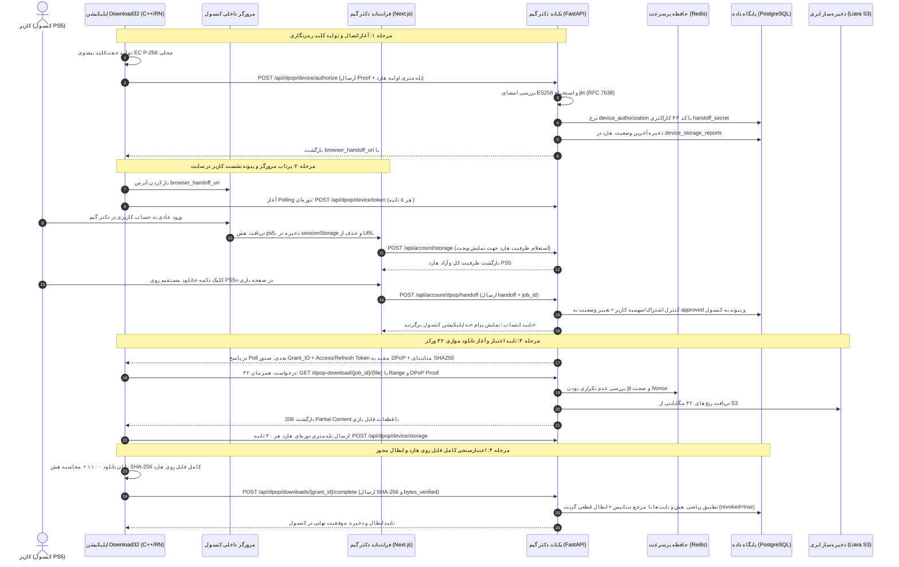
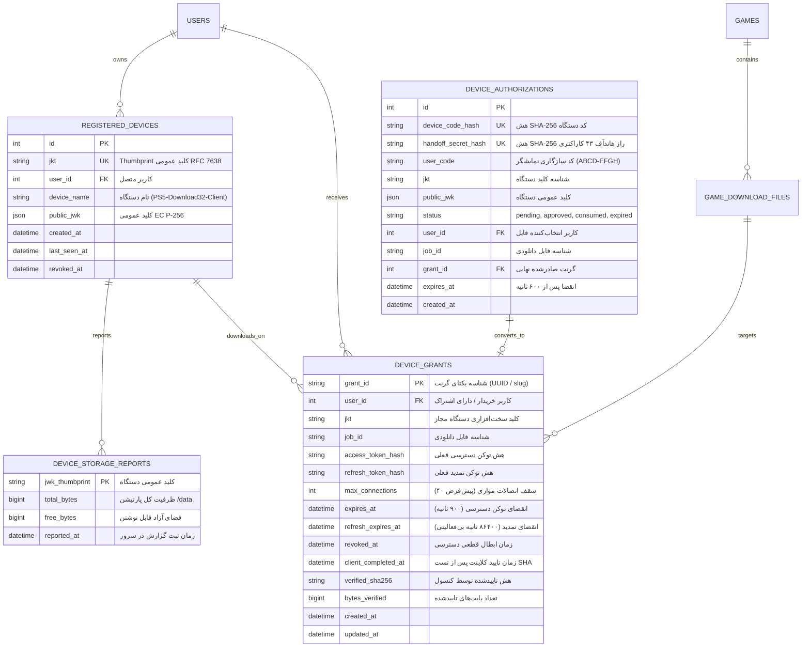

<div dir="rtl" lang="fa">

# 🎮 دستورالعمل جامع اجرایی گام شانزدهم: یکپارچه‌سازی پلتفرم با اپلیکیشن بومی Download32 کنسول PS5، پروتکل اثبات کلید DPoP (RFC 9449)، انتقال بدون اصطکاک مرورگر (Browser Handoff)، موتور دانلود موازی ۳۲ کانکشنه و تله‌متری زنده حافظه کنسول (16-ps5-download32-and-dpop-integration)

> **شماره گام:** ۱۶  
> **عنوان مرحله:** پیاده‌سازی پروتکل ارتباطی امن و بدون اصطکاک با اپلیکیشن Download32 کنسول پلی‌استیشن ۵ (نسخه 01.015.000+)، پروتکل اثبات مالکیت کلید DPoP طبق استاندارد RFC 9449، جریان Handoff مرورگر، موتور سرو موازی فایل با ۳۲ ورکر و چانک‌های ۳۲ مگابایتی، سامانه ثبت و مانیتورینگ زنده تله‌متری حافظه هارد PS5 (`/data`) در سایت، و ابطال اتمیک گرنت با اعتبارسنجی هش SHA-256 کامل  
> **وابستگی‌ها:** گام‌های ۰۱ تا ۱۵، ماژول بازی‌ها و فایل‌های دانلودی ۵ پارت (`GameDownloadFile`)، سیستم اشتراک و سهمیه دانلود، استوریج Liara S3  
> **اسناد مرجع مبنا:** `DOWNLOAD32_MAIN_SITE_INTEGRATION_FA.md` و `CONSOLE_STORAGE_SITE_INTEGRATION_FA.md`  

---

> [!IMPORTANT]
> **اصول و الزامات تخطی‌ناپذیر معماری گام شانزدهم (Core Inviolable Mandates):**
> 1. **اثبات مالکیت کلید (DPoP Key-Binding - RFC 9449):** هیچ توکن دانلود از نوع Bearer ساده یا لینک عمومی با توکن متنی وجود ندارد. تمام توکن‌های دانلود مقید به کلید خصوصی سخت‌افزاری کنسول (`EC P-256`) هستند. حتی با افشای کامل توکن دسترسی یا آدرس دانلود، بدون کلید خصوصی کنسول، دانلود حتی یک بایت از فایل غیرممکن است.
> 2. **جریان Handoff بدون کد (Zero-Friction Browser Handoff):** کاربر نیازی به تایپ کد ۸ رقمی یا کپی توکن ندارد. اپلیکیشن کنسول مرورگر را با پارامتر هشدار `#ps5=<43-char-secret>` باز می‌کند. سایت پس از لاگین معمولی کاربر، با فشردن دکمه «دانلود مستقیم روی PS5»، فایل را به همان راز Handoff پیوند می‌زند و اپ در پس‌زمینه دانلود را شروع می‌کند.
> 3. **عدم انقضای خودسرانه وسط دانلود:** سرور هرگز با ارسال آخرین بایت یا فرض پوشش رنج‌ها، مجوز دانلود را باطل نمی‌کند. مجوز تنها پس از دریافت سیگنال رسمی `complete` از کنسول همراه با تایید هش SHA-256 کل فایل باطل می‌گردد.
> 4. **پشتیبانی کامل از موتور ۳۲ کانکشنه:** سرور باید قادر به سرو موازی ۳۲ ورکر همزمان به ازای هر دانلود با چانک‌های ۳۲ مگابایتی (`33,554,432 bytes`) و رنج‌های منقسم (Split Ranges) و پروب‌های تک‌بایتی `bytes=0-0` بدون مصرف رم اضافی (پایپ مستقیم استریم از S3) باشد.
> 5. **تله‌متری زنده حافظه PS5 در سایت:** حجم هارد `/data` که توسط اپ با توابع بومی سیستم‌عامل خوانده می‌شود، در سایت به صورت کارت گرافیکی نمایش داده شده و در صورت کمبود فضا پیش از دانلود به کاربر هشدار می‌دهد.
> 6. **ایمنی در برابر Replay و Nonce Storm:** هر درخواست ورکر دارای یک `jti` تصادفی و تازه است که در ردیس با سرعت میکروثانیه بررسی و یکبارمصرف می‌شود. نانس‌های سرور دارای هم‌پوشانی زمانی جهت جلوگیری از باطل شدن همزمان ۳۲ ورکر هستند.

---

## ۱. نقشه راه و نمودار توالی عملیات (End-to-End Sequence Diagram)



---

## ۲. مدل داده و اسکیمای پایگاه داده (Database Schema & Models)

مدل‌های زیر در ماژول `app/modules/dpop/models.py` پیاده‌سازی شده و از طریق مایگریشن Alembic به پایگاه داده PostgreSQL افزوده می‌شوند:



### ساختار کلیدهای ردیس (Redis In-Memory Key Design)
جهت تضمین پاسخ‌دهی زیر ۱۰ میلی‌ثانیه برای ۳۲ ورکر موازی:
* `dpop:replay:{jkt}:{jti}`: با انقضای ۱۲۰ ثانیه (`SETNX`) جهت رد فوری درخواست‌های Replay.
* `dpop:nonce:{nonce_str}`: نانس‌های معتبر صادرشده برای کلاینت با انقضای ۱۸۰ ثانیه.
* `dpop:recovery:{device_code_hash}`: کش موقت ۳۰۰ ثانیه‌ای برای بازیابی امن پاسخ‌های گم‌شده شبکه (Graceful Recovery).

---

## ۳. هسته رمزنگاری DPoP طبق RFC 9449 و RFC 7638

ماژول امنیتی اختصاصی در مسیر `app/core/dpop.py` مسئول تمامی محاسبات ریاضی و اعتبارسنجی‌های رمزنگاری است:

### ۳.۱. مشخصات کلید بیضوی (Elliptic Curve Key)
* **منحنی مجاز:** فقط منحنی استاندارد `P-256` (یا `secp256r1` / `prime256v1`).
* **الگوریتم امضا:** `ES256` (ECDSA با هش SHA-256).
* **قالب JWK عمومی:**
  ```json
  {
    "kty": "EC",
    "crv": "P-256",
    "x": "f83OJ3D2xFmT4v7Gy4eDA5XqkRNu39S6NY57QgoQwts",
    "y": "x_daQauBhQ0tZxP99jS28wA2yvWzD9T442m3r_aN2kg"
  }
  ```
  > [!CAUTION]
  > وجود هرگونه پارامتر کلید خصوصی (مانند فیلد `d`) در شیء JWK بلافاصله منجر به رد درخواست با خطای `400 Bad Request` می‌شود.

### ۳.۲. محاسبه شناسه اثرانگشت کلید (JWK Thumbprint - RFC 7638)
اثرانگشت کلید (`jkt`) از روی هش SHA-256 رشته JSON کانونیکال و بدون فاصله فیلدهای اجباری تولید می‌شود:
$$\text{Canonical JSON} = \text{\{"crv":"P-256","kty":"EC","x":"...","y":"..."\}}$$
$$\text{jkt} = \text{base64url}(\text{SHA256}(\text{Canonical JSON}))$$

### ۳.۳. کلیم‌ها و فیلدهای هدر اثبات DPoP Proof
هر اثبات ارسالی در هدر `DPoP: <jwt>` باید شامل فیلدهای زیر باشد:
* **Header:**
  * `typ`: دقیقاً `"dpop+jwt"`
  * `alg`: دقیقاً `"ES256"`
  * `jwk`: شیء کلید عمومی
* **Payload:**
  * `jti`: رشته تصادفی و یکتا برای هر درخواست (جلوگیری از Replay Attack)
  * `htm`: متد HTTP درخواست (مثلاً `"GET"` یا `"POST"`)
  * `htu`: آدرس کامل و دقیق عمومی درخواست (بدون Query و Fragment)
  * `iat`: زمان صدور توکن بر حسب ثانیه (بازه مجاز ±۱۲۰ ثانیه نسبت به ساعت سرور)
  * `nonce`: نانس معتبر صادرشده توسط سرور (در صورت نیاز)
  * `ath`: هش توکن دسترسی:
    $$\text{ath} = \text{base64url}(\text{SHA256}(\text{access\_token}))$$
    *(فقط در درخواست‌هایی که هدر `Authorization: DPoP <token>` دارند الزامی است)*

---

## ۴. مشخصات کامل اندپوینت‌های API (API Specifications)

### ۴.۱. شروع اتصال اپلیکیشن کنسول (`POST /api/dpop/device/authorize`)
اپلیکیشن در بدو باز شدن این متد را با اثبات کلید خود فراخوانی می‌کند:
* **Headers:**
  * `DPoP: <fresh-proof>`
* **Request Body:**
  ```json
  {
    "device_name": "PS5-Download32-Client",
    "scope": "download:file",
    "browser_handoff": true,
    "storage": {
      "volume": "/data",
      "total_bytes": 1000000000000,
      "free_bytes": 250000000000
    }
  }
  ```
* **Response (HTTP 200 OK):**
  ```json
  {
    "device_code": "dpop_dc_a1b2c3d4e5f6...",
    "user_code": "ABCD-EFGH",
    "browser_handoff_uri": "https://dltest.gamedr.ir/login/#ps5=XXXXXXXXXXXXXXXXXXXXXXXXXXXXXXXXXXXXXXXXXXX",
    "verification_uri": "https://dltest.gamedr.ir/account/",
    "expires_in": 600,
    "interval": 5,
    "jkt": "PUBLIC_KEY_THUMBPRINT"
  }
  ```

---

### ۴.۲. پایش وضعیت صدور مجوز توسط کنسول (`POST /api/dpop/device/token`)
اپلیکیشن کنسول هر ۵ ثانیه سرور را با ارسال کد دستگاه و اثبات کلید پایش می‌کند:
* **Headers:**
  * `DPoP: <fresh-proof>`
* **Request Body:**
  ```json
  {
    "grant_type": "urn:ietf:params:oauth:grant-type:device_code",
    "device_code": "dpop_dc_a1b2c3d4e5f6..."
  }
  ```
* **حالت در حال انتظار (HTTP 400 Bad Request):**
  ```json
  {
    "error": "authorization_pending"
  }
  ```
* **حالت تایید و صدور موفق گرنت (HTTP 200 OK):**
  ```json
  {
    "token_type": "DPoP",
    "access_token": "DPOP_ACCESS_TOKEN_STRING",
    "refresh_token": "DPOP_REFRESH_TOKEN_STRING",
    "expires_in": 900,
    "refresh_expires_in": 86400,
    "grant_id": "grant_998877",
    "device_id": "device_112233",
    "jkt": "PUBLIC_KEY_THUMBPRINT",
    "job_id": "job_gow_ragnarok_p1",
    "download_url": "https://dltest.gamedr.ir/dpop-download/job_gow_ragnarok_p1/file.bin",
    "file": {
      "job_id": "job_gow_ragnarok_p1",
      "file_name": "God_of_War_Ragnarok_Part1.pkg",
      "size_bytes": 10737418240,
      "sha256": "e3b0c44298fc1c149afbf4c8996fb92427ae41e4649b934ca495991b7852b855",
      "etag": "\"sha256-e3b0c44298fc1c149afbf4c8996fb92427ae41e4649b934ca495991b7852b855\"",
      "file_version": "sha256-e3b0c44298fc1c149afbf4c8996fb92427ae41e4649b934ca495991b7852b855"
    },
    "max_connections": 40,
    "recovered": false
  }
  ```

---

### ۴.۳. پیوند انتخاب فایل در سایت به کنسول (`POST /api/account/dpop/handoff`)
توسط فرانت‌اند سایت به هنگام کلیک کاربر روی «دانلود روی PS5» ارسال می‌شود:
* **Headers:**
  * `Authorization: Bearer <user-jwt-token>` (نشست کاربر در سایت)
  * `Origin: https://dltest.gamedr.ir`
* **Request Body:**
  ```json
  {
    "handoff": "XXXXXXXXXXXXXXXXXXXXXXXXXXXXXXXXXXXXXXXXXXX",
    "job_id": "job_gow_ragnarok_p1"
  }
  ```
* **کنترل‌های امنیتی سرور:**
  1. بررسی فعال بودن حساب کاربر و داشتن سهمیه یا اشتراک معتبر برای این فایل.
  2. جست‌وجوی رکورد `device_authorizations` با هش سکرت هاندآف ۴۳ کاراکتری.
  3. تغییر وضعیت اتمیک رکورد به `approved` و درج `user_id` و `job_id`.
  4. جلوگیری اتمیک از Race Condition (فقط اولین ادعای معتبر تایید می‌شود).
* **Response (HTTP 200 OK):**
  ```json
  {
    "ok": true,
    "job_id": "job_gow_ragnarok_p1"
  }
  ```

---

### ۴.۴. گزارش دوره‌ای تله‌متری حافظه هارد PS5 (`POST /api/dpop/device/storage`)
هر ۳۰ ثانیه از طرف اپلیکیشن کنسول ارسال می‌شود:
* **Headers:**
  * `DPoP: <fresh-proof>`
* **Request Body:**
  ```json
  {
    "volume": "/data",
    "total_bytes": 1000000000000,
    "free_bytes": 250000000000
  }
  ```
* **Response (HTTP 200 OK):**
  * هدرهای `Cache-Control: no-store`, `Server-Time: <epoch>`, `DPoP-Nonce: <nonce>`
  ```json
  {
    "ok": true
  }
  ```

---

### ۴.۵. استعلام وضعیت حافظه کنسول برای سایت (`POST /api/account/storage`)
سایت هر ۱۰ ثانیه وضعیت هارد کنسول‌های کاربر را جهت نمایش در ویجت استعلام می‌کند:
* **Headers:**
  * `Authorization: Bearer <user-jwt>`
  * `Origin: https://dltest.gamedr.ir`
* **Request Body (همراه با سکرت هاندآف تب یا خالی):**
  ```json
  {
    "handoff": "XXXXXXXXXXXXXXXXXXXXXXXXXXXXXXXXXXXXXXXXXXX"
  }
  ```
* **Response (HTTP 200 OK):**
  ```json
  {
    "devices": [
      {
        "device_name": "PS5-Download32-Client",
        "volume": "/data",
        "total_bytes": 1000000000000,
        "free_bytes": 250000000000,
        "reported_at": 1793400000,
        "age_seconds": 12,
        "stale": false
      }
    ]
  }
  ```
  *(اگر `age_seconds > 90` باشد، فیلد `stale: true` برگردانده می‌شود تا در UI اخطار آفلاین بودن نمایش یابد)*.

---

### ۴.۶. موتور سرو استریم فایل‌های حجیم (`GET /dpop-download/{job_id}/{filename}`)
این اندپوینت میزبان ترافیک اصلی دانلود موازی ۳۲ ورکر کنسول است:
* **Headers ارسالی از کنسول:**
  * `Authorization: DPoP <dpop-access-token>`
  * `DPoP: <fresh-proof-with-ath>`
  * `Range: bytes=0-33554431` (رنج قطعه ۳۲ مگابایتی)
  * `If-Range: "sha256-<hash>"`
* **Headers بازگشتی از سرور (HTTP 206 Partial Content):**
  * `Content-Type: application/octet-stream`
  * `Accept-Ranges: bytes`
  * `Content-Range: bytes 0-33554431/10737418240`
  * `Content-Length: 33554432`
  * `ETag: "sha256-e3b0c44298fc1c149afbf4c8996fb92427ae41e4649b934ca495991b7852b855"`
  * `X-Content-SHA256: e3b0c44298fc1c149afbf4c8996fb92427ae41e4649b934ca495991b7852b855`
  * `Cache-Control: no-store`
  * `DPoP-Nonce: <fresh-nonce>`
  * `Server-Time: <epoch-seconds>`

---

### ۴.۷. اعلام اتمام دانلود و ابطال قطعی گرنت (`POST /api/dpop/downloads/{grant_id}/complete`)
کنسول پس از دریافت ۱۰۰٪ بایت‌ها و راستی‌آزمایی هش SHA-256 روی هارد خود، این متد را فراخوانی می‌کند:
* **Headers:**
  * `Authorization: DPoP <dpop-access-token>`
  * `DPoP: <fresh-proof-including-ath>`
* **Request Body:**
  ```json
  {
    "sha256": "e3b0c44298fc1c149afbf4c8996fb92427ae41e4649b934ca495991b7852b855",
    "bytes_verified": 10737418240,
    "revoke_grant": true
  }
  ```
* **اعتبارسنجی سرور:**
  1. مطابقت دقیق `bytes_verified` با حجم کل فایل در دیتابیس (`file.size_bytes`).
  2. مطابقت دقیق هش `sha256` با هش مرجع در دیتابیس.
  3. علامت‌گذاری `revoked_at` و `client_completed_at` در جدول `device_grants`.
* **Response (HTTP 200 OK):**
  ```json
  {
    "ok": true,
    "grant_id": "grant_998877",
    "job_id": "job_gow_ragnarok_p1",
    "sha256_verified": true,
    "bytes_verified": 10737418240,
    "revoked": true
  }
  ```

---

## ۵. معماری رابط کاربری فرانت‌اند (Next.js 14 Frontend UI)

### ۵.۱. هوک مدیریت هاندآف کنسول (`usePs5Handoff`)
یک هوک کلاینتی در `frontend/src/hooks/usePs5Handoff.ts`:
* خواندن پارامتر هش `#ps5=<43-char-secret>` از `window.location.hash`.
* ذخیره‌سازی ایمن در `sessionStorage` تب جاری با کلید `drgame_download32_handoff`.
* پاکسازی بلافاصله پارامتر از نوار آدرس مرورگر با `history.replaceState` بدون ایجاد ری‌لود.

### ۵.۲. ویجت نمایش حافظه زنده کنسول (`ConsoleStorageWidget`)
کامپوننت اختصاصی در `frontend/src/components/console/ConsoleStorageWidget.tsx`:
* استعلام خودکار هر ۱۰ ثانیه از `/api/account/storage`.
* نمایش کارت تاریک و مدرن شیشه‌ای (Glassmorphism) متناسب با تم نئونی دکتر گیم:
  * نام کنسول متصل‌شده.
  * نوار درصد فضای مصرف‌شده و آزاد (مثلاً: `فضای کل: 825 GiB — آزاد: 340 GiB`).
  * تگ وضعیت: `آنلاین` (سبز) یا `گزارش قدیمی` (زرد در صورت `stale: true`).
  * مقایسه هوشمند حجم بازی فعلی با فضای آزاد؛ چنانچه حجم فایل از فضای آزاد بیشتر باشد، نوار به رنگ قرمز نئونی درآمده و پیام هشدار نمایش می‌یابد.

### ۵.۳. دکمه عملیاتی «دانلود مستقیم روی PS5»
* در کامپوننت دانلود بازی‌ها (`frontend/src/components/games/DownloadLinksModal.tsx` و صفحه دانلودها):
  * اگر کاربر از کنسول آمده باشد (وجود Handoff در سشن)، این دکمه به عنوان دکمه اصلی و برجسته نمایش می‌یابد.
  * پس از کلیک و ارسال موفقیت‌آمیز به بک‌اند، یک انیمیشن زیبا همراه با پیام «دستور دانلود به کنسول شما ارسال شد؛ به اپلیکیشن بازگردید» نمایش داده می‌شود.

---

## ۶. ماتریس خطاها و سناریوهای مرزی (Edge Cases & Resilience Matrix)

| سناریو | رفتار سرور / کلاینت | وضعیت پاسخ |
|---|---|---|
| عدم انتخاب فایل در سایت و تلاش برای دریافت توکن | پاسخ استاندارد `authorization_pending` و ادامه Polling طبق `interval` | `400 Bad Request` |
| ارسال نانس قدیمی یا منقضی‌شده توسط ورکرها | بازگرداندن هدر `WWW-Authenticate: DPoP error="use_dpop_nonce"` همراه نانس تازه | `401 Unauthorized` |
| اختلاف ساعت کنسول با سرور (`iat` خارج از بازه) | بازگرداندن هدر `Server-Time` با زمان دقیق یونیکس سرور جهت تصحیح کلاینت | `400 / 401` |
| درخواست دانلود با توکن معتبر اما کلید عمومی متفاوت | خطای عدم تطابق اثرانگشت کلید (`dpop_key_mismatch`) و رد فوری | `401 Unauthorized` |
| درخواست تکراری با همان `jti` | شناسایی حمله بازپخش در ردیس (`dpop_replay_detected`) و انسداد درخواست | `401 Unauthorized` |
| انقضای توکن دسترسی در میان یک استریم ۳۲ مگابایتی | عدم قطع استریم در حال انتقال؛ تمدید با `refresh_token` برای رنج‌های بعدی | `206 ادامه می‌یابد` |
| درخواست پروب اولیه `Range: bytes=0-0` | بازگرداندن ۱ بایت اول فایل همراه با متادیتای رنج کامل، بدون احتساب در مصرف سهمیه | `206 Partial Content` |
| تلاش برای ثبت اتمام دانلود با هش نامنطبق یا بایت ناقص | رد ادعا و عدم ابطال گرنت (`SHA mismatch / Bytes mismatch`) | `400 Bad Request` |

---

## ۷. معیارهای پذیرش و آزمون نهایی گام ۱۶ (Acceptance Checklist)
1. صدور موفق کدهای Handoff و Device Code بر اساس اثبات کلید `EC P-256`.
2. ثبت موفقیت‌آمیز تله‌متری اولیه و دوره‌ای حافظه کنسول در PostgreSQL و بازگشت در API استعلام سایت.
3. پیوند موفقیت‌آمیز فایل انتخابی کاربر در فرانت‌اند با سکرت Handoff کنسول بدون نیاز به تایپ دستی کد.
4. اعتبارسنجی ریاضی امضای DPoP، کنترل Replay Attack و نانس‌ها در تمامی اندپوینت‌های محافظت‌شده.
5. استریم موفق موازی چانک‌های ۳۲ مگابایتی فایل‌های بازی روی مسیر `/dpop-download/...` با هدرهای استاندارد HTTP 206.
6. اعتبارسنجی موفق هش SHA-256 کامل و ابطال اتمیک گرنت پس از دانلود کامل.
7. رندر بدون نقص ویجت حافظه کنسول و دکمه دانلود در فرانت‌اند Next.js.
8. سبز بودن ۱۰۰٪ تست‌های Pytest برای تمامی اندپوینت‌های DPoP و یکپارچه‌سازی سرویس.

</div>
