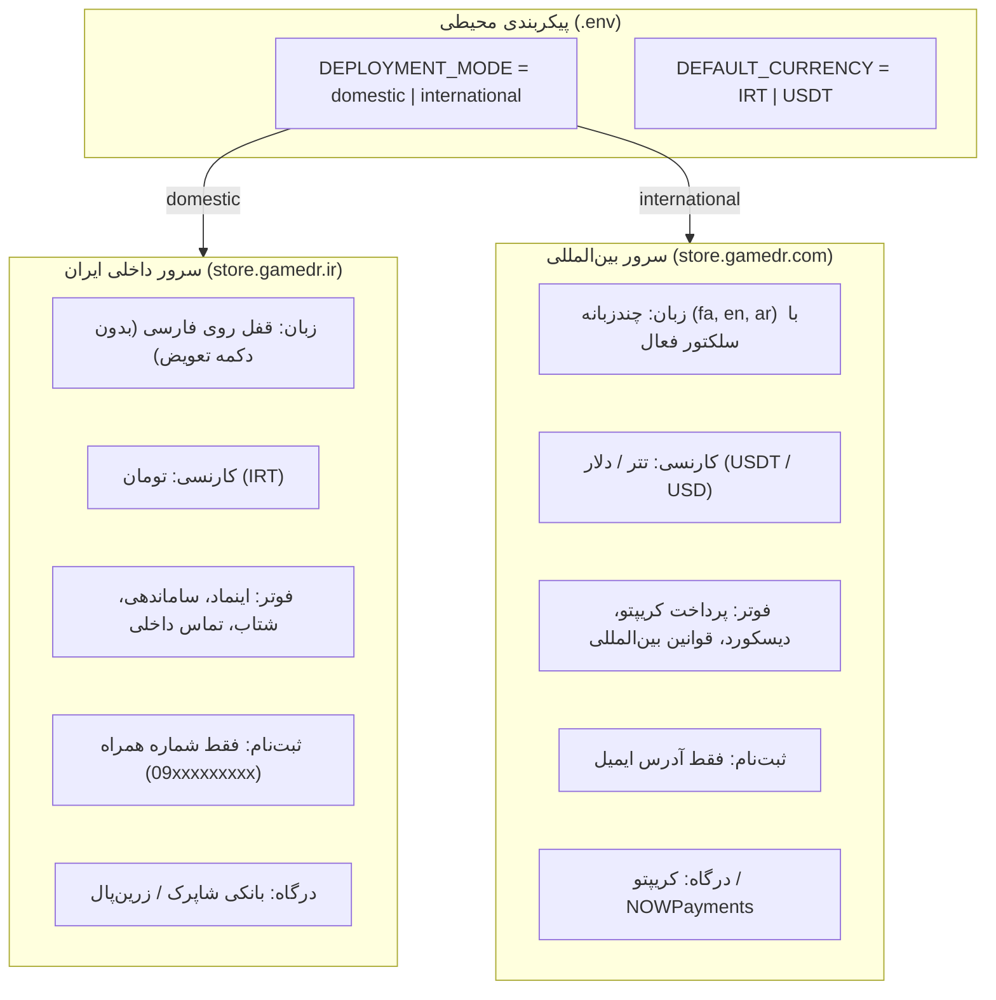
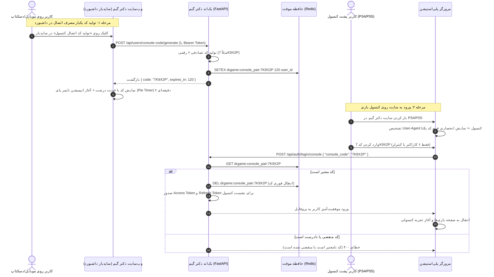

<div dir="rtl" lang="fa">

# 🌐 دستورالعمل جامع اجرایی گام هفدهم: معماری دو سروره (داخلی و بین‌المللی)، بازنویسی یکپارچه احراز هویت، کد پویای اتصال کنسول با تایمر پای و استانداردسازی کامل رابط کاربری (17-dual-mode-and-auth-overhaul)

> **شماره گام:** ۱۷  
> **ترکیب تسک‌های مبنا:** تسک ۱ (حالت دو سروره داخلی و بین‌المللی) + تسک ۲ (بازبینی، اصلاح و استانداردسازی سیستم لاگین و ثبت‌نام)  
> **عنوان مرحله:** پیاده‌سازی معماری دوگانه داخلی/بین‌المللی بر پایه متغیرهای محیطی، تفکیک دیتابیس ریالی و تتری با فیلد کارنسی (`currency`)، کنترل هوشمند زبان و فوتر، بازنویسی سیستم ثبت‌نام (موبایل برای ایران / ایمیل برای بین‌المللی)، سرویس یکپارچه لاگ OTP، مسیریابی شیوه‌های ورود بر اساس User-Agent (تفکیک موبایل/دسکتاپ از پلی‌استیشن)، پیاده‌سازی کد اتصال پویای کنسول با تایمر پای (Pie Timer) ۲ دقیقه‌ای در سایدبار، و رفع باگ‌های کنتراست رنگ و اعتبارسنجی زنده فرم‌های لاگین.  
> **وابستگی‌ها:** گام‌های ۰۱ تا ۱۶، ماژول کاربران (`users`)، ماژول احراز هویت (`auth`)، کیف پول و امور مالی (`wallet` / `subscriptions`)، سرویس ردیس (`Redis`).

---

> [!IMPORTANT]
> **اصول و الزامات تخطی‌ناپذیر معماری گام هفدهم (Core Inviolable Mandates):**
> 1. **تفکیک قطعی بر اساس `DEPLOYMENT_MODE`:** تمام تفاوت‌های رفتاری بین نسخه داخلی و بین‌المللی (زبان، فوتر، ثبت‌نام، کارنسی) باید صرفاً از طریق متغیر محیطی در فایل `.env` پیکربندی شوند و هیچ نیازی به تغییر کد هنگام دیپلوی روی دو سرور نباشد.
> 2. **ستون کارنسی برای همگام‌سازی آینده دیتابیس‌ها:** تمامی جداول حاوی مبالغ مالی (`user_wallets`, `commission_ledgers`, `transactions`, `subscriptions`, ...) باید علاوه بر مبلغ، دارای فیلد اجباری `currency` (با پیش‌فرض خوانده‌شده از `.env`) باشند تا در آینده امکان یکپارچه‌سازی و ادغام دیتابیس ریالی و تتری بدون ابهام وجود داشته باشد.
> 3. **قفل کامل زبان در نسخه داخلی:** در حالت `domestic`، زبان سایت به طور دائمی روی فارسی (`fa`) قفل است و سلکتور زبان (`LanguageSwitcher`) از هدر و تمام منوها کاملاً حذف می‌شود. در حالت `international`، سلکتور زبان فعال بوده و تغییر لحظه‌ای بین `fa`، `en` و `ar` امکان‌پذیر است.
> 4. **ثبت‌نام تفکیک‌شده و اطلاعات کامل کاربر:** در نسخه داخلی ثبت‌نام **صرفاً با شماره موبایل ایران** (`09...`) و در نسخه بین‌المللی **صرفاً با ایمیل** مجاز است. فرم ثبت‌نام نام کامل، نام‌کاربری یکتا (انتخابی توسط کاربر)، پسورد و کد OTP را دریافت می‌کند.
> 5. **مسیریابی ورود بر اساس User-Agent:**
>    - در دسکتاپ و موبایل: فقط ۲ شیوه ورود (۱. رمز عبور / ۲. کد یکبار مصرف OTP) نمایش داده می‌شود و تب کنسول پنهان است.
>    - در کنسول پلی‌استیشن (PS4 و PS5): فقط و فقط ۱ شیوه ورود (کد یکتای کنسول) نمایش داده می‌شود و ورود با پسورد/OTP مخفی است تا کاربر با دسته درگیر تایپ نشود.
> 6. **کد اتصال کنسول پویا با تایمر پای (Pie Timer):** کد ورود کنسول از اطلاعات ثابت پروفایل حذف شده و به ویجت اختصاصی در سایدبار منتقل می‌شود. با کلیک کاربر، یک کد ۶-۸ رقمی تصادفی در ردیس با انقضای ۲ دقیقه‌ای (120 ثانیه) ساخته شده و یک انیمیشن دایره‌ای تایمر پای شمارش معکوس را نشان می‌دهد؛ پس از اتمام تایمر، کد منقضی و پاک می‌شود.
> 7. **رفع کامل باگ‌های UI فرم‌ها:** رفع باگ سفید شدن پس‌زمینه و متن هنگام تایپ در فرم‌ها، پیاده‌سازی اعتبارسنجی زنده (Live Validation) موبایل/ایمیل، و افزودن دکمه نمایش/مخفی‌سازی پسورد (آیکون چشم).

---

## ۱. نقشه راه و مقایسه معماری دو سروره (Domestic vs International)



---

## ۲. متغیرهای محیطی جدید و ارتقای کانفیگ

در فایل‌های `.env`, `.env.example`, `.env.prod`, `.env.prod.example`:

```ini
# =============================================================================
# Deployment & Regional Configuration
# =============================================================================
# Values: domestic (Iran / Rial-Toman) | international (Global / Crypto-USD)
DEPLOYMENT_MODE=domestic
DEFAULT_CURRENCY=IRT

# Next.js Client Mirrors
NEXT_PUBLIC_DEPLOYMENT_MODE=domestic
NEXT_PUBLIC_DEFAULT_CURRENCY=IRT
```

در کدهای پایتون (`app/core/config.py`):
```python
class Settings(BaseSettings):
    ...
    DEPLOYMENT_MODE: str = "domestic"  # "domestic" | "international"
    DEFAULT_CURRENCY: str = "IRT"      # "IRT" | "USDT" | "USD"
```

---

## ۳. تغییرات مدل‌های پایگاه داده و مهاجرت Alembic (Multi-Currency Schema)

برای اطمینان از اینکه دیتابیس ریالی و تتری قابلیت ادغام و همگام‌سازی تمیز در آینده را داشته باشند، ستون `currency` به جداول مالی اضافه می‌شود.

### الف) جدول کیف پول (`user_wallets`):
```python
class UserWallet(Base):
    __tablename__ = "user_wallets"
    ...
    currency: Mapped[str] = mapped_column(String(10), default=lambda: settings.DEFAULT_CURRENCY, nullable=False)
    withdrawable_balance: Mapped[int] = mapped_column(BigInteger, default=0, nullable=False)
    total_earned: Mapped[int] = mapped_column(BigInteger, default=0, nullable=False)
    total_withdrawn: Mapped[int] = mapped_column(BigInteger, default=0, nullable=False)
```
*(ستون‌های قدیمی مثل `withdrawable_balance_toman` به عنوان فیلدهای جنریک با نگهداری کارنسی مهاجرت داده می‌شوند).*

### ب) جدول لجر کمیسیون و تراکنش‌ها (`commission_ledgers` / `transactions`):
```python
class CommissionLedger(Base):
    __tablename__ = "commission_ledgers"
    ...
    amount: Mapped[int] = mapped_column(BigInteger, nullable=False)
    currency: Mapped[str] = mapped_column(String(10), default=lambda: settings.DEFAULT_CURRENCY, nullable=False)
```

### ج) جدول پلن‌های اشتراک (`subscription_tiers`):
در پلن‌های اشتراک مقادیر `price_toman` و `price_usd` از قبل وجود دارند و متد سرویس بر حسب `DEPLOYMENT_MODE` مبلغ و واحد مناسب را به کلاینت تحویل می‌دهد.

---

## ۴. بازنویسی سرویس احراز هویت و OTP (Authentication Overhaul)

### ۱. سرویس یکپارچه چاپ/ارسال OTP (`OTPService`):
```python
import logging

logger = logging.getLogger("drgame.otp")

class OTPService:
    @staticmethod
    async def dispatch_otp(target: str, code: str, mode: str) -> None:
        """
        Unified OTP dispatcher.
        Currently prints formatted notice to server logs.
        In future steps, connects to Kavenegar/SMS.ir or Sendgrid.
        """
        is_phone = not ("@" in target)
        channel = "SMS" if is_phone else "EMAIL"
        
        log_message = (
            f"\n======================================================\n"
            f"🔑 [OTP SERVICE DISPATCH]\n"
            f"   • Target:   {target}\n"
            f"   • Channel:  {channel}\n"
            f"   • Mode:     {mode}\n"
            f"   • OTP Code: {code}\n"
            f"   • TTL:      120 Seconds\n"
            f"======================================================\n"
        )
        logger.info(log_message)
        print(log_message, flush=True)
```

### ۲. اعتبارسنجی ثبت‌نام بر اساس حالت سرور:
- در متد `AuthService.register_user`:
  - اگر `settings.DEPLOYMENT_MODE == "domestic"`:
    - فیلد `target` باید شماره موبایل معتبر ایران باشد (`^09\d{9}$` یا `^\+989\d{9}$`). در صورت ارسال ایمیل: خطای ۴۰۰ صادر می‌شود: `در نسخه داخلی ثبت‌نام فقط با شماره موبایل امکان‌پذیر است.`
  - اگر `settings.DEPLOYMENT_MODE == "international"`:
    - فیلد `target` باید آدرس ایمیل معتبر باشد. در صورت ارسال شماره تلفن: خطای ۴۰۰ صادر می‌شود: `In the international version, registration is only permitted with an email address.`
- فیلدهای ثبت‌نام کامل:
  ```json
  {
    "target": "09121234567",
    "code": "482910",
    "full_name": "امیرحسین رضایی",
    "username": "amir_gamer",
    "password": "SecurePassword123",
    "referral_code": "REF8X92K"
  }
  ```

---

## ۵. جریان کد اتصال پویای کنسول با تایمر پای (Dynamic Console Pairing Flow)



---

## ۶. تفکیک فرم ورود بر اساس `User-Agent` و رفع خطاهای UI

### ۱. منطق نمایش در کامپوننت `AuthModal.tsx`:
```tsx
const isPlayStation = /playstation|ps5|ps4/i.test(navigator.userAgent);

// در رندر مودال:
if (isPlayStation) {
  // فقط و فقط فرم ورود با کد یکتا رندر می‌شود
  // تب‌های پسورد و OTP کاملاً مخفی می‌شوند
} else {
  // دسکتاپ و موبایل: فقط تب‌های OTP و Password رندر می‌شوند
  // تب کنسول کاملاً مخفی می‌شود
}
```

### ۲. رفع باگ سفید شدن پس‌زمینه و متن هنگام تایپ (Contrast Bug):
کلاس‌های CSS اینپوت‌ها صراحتاً اصلاح می‌شوند:
```css
/* تضمین خوانایی و پایداری تم تاریک در فوکوس و تایپ */
input.auth-input {
  background-color: #0d121f !important;
  color: #ffffff !important;
  -webkit-text-fill-color: #ffffff !important;
  caret-color: #a855f7 !important;
}

input.auth-input:focus {
  background-color: #121829 !important;
  border-color: #a855f7 !important;
}
```

### ۳. اعتبارسنجی زنده ورودی (Smart Live Detection):
هنگام تایپ در فیلد شناسایی:
- اگر با `09` یا `+98` شروع شود: آیکون موبایل (`Phone`) سبز شده و شمارنده ۱۱ رقم فعال می‌شود.
- اگر کاراکتر `@` تایپ شود: آیکون ایمیل (`Mail`) فعال شده و فرمت ساختار ایمیل بررسی می‌شود.
- در صورت عدم تطابق با حالت سرور (`domestic` vs `international`) پیام راهنمای مناسب به صورت بلادرنگ زیر فیلد نمایش داده می‌شود.

### ۴. دکمه نمایش/مخفی‌سازی پسورد (Show/Hide Password):
در تمام فیلدهای پسورد کامپوننت آیکونیک `Eye` و `EyeOff` قرار می‌گیرد تا کاربر بتواند رمز تایپ‌شده را مشاهده یا مخفی کند.

---

## ۷. تغییرات هدر و فوتر بر اساس `DEPLOYMENT_MODE`

### ۱. هدر (`Header.tsx`):
```tsx
const deploymentMode = process.env.NEXT_PUBLIC_DEPLOYMENT_MODE || 'domestic';

// در رندر هدر:
{deploymentMode === 'international' && (
  <LanguageSwitcher />
)}
```
در نسخه `domestic`، مؤلفه `LanguageSwitcher` رندر نمی‌شود و زبان همواره روی `fa` باقی می‌ماند.

### ۲. فوتر (`Footer.tsx`):
- نوار سوئیچ دستی بالای فوتر (`Mode Switcher Banner`) به طور کامل حذف می‌شود، زیرا سرور از قبل وضعیت خود را به صورت سروری تعیین کرده است.
- در حالت `domestic`: نمایش لوگوی اینماد، ساماندهی، راه‌های ارتباطی با تلفن ثابت ایران و شبکه‌های اجتماعی بومی.
- در حالت `international`: نمایش لوگوی ارزهای دیجیتال، کارت‌های بین‌المللی، دیسکورد و شرایط پشتیبانی بین‌المللی.

---

## ۸. جدول مشخصات اندپوینت‌های جدید و ارتقایافته

| مسیر (Endpoint) | متد | دسترسی | شرح عملکرد | ورودی / خروجی |
| :--- | :---: | :---: | :--- | :--- |
| `/api/auth/otp/send` | `POST` | عمومی | ارسال کد تایید با رعایت محدودیت ریت‌لیمیت و تفکیک موبایل/ایمیل بر اساس مود | `OTPRequest` ➔ `MessageResponse` |
| `/api/auth/register` | `POST` | عمومی | ثبت‌نام کامل با اعتبارسنجی OTP و قوانین Domestic/International | `RegisterRequest` ➔ `TokenResponse` |
| `/api/auth/login` | `POST` | عمومی | ورود با نام‌کاربری/شناسه + رمز عبور (مخصوص موبایل و دسکتاپ) | `PasswordLoginRequest` ➔ `TokenResponse` |
| `/api/auth/login/otp` | `POST` | عمومی | ورود بدون پسورد با کد OTP (مخصوص موبایل و دسکتاپ) | `OTPLoginRequest` ➔ `TokenResponse` |
| `/api/auth/login/console` | `POST` | عمومی | ورود اختصاصی با کد یکتای پویای ۲ دقیقه‌ای (مخصوص کنسول PS4/PS5) | `ConsoleLoginRequest` ➔ `TokenResponse` |
| `/api/users/console-code/generate` | `POST` | کاربر لاگین‌شده | تولید کد موقت ۲ دقیقه‌ای اتصال کنسول و ذخیره در ردیس | بدون ورودی ➔ `{ "code": "...", "expires_in": 120 }` |

---

## ۹. چک‌لیست تست و راستی‌آزمایی (Verification & QA)

1. [ ] اجرای تست واحد بک‌اند برای ثبت‌نام با شماره همراه در حالت `domestic` و اطمینان از رد شدن ایمیل.
2. [ ] اجرای تست واحد بک‌اند برای ثبت‌نام با ایمیل در حالت `international` و اطمینان از رد شدن شماره همراه.
3. [ ] تست تولید کد کنسول در ردیس با انقضای ۱۲۰ ثانیه و تست ابطال اتمیک آن پس از یک‌بار ورود موفق.
4. [ ] تست User-Agent روی دسکتاپ/موبایل (مخفی بودن تب کنسول) و روی شبیه‌ساز PlayStation (نمایش انحصاری کد یکتا).
5. [ ] تست ظاهری فیلدهای ورودی در مرورگرهای دسکتاپ و موبایل و تایید عدم تغییر رنگ متن به سفید روی زمینه سفید.
6. [ ] بررسی مهاجرت ستون `currency` در دیتابیس بدون اختلال در داده‌های موجود.
7. [ ] تایید عدم نمایش سلکتور زبان و فوتر خارجی در نسخه `domestic`.
</div>
