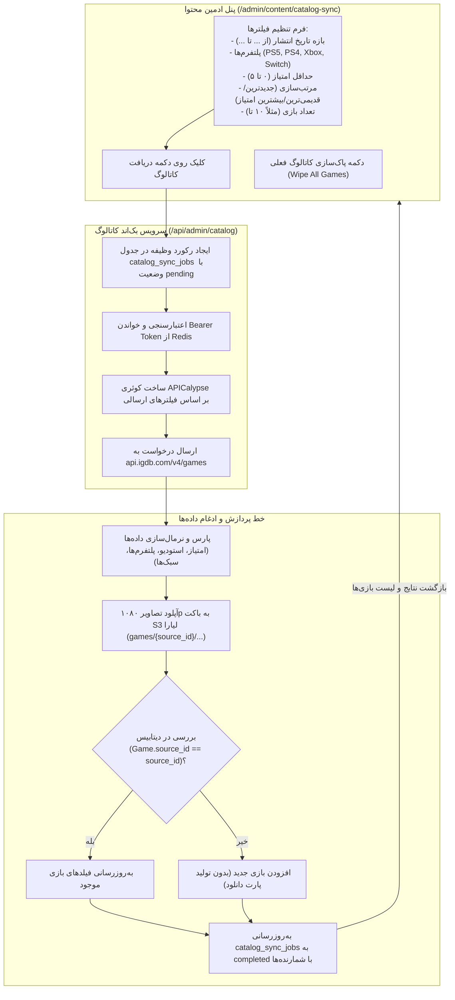

<div dir="rtl" lang="fa">

# 🎮 دستورالعمل جامع اجرایی گام هجدهم: سامانه جامع دریافت و همگام‌سازی کاتالوگ بازی‌ها در پنل ادمین با فیلترهای پیشرفته و نام‌گذاری خنثی (18-igdb-catalog-sync)

> **شماره گام:** ۱۸  
> **ترکیب تسک‌های مبنا:** تسک ۳ (بازبینی، بازنویسی و ارتقای کامل سرویس جمع‌آوری کاتالوگ بازی‌ها)  
> **عنوان مرحله:** پیاده‌سازی زیرساخت مدرن دریافت کاتالوگ بازی‌ها در پنل ادمین محتوا (`/admin/content/catalog-sync`) مجهز به فیلتر بازه تاریخی انتشار (از تاریخ تا تاریخ)، مرتب‌سازی زمانی/امتیازی، فیلتر حداقل امتیاز، فیلتر ۴ گانه پلتفرم‌ها (PS5, PS4, Xbox, Switch)، موتور همگام‌سازی و Upsert هوشمند بر پایه شناسه جنریک `source_id`، جدول اختصاصی ردگیری عملیات دریافت (`catalog_sync_jobs`)، پاک‌سازی کامل کاتالوگ فعلی، و آپلود خودکار و موازی تصاویر باکیفیت ۱۰۸۰p در فضای ابری لیارا (S3).  
> **وابستگی‌ها:** گام‌های ۰۱ تا ۱۷، ماژول بازی‌ها (`games`)، فضای ابری لیارا (`storage`)، ردیس (`Redis`)، ماژول ادمین (`admin`).

---

> [!IMPORTANT]
> **اصول و الزامات تخطی‌ناپذیر معماری گام هجدهم (Core Inviolable Mandates):**
> 1. **نام‌گذاری خنثی و فاقد وابستگی به برندهای خارجی (`source_id`):** تمام جداول پایگاه داده اعم از `games` و `genres` باید فاقد هرگونه نشانه یا نام سرویس شخص ثالث (مانند `rawg_id` یا `igdb_id`) باشند. شناسه ارجاع خارجی در ستون عمومی `source_id: Mapped[str | None]` (ایندکس‌دار و یکتا) ذخیره می‌شود. ستون قدیمی `rawg_id` به عنوان فیلد legacy اختیاری (`nullable=True`) نگهداری خواهد شد.
> 2. **عدم تولید هرگونه پارت دانلودی برای بازی‌ها:** بر اساس دستور صریح کارفرما، هیچ پارت دانلودی پیش‌فرض (دیتای اصلی، چیت، آپدیت و ...) به صورت خودکار برای بازی‌ها تولید نمی‌شود. مدیریت فایل‌های دانلودی به صورت مستقل در سیستم دانلود و بخش ادمین فایل‌ها انجام خواهد شد.
> 3. **جدول دیتابیسی ردگیری وظایف دریافت کاتالوگ (`catalog_sync_jobs`):** کلیه عملیات‌های همگام‌سازی اجرا شده از پنل ادمین در جدول اختصاصی ثبت می‌شوند تا سوابق دریافت شامل فیلترهای اعمال‌شده، بازه تاریخی، پلتفرم‌ها، تعداد درخواستی، تعداد ثبت‌شده و به‌روزرسانی‌شده، و خطاهای احتمالی ماندگار و قابل بازبینی باشد.
> 4. **منطق هوشمند Upsert در دیتابیس:** در هنگام دریافت بازی‌ها، ابتدا شناسه `source_id` و `slug` در دیتابیس استعلام می‌شود؛ در صورت وجود بازی قبلی، تمامی متادیتاها، امتیازات، پلتفرم‌ها و اسکرین‌شات‌ها به‌روزرسانی می‌شوند (`Update`)، و در غیر این صورت بازی جدید درج می‌گردد (`Insert`).
> 5. **فیلترهای چهارگانه پلتفرم کنسولی:**
>    - پلی‌استیشن ۵ (`PS5`): کد شناسه ۱۶۷
>    - پلی‌استیشن ۴ (`PS4`): کد شناسه ۴۸
>    - ایکس‌باکس (`Xbox`): کدهای سری ایکس/اس (۱۶۹) و وان (۴۹)
>    - نینتندو سوییچ (`Switch`): کدهای ۱۳۰ و ۵۰۸
> 6. **فیلترهای زمانی و مرتب‌سازی دقیق:**
>    - بازه تاریخ انتشار: تبدیل تاریخ‌های شمسی/میلادی ورودی به یونیکس تایم‌استمپ جهت اعمال در شرط APICalypse (`first_release_date >= start & first_release_date <= end`).
>    - مرتب‌سازی بر اساس: ۱. تاریخ انتشار (جدیدترین به قدیمی‌ترین)، ۲. تاریخ انتشار (قدیمی‌ترین به جدیدترین)، ۳. بالاترین امتیاز مجموع.
>    - فیلتر حداقل امتیاز کاربری (مقیاس ۰ تا ۵ در فرانت، معادل ۰ تا ۱۰۰ در کوئری).
> 7. **قابلیت پاک‌سازی کامل کاتالوگ فعلی (Wipe Catalog):** ارائه قابلیت امن در پنل ادمین جهت حذف کامل تمامی بازی‌های دیتابیس و رکوردهای وابسته به آن‌ها (`game_interactions`, `game_download_links`, `game_download_files`, `user_download_histories`, `games`) با تاییدیه ادمین، تا بتوان کاتالوگ تمیز را از صفر با پنل تست کرد.
> 8. **آپلود مستقیم تصاویر به باکت S3 لیارا:** کاور بازی (`games/{source_id}/cover.jpg`)، هیرو بنر آرت‌ورک (`games/{source_id}/banner.jpg`) و تا ۶ اسکرین‌شات گیم‌پلی (`games/{source_id}/screenshots/{index}.jpg`) با رزولوشن ۱۰۸۰p دانلود و در باکت اختصاصی لیارا آپلود می‌شوند.

---

## ۱. نقشه راه جریان داده و جریان کاری پنل ادمین



---

## ۲. طراحی طرح‌بندی پایگاه داده (Database Schema)

### ۲.۱. جدول رهگیری وظایف دریافت کاتالوگ (`catalog_sync_jobs`)
```python
class CatalogSyncJob(Base):
    __tablename__ = "catalog_sync_jobs"

    id: Mapped[int] = mapped_column(Integer, primary_key=True, index=True)
    status: Mapped[str] = mapped_column(String(20), default="pending", index=True)  # pending, in_progress, completed, failed
    platforms: Mapped[list] = mapped_column(JSON, default=list)  # ["PS5", "PS4", "Xbox", "Switch"]
    date_from: Mapped[str | None] = mapped_column(String(20), nullable=True)
    date_to: Mapped[str | None] = mapped_column(String(20), nullable=True)
    min_rating: Mapped[float] = mapped_column(Float, default=0.0)
    sort_by: Mapped[str] = mapped_column(String(50), default="release_date_desc")
    requested_count: Mapped[int] = mapped_column(Integer, default=10)
    imported_count: Mapped[int] = mapped_column(Integer, default=0)
    updated_count: Mapped[int] = mapped_column(Integer, default=0)
    error_message: Mapped[str | None] = mapped_column(Text, nullable=True)
    created_at: Mapped[datetime] = mapped_column(DateTime(timezone=True), default=lambda: datetime.now(timezone.utc), nullable=False)
    completed_at: Mapped[datetime | None] = mapped_column(DateTime(timezone=True), nullable=True)
```

### ۲.۲. اصلاح مدل `Game` و `Genre` با فیلد جنریک `source_id`
```python
class Game(Base):
    __tablename__ = "games"

    id: Mapped[int] = mapped_column(Integer, primary_key=True, index=True)
    source_id: Mapped[str | None] = mapped_column(String(50), unique=True, index=True, nullable=True)
    rawg_id: Mapped[int | None] = mapped_column(Integer, unique=True, index=True, nullable=True)
    # سایر فیلدها بدون تغییر...
```

---

## ۳. نگاشت پلتفرم‌ها و زبان کوئری APICalypse

### ۳.۱. نگاشت کدهای پلتفرم
| برچسب در پنل ادمین | کدهای پلتفرم در مرجع IGDB | نام‌های معادل |
| :---: | :---: | :--- |
| `PS5` | `167` | PlayStation 5 |
| `PS4` | `48` | PlayStation 4 |
| `Xbox` | `169, 49` | Xbox Series X\|S, Xbox One |
| `Switch` | `130, 508` | Nintendo Switch, Nintendo Switch 2 |

### ۳.۲. ساخت پویای کوئری
```python
where_parts = []
# ۱. فیلتر پلتفرم
if platform_ids:
    where_parts.append(f"platforms = ({','.join(map(str, platform_ids))})")

# ۲. فیلتر بازه تاریخ
if start_ts:
    where_parts.append(f"first_release_date >= {start_ts}")
if end_ts:
    where_parts.append(f"first_release_date <= {end_ts}")

# ۳. فیلتر حداقل امتیاز
if min_rating_100 > 0:
    where_parts.append(f"rating >= {min_rating_100}")

# ۴. داشتن کاور
where_parts.append("cover != null")

where_clause = " & ".join(where_parts)
```

---

## ۴. رابط کاربری پنل ادمین محتوا (`/admin/content/catalog-sync`)

این صفحه شامل بخش‌های زیر است:
1. **هدر و راهنمای دریافت:** کارت اطلاعات و وضعیت اتصال به مرجع بازی‌ها.
2. **فرم فیلترهای چندگانه:**
   - چک‌باکس‌های پلتفرم: `PlayStation 5`، `PlayStation 4`، `Xbox`، `Nintendo Switch` با آیکون‌های رنگی اختصاصی.
   - ورودی بازه تاریخ: تاریخ شروع (`از`) و تاریخ پایان (`تا`) با امکان انتخاب سریع سال‌های ۲۰۲۴، ۲۰۲۳، ۲۰۲۲.
   - حداقل امتیاز کاربری با اسلایدر یا ورودی ۰ تا ۵ ستاره.
   - تعداد بازی درخواستی (۵، ۱۰، ۲۰، ۵۰ عدد).
   - مرتب‌سازی بر اساس: "جدیدترین تاریخ انتشار"، "قدیمی‌ترین تاریخ انتشار"، "بالاترین امتیاز مجموع".
3. **دکمه‌های اقدام:**
   - دکمه سبز رنگ "شروع دریافت کاتالوگ" همراه با وضعیت لودینگ و نمایش لحظه‌ای بازی‌های در حال دریافت.
   - دکمه قرمز رنگ "پاک‌سازی کاتالوگ فعلی دیتابیس (Wipe Games)" با مودال تایید و هشدار.
4. **پیش‌نمایش بازی‌های دریافت شده:** کارت‌های تمیز بازی‌های همگام‌شده با کاور ۱۰۸۰p، برچسب جدید / آپدیت شده، امتیاز، استودیو و پلتفرم‌ها.
5. **جدول تاریخچه همگام‌سازی‌ها:** جدول سوابق قبلی از `catalog_sync_jobs` با شمارنده‌های موفقیت و زمان اجرا.

</div>