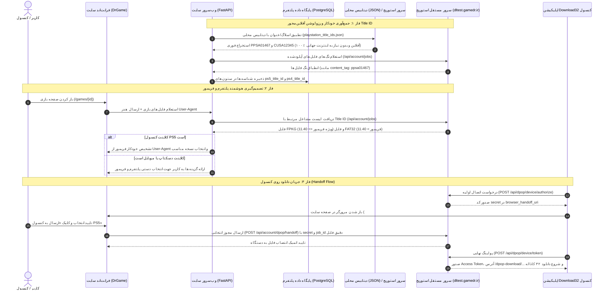
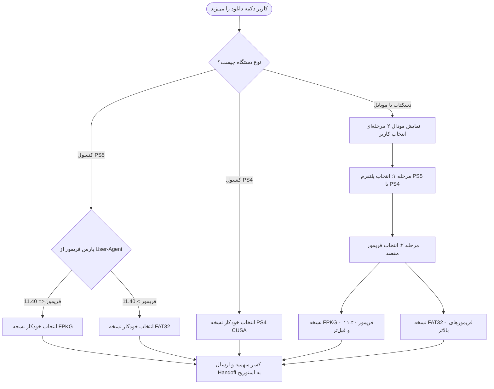
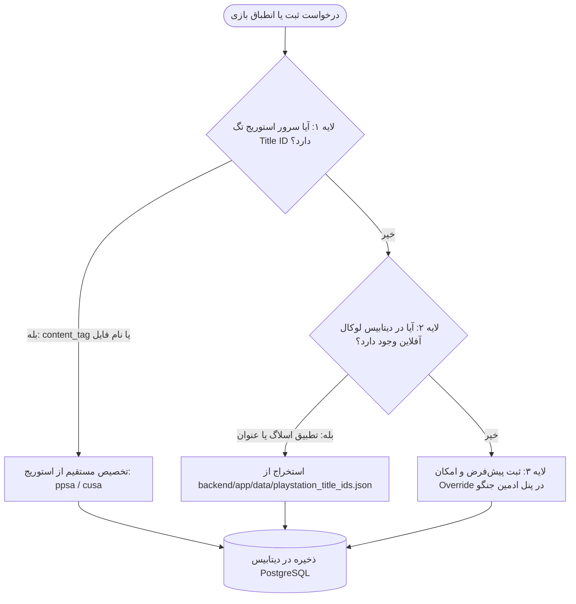

<div dir="rtl" lang="fa">

# 🎮 دستورالعمل جامع اجرایی گام نوزدهم: سامانه داینامیک لینک‌های دانلود، استخراج شناسه‌های کنسولی (Title ID)، تفکیک فریمور و یکپارچه‌سازی با سرور استوریج و Download32 (19-dynamic-game-downloads-and-catalog-title-ids)

> **شماره گام:** ۱۹  
> **ترکیب تسک‌های مبنا:** تسک‌های تکمیلی فاز دانلود و کاتالوگ (حذف کامل ثبت دستی لینک‌های دانلود، استخراج داینامیک شناسه‌های کنسولی PPSA و CUSA در کاتالوگ، تفکیک هوشمند پلتفرم بر اساس User-Agent، معماری دوگانه فرمت‌های FPKG در برابر FAT32 بر اساس فریمور کنسول، و اتصال کامل به سرور استوریج و پروتکل DPoP اپلیکیشن Download32)  
> **عنوان مرحله:** طراحی و استقرار معماری تمام‌اتوماتیک و بدون دخالت دست برای لینک‌ها و پارت‌های دانلود بازی‌ها، ذخیره‌سازی شناسه‌های رسمی محصول سونی (`ps5_title_id` و `ps4_title_id`) در دیتابیس کاتالوگ، پشتیبانی هوشمند از دوگانگی فرمت فایل‌ها بر حسب فریمور پلی‌استیشن ۵ (فرمت FPKG برای فریمور ۱۱.۴۰ به قبل و فرمت FAT32 برای فریمورهای بعدی)، تفکیک خودکار پلتفرم و فریمور بر پایه هدر `User-Agent` کنسول در برابر انتخاب صریح کاربر در مرورگرهای دسکتاپ و موبایل، و یکپارچه‌سازی بی‌واسطه با سرور دانلود و آبجکت استوریج (`tgstorage` روی `https://dltest.gamedr.ir`).  
> **وابستگی‌ها:** گام‌های ۰۱ تا ۱۸، ماژول کاتالوگ بازی‌ها (`catalog_sync` و `games`)، سیستم اشتراک‌ها و سهمیه (`subscriptions`)، ماژول پروتکل DPoP (`dpop`)، و مستندات رسمی زیرساخت تیم استوریج (`DOWNLOAD32_MAIN_SITE_INTEGRATION_FA.md`).  

---

> [!IMPORTANT]
> **اصول و الزامات تخطی‌ناپذیر معماری گام نوزدهم (Core Inviolable Mandates):**
> 1. **حذف قطعی و نهایی سیستم ثبت دستی پارت‌ها (Zero Manual Download Links):**  
>    هیچ ادمین یا کاربری نباید برای ثبت، ویرایش یا انتشار پارت‌های چند گیگابایتی بازی‌ها آدرس‌های URL دستی یا حجم دستی وارد کند. جدول قدیمی و ایستا `game_download_links` از چرخه استعلام فرانت‌اند خارج شده و کلیه لینک‌ها، پارت‌ها و مشخصات دانلود به صورت **۱۰۰٪ داینامیک** از تطبیق شناسه‌های کنسولی با مخزن سرور استوریج تغذیه می‌شوند.
> 2. **نگاشت استاندارد شناسه‌های کنسولی سونی (PlayStation Title IDs):**  
>    در دیتابیس کاتالوگ برای هر بازی باید دو ستون مستقل و رسمی تعبیه شود:
>    - `ps5_title_id`: شناسه رسمی پلی‌استیشن ۵ با فرمت دقیق `PPSAxxxxx` (مثال: `PPSA01467` برای Spider-Man Remastered).
>    - `ps4_title_id`: شناسه رسمی پلی‌استیشن ۴ با فرمت دقیق `CUSAxxxxx` (مثال: `CUSA00123`).
> 3. **پشتیبانی از دوگانگی فرمت فریمورهای PS5 (FPKG vs FAT32 Engine):**  
>    بر اساس مستندات استوریج و ماهیت جیلبریک پلی‌استیشن ۵:
>    - **فریمور ۱۱.۴۰ و قبل‌تر (کنسول‌های کپی‌خور با فریمورهای ۴.xx تا ۱۱.۴۰):** بسته دانلودی باید با فرمت **FPKG** (`download_format: "fpkg"` یا `pkg`) تحویل داده شود که مستقیماً با ابزارهای نصب پکیج کنسول (Package Installer / itemzflow) اجرا می‌گردد.
>    - **فریمورهای بالاتر از ۱۱.۴۰:** بسته دانلودی به صورت ساختار دایرکتوری/پارت‌های زیر ۴ گیگابایتی سازگار با **FAT32** (`content_format: "fat32"`) ارائه می‌شود.
> 4. **تشخیص هوشمند User-Agent در کنسول در برابر انتخاب صریح در دسکتاپ/موبایل:**  
>    - **مرورگر کنسول PS5:** نسخه فریمور از روی هدر User-Agent (`PlayStation 5/XX.XX`) پارس می‌شود؛ اگر فریمور `<= 11.40` بود فرمت FPKG و اگر `> 11.40` بود فرمت FAT32 به صورت خودکار پیش‌فرض شده و دکمه تک‌کلیکی «دانلود روی PS5» فعال می‌گردد.
>    - **مرورگر کنسول PS4:** نسخه PS4 با شناسه `CUSA` پیش‌فرض می‌شود.
>    - **مرورگر دسکتاپ و موبایل:** از کاربر در یک پاپ‌آپ شکیل خواسته می‌شود که هم **پلتفرم (PS5 یا PS4)** و هم **فرمت فریمور (FPKG ۱۱.۴۰ به قبل یا FAT32 فریمور بالاتر)** را خودش انتخاب کند.
> 5. **انطباق ۱۰۰٪ با قرارداد سرور استوریج و DPoP (`DOWNLOAD32_MAIN_SITE_INTEGRATION_FA.md`):**  
>    سرور فایل و استوریج (`tgstorage` روی `dltest.gamedr.ir`) از پیش مستقر بوده و فایل‌های بازی را با کلید `content_tag` یا `tag` برابر با همان Title ID (مثل `ppsa24342`) و فیلدهای `download_format` و `content_format` نگهداری می‌کند. اتصال سایت به این سرور از طریق ارسال `job_id` در اندپوینت `/api/account/dpop/handoff` و مدیریت نشست Handoff کنسول صورت می‌گیرد.
> 6. **حفظ پایستگی کسر سهمیه و رصد تاریخچه دانلود:**  
>    تمامی استعلام‌ها و صدورهای مجوز دانلود باید قانون کسر اتمیک سهمیه حجم کاربر بر اساس `size_bytes` واقعی گزارش‌شده توسط استوریج را اعمال کرده و لاگ تراکنش را در جدول `user_download_history` به ثبت برسانند (بدون دانلود مجدد رایگان).

---

## ۱. نقشه کلان جریان داده و تعامل سیستم‌ها (System Architecture & Sequence Flow)



---

## ۲. منطق مهندسی تفکیک فریمور و فرمت‌های ذخیره‌سازی (Firmware Compatibility Engine)

### ۲.۱. ساختار فایل‌ها در سرور استوریج (`dltest.gamedr.ir`):
در استعلام زنده انجام‌شده از سرور استوریج، هر رکورد دانلود علاوه بر شناسه و عنوان، دو صفت ساختاری دارد:
1. `download_format`: نوع پکیج فایل (`fpkg`، `pkg`، `zip`، `rar`)
2. `content_format`: فرمت فایل‌سیستم و کپی‌خور (`fat32`، `exfat`)
3. `tag` / `content_tag`: شناسه سونی بازی (`ppsa24342`)

```json
{
  "id": "8fc2aa2caeea4c1fa5fa5ae53105c3df",
  "display_name": "bat man arkham",
  "content_tag": "ppsa24342",
  "platform": "ps5",
  "download_format": "fpkg",
  "content_format": "exfat",
  "release_version": "v1.00",
  "size_bytes": 1073741824,
  "status": "ready"
}
```

### ۲.۲. درخت تصمیم‌گیری انتخاب فرمت (Decision Tree):



### ۲.۳. الگوریتم پارس فریمور در هدر User-Agent:
```python
import re

PS5_UA_PATTERN = re.compile(r"PlayStation\s+5/(\d+\.\d+)", re.IGNORECASE)
PS4_UA_PATTERN = re.compile(r"PlayStation\s+4\s+(\d+\.\d+)", re.IGNORECASE)

def detect_console_firmware(user_agent: str) -> dict:
    """Extract console type and firmware float version from User-Agent."""
    ua = user_agent or ""
    m5 = PS5_UA_PATTERN.search(ua)
    if m5:
        try:
            fw = float(m5.group(1))
            recommended = "fpkg" if fw <= 11.40 else "fat32"
            return {"platform": "ps5", "firmware": fw, "recommended_format": recommended}
        except ValueError:
            return {"platform": "ps5", "firmware": None, "recommended_format": "fpkg"}

    m4 = PS4_UA_PATTERN.search(ua)
    if m4:
        try:
            fw = float(m4.group(1))
            return {"platform": "ps4", "firmware": fw, "recommended_format": "fpkg"}
        except ValueError:
            return {"platform": "ps4", "firmware": None, "recommended_format": "fpkg"}

    return {"platform": "desktop_or_mobile", "firmware": None, "recommended_format": None}
```

---

## ۳. طراحی طرح‌بندی دیتابیس (Database Schema Updates)

### ۳.۱. اصلاح مدل `Game` در `backend/app/modules/games/models.py`:
افزودن شناسه‌های رسمی کنسولی و نگاشت متادیتای استوریج به مدل بازی:

```python
class Game(Base):
    __tablename__ = "games"

    # ... سایر فیلدهای موجود ...

    # شناسه‌های رسمی محصول پلی‌استیشن (PlayStation Title IDs)
    ps5_title_id: Mapped[str | None] = mapped_column(
        String(20), index=True, nullable=True, comment="Sony PS5 Title ID (e.g. PPSA01467)"
    )
    ps4_title_id: Mapped[str | None] = mapped_column(
        String(20), index=True, nullable=True, comment="Sony PS4 Title ID (e.g. CUSA00123)"
    )

    # اطلاعات کش‌شده از سرور استوریج
    storage_sync_status: Mapped[str] = mapped_column(
        String(20), default="unknown", index=True, comment="unknown, ready, not_found, pending"
    )
    available_formats: Mapped[list] = mapped_column(
        JSON, default=list, comment="Cached array of available storage jobs: [{id, format, content_format, size_bytes}]"
    )
    file_size_bytes: Mapped[int | None] = mapped_column(
        BigInteger, nullable=True, comment="Default/Primary file size in bytes from storage"
    )
    sha256_checksum: Mapped[str | None] = mapped_column(
        String(64), nullable=True, comment="Official 64-char lowercase hex SHA-256"
    )
```

---

## ۴. معماری استخراج و انطباق شناسه‌های کنسولی بدون وابستگی به اینترنت جهانی (Offline-First 3-Tier Title ID Resolution Engine)

### ۴.۱. تحلیل مسئله و چرایی عدم وابستگی به وب‌سرویس‌های خارجی در محیط ایران:
1. **بررسی دیتابیس IGDB:**
   تحلیل فنی اسناد و خروجی‌های API سرویس IGDB نشان می‌دهد که فیلد `external_games` تنها دسته‌بندی‌های فروشگاهی (مانند `category: 36` معادل PlayStation Store Concept ID یا `uid: 200520`) را بازمی‌گرداند و شماره‌سریال‌های فیزیکی/دیجیتالی دیسک‌های کنسول سونی (`PPSAxxxxx` و `CUSAxxxxx`) در ساختار داده‌های IGDB ذخیره **نمی‌شوند**.
2. **چالش وب‌سرویس مستقیم سونی (`store.playstation.com`):**
   استعلام زنده از سرورهای سونی در زمان اجرا (Runtime) با دو چالش مرگبار مواجه است:
   - **تحریم و فیلترینگ شدید:** سرویس‌های فروشگاهی سونی از داخل ایران به شدت دچار Geo-blocking و فیلترینگ هستند.
   - **قطع اینترنت بین‌الملل (اینترنت ملی):** در زمان قطعی اینترنت جهانی، پلتفرم دکترگیم باید بتواند به صورت ۱۰۰٪ آفلاین و پایدار بازی‌ها را به کاربران داخلی و کنسول‌های PS5 تحویل دهد. بنابراین تکیه به یک وب‌سرویس خارجی برای دریافت Title ID ناقض اصل تاب‌آوری ملی سیستم است.



---

### ۴.۲. معماری ۳ لایه آفلاین‌محور استخراج Title ID (3-Tier Resolution):

#### لایه اول: کشف از سرور استوریج (Storage-First Discovery - اولویت ۱)
سرور آبجکت استوریج و دانلود داخلی (`tgstorage` روی `https://dltest.gamedr.ir`) پکیج‌ها و پارت‌های بازی‌ها را نگهداری می‌کند. هر رکورد در خروجی اندپوینت `GET /api/account/jobs` دارای ویژگی‌های ساختاری است:
- `content_tag` یا `tag`: مستقیماً برابر با کد رسمی سونی است (مثال: `"content_tag": "ppsa24342"` یا `"cusa00123"`).
- در صورت عدم وجود فیلد صریح تگ، عبارات باقاعده (Regex) نام فایل‌های آپلودشده پکیج (`.pkg` یا `.zip`) را برای یافتن الگوی `PPSA\d{5}` و `CUSA\d{5}` اسکن می‌کنند.

#### لایه دوم: دیتابیس غنی آفلاین محلی (Curated Offline Dataset - اولویت ۲)
یک فایل جیسون ساختاریافته در مسیر `backend/app/data/playstation_title_ids.json` به همراه کدهای پروژه مستقر می‌شود. این فایل شامل شناسه‌های بازی‌های معتبر و محبوب است و نیازی به هیچ‌گونه اتصال اینترنتی ندارد:

```json
{
  "marvels-spider-man-remastered": {
    "title_en": "Marvel's Spider-Man Remastered",
    "ps5_title_id": "PPSA01467",
    "ps4_title_id": "CUSA11995"
  },
  "god-of-war-ragnarok": {
    "title_en": "God of War Ragnarök",
    "ps5_title_id": "PPSA08330",
    "ps4_title_id": "CUSA34388"
  },
  "the-last-of-us-part-i": {
    "title_en": "The Last of Us Part I",
    "ps5_title_id": "PPSA03396",
    "ps4_title_id": "CUSA00557"
  }
}
```

#### لایه سوم: بازنویسی و مدیریت دستی در ادمین پنل جنگو (Zero-Trust Admin Override - اولویت ۳)
در مدل‌های `admin-panel`، فیلدهای `ps5_title_id` و `ps4_title_id` در فرم مدیریت بازی‌ها قابل مشاهده و ویرایش هستند تا در صورت اضافه شدن عناوین جدید قبل از به‌روزرسانی فایل محلی، ادمین بتواند با یک کلیک شناسه‌ها را ثبت یا اصلاح کند.

---

### ۴.۳. پیاده‌سازی رزولور آفلاین (`backend/app/modules/catalog_sync/title_resolver.py`):

```python
import os
import re
import json
import logging
from typing import Optional, Tuple

logger = logging.getLogger("drgame.title_resolver")

DATA_FILE_PATH = os.path.join(
    os.path.dirname(os.path.dirname(os.path.dirname(os.path.abspath(__file__)))),
    "data",
    "playstation_title_ids.json",
)

PPSA_REGEX = re.compile(r"PPSA\d{5}", re.IGNORECASE)
CUSA_REGEX = re.compile(r"CUSA\d{5}", re.IGNORECASE)

_OFFLINE_CACHE: dict = {}


def _load_offline_dataset() -> dict:
    """Load curated offline PlayStation Title IDs dataset into memory."""
    global _OFFLINE_CACHE
    if not _OFFLINE_CACHE and os.path.isfile(DATA_FILE_PATH):
        try:
            with open(DATA_FILE_PATH, "r", encoding="utf-8") as f:
                _OFFLINE_CACHE = json.load(f)
            logger.info(f"Loaded {len(_OFFLINE_CACHE)} offline Title ID entries from {DATA_FILE_PATH}")
        except Exception as e:
            logger.error(f"Failed to load offline title IDs dataset: {e}")
    return _OFFLINE_CACHE


def normalize_title_slug(title: str) -> str:
    """Normalize game title to matching key."""
    clean = re.sub(r"[™®©'\"’]", "", title.lower())
    clean = re.sub(r"[^a-z0-9]+", "-", clean).strip("-")
    return clean


def resolve_playstation_title_ids(
    game_title: str,
    slug: Optional[str] = None,
    storage_tag: Optional[str] = None,
) -> Tuple[Optional[str], Optional[str]]:
    """
    100% Offline-Resilient Title ID Resolution Engine.
    Tier 1: Inspect storage server tag/content_tag.
    Tier 2: Match against offline JSON dictionary by slug or normalized title.
    Returns: (ps5_title_id, ps4_title_id)
    """
    ps5_id = None
    ps4_id = None

    # Tier 1: Storage Tag inspection
    if storage_tag:
        tag_upper = storage_tag.upper().strip()
        m5 = PPSA_REGEX.search(tag_upper)
        if m5:
            ps5_id = m5.group(0)
        m4 = CUSA_REGEX.search(tag_upper)
        if m4:
            ps4_id = m4.group(0)

    # Tier 2: Offline Curated Dataset
    if not (ps5_id and ps4_id):
        dataset = _load_offline_dataset()
        target_slug = slug or normalize_title_slug(game_title)

        entry = dataset.get(target_slug)
        if not entry:
            # Fuzzy match by normalized key
            norm_key = normalize_title_slug(game_title)
            entry = dataset.get(norm_key)

        if entry:
            ps5_id = ps5_id or entry.get("ps5_title_id")
            ps4_id = ps4_id or entry.get("ps4_title_id")

    return ps5_id, ps4_id
```

---

## ۵. سرویس پل ارتباطی سرور استوریج (`StorageBridgeService`)

سرویس جدید `StorageBridgeService` در `backend/app/modules/games/storage_bridge.py` پیاده‌سازی می‌شود:

### ۵.۱. قابلیت‌های کلیدی سرویس:
1. **استعلام مخزن فایل‌های آماده (`fetch_available_storage_jobs`):**  
   ارسال درخواست با نشست سیستمی به `GET https://dltest.gamedr.ir/api/account/jobs`.
2. **انطباق هوشمند فایل‌ها بر اساس Title ID و فرمت:**  
   یافتن کلیه رکوردهایی که `tag` آن‌ها با `ps5_title_id` یا `ps4_title_id` همخوانی دارد و دسته‌بندی آن‌ها در دو گروه:
   - گروه FPKG: `download_format == "fpkg"` یا پسوند فایل `.pkg`
   - گروه FAT32: `content_format == "fat32"` یا `download_format == "zip"`
3. **ارسال Handoff دقیق بر اساس انتخاب نهایی:**  
   انتقال مستقیم `job_id` دقیق فایل انتخاب‌شده به همراه secret کنسول:
   `POST https://dltest.gamedr.ir/api/account/dpop/handoff`
4. **کسر اتمیک سهمیه و ثبت تاریخچه:**  
   کسر حجم بر اساس بایت‌های واقعی (`size_bytes / (1024**3)`) و ثبت در `user_download_history`.

---

## ۶. به‌روزرسانی رابط کاربری فرانت‌اند (Frontend UI Overhaul)

1. **نمایش برچسب‌های رسمی کنسولی در `DownloadBox.tsx`:**  
   نمایش بج‌های نئونی اختصاصی:
   - `PS5: PPSA01467`
   - `PS4: CUSA00123`
2. **طراحی مودال هوشمند انتخاب پلتفرم و فرمت در `DownloadConfirmModal.tsx`:**  
   * **برای کاربران کنسول:** نمایش خودکار فریمور تشخیص‌داده‌شده (مثلاً «کنسول PS5 شما با فریمور 9.00 شناسایی شد - نسخه سازگار FPKG آماده ارسال است»).
   * **برای کاربران دسکتاپ و موبایل:**  
     کارت‌های تعاملی ۲ گزینه‌ای:
     * 🔘 **نسخه FPKG سونی:** ویژه کنسول‌های کپی‌خور با فریمور ۱۱.۴۰ و پایین‌تر.
     * 🔘 **نسخه FAT32:** ویژه فریمورهای بالاتر یا انتقال مستقیم روی دیسک اکسترنال.
3. **ارسال مستقیم به Download32:**  
   ارسال شناسه فایل به اندپوینت هندوآف و هدایت کنسول به آغاز دانلود ۳۲ کاناله بدون وابستگی به لینک‌های استاتیک محلی.

</div>
