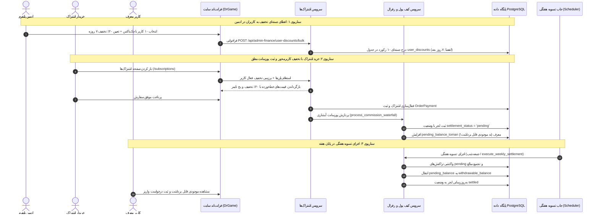
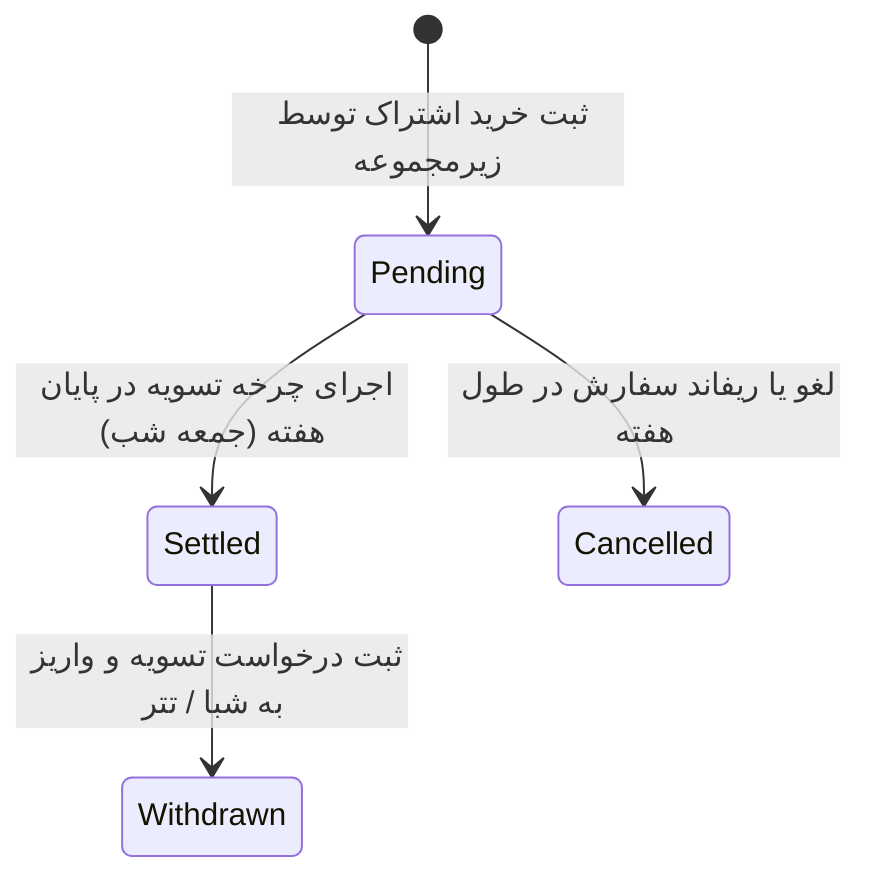

<div dir="rtl" lang="fa">

# 🤝 دستورالعمل جامع اجرایی گام بیستم: سامانه تسویه هفتگی کیف پول رفرال، ارتقای لایه‌های شبکه و تخفیف‌های کاربرمحور دسته‌ای (20-weekly-referral-settlement-and-user-discounts)

> **شماره گام:** ۲۰  
> **ترکیب تسک‌های مبنا:** تسک‌های تکمیلی فاز مالی، بازاریابی ارجاعی و فروش اشتراک (تغییر مدل شارژ اتمیک لحظه‌ای کیف پول به تسویه چرخه‌ای هفتگی، تفکیک موجودی معلق در برابر قابل برداشت، نمایش پویای تمام لایه‌های نامحدود در داشبورد کاربری، کاوشگر شجره‌نامه و مرکز تسویه در ادمین رفرال، و سیستم تخفیف‌های کاربرمحور با قابلیت انتساب دسته‌ای گروهی در بخش اشتراک‌ها)  
> **عنوان مرحله:** استقرار موتور تسویه دوره‌ای و هفتگی پورسانت‌های رفرال، ثبت تراکنش‌های معلق در لجر، بازطراحی داشبورد کاربری رفرال با سطوح نامحدود و شبیه‌ساز سود، توسعه مرکز فرماندهی تسویه و خزانه‌داری در پنل ادمین رفرال، و پیاده‌سازی زیرساخت تخفیف‌های اختصاصی متصل به کاربر (`UserDiscount`) با قابلیت اعمال دسته‌ای (Bulk Promotion Assignment) در پنل مدیریت اشتراک‌ها.  
> **وابستگی‌ها:** گام‌های ۰۱ تا ۱۹، ماژول‌های `wallet`, `subscriptions`, `users`, `admin`، مدل‌های `CommissionLedger`, `UserWallet`, `ReferralTreasuryPool`, `OrderPayment` و سند مبنای کسب‌وکار `source/referral/SYSTEM-PROPOSAL-FA.md`.  

---

> [!IMPORTANT]
> **اصول و الزامات تخطی‌ناپذیر معماری گام بیستم (Core Inviolable Mandates):**
> 1. **توقف شارژ فوری و لحظه‌ای موجودی قابل برداشت (Batch Settlement Mandate):**  
>    در لحظه خرید اشتراک توسط زیرمجموعه، پورسانت به هیچ عنوان نباید بلافاصله به `withdrawable_balance_toman` واریز شود. کلیه مبالغ سهم معرف‌ها باید با وضعیت `pending` در دفتر لجر (`commission_ledgers`) ثبت شده و تنها به ستون جدید `pending_balance_toman` در کیف پول افزوده شوند تا ریسک شارژبک، لغو سفارش و کلاهبرداری صفر گردد.
> 2. **چرخه تسویه منظم هفتگی (Weekly Settlement Cycle):**  
>    در پایان هر هفته (موعد استاندارد: جمعه‌ها ساعت ۲۳:۵۹ یا اجرای دستی توسط ادمین)، یک تراکنش اتمیک تسویه اجرا می‌شود که تمامی پورسانت‌های `pending` دوره را تجمیع، وضعیت لجر را به `settled` تبدیل، و موجودی را از `pending_balance_toman` به `withdrawable_balance_toman` منتقل می‌نماید.
> 3. **پشتیبانی بصری از عمق نامحدود شبکه (Infinite Waterfall Visualizer):**  
>    محدودیت بصری ۳ لایه در فرانت‌اند داشبورد کاربر باید حذف شود. داشبورد باید سطوح ۱، ۲، ۳، ۴ و لایه‌های عمیق‌تر شبکه را به همراه درصد سهم، تعداد اعضا، اعضای فعال و درآمد تجمیعی نمایش دهد.
> 4. **حذف اجبار تایپ کد تخفیف و گذار به تخفیف کاربرمحور (User-Bound Discounts):**  
>    تخفیف‌ها نباید محدود به یک رشته متنی عمومی باشند که کاربر دستی وارد کند. جدول جدید `user_discounts` تخفیف را مستقیماً به شناسه کاربر پیوند داده و در صفحه پلن‌های اشتراک به صورت خودکار با برچسب درصد و شمارش معکوس زمان انقضا اعمال می‌کند.
> 5. **قابلیت انتساب دسته‌ای در پنل ادمین (Bulk Assignment Feature):**  
>    در پنل ادمین، ادمین باید بتواند با استفاده از چک‌باکس چندتایی (Multi-Select)، چندین کاربر (مثلاً ۱۰ یا ۵۰ کاربر) را همزمان انتخاب کرده و با یک کلیک یک تخفیف مشخص (مثلاً ۲۰٪ به مدت ۷ روز) را به همه آنها اختصاص دهد.

---

## ۱. دیاگرام کلان جریان تسویه هفتگی و اعمال تخفیف کاربرمحور



---

## ۲. منطق مهندسی و الگوریتم تسویه هفتگی پورسانت‌ها (Weekly Settlement Engine)

### ۲.۱. چرخه حیات تراکنش‌های پورسانت (Lifecycle States):



1. **حالت `pending` (در انتظار تسویه):**
   - بلافاصله پس از پرداخت موفق سفارش توسط خریدار در `CommissionLedger` درج می‌گردد.
   - مبلغ به `wallet.pending_balance_toman` افزوده می‌شود.
   - کاربر آن را در داشبورد خود تحت عنوان «پورسانت در انتظار تسویه این هفته» با تاریخ تسویه بعدی مشاهده می‌کند.
2. **حالت `settled` (تسویه‌شده و قطعی):**
   - در پایان هفته طی تراکنش اتمیک `execute_weekly_settlement`:
     ```python
     wallet.withdrawable_balance_toman += total_user_pending
     wallet.pending_balance_toman = max(0, wallet.pending_balance_toman - total_user_pending)
     ledger.settlement_status = "settled"
     ledger.settled_at = now
     ledger.settlement_batch_id = batch_id
     ```
3. **حالت `cancelled` (ابطال‌شده در صورت لغو سفارش):**
   - در صورت مرجوعی، تراکنش `pending` قبل از تسویه ابطال شده و از موجودی معلق کسر می‌گردد، بدون اینکه به حساب قابل برداشت دست خورده باشد.

---

## ۳. تغییرات طرح‌بندی پایگاه داده (Database Schema Updates)

### ۳.۱. مدل `UserWallet` در `backend/app/modules/wallet/models.py`:
افزودن موجودی معلق دوره‌ای:
```python
class UserWallet(Base):
    __tablename__ = "user_wallets"

    id: Mapped[int] = mapped_column(Integer, primary_key=True, index=True)
    user_id: Mapped[int] = mapped_column(Integer, unique=True, index=True, nullable=False)
    currency: Mapped[str] = mapped_column(String(10), default="IRT", nullable=False)
    
    # موجودی در انتظار تسویه هفتگی
    pending_balance_toman: Mapped[int] = mapped_column(BigInteger, default=0, nullable=False)
    
    # موجودی تسویه‌شده و قابل برداشت
    withdrawable_balance_toman: Mapped[int] = mapped_column(BigInteger, default=0, nullable=False)
    
    total_earned_toman: Mapped[int] = mapped_column(BigInteger, default=0, nullable=False)
    total_withdrawn_toman: Mapped[int] = mapped_column(BigInteger, default=0, nullable=False)
    updated_at: Mapped[datetime] = mapped_column(DateTime(timezone=True), default=lambda: datetime.now(timezone.utc), onupdate=lambda: datetime.now(timezone.utc), nullable=False)
```

### ۳.۲. مدل `CommissionLedger` در `backend/app/modules/wallet/models.py`:
افزودن رصد دوره‌های تسویه:
```python
class CommissionLedger(Base):
    __tablename__ = "commission_ledgers"

    id: Mapped[int] = mapped_column(Integer, primary_key=True, index=True)
    order_payment_id: Mapped[int] = mapped_column(Integer, index=True, nullable=False)
    beneficiary_type: Mapped[str] = mapped_column(String(20), nullable=False)  # "user", "treasury", "ceo"
    user_id: Mapped[int | None] = mapped_column(Integer, index=True, nullable=True)
    tier_level: Mapped[int] = mapped_column(Integer, default=1, nullable=False)
    amount_toman: Mapped[int] = mapped_column(BigInteger, nullable=False)
    currency: Mapped[str] = mapped_column(String(10), default="IRT", nullable=False)
    description: Mapped[str] = mapped_column(String(255), nullable=False)
    
    # رصد تسویه هفتگی
    settlement_status: Mapped[str] = mapped_column(String(20), default="pending", index=True, nullable=False)  # "pending", "settled", "cancelled"
    settled_at: Mapped[datetime | None] = mapped_column(DateTime(timezone=True), nullable=True)
    settlement_batch_id: Mapped[str | None] = mapped_column(String(50), index=True, nullable=True)
    
    created_at: Mapped[datetime] = mapped_column(DateTime(timezone=True), default=lambda: datetime.now(timezone.utc), nullable=False)
```

### ۳.۳. مدل جدید بچ‌های تسویه `SettlementBatch` در `backend/app/modules/wallet/models.py`:
نگهداری سوابق دوره‌های تسویه هفتگی:
```python
class SettlementBatch(Base):
    __tablename__ = "settlement_batches"

    id: Mapped[int] = mapped_column(Integer, primary_key=True, index=True)
    batch_code: Mapped[str] = mapped_column(String(50), unique=True, index=True, nullable=False)  # e.g. "SETTLE-2026-W45"
    total_amount_toman: Mapped[int] = mapped_column(BigInteger, nullable=False)
    total_transactions_count: Mapped[int] = mapped_column(Integer, nullable=False)
    beneficiaries_count: Mapped[int] = mapped_column(Integer, nullable=False)
    executed_by_type: Mapped[str] = mapped_column(String(20), default="cron", nullable=False)  # "cron", "admin"
    executed_by_admin_id: Mapped[int | None] = mapped_column(Integer, nullable=True)
    period_start: Mapped[datetime] = mapped_column(DateTime(timezone=True), nullable=False)
    period_end: Mapped[datetime] = mapped_column(DateTime(timezone=True), nullable=False)
    created_at: Mapped[datetime] = mapped_column(DateTime(timezone=True), default=lambda: datetime.now(timezone.utc), nullable=False)
```

### ۳.۴. مدل جدید تخفیف کاربرمحور `UserDiscount` در `backend/app/modules/subscriptions/models.py`:
```python
class UserDiscount(Base):
    __tablename__ = "user_discounts"

    id: Mapped[int] = mapped_column(Integer, primary_key=True, index=True)
    user_id: Mapped[int] = mapped_column(Integer, ForeignKey("users.id", ondelete="CASCADE"), index=True, nullable=False)
    title: Mapped[str] = mapped_column(String(100), default="تخفیف ویژه اشتراک", nullable=False)
    discount_percent: Mapped[int] = mapped_column(Integer, nullable=False)  # e.g. 20 for 20%
    max_discount_toman: Mapped[int | None] = mapped_column(Integer, nullable=True)
    applicable_tier_codes: Mapped[list] = mapped_column(JSON, default=list, nullable=False)  # empty = all tiers
    starts_at: Mapped[datetime] = mapped_column(DateTime(timezone=True), default=lambda: datetime.now(timezone.utc), nullable=False)
    expires_at: Mapped[datetime] = mapped_column(DateTime(timezone=True), nullable=False)
    is_used: Mapped[bool] = mapped_column(Boolean, default=False, index=True, nullable=False)
    used_at: Mapped[datetime | None] = mapped_column(DateTime(timezone=True), nullable=True)
    order_payment_id: Mapped[int | None] = mapped_column(Integer, nullable=True)
    is_active: Mapped[bool] = mapped_column(Boolean, default=True, index=True, nullable=False)
    created_by_admin_id: Mapped[int | None] = mapped_column(Integer, nullable=True)
    created_at: Mapped[datetime] = mapped_column(DateTime(timezone=True), default=lambda: datetime.now(timezone.utc), nullable=False)
```

---

## ۴. بازطراحی و ارتقای داشبورد رفرال کاربری (User Dashboard UI Overhaul)

### ۴.۱. کارت‌های دوگانه موجودی کیف پول و تایمر تسویه:
1. **کارت موجودی قابل برداشت (نقد):**
   - نمایش مبلغ `withdrawable_balance_toman` با دکمه دسترسی فوری به مودال برداشت وجه.
2. **کارت پورسانت در انتظار تسویه (Pending):**
   - نمایش مبلغ پورسانت‌های جمع‌آوری‌شده در هفته جاری با بج انیمیشنی زرد/فیروزه‌ای:  
     `⏱️ تسویه خودکار: جمعه شب (۴ روز و ۶ ساعت دیگر)`.

### ۴.۲. تفکیک نامحدود و پویای لایه‌های شبکه (Dynamic Network Levels Breakdown):
- حذف سلکتور ۳ گزینه‌ای و جایگزینی با تب‌های واکنش‌گرا و پویا:
  - **تب سطح ۱ (معرف مستقیم - ۱۰.۵٪):** نمایش تعداد معرفی‌های مستقیم، مشترکین فعال و مجموع پورسانت سطح ۱.
  - **تب سطح ۲ (۵.۲۵٪):** نمایش اعضای لایه ۲ و سود تولیدی.
  - **تب سطح ۳ (۲.۶۲۵٪):** نمایش اعضای لایه ۳.
  - **تب سطح ۴ (۱.۳۱٪):** نمایش اعضای لایه ۴.
  - **تب سطوح ۵ به بعد (سایر اعضای شبکه):** نمایش تجمیعی لایه‌های عمیق‌تر.

### ۴.۳. جدول اعضای شبکه (Network Roster with Privacy):
- نمایش لیستی از زیرمجموعه‌ها:
  - نام کاربر (ماسک‌شده جهت حفظ حریم خصوصی: `al***` یا `کاربر #1042`).
  - لایه در شبکه (سطح ۱، ۲، ۳، ...).
  - وضعیت اشتراک (بج سبز: فعال | بج خاکستری: فاقد اشتراک).
  - تاریخ عضویت و کل درآمدی که برای کاربر ایجاد کرده است.

### ۴.۴. ابزار شبیه‌ساز سود ماهانه (Referral Profit Calculator):
- اسلایدر تعاملی: انتخاب تعداد افراد و نوع پلن (برنزی، نقره‌ای، طلایی) و مشاهده سود پیش‌بینی‌شده ماهانه بر اساس فرمول نصف‌شونده.

### ۴.۵. ابزار بازاریابی آماده (Marketing Toolkit):
- دکمه کپی لینک رفرال به همراه دکمه «کپی متن آماده دعوت»:  
  متن تبلیغاتی فارسی مناسب جهت ارسال مستقیم در تلگرام، ایتا و واتساپ.

---

## ۵. پنل مدیریت ادمین رفرال و خزانه‌داری ([`/admin/referral`](file:///home/tida/Desktop/Projects/DrGame-Eccomerce/frontend/src/app/(admin)/admin/referral))

### ۵.۱. مرکز فرماندهی تسویه هفتگی (Weekly Settlement Control Center):
- نمایش شاخص‌های زنده دوره جاری:
  - حجم کل پورسانت‌های معلق هفته (`total_pending_amount`).
  - تعداد کل تراکنش‌های در انتظار تسویه.
  - تعداد کاربرانی که مشمول واریز پایان هفته خواهند بود.
- دکمه **«پیش‌نمایش محاسبات تسویه (Dry Run)»**: مشاهده گزارش کامل بدون ایجاد تغییر در پایگاه داده.
- دکمه **«اجرای تسویه هفتگی (Execute Batch)»**: تسویه دستی یا اضطراری به همراه صدور کد پیگیری بچ.
- جدول تاریخچه دوره‌های تسویه با امکان خروجی فایل اکسل/CSV.

### ۵.۲. کاوشگر شجره‌نامه و درخت رفرال (Tree & Pedigree Explorer):
- فیلد جستجوی پیشرفته بر اساس نام، موبایل، یا آیدی کاربر.
- نمایش بصری شجره‌نامه:
  - مسیر بالادستی (Uplines تا ریشه پلتفرم).
  - درخت پایین‌دستی (Downlines و زیرشاخه‌ها).
- قابلیت فعال/غیرفعال‌سازی وضعیت کاربر مخفی (`is_referral_hidden`) برای دور زدن واسطه‌های متخلف.

### ۵.۳. داشبورد خزانه‌داری پلتفرم (Platform Treasury Pool Dashboard):
- نمایش مانده صندوق پلتفرم (`referral_treasury_pool`) حاصل از مبالغ باقیمانده پورسانت‌ها.
- مشاهده لاگ‌های حسابرسی (`treasury_logs`).
- قابلیت اعطای پاداش دستی به کاربران وفادار از محل این صندوق (`admin_grant_treasury_reward`).

---

## ۶. پیاده‌سازی سیستم تخفیف کاربرمحور دسته‌ای در بخش اشتراک‌ها

### ۶.۱. اندپوینت‌های API در بک‌اند:
- `POST /api/admin-finance/user-discounts/bulk`:
  - دریافت لیست شناسه‌های کاربران (`user_ids`)، درصد تخفیف (`discount_percent`)، مدت اعتبار به روز (`duration_days`)، عنوان و پلن‌های مشمول.
  - درج ایمن و دسته‌ای در پایگاه داده.
- `GET /api/admin-finance/user-discounts`: لیست تخفیف‌های کاربران با فیلتر فعال/منقضی/مصرف‌شده.
- `DELETE /api/admin-finance/user-discounts/{id}`: لغو یا ابطال تخفیف کاربر.

### ۶.۲. تجربه کاربری در صفحه خرید اشتراک ([`/subscriptions`](file:///home/tida/Desktop/Projects/DrGame-Eccomerce/frontend/src/app/(store)/subscriptions/page.tsx)):
- در صورت لاگین بودن کاربر دارای تخفیف معتبر:
  - نمایش قیمت اصلی به صورت خط‌خورده.
  - نمایش قیمت تخفیف‌خورده با برچسب نئونی اختصاصی: `🔥 ۲۰٪ تخفیف ویژه شما — مهلت استفاده: ۶ روز باقی‌مانده`.
  - در صفحه پرداخت (`/checkout`): عدم نیاز به تایپ دستی کد و کسر خودکار تخفیف.

### ۶.۳. رابط کاربری انتخاب دسته‌ای در پنل ادمین ([`/admin/users`](file:///home/tida/Desktop/Projects/DrGame-Eccomerce/frontend/src/app/(admin)/admin/users/page.tsx)):
- چک‌باکس انتخاب سطرها در جدول کاربران (Select All / Multi-Select).
- بار شناور پایین صفحه هنگام انتخاب حداقل یک کاربر:  
  `۱۰ کاربر انتخاب شده است` + دکمه **«اعطای تخفیف اشتراک گروهی»**.
- مودال زیبا جهت تنظیم درصد تخفیف، مدت زمان اعتبار (روزها یا تاریخ مشخص) و اعمال با یک کلیک.

---

## ۷. استراتژی آزمون و تضمین کیفیت (Testing Strategy)

1. **تست‌های واحد و یکپارچگی موتور تسویه هفتگی:**
   - تست ثبت پورسانت به صورت `pending` هنگام پرداخت اشتراک.
   - تست عدم تغییر `withdrawable_balance_toman` قبل از اجرای تسویه.
   - تست اجرای موفق تسویه هفتگی، تجمیع مبالغ و انتقال کامل به موجودی قابل برداشت.
   - تست جلوگیری از تسویه مجدد تراکنش‌های قبلاً تسویه‌شده (`idempotency`).
2. **تست‌های تخفیف کاربرمحور:**
   - تست درج دسته‌ای (Bulk Creation) برای چندین کاربر.
   - تست اعمال خودکار در محاسبه سبد خرید اشتراک و کسر سهم تخفیف.
   - تست انقضای خودکار پس از پایان مهلت زمانی (`expires_at < now()`).
   - تست یک‌بار مصرف بودن و علامت خوردن `is_used = True`.
3. **تست بیلد فرانت‌اند:**
   - اجرای `npx tsc --noEmit` و بیلد موفق Next.js برای صفحات جدید و ارتقایافته.

</div>
