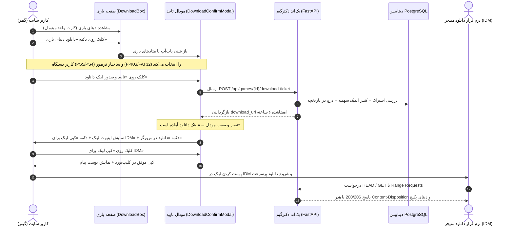

# 📦 دستورالعمل جامع اجرایی گام بیست و یکم: ساده‌سازی باکس دانلود بازی‌ها، حذف کارت‌های فنی فریمور و استقرار ماژول نمایش لینک برای IDM (21-game-download-box-simplification-and-idm-support)

> **شماره گام:** ۲۱  
> **ترکیب تسک‌های مبنا:** بازطراحی رابط کاربری باکس دانلود در صفحه بازی (`DownloadBox.tsx`)، خلوت‌سازی تب دیتای بازی و انتقال انتخاب‌های تخصصی فریمور (FPKG و FAT32) به پاپ‌آپ، بازطراحی فرآیند مودال تایید دانلود (`DownloadConfirmModal.tsx`)، استقرار مرحله «لینک دانلود آماده است»، ارائه مستقیم لینک امن، دکمه کپی لینک برای دانلود منیجرها (IDM)، و درج دکمه کپی لینک در تاریخچه دانلودها (`/dashboard/downloads`).  
> **عنوان مرحله:** یکپارچه‌سازی و مینیمال‌سازی باکس دانلود دیتای بازی، حذف سردرگمی نسخه‌های فریمور از صفحه اصلی بازی، پیاده‌سازی گام تکمیلی صدور لینک مستقیم با قابلیت کپی سریع برای Internet Download Manager (IDM) با حفظ کسر اتمیک سهمیه و قانون منع دانلود مجدد رایگان.  
> **وابستگی‌ها:** گام‌های ۱۹ و ۲۰، ماژول‌های `games`, `subscriptions`, `quota`، کامپوننت‌های `DownloadBox`, `DownloadConfirmModal`, `downloads/page.tsx`.

---

> [!IMPORTANT]
> **اصول و الزامات تخطی‌ناپذیر معماری گام بیست و یکم (Core Inviolable Mandates):**
> 1. **حذف کارت‌های فنی و گیج‌کننده فریمور از صفحه بازی (Clean Storefront Mandate):**  
>    کاربر در صفحه بازی نباید با دو کارت فنی جداگانه FPKG (فریمور ۱۱.۴۰ به پایین) و FAT32 (فریمورهای بالاتر) بمباران اطلاعاتی شود. تب دیتای بازی در `DownloadBox` باید تنها یک کارت واحد و شکیل تحت عنوان «دیتای رسمی بازی پلی‌استیشن» به همراه مشخصات کلی و یک دکمه اصلی دانلود نمایش دهد.
> 2. **انتقال قطعی انتخاب فریمور و دستگاه به پاپ‌آپ تایید:**  
>    انتخاب بین پلتفرم (PS5 یا PS4) و ساختار فریمور (FPKG یا FAT32) به طور کامل به داخل مودال `DownloadConfirmModal` منتقل می‌شود تا کاربر با تمرکز کامل در یک دیالوگ دو مرحله‌ای تصمیم‌گیری کند.
> 3. **پایان بسته شدن خودکار مودال و استقرار مرحله لینک آماده (IDM First UX):**  
>    مودال پس از کسر سهمیه و صدور بلیت دانلود به هیچ عنوان نباید بلافاصله بسته شود یا صرفاً به دانلودر ضعیف مرورگر متکی باشد. مودال باید وارد مرحله «لینک دانلود آماده است» شده و آدرس کامل دانلود مستقیم را با دکمه بزرگ «کپی لینک دانلود برای IDM» و دکمه ثانویه «دانلود در مرورگر» در اختیار کاربر بگذارد.
> 4. **پشتیبانی کامل از شناسه انقضا و کپی در تاریخچه دانلودها:**  
>    در صفحه `/dashboard/downloads` برای رکوردهایی که مدت زمان صدور بلیت آن‌ها کمتر از ۶ ساعت است، دکمه کپی لینک مستقیم فعال باشد تا کاربر بتواند بدون کسر مجدد سهمیه، لینک دانلود را روی سیستم یا نرم‌افزار دانلود منیجر کپی کند. پس از ۶ ساعت، با انقضای توکن امضا، طبق قانون strict NO free re-download، دکمه منقضی شده و دانلود مجدد نیازمند صدور بلیت جدید از صفحه بازی خواهد بود.
> 5. **پشتیبانی قطعی از اتصالات چندکاناله IDM و هدرهای استاندارد Range:**  
>    اندپوینت استریم دانلود در بک‌اند باید متدهای `GET` و `HEAD`، هدر `Accept-Ranges: bytes`، `Content-Length` دقیق، و هدر `Content-Disposition: attachment; filename="..."` را به طور کامل پشتیبانی کند تا IDM بدون هیچ خطایی با حداکثر تعداد کانکشن (مثلاً ۳۲ کانکشن موازی) فایل را دریافت کند.

---

## ۱. دیاگرام جریان تعاملی کاربر در گام بیست و یکم

---

## ۲. جزئیات تغییرات فرانت‌اند (Frontend Overhaul)

### ۲-۱. بازطراحی کامپوننت `DownloadBox.tsx`:
- **حذف حلقه رندر `availableFormats.map(...)` با دو کارت FPKG و FAT32.**
- **افزودن کارت واحد دیتای بازی:**
  - عنوان: «دیتای کامل بازی پلی‌استیشن»
  - برچسب پلتفرم‌های موجود: `PS5 (PPSA)` و `PS4 (CUSA)`
  - حجم کل پکیج: مقدار `size_gb` بازی
  - وضعیت فایل: برچسب سلامت `تایید شده و بدون دستکاری`
  - نشان وضعیت سهمیه کاربر: حجم باقیمانده اشتراک
  - دکمه اکشن: دکمه بزرگ و با ابهت «دانلود دیتای بازی» (یا «ارسال به کنسول PS5» در صورت تشخیص کنسول)
  - با کلیک کاربر، تابع `handleOpenFormatModal(recommendedFormat, true)` فراخوانی شده و مودال باز می‌شود.
- **تب‌های دیگر (DLC، زیرنویس، دوبله و ترینر):** بدون تغییر و با ساختار مجزای قبلی باقی می‌مانند.

### ۲-۲. بازطراحی کامپوننت `DownloadConfirmModal.tsx`:
- **افزودن استیت مرحله‌بندی (Workflow Steps):**
  - استیت `modalStep: 'configure' | 'ready'`
  - در حالت `configure`:
    - انتخاب پلتفرم (PS5 / PS4)
    - انتخاب ساختار فریمور (FPKG برای فریمور ۱۱.۴۰ به پایین / FAT32 برای فریمورهای بالاتر)
    - نمایش پیش‌نمایش حجم، چک‌سام و پیش‌نمایش کسر سهمیه
    - دکمه تایید نهایی
  - در حالت `ready` (پس از صدور بلیت):
    - آیکون جشن/تایید سبز نئونی
    - تیتر: «لینک دانلود اختصاصی شما صادر شد»
    - اینپوت متنی با کلاس `font-mono text-xs select-all` حاوی آدرس کامل لینک دانلود مستقیم
    - دکمه اصلی: **«کپی لینک برای IDM»** با آیکون `Copy` / `Check` و بازخورد کپی موفق
    - دکمه ثانویه: **«دانلود مستقیم در مرورگر»** برای کاربرانی که بدون IDM مایل به دانلود هستند
    - باکس اطلاعاتی: نمایش انقضای ۶ ساعته، پشتیبانی از Resume و هشدار کسر حجم
    - دکمه بستن پاپ‌آپ

### ۲-۳. ارتقای صفحه تاریخچه دانلودها (`frontend/src/app/(dashboard)/dashboard/downloads/page.tsx`):
- در هر ردیف جدول تاریخچه دانلودها:
  - محاسبه زمان سپری‌شده از `downloaded_at`.
  - اگر زمان کمتر از ۶ ساعت باشد:
    - نمایش دکمه «کپی لینک دانلود» با تولید URL امضاشده معتبر.
  - اگر بیش از ۶ ساعت گذشته باشد:
    - نمایش برچسب خاکستری «لینک منقضی شده (جهت دانلود مجدد از صفحه بازی اقدام فرمایید)».

---

## ۳. جزئیات تغییرات بک‌اند (Backend Optimization)

### ۳-۱. تضمین آدرس کامل در `generate_download_ticket`:
- بررسی مقدار `download_url`:
  - اگر آدرس به صورت نسبی تولید شده باشد (`/api/games/...`)، فرانت‌اند با ترکیب `NEXT_PUBLIC_API_URL` آدرس مطلق و کامل قابل استفاده در IDM (شامل `https://...`) را تولید می‌کند.
- تولید هش امضای اعتبارسنجی با انقضای دقیق ۶ ساعته (`exp = now + 21600`).

### ۳-۲. هدرهای پاسخ در `stream_direct_game_download`:
- پشتیبانی کامل از متدهای `GET` و `HEAD`.
- تنظیم دقیق هدرها:
  - `Content-Disposition: attachment; filename="{filename}"`
  - `Accept-Ranges: bytes`
  - `Content-Length: {total_size}`
  - `Content-Type: application/octet-stream` (یا `application/x-ps-pkg` / `application/zip`)
  - پاسخ با کد وضعیت `206 Partial Content` در صورت وجود هدر `Range: bytes=start-end`.

---

## ۴. ماتریس راستی‌آزمایی و تست‌های کیفی (Acceptance Criteria)

| شماره | سناریوی آزمون | نتیجه مورد انتظار |
| :--- | :--- | :--- |
| **۱** | بارگذاری صفحه بازی در دسکتاپ | تب دیتا تنها ۱ کارت تمیز با عنوان دیتای رسمی و دکمه «دانلود دیتای بازی» نشان می‌دهد. کارت‌های فنی FPKG/FAT32 در صفحه اصلی مخفی هستند. |
| **۲** | کلیک روی دکمه دانلود بازی | مودال باز شده و گام انتخاب پلتفرم (PS5/PS4) و فریمور (FPKG/FAT32) را با جزئیات کامل نشان می‌دهد. |
| **۳** | کلیک روی تایید دانلود | سهمیه کسر می‌شود، مودال بسته نمی‌شود، بلکه به صفحه «لینک دانلود آماده است» سوئیچ می‌کند. |
| **۴** | کلیک روی «کپی لینک برای IDM» | آدرس کامل لینک در کلیپ‌بورد کپی شده و پیام موفقیت سبز نمایش می‌یابد. |
| **۵** | پیست کردن لینک در IDM یا تست با `curl -I` | سرور با `200 OK`، هدر `Content-Disposition` و `Accept-Ranges: bytes` پاسخ می‌دهد. |
| **۶** | مراجعه به `/dashboard/downloads` | بازی با نام و مشخصات ثبت شده و دکمه کپی لینک فعال است. |

