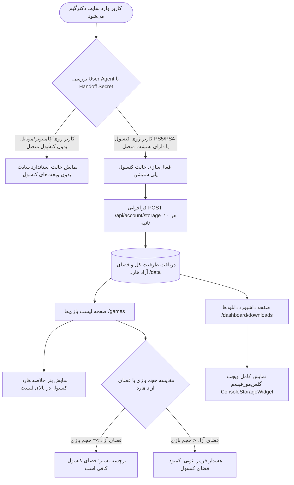

# 🎮 دستورالعمل جامع اجرایی گام بیست و دوم: تشخیص هوشمند کنسول‌های پلی‌استیشن و نمایش زنده تله‌متری حافظه در کاتالوگ و داشبورد دانلودها (22-playstation-console-detection-and-storage-telemetry)

> **شماره گام:** ۲۲  
> **ترکیب تسک‌های مبنا:** گسترش هوک تشخیص سخت‌افزار (`usePs5Handoff.ts`) با تحلیل رشته User-Agent مرورگر کنسول‌های PS5 و PS4، ارتقای کامپوننت کارت بازی (`GameCard.tsx`) با نمایش هوشمند وضعیت گنجایش حافظه کنسول در کنار برچسب حجم بازی، درج بنر تله‌متری زنده کنسول در بالای کاتالوگ بازی‌ها (`/games`)، و استقرار ویجت ظرفیت هارد کنسول (`ConsoleStorageWidget`) در صفحه تاریخچه دانلودها (`/dashboard/downloads`).  
> **عنوان مرحله:** استقرار سیستم پایش هوشمند گنجایش حافظه کنسول‌های سونی پلی‌استیشن (PS5 / PS4 Storage Telemetry Gauge)، مقایسه بلادرنگ حجم پکیج بازی‌ها با فضای آزاد هارد داخلی و اکسترنال دستگاه، و هشدار پیشگیرانه کمبود فضا قبل از اقدام به دانلود یا ارسال به کنسول.  
> **وابستگی‌ها:** گام‌های ۱۶، ۱۹ و ۲۱، ماژول‌های `dpop`, `games`، کامپوننت‌های `ConsoleStorageWidget`, `GameCard`, `games/page.tsx`, `downloads/page.tsx`.

---

> [!IMPORTANT]
> **اصول و الزامات تخطی‌ناپذیر معماری گام بیست و دوم (Core Inviolable Mandates):**
> 1. **تشخیص دوگانه کنسول (User-Agent + DPoP Handoff Session):**  
>    تشخیص کنسول نباید صرفاً وابسته به ورود دستی کد نشست (Handoff Secret) باشد. اگر کاربر مستقیماً مرورگر کنسول پلی‌استیشن ۵ یا پلی‌استیشن ۴ را باز کرده باشد، سیستم باید به شکل خودکار از روی `navigator.userAgent` دستگاه را به عنوان کنسول رسمی شناسایی کند.
> 2. **پایش تطبیقی فضا در کارت بازی‌ها (Adaptive Space Pre-Check):**  
>    در صفحه کاتالوگ بازی‌ها، اگر اطلاعات حافظه کنسول در دسترس باشد، در کنار برچسب حجم هر بازی (مثلاً ۶۷ گیگابایت)، سیستم باید بلافاصله حجم بازی را با فضای آزاد هارد مقایسه کند:
>    - در صورت کفایت فضا: نمایش نشان تایید سبز ظریف: `✔ فضای هارد کافی است`
>    - در صورت کمبود فضا: نمایش هشدار قرمز/نارنجی نئونی: `⚠ کمبود فضای کنسول (نیاز به آزادسازی حافظه)`
> 3. **عدم اختلال در کاربران دسکتاپ و موبایل (Zero Disruption for Desktop/Mobile):**  
>    برای کاربرانی که با کامپیوتر یا موبایل وارد سایت شده‌اند و هیچ کنسولی را متصل نکرده‌اند، ظاهر سایت باید بدون هیچ‌گونه پیام خطا یا فضای خالی اضافه رندر شود و نشانگرهای مربوط به کنسول مخفی بمانند.
> 4. **تله‌متری دوره‌ای و بهینه‌سازی بار شبکه (Polling Policy):**  
>    استعلام تله‌متری هارد کنسول از اندپوینت `/api/account/storage` باید هر ۱۰ ثانیه یک‌بار (طبق استاندارد اپلیکیشن Download32) انجام شود و هنگام خروج از صفحه یا فوکوس نبودن تب، تایمر پاکسازی شود تا بار اضافی به سرور تحمیل نگردد.

---

## ۱. دیاگرام جریان تله‌متری حافظه کنسول در کاتالوگ و داشبورد

---

## ۲. جزئیات تغییرات و توسعه فرانت‌اند

### ۲-۱. ارتقای هوک `usePs5Handoff.ts`:
- افزودن قابلیت تجزیه رشته `navigator.userAgent`:
  - الگوهای شناسایی:
    - `PlayStation 5` -> `detectedPlatform: 'ps5'`
    - `PlayStation 4` -> `detectedPlatform: 'ps4'`
- استیت‌های خروجی:
  - `isConsole: boolean` (ترکیب `Boolean(handoffSecret) || isPsBrowser`)
  - `consolePlatform: 'ps5' | 'ps4' | 'desktop'`
  - `firmwareVersion: number | null` (در صورت وجود نسخه در User-Agent)

### ۲-۲. ارتقای کامپوننت `GameCard.tsx`:
- دریافت وضعیت حافظه کنسول (از طریق Context یا هوک یا کش سراسری استوریج).
- در کنار برچسب حجم پکیج (گوشه بالا چپ کارت):
  - اگر کنسول متصل باشد و متادیتای هارد موجود باشد:
    - در صورت وجود فضای کافی: بج فشرده سبز با آیکون تیک و نمایش فضای آزاد.
    - در صورت کمبود فضا: بج چشمک‌زن قرمز/نارنجی نئونی با آیکون هشدار برای آگاهی کاربر.

### ۲-۳. ارتقای صفحه کاتالوگ بازی‌ها (`frontend/src/app/(store)/games/page.tsx`):
- در صورت تشخیص کنسول:
  - نمایش یک نوار افقی باریک و مدرن تله‌متری در بالای فیلترهای بازی:
    - نمایش نام کنسول (`PlayStation 5 Console` یا `PlayStation 4 Console`).
    - نوار پیشرفت وضعیت مصرف هارد (درصد پر بودن SSD داخلی).
    - نمایش حجم آزاد به گیگابایت (مثلاً `۳۴۵.۲ گیگابایت فضای خالی`).
    - وضعیت آنلاین/زنده بودن ارتباط با اپلیکیشن Download32.

### ۲-۴. ارتقای صفحه داشبورد دانلودها (`frontend/src/app/(dashboard)/dashboard/downloads/page.tsx`):
- افزودن کامپوننت `ConsoleStorageWidget` در بالای کارت‌های آمار دانلودها:
  - کاربر در یک نگاه هم حجم سهمیه اشتراک خود را می‌بیند و هم وضعیت فیزیکی هاردهای متصل به کنسول خود را رصد می‌کند.
  - نمایش وضعیت دیسک داخلی (`/data`) و هاردهای اکسترنال USB متصل به کنسول.

---

## ۳. ماتریس راستی‌آزمایی و معیارهای پذیرش (Acceptance Criteria)

| شماره | سناریوی آزمون | نتیجه مورد انتظار |
| :--- | :--- | :--- |
| **۱** | باز کردن سایت با User-Agent کنسول PS5 | سیستم بدون نیاز به وارد کردن کد دستی، دستگاه را به عنوان کنسول شناسایی می‌کند. |
| **۲** | استعلام تله‌متری هارد کنسول | اندپوینت `/api/account/storage` ظرفیت کل، آزاد و درصد هارد را بازمی‌گرداند. |
| **۳** | بررسی کارت بازی‌ها در کاتالوگ | در کنار بازی‌های حجیم‌تر از فضای آزاد هارد، علامت هشدار کمبود فضا و در کنار بازی‌های مناسب، تیک سبز کفایت فضا نمایش می‌یابد. |
| **۴** | مشاهده صفحه دانلودها (`/dashboard/downloads`) | ویجت زنده وضعیت حافظه کنسول با نوار درصد و مقدار گیگابایت آزاد رندر می‌شود. |
| **۵** | باز کردن سایت در مرورگر ویندوز/کروم عادی | کارت‌ها بدون هیچ اختلال، پیام خطا یا فضای خالی اضافه مثل حالت عادی رندر می‌شوند. |

