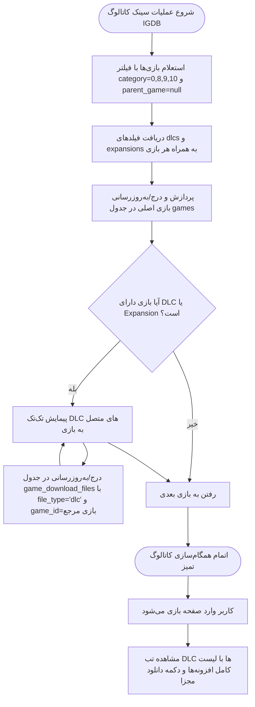

<div dir="rtl" lang="fa">

# 🗡️ دستورالعمل جامع اجرایی گام بیست و سوم: ارتقای موتور همگام‌سازی کاتالوگ IGDB، تفکیک محتواهای الحاقی (DLC) از بازی‌های اصلی و الصاق هوشمندانه افزونه‌ها (23-catalog-sync-dlc-separation-and-enrichment)

> **شماره گام:** ۲۳  
> **ترکیب تسک‌های مبنا:** اصلاح و بهینه‌سازی موتور همگام‌سازی کاتالوگ (`backend/app/modules/catalog_sync/services.py`)، اعمال فیلتر هوشمند دسته‌بندی IGDB (`category` و `parent_game`) جهت جلوگیری از درج DLCها به عنوان بازی مستقل، دریافت متادیتای اختصاصی بسته‌های الحاقی و افزونه‌ها (`dlcs` و `expansions`)، ذخیره خودکار DLCها ذیل بازی مرجع در جدول `game_download_files` با نوع `dlc`، نمایش شکیل افزونه‌ها در تب اختصاصی DLC در صفحه بازی (`DownloadBox.tsx`)، و اجرای اسکریپت پاکسازی رکوردهای الحاقی موجود در کاتالوگ.  
> **عنوان مرحله:** تفکیک بنیادین بسته‌های دانلودی الحاقی (DLCs/Expansions) از عناوین اصلی استور، پاکسازی ویترین فروشگاه از تایتل‌های قطعه‌قطعه، و ارائه ساختارمند بسته‌های الحاقی ذیل صفحه همان بازی با قابلیت صدور بلیت و دانلود مجزا.  
> **وابستگی‌ها:** گام‌های ۰۳، ۱۸، ۱۹ و ۲۱، ماژول‌های `catalog_sync`, `games`, `rawg_sync`، مدل‌های `Game`, `GameDownloadFile`, `CatalogSyncJob`.

---

> [!IMPORTANT]
> **اصول و الزامات تخطی‌ناپذیر معماری گام بیست و سوم (Core Inviolable Mandates):**
> 1. **ممنوعیت درج DLC به عنوان عنوان مستقل در جدول بازی‌ها (Clean Catalog Mandate):**  
>    هیچ بسته الحاقی، اکسپنشن، سیزن پس یا اسکین‌پکی نباید به عنوان یک ردیف مجزا در جدول `games` ذخیره شود. جدول `games` منحصراً ویژه عناوین مستقل بازی (بازی‌های کامل، ریمیک، ریمستر و نسخه‌های جامع) است.
> 2. **پشتیبانی کامل از ساختار سلسله‌مراتبی IGDB:**  
>    در موتور سینک کاتالوگ، استعلام‌ها باید صریحاً دارای شرط `category = (0, 8, 9, 10)` و `parent_game = null` باشند تا پکیج‌های وابسته استخراج و فیلتر شوند.
> 3. **الصاق ساختارمند DLCها به عنوان فایل‌های دانلودی بازی مرجع:**  
>    اطلاعات هر DLC (نام افزونه، اسلاگ، کاور و تاریخ انتشار) باید استخراج شده و ذیل رکورد همان بازی اصلی در جدول `game_download_files` با فیلد `file_type = "dlc"` ثبت گردد.
> 4. **نمایش پویا در تب اختصاصی DLC در صفحه بازی:**  
>    در صفحه بازی (مثلاً ویچر ۳)، در تب اختصاصی «بسته‌های الحاقی و DLC»، تمامی افزونه‌های مرتبط (مانند *Blood and Wine* و *Hearts of Stone*) به همراه نام پارت، حجم تخمینی، و دکمه اختصاصی دانلود نمایش داده شوند.
> 5. **حفظ پایداری آزمون‌های پیشین و اسکریپت بازسازی دیتابیس:**  
>    اسکریپت پاکسازی باید رکوردهای پیشین کاتالوگ را بررسی کرده، عناوینی که ماهیت پک الحاقی دارند (مانند پکیج‌های مبل و کاراکتر) را شناسایی و به جدول فایل‌های الحاقی بازی متناظر منتقل یا از جدول بازی‌های اصلی پاک کند.

---

## ۱. دیاگرام جریان تفکیک و الصاق DLCها در موتور کاتالوگ



---

## ۲. دسته‌بندی‌های استاندارد IGDB و ماتریس فیلترینگ

در دیتابیس مرجع IGDB فیلد `category` کدهای زیر را حمل می‌کند:

| کد | عنوان استاندارد IGDB | نحوه برخورد در دکترگیم |
| :---: | :--- | :--- |
| **0** | `main_game` (بازی کامل) | ✅ ذخیره به عنوان بازی در جدول `games` |
| **1** | `dlc_addon` (محتوای دانلودی الحاقی) | ❌ عدم ثبت در `games` / ✅ ذخیره به عنوان رکورد `dlc` در `game_download_files` |
| **2** | `expansion` (بسته گسترش‌دهنده داستانی) | ❌ عدم ثبت در `games` / ✅ ذخیره به عنوان رکورد `dlc` در `game_download_files` |
| **3** | `bundle` (بسته‌های تجمیعی باندل) | بر اساس `parent_game` تصمیم‌گیری می‌شود |
| **4** | `standalone_expansion` (اکسپنشن مستقل) | ✅ مجاز به عنوان بازی اگر عنوان مستقل باشد |
| **8** | `remake` (بازسازی کامل بازی) | ✅ ذخیره به عنوان بازی در جدول `games` |
| **9** | `remaster` (نسخه بهبودیافته گرافیکی) | ✅ ذخیره به عنوان بازی در جدول `games` |
| **10** | `expanded_game` (نسخه ادیشن کامل با تمام DLCها) | ✅ ذخیره به عنوان بازی در جدول `games` |

---

## ۳. جزئیات تغییرات فنی بک‌اند (Backend Implementation)

### ۳-۱. اصلاح کوئری کاتالوگ در `backend/app/modules/catalog_sync/services.py`:
- افزودن شرط به `where_clauses`:
  ```python
  where_clauses.append("category = (0, 8, 9, 10)")
  where_clauses.append("parent_game = null")
  ```
- گسترش فیلدهای استعلامی در رشته `fields`:
  ```python
  fields = """
      id, name, slug, summary, storyline, first_release_date,
      rating, rating_count, aggregated_rating, total_rating, category,
      cover.image_id, cover.url,
      artworks.image_id, screenshots.image_id,
      genres.name, platforms.id, platforms.name, game_modes.name,
      involved_companies.company.name, involved_companies.developer, involved_companies.publisher,
      dlcs.id, dlcs.name, dlcs.slug, dlcs.summary, dlcs.first_release_date, dlcs.cover.url,
      expansions.id, expansions.name, expansions.slug, expansions.summary, expansions.first_release_date, expansions.cover.url;
  """
  ```

### ۳-۲. پردازش و درج رکوردهای DLC در جدول `game_download_files`:
- پس از ذخیره/به‌روزرسانی موفق بازی مرجع:
  - استخراج لیست تجمیعی `item.get("dlcs", []) + item.get("expansions", [])`.
  - به ازای هر آیتم الحاقی:
    - بررسی عدم تکرار در دیتابیس (بر اساس `game_id` و `title`).
    - درج یک رکورد در `GameDownloadFile`:
      - `game_id = game.id`
      - `file_type = "dlc"`
      - `title = dlc_item.get("name")`
      - `file_size_gb = 5.0` (یا سایز متناظر استوریج)
      - `download_url = f"/api/games/{game.id}/downloads/{dlc_id}/stream"`
      - `allowed_tiers = ["gold", "silver", "bronze"]`
      - `is_active = True`

### ۳-۳. اسکریپت پاکسازی و مایگریشن داده‌های کاتالوگ:
- بررسی رکوردهای فعلی `games`:
  - شناسایی عناوینی که دارای کلماتی نظیر `Pack`, `Bundle`, `DLC`, `Season` در نام خود هستند یا اسلاگ آن‌ها نشان‌دهنده الحاقی بودن است.
  - انتقال این موارد به عنوان ساب‌پکیج‌های بازی مرجع یا غیرفعال‌سازی از استور اصلی.

---

## ۴. ماتریس راستی‌آزمایی و معیارهای پذیرش (Acceptance Criteria)

| شماره | سناریوی آزمون | نتیجه مورد انتظار |
| :--- | :--- | :--- |
| **۱** | استعلام بازی ویچر ۳ در سینک کاتالوگ | فقط ۱ رکورد به نام `The Witcher 3: Wild Hunt` به عنوان بازی اصلی ثبت می‌شود. |
| **۲** | بررسی بسته‌های الحاقی ویچر ۳ | بسته‌های *Blood and Wine* و *Hearts of Stone* در جدول `game_download_files` با `file_type = 'dlc'` درج می‌شوند. |
| **۳** | باز کردن صفحه بازی در سایت | در تب «DLC و افزونه‌ها»، لیست کامل دی‌ال‌سی‌ها با عنوان، کاور و دکمه دانلود نمایش می‌یابد. |
| **۴** | جستجو در استور | فروشگاه دیگر شامل بازی‌های کاذب مثل «مبل پک» یا «دی‌ال‌سی اسکین» به عنوان بازی جداگانه نیست. |
| **۵** | دانلود فایل DLC | سهمیه به اندازه حجم همان DLC کسر شده و فایل الحاقی دانلود می‌شود. |

</div>
