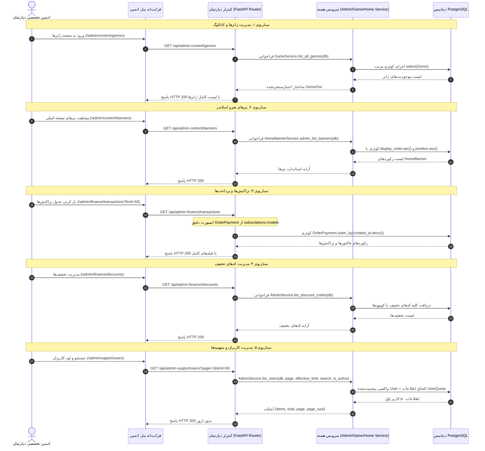

<div dir="rtl" lang="fa">

# 🛠️ دستورالعمل جامع اجرایی گام بیست و چهارم: ریشه‌یابی و رفع خطاهای ۵۰۰ پنل‌های ادمین و اصلاح اعتبارسنجی اولویت تیکت‌های پشتیبانی (24-admin-500-errors-and-ticket-validation-fixes)

> **شماره گام:** ۲۴  
> **عنوان مرحله:** ریشه‌یابی تخصصی و رفع پایدار کلیه خطاهای ۵۰۰ در پنل‌های ادمین دپارتمانی (مدیریت محتوا، مدیریت مالی و اشتراک، پشتیبانی کاربران) بر اساس گزارش `500errors.md`، رفع ارور ۴۲۲ اعتبارسنجی اولویت تیکت در پنل کاربری، همگام‌سازی امضای متدهای سرویس با کنترلرهای FastAPI، اصلاح ایمپورت‌های مدل دیتابیس و تطبیق فیلدهای کوئری با مدل‌های SQLAlchemy.  
> **فایل مرجع گزارش خطاها:** `500errors.md`  
> **وابستگی‌ها:** ماژول‌های `admin` (روترهای `content_router.py`, `finance_router.py`, `support_router.py` و `services.py`)، ماژول `tickets` (اسکیماها و مدل‌ها)، ماژول `home` (`banner_models.py` و `services.py`)، ماژول `games` (`models.py` و `services.py`)، ماژول `subscriptions` (`models.py`) و ماژول `wallet` (`models.py`).

---

> [!IMPORTANT]
> **اصول و الزامات تخطی‌ناپذیر معماری گام بیست و چهارم (Core Inviolable Mandates):**
> 1. **ریشه‌یابی علمی خطاها در سطح کد (Root-Cause Accuracy Mandate):**  
>    هیچ تغییری نباید بدون تطبیق دقیق با استک تریس پایتون اعمال شود. تمام ارورهای ۵۰۰ شناسایی‌شده حاصل خطاهای نحوی در سطح اجرا (مانند `AttributeError`, `ImportError`, `TypeError`) یا ناسازگاری امضای متدها بین لایه‌های Router و Service بوده‌اند و مستقیماً باید در نقطه اتصال کنترلر و سرویس برطرف شوند.
> 2. **پشتیبانی دوطرفه از اعتبارسنجی اولویت تیکت (Backward & Forward Ticket Validation):**  
>    در فرم ایجاد تیکت کاربری (`NewTicketModal.tsx`) مقادیر `'low' | 'medium' | 'high'` ارسال می‌شوند در حالی که بک‌اند با الگوی `^(normal|urgent)$` درخواست را رد می‌کرد. بک‌اند باید تمام مقادیر `('low', 'medium', 'high', 'normal', 'urgent')` را بپذیرد و آن را ذخیره کند تا هیچ کلاینتی دچار خطای ۴۲۲ نشود.
> 3. **عدم بازنویسی مجدد منطق بیزنس (DRY & Reuse Mandate):**  
>    سرویس‌های اختصاصی برای مدیریت ژانرها (`GameService`)، بنرها (`HomeBannerService`)، و کدهای تخفیف (`AdminService`) هم‌اکنون در سیستم موجودند اما به دلیل تفاوت در نام‌گذاری متدها یا نام ستون‌ها فراخوانی نمی‌شدند. باید این متدهای آماده و تست‌شده به درستی در کنترلرها متصل شوند.
> 4. **سازگاری کامل پارامترهای Pagination بین فرانت‌اند و بک‌اند:**  
>    فرانت‌اند پنل‌های ادمین در درخواست‌های خود پارامتر `limit` (مانند `?page=1&limit=50`) را ارسال می‌کند در حالی که روتر بک‌اند `page_size` را دریافت می‌کرد. روترها باید از هر دو پارامتر `page_size` و `limit` (با مقدار پیش‌فرض ۲۰ و حداکثر ۱۰۰) پشتیبانی کنند.
> 5. **حفظ امنیت و لایه‌های دسترسی RBAC دپارتمانی:**  
>    تمام متدهای اصلاح‌شده باید گارد امنیتی مربوطه (`require_content_admin`, `require_finance_admin`, `require_support_admin`) با سطح دسترسی متناسب (`FULL_CRUD` یا `READ_ONLY`) و ثبت لاگ در `AuditLog` (`log_admin_action`) را کاملاً حفظ نمایند.

---

## ۱. جدول ماتریس عیب‌یابی و ریشه‌یابی خطاها بر اساس `500errors.md`

| شماره | بخش گزارش‌شده در `500errors.md` | کد خطا | فایل و خط معیوب | علت ریشه‌ای دقیق (Root Cause) | راهکار قطعی رفع مشکل |
| :---: | :--- | :---: | :--- | :--- | :--- |
| **۱** | **پنل کاربری: بخش ایجاد تیکت جدید** | `422` | `tickets/schemas.py:10` | رجکس Pydantic به صورت `pattern="^(normal\|urgent)$"` تنظیم شده در حالی که فرانت‌اند در `NewTicketModal.tsx` مقدار `'low' \| 'medium' \| 'high'` ارسال می‌کند. | اصلاح پترن اسکیما به `^(normal\|urgent\|low\|medium\|high)$` و نرمال‌سازی در سرویس. |
| **۲** | **پنل محتوا: بخش ژانرها و دسته‌ها** | `500` | `content_router.py:428, 437` | فراخوانی متدهای ناموجود `GameService.get_genres` و `GameService.create_genre` که باعث بروز `AttributeError` می‌شود. | اتصال اندپوینت‌ها به متدهای موجود `GameService.list_all_genres` و `GameService.admin_create_genre` و افزودن `PUT` و `DELETE`. |
| **۳** | **پنل محتوا: بخش بنرهای صفحه اصلی** | `500` | `content_router.py:536, 548` | ارجاع به ستون ناموجود `HomeBanner.order_priority` به جای `display_order` و عدم پر کردن فیلد الزامی `description` در ایجاد بنر. | استفاده از متدهای جامع و آماده `HomeBannerService.admin_list_banners` و `admin_create_banner`. |
| **۴** | **پنل مالی: بخش تراکنش‌ها و پرداخت‌ها** | `500` | `finance_router.py:323` | تلاش برای ایمپورت `OrderPayment` از ماژول نامربوط `wallet.models` که باعث خطای زمان اجرای `ImportError` می‌شود. | ایمپورت صحیح `OrderPayment` از `app.modules.subscriptions.models` و پشتیبانی از پارامتر `limit`. |
| **۵** | **پنل مالی: بخش کدهای تخفیف اشتراک** | `500` | `finance_router.py:352, 363, 384, 405` | ناهمخوانی اسامی متدها: فراخوانی `list_discounts` به جای `list_discount_codes` و `create_discount` به جای `create_discount_code` در `AdminService` که موجب `AttributeError` می‌شود. | فراخوانی مستقیم اسامی صحیح متدهای موجود در `AdminService` یا تعریف توابع Alias. |
| **۶** | **پنل پشتیبانی: مدیریت کاربران و سهمیه‌ها** | `500` | `support_router.py:402` & `services.py:23` | ناسازگاری آرگومان‌ها: کنترلر ۵ آرگومان ارسال می‌کرد اما متد `list_users` حداکثر ۴ آرگومان می‌پذیرفت (`TypeError`). همچنین جای پارامترها جا‌به‌جا بود. | اصلاح امضای `AdminService.list_users`، اصلاح نحوه پاس دادن آرگومان‌ها و فیلتر `is_active`. |
| **۷** | **پنل پشتیبانی: تنظیم سهمیه و تغییر وضعیت** | `500/405` | `support_router.py:422, 444` | کنترلر آرگومان `redis` را به `adjust_user_quota` پاس نداده و متد `update_user_status` اصلاً در `AdminService` پیاده‌سازی نشده بود! | تزریق دپندنسی ردیس، پیاده‌سازی متد `update_user_status` و پذیرش متد `PUT` برای تنظیم سهمیه. |

---

## ۲. مستندات تفصیلی ریشه‌یابی و پیاده‌سازی هر بخش

### ۲.۱. بخش تیکت‌ها: رفع خطای ۴۲۲ ایجاد تیکت
- **شرح ایراد:**  
  در کامپوننت `frontend/src/components/tickets/NewTicketModal.tsx` متغیر اولویت به صورت زیر تعریف شده است:
  ```typescript
  const [priority, setPriority] = useState<'low' | 'medium' | 'high'>('medium');
  ```
  و در زمان ثبت فرم، فیلد `priority` با مقدار `'low'`، `'medium'` یا `'high'` برای اندپوینت `POST /api/tickets` ارسال می‌شود.  
  اما در بک‌اند، فایل `backend/app/modules/tickets/schemas.py:10`:
  ```python
  class TicketCreate(BaseModel):
      subject: str = Field(..., min_length=3, max_length=200)
      department: str = Field(..., min_length=2, max_length=50)
      priority: str = Field("normal", pattern="^(normal|urgent)$")  # <--- علت خطای ۴۲۲
      message: str = Field(..., min_length=5, max_length=5000)
  ```
  پایدانتیک بلافاصله خطای اعتبارسنجی زیر را برمی‌گرداند:
  ```json
  {
    "detail": [
      {
        "type": "string_pattern_mismatch",
        "loc": ["body", "priority"],
        "msg": "String should match pattern '^(normal|urgent)$'",
        "input": "medium",
        "ctx": {"pattern": "^(normal|urgent)$"}
      }
    ]
  }
  ```
- **راهکار پیاده‌سازی:**
  1. در `backend/app/modules/tickets/schemas.py` الگوی رجکس فیلد `priority` به صورت زیر گسترش داده می‌شود:
     ```python
     priority: str = Field("normal", pattern="^(normal|urgent|low|medium|high)$")
     ```
  2. در ستون دیتابیس `Ticket.priority` که از نوع `String(32)` است، مقادیر جدید بدون نیاز به تغییر اسکیمای دیتابیس به درستی ذخیره می‌شوند. جهت سازگاری کامل، در لایه سرویس یا اسکیما می‌توان یک نگاشت برای تبدیل `low -> normal`، `medium -> normal` و `high -> urgent` یا ذخیره مستقیم آن‌ها در نظر گرفت تا در صفحه لیست تیکت‌ها و مدال گفتگو برچسب‌های رنگی فرانت‌اند (`dashboardTickets.priority.high`, `low`, `medium`) دقیقاً لود شوند.

---

### ۲.۲. پنل محتوا: رفع خطای ۵۰۰ ژانرها و دسته‌بندی‌ها (`/admin/content/genres`)
- **شرح ایراد:**  
  کنترلر `backend/app/modules/admin/routers/content_router.py` در خطوط ۴۲۵ تا ۴۴۰:
  ```python
  @router.get("/genres")
  async def list_genres(db: AsyncSession = Depends(get_db), _: ContentAdmin = Depends(require_content_admin())):
      from app.modules.games.services import GameService
      return await GameService.get_genres(db)  # <--- AttributeError!
  ```
  کلاس `GameService` هیچ تابعی به نام `get_genres` یا `create_genre` ندارد.
- **راهکار پیاده‌سازی:**
  در `backend/app/modules/games/services.py:720` توابع زیر به شکل کامل و بهینه پیاده‌سازی شده‌اند:
  - `GameService.list_all_genres(db: AsyncSession, only_active: bool = False, only_top8: bool = False) -> List[Genre]`
  - `GameService.admin_create_genre(db: AsyncSession, data: dict) -> Genre`
  - `GameService.admin_update_genre(db: AsyncSession, genre_id: int, data: dict) -> Genre`
  - `GameService.admin_delete_genre(db: AsyncSession, genre_id: int) -> dict`
  
  کنترلر `content_router.py` باید بدین صورت اصلاح شود:
  ```python
  @router.get("/genres")
  async def list_genres(db: AsyncSession = Depends(get_db), _: ContentAdmin = Depends(require_content_admin())):
      from app.modules.games.services import GameService
      return await GameService.list_all_genres(db)

  @router.post("/genres", status_code=status.HTTP_201_CREATED)
  async def create_genre(
      payload: GenreCreate,
      request: Request,
      db: AsyncSession = Depends(get_db),
      current_admin: ContentAdmin = Depends(require_content_admin(level=AdminAccessLevel.FULL_CRUD)),
  ):
      from app.modules.games.services import GameService
      genre = await GameService.admin_create_genre(db, payload.model_dump())
      await log_admin_action(...)
      return genre

  @router.put("/genres/{genre_id}")
  async def update_genre(
      genre_id: int,
      payload: GenreUpdate,
      request: Request,
      db: AsyncSession = Depends(get_db),
      current_admin: ContentAdmin = Depends(require_content_admin(level=AdminAccessLevel.FULL_CRUD)),
  ):
      from app.modules.games.services import GameService
      genre = await GameService.admin_update_genre(db, genre_id, payload.model_dump(exclude_unset=True))
      await log_admin_action(...)
      return genre

  @router.delete("/genres/{genre_id}")
  async def delete_genre(
      genre_id: int,
      request: Request,
      db: AsyncSession = Depends(get_db),
      current_admin: ContentAdmin = Depends(require_content_admin(level=AdminAccessLevel.FULL_CRUD)),
  ):
      from app.modules.games.services import GameService
      res = await GameService.admin_delete_genre(db, genre_id)
      await log_admin_action(...)
      return res
  ```

---

### ۲.۳. پنل محتوا: رفع خطای ۵۰۰ بنرهای صفحه اصلی (`/admin/content/banners`)
- **شرح ایراد:**  
  کنترلر `backend/app/modules/admin/routers/content_router.py` در خط ۵۳۶:
  ```python
  stmt = select(HomeBanner).order_by(HomeBanner.order_priority.asc())
  ```
  مدل `HomeBanner` در `backend/app/modules/home/banner_models.py` ستونی به نام `order_priority` ندارد و نام این ستون در مدل دیتابیس `display_order` است. فراخوانی `HomeBanner.order_priority` منجر به بروز فوری `AttributeError` و ارور ۵۰۰ می‌گردد.
  علاوه بر این، در متد `create_banner` فرم ارسالی فرانت‌اند فیلد `description` را ندارد، در حالی که در مدل دیتابیس `description` اجباری (`nullable=False`) است و ساخت نمونه خام باعث خطای یکپارچگی SQLAlchemy می‌شود.
- **راهکار پیاده‌سازی:**
  ماژول سرویس `HomeBannerService` در `backend/app/modules/home/services.py` تمام این موارد را مدیریت می‌کند:
  ```python
  @router.get("/banners")
  async def list_banners(
      position: Optional[int] = Query(None, description="Position 1 or 2"),
      db: AsyncSession = Depends(get_db),
      _: ContentAdmin = Depends(require_content_admin()),
  ):
      from app.modules.home.services import HomeBannerService
      return await HomeBannerService.admin_list_banners(db, position=position)

  @router.post("/banners", status_code=status.HTTP_201_CREATED)
  async def create_banner(
      payload: dict,
      request: Request,
      db: AsyncSession = Depends(get_db),
      current_admin: ContentAdmin = Depends(require_content_admin(level=AdminAccessLevel.FULL_CRUD)),
  ):
      from app.modules.home.services import HomeBannerService
      banner = await HomeBannerService.admin_create_banner(db, payload)
      await log_admin_action(...)
      return banner

  @router.delete("/banners/{banner_id}")
  async def delete_banner(
      banner_id: int,
      request: Request,
      db: AsyncSession = Depends(get_db),
      current_admin: ContentAdmin = Depends(require_content_admin(level=AdminAccessLevel.FULL_CRUD)),
  ):
      from app.modules.home.services import HomeBannerService
      res = await HomeBannerService.admin_delete_banner(db, banner_id=banner_id)
      await log_admin_action(...)
      return res
  ```

---

### ۲.۴. پنل مالی: رفع خطای ۵۰۰ تراکنش‌ها و پرداخت‌ها (`/admin/finance/transactions`)
- **شرح ایراد:**  
  کنترلر `backend/app/modules/admin/routers/finance_router.py` در خط ۳۲۳:
  ```python
  @router.get("/transactions")
  async def list_transactions(...):
      from app.modules.wallet.models import OrderPayment  # <--- ImportError!
  ```
  مدل جدول تراکنش‌های پرداخت اشتراک `OrderPayment` در پکیج `app.modules.subscriptions.models` قرار دارد و در `wallet.models` وجود ندارد. در نتیجه به محض فراخوانی اندپوینت، اکسیپشن `ImportError` پرتاب شده و پاسخ ۵۰۰ به کاربر برمی‌گردد.
  همچنین فرانت‌اند درخواست را به صورت `?page=1&limit=50` ارسال می‌کند، در حالی که روتر پارامتر را با نام `page_size` دریافت می‌کرد.
- **راهکار پیاده‌سازی:**
  1. ایمپورت صحیح مدل از `app.modules.subscriptions.models`:
     ```python
     from app.modules.subscriptions.models import OrderPayment
     ```
  2. پشتیبانی همزمان از پارامترهای `limit` و `page_size`:
     ```python
     @router.get("/transactions")
     async def list_transactions(
         page: int = Query(1, ge=1),
         page_size: Optional[int] = Query(None, ge=1, le=100),
         limit: Optional[int] = Query(None, ge=1, le=100),
         status_filter: Optional[str] = None,
         db: AsyncSession = Depends(get_db),
         _: FinanceAdmin = Depends(require_finance_admin()),
     ):
         effective_limit = limit or page_size or 20
         query = select(OrderPayment)
         if status_filter:
             query = query.where(OrderPayment.status == status_filter)

         count_res = await db.execute(select(func.count()).select_from(query.subquery()))
         total = count_res.scalar() or 0

         items_res = await db.execute(
             query.order_by(OrderPayment.created_at.desc())
             .offset((page - 1) * effective_limit)
             .limit(effective_limit)
         )
         return {
             "items": items_res.scalars().all(),
             "total": total,
             "page": page,
             "page_size": effective_limit,
         }
     ```

---

### ۲.۵. پنل مالی: رفع خطای ۵۰۰ کدهای تخفیف اشتراک (`/admin/finance/discounts`)
- **شرح ایراد:**  
  کنترلر `backend/app/modules/admin/routers/finance_router.py` در خطوط ۳۵۰ تا ۴۱۰:
  ```python
  @router.get("/discounts")
  async def list_discounts(...):
      return await AdminService.list_discounts(db)  # <--- AttributeError!
  ```
  در حالی که در `backend/app/modules/admin/services.py:554, 560, 583, 880` اسامی متدها به این صورت تعریف شده‌اند:
  - `AdminService.list_discount_codes(db)`
  - `AdminService.create_discount_code(db, data)`
  - `AdminService.update_discount_code(db, discount_id, data)`
  - `AdminService.delete_discount_code(db, discount_id)`
  ناهمخوانی اسامی موجب پرتاب `AttributeError: type object 'AdminService' has no attribute 'list_discounts'` و خطای ۵۰۰ در تمامی عملیات‌های دریافت، ساخت، ویرایش و حذف کد تخفیف می‌شود.
- **راهکار پیاده‌سازی:**
  اصلاح متدهای فراخوانی‌شده در روتر مالی:
  ```python
  @router.get("/discounts")
  async def list_discounts(db: AsyncSession = Depends(get_db), _: FinanceAdmin = Depends(require_finance_admin())):
      return await AdminService.list_discount_codes(db)

  @router.post("/discounts", status_code=status.HTTP_201_CREATED)
  async def create_discount(
      payload: DiscountCreateRequest,
      request: Request,
      db: AsyncSession = Depends(get_db),
      current_admin: FinanceAdmin = Depends(require_finance_admin(level=AdminAccessLevel.FULL_CRUD)),
  ):
      res = await AdminService.create_discount_code(db, payload.model_dump())
      await log_admin_action(...)
      return res

  @router.put("/discounts/{discount_id}")
  async def update_discount(
      discount_id: int,
      payload: AdminDiscountUpdate,
      request: Request,
      db: AsyncSession = Depends(get_db),
      current_admin: FinanceAdmin = Depends(require_finance_admin(level=AdminAccessLevel.FULL_CRUD)),
  ):
      res = await AdminService.update_discount_code(db, discount_id, payload.model_dump(exclude_unset=True))
      await log_admin_action(...)
      return res

  @router.delete("/discounts/{discount_id}")
  async def delete_discount(
      discount_id: int,
      request: Request,
      db: AsyncSession = Depends(get_db),
      current_admin: FinanceAdmin = Depends(require_finance_admin(level=AdminAccessLevel.FULL_CRUD)),
  ):
      res = await AdminService.delete_discount_code(db, discount_id)
      await log_admin_action(...)
      return res
  ```

---

### ۲.۶. پنل پشتیبانی: رفع خطای ۵۰۰ مدیریت کاربران و سهمیه‌ها (`/admin-support/users`)
- **شرح ایراد:**  
  کنترلر `backend/app/modules/admin/routers/support_router.py` در خط ۴۰۱:
  ```python
  @router.get("/users")
  async def list_users(
      page: int = Query(1, ge=1),
      page_size: int = Query(20, ge=1, le=100),
      search: Optional[str] = None,
      is_active: Optional[bool] = None,
      db: AsyncSession = Depends(get_db),
      _: SupportAdmin = Depends(require_support_admin()),
  ):
      return await AdminService.list_users(db, page, page_size, search, is_active)  # <--- TypeError!
  ```
  و امضای تابع در `backend/app/modules/admin/services.py:23`:
  ```python
  @staticmethod
  async def list_users(
      db: AsyncSession,
      search: str | None = None,
      page: int = 1,
      page_size: int = 20,
  ) -> dict:
  ```
  کنترلر ۵ آرگومان پوزیشنی ارسال می‌کند اما سرویس حداکثر ۴ آرگومان می‌پذیرد:
  `TypeError: AdminService.list_users() takes from 1 to 4 positional arguments but 5 were given`
  علاوه بر این ترتیب آرگومان‌ها کاملاً درهم ریخته بود (مثلاً آرگومان `page` به جای `search` می‌نشست و `search` به جای `page_size`!).
  
  همچنین دو باگ زنجیره‌ای وابسته دیگر در این صفحه وجود دارد:
  1. **خطای ۵۰۰ در شارژ سهمیه (`adjust-quota`):**  
     کنترلر در خط ۴۲۲ صدا می‌زند: `await AdminService.adjust_user_quota(db, user_id, payload)` (۳ آرگومان)، در حالی که متد سرویس به این شکل است:
     `adjust_user_quota(db, redis, user_id, added_gb, reason)`. آرگومان ردیس وجود نداشت و پایدانتیک پیلود به جای `user_id` پاس داده می‌شد که با پرتاب `TypeError` کرش می‌کرد. همچنین فرانت‌اند از متد `PUT` و فیلد `additional_gb` استفاده می‌کند.
  2. **خطای ۵۰۰ در تغییر وضعیت کاربر (`status`):**  
     کنترلر در خط ۴۴۴ صدا می‌زند: `AdminService.update_user_status(db, user_id, payload.is_active)` در حالی که چنین متدی در `AdminService` اصلاً تعریف نشده بود و بلافاصله `AttributeError` رخ می‌داد!

- **راهکار پیاده‌سازی:**
  1. بازنویسی امضای `AdminService.list_users` جهت پشتیبانی مرتب و صریح از پارامترهای نام‌دار به همراه فیلتر وضعیت `is_active`:
     ```python
     @staticmethod
     async def list_users(
         db: AsyncSession,
         page: int = 1,
         page_size: int = 20,
         search: Optional[str] = None,
         is_active: Optional[bool] = None,
     ) -> dict:
     ```
  2. اصلاح کوئری و کانت در `list_users` جهت اعمال `is_active`:
     ```python
     if is_active is not None:
         stmt = stmt.where(User.is_active == is_active)
         count_stmt = count_stmt.where(User.is_active == is_active)
     ```
  3. در روتر `support_router.py`، پشتیبانی از پارامتر `limit` فرانت‌اند:
     ```python
     @router.get("/users")
     async def list_users(
         page: int = Query(1, ge=1),
         page_size: Optional[int] = Query(None, ge=1, le=100),
         limit: Optional[int] = Query(None, ge=1, le=100),
         search: Optional[str] = None,
         is_active: Optional[bool] = None,
         db: AsyncSession = Depends(get_db),
         _: SupportAdmin = Depends(require_support_admin()),
     ):
         effective_limit = limit or page_size or 20
         return await AdminService.list_users(
             db=db,
             page=page,
             page_size=effective_limit,
             search=search,
             is_active=is_active,
         )
     ```
  4. اصلاح `adjust_user_quota`: تزریق وابستگی ردیس (`get_redis`) در روتر، پشتیبانی از هر دو متد `POST` و `PUT`، و پذیرش نام فیلد `additional_gb` در کنار `added_gb`.
  5. پیاده‌سازی متد گم‌شده `update_user_status` در `AdminService`:
     ```python
     @staticmethod
     async def update_user_status(db: AsyncSession, user_id: int, is_active: bool) -> dict:
         user = (await db.execute(select(User).where(User.id == user_id))).scalar_one_or_none()
         if not user:
             raise NotFoundException("کاربر یافت نشد.")
         user.is_active = is_active
         await db.commit()
         await db.refresh(user)
         return {"status": "success", "user_id": user.id, "is_active": user.is_active}
     ```

---

## ۳. دیاگرام توالی تصحیح جریان فراخوانی‌ها در گام بیست و چهارم



---

## ۴. استراتژی اعتبارسنجی، تست و تضمین کیفیت (QA & Verification)

۱. **تست خودکار ماژول تیکت‌ها (`pytest`):**  
   اجرای تست‌های ماژول تیکت برای اطمینان از اینکه ارسال هر یک از اولویت‌های `'low'`, `'medium'`, `'high'`, `'normal'`, `'urgent'` موفقیت‌آمیز است و خطای ۴۲۲ تولید نمی‌کند.  
۲. **تست خودکار اندپوینت‌های پنل محتوا (`pytest`):**  
   ایجاد سناریوی آزمایشی برای `GET /admin-content/genres` و `GET /admin-content/banners` با توکن ادمین محتوا و بررسی کد وضعیت ۲۰۰.  
۳. **تست خودکار اندپوینت‌های پنل مالی (`pytest`):**  
   بررسی اندپوینت‌های `GET /admin-finance/transactions` و `GET /admin-finance/discounts` و تایید بازگشت ساختار صفحه و عدم پرتاب `ImportError`.  
۴. **تست خودکار پنل پشتیبانی (`pytest`):**  
   فراخوانی اندپوینت `GET /admin-support/users` با پارامترهای مختلف جستجو و بررسی عدم بروز `TypeError` در تعداد و نوع آرگومان‌ها.  
۵. **بررسی عدم وجود خطای تایپ در فرانت‌اند (`tsc --noEmit`):**  
   اجرای دستور کامپایل تایپ‌اسکریپت در فرانت‌اند جهت تضمین سلامت تمامی کامپوننت‌های پنل‌های ادمین و تیکت‌ها.

</div>
