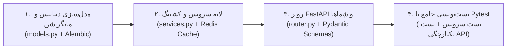

<div dir="rtl" lang="fa">

# 📜 سند راهبرد و سیاست کلی توسعه پلتفرم دکتر گیم (DrGame Backend Development Policy)

> **عنوان سند:** سیاست‌ها، استانداردها، اصول فنی و معماری کلان سرویس بک‌اند دکتر گیم (DrGame Backend)  
> **نگارش:** نسخه ۲.۰ (معماری ماژولار مونو‌لیت دامنه‌محور با FastAPI، کش Redis، پایگاه داده PostgreSQL و تمرکز منحصراً بر بک‌اند)  
> **مخاطب:** تیم توسعه، معماران نرم‌افزار و ایجنت‌های هوش مصنوعی (AI Coding Agents)  
> **محل قرارگیری سند:** `backend/agent/development-policy.md`

---

## ۱. چشم‌انداز، فلسفه و اصول بنیادین

پلتفرم **دکتر گیم (DrGame-Ecommerce)** یک اکوسیستم فروشگاهی و محتوایی گیمینگ در سطح استانداردهای کنسول پلی‌استیشن (PlayStation Store Experience) است که برای ارائه اشتراک‌های دانلودی، مدیریت سهمیه ترافیک، همگام‌سازی بازی‌های روز از دیتابیس بین‌المللی RAWG، مدیریت تراکنش‌های مالی ریالی/کریپتو، سیستم پورسانت آبشاری ۳ سطحی و ارتباطات گیمیفای‌شده گیمرها طراحی شده است.

این سند چارچوب‌های فنی قطعی، معماری کدبیس بک‌اند، استانداردهای طراحی API و خطوط قرمز توسعه را تعیین می‌کند تا سرویس بک‌اند با **بالاترین کارایی (پاسخ‌دهی زیر ۵۰ میلی‌ثانیه با کشینگ تهاجمی ردیس)، ایزولاسیون کامل ماژول‌ها، پایداری کانتینری و تطابق کامل با قراردادهای فرانت‌اند** توسعه یابد.

### 🚨 اصول کلیدی و خطوط قرمز قطعی توسعه:

1. **سیاست تمرکز منحصراً بر بک‌اند و ممنوعیت هرگونه تغییر در فرانت‌اند (Strict Backend-Only Policy):**
   - **کدبیس فرانت‌اند (`frontend/`) کاملاً فریز (Locked / Read-Only) است.** هیچ ایجنت یا توسعه‌دهنده‌ای حق ایجاد، ویرایش، حذف یا دستکاری هیچ فایلی را در پوشه فرانت‌اند ندارد.
   - تمامی نیازمندی‌های جدید، باگ‌های ارتباطی، داده‌های ساختگی (Mock Data) و داده‌های ایستا (Hardcoded Data) که در گزارش‌های ممیزی (از جمله `AUDIT_MOCKS_AND_MISSING_APIS.md` و `DrGame_Frontend_Documentation.md`) مشخص شده‌اند، **باید صرفاً و منحصراً از طریق توسعه مدل‌ها، سرویس‌ها و اندپوینت‌های بک‌اند برطرف گردند.**
2. **فرانت‌اند به عنوان مشخصات مرجع و قرارداد API (Frontend as Reference Specification):**
   - کلاینت و تایپ‌های موجود فرانت‌اند (`frontend/src/types/`, `frontend/src/lib/apiClient.ts`, و صفحات کلاینت) به عنوان مرجع قطعی شکل داده‌ها (Data Shapes)، ساختار DTOها، نام‌گذاری فیلدها و کدهای وضعیت HTTP در نظر گرفته می‌شوند. بک‌اند موظف است پاسخ‌های خروجی و مدل‌های ورودی خود را دقیقاً منطبق بر انتظارات فرانت‌اند پیکربندی کند تا بدون تغییر فرانت‌اند، اتصال بی‌نقص برقرار گردد.
3. **معماری ماژولار مونو‌لیت دامنه‌محور (Modular Monolith):**
   - بک‌اند با **FastAPI (Python 3.12+)** و به صورت ماژول‌های کاملاً ایزوله تجاری در پوشه `backend/app/modules/` سازماندهی می‌شود. هر ماژول تمام لایه‌های اختصاصی خود (`models.py`, `schemas.py`, `services.py`, `router.py`, `tests/`) را در بر می‌گیرد تا در آینده امکان تفکیک به میکروسرویس مستقل فراهم باشد.
4. **مرز طلایی ماژول‌ها و ممنوعیت رابطه مستقیم Foreign Key:**
   - هیچ مدلی در یک ماژول حق ندارد رابطه مستقیم ORM (`relationship`) یا کلید خارجی صریح با جدول ماژول دیگر برقرار کند. ارجاعات صرفاً از طریق شناسه خام (`user_id: int`، `game_id: int`، `subscription_id: int`) انجام شده و ارتباطات داده‌ای بین‌ماژولی منحصراً از طریق توابع لایه سرویس صورت می‌پذیرد.
5. **کشینگ تهاجمی با Redis (High-Performance In-Memory Caching):**
   - داده‌های پرخوانش مانند فهرست کاتالوگ بازی‌ها، جزئیات بازی‌ها، اسلایدرها و بنرهای صفحه اصلی، وضعیت سهمیه کاربر (`quota`)، سشن‌های فعال، آمار رفرال و تنظیمات سایت با کلیدهای استاندارد در Redis با سیاست ابطال فعال (Explicit Invalidation) مدیریت می‌شوند.
6. **سیاست قطعی اجرای صرفاً کانتینری (Strict Docker-Only Policy):**
   - تمامی دستورات توسعه بک‌اند اعم از اجرای مایگریشن‌های Alembic، آزمون‌های Pytest، اجرای سرور Uvicorn و اسکریپت‌های Seed منحصراً باید داخل کانتینر Docker و از طریق دستورات کانتینری اجرا شوند. اجرای مستقیم ابزارها روی هاست ممنوع است.
7. **پوشش تست خودکار ۱۰۰ درصدی با Pytest:**
   - برای تمامی سرویس‌ها، روترها و موتورهای منطقی بک‌اند (محاسبه سهمیه، اشتراک، اتصال RAWG، پورسانت رفرال، احراز هویت، تیکت‌ها) تست‌های خودکار دو لایه (Service Layer + API Integration) با Pytest تدوین شده و شرط پیشروی، قبولی ۱۰۰٪ آزمون‌هاست.
8. **چرخه ۴ مرحله‌ای توسعه فیچرهای بک‌اند (4-Step Backend Feature Pipeline):**
   - توسعه هر قابلیت یا رفع هر نقص، الزاماً از خط‌لوله ۴ مرحله‌ای (تغییر دیتابیس و مایگریشن Alembic ➔ پیاده‌سازی سرویس و کش ردیس ➔ ساخت روتر FastAPI و شِماهای Pydantic مطابق مشخصات فرانت ➔ تست‌های دولایه با Pytest در داکر) پیروی می‌کند.
9. **تفکیک ساختار ایجنت و گزارش‌ها (Modular Monorepo Structure):**
   - پوشه‌های مدیریت وظایف ایجنت و گزارش‌های پیشرفت به داخل ریشه بک‌اند منتقل شده‌اند:
     - مستندات و چک‌لیست‌های گام‌به‌گام: `backend/agent/`
     - گزارش‌های دوره‌ای و ممیزی‌ها: `backend/reports/`

---

## ۲. معماری بک‌اند: مونو‌لیت ماژولار دامنه‌محور (Modular Monolith)

### ۲.۱ ساختار دایرکتوری سرویس بک‌اند
سرویس بک‌اند طبق ساختار زیر مهندسی شده است:

```text
backend/
├── agent/                          ← فرآیندها، دستورالعمل‌ها و تسک‌های ایجنت
│   ├── development-policy.md       ← این سند (سیاست‌های راهبردی بک‌اند)
│   ├── 01-step-name/
│   │   ├── instructions.md         ← راهنمای فنی و نقشه راه استپ
│   │   └── tasks.md                ← چک‌لیست زنده وظایف ایجنت
│   └── ...
├── reports/                        ← گزارش‌های ممیزی و پیشرفت فازهای بک‌اند
│   ├── 01.md
│   ├── ...
│   └── 05.md
├── app/
│   ├── core/                       ← هسته مرکزی مشترک زیرساخت
│   │   ├── config.py               ← تنظیمات سراسری از .env با pydantic-settings
│   │   ├── database.py             ← اتصال ناهمگام به PostgreSQL 16 (SQLAlchemy 2.0 Async)
│   │   ├── redis_client.py         ← کلاینت متمرکز ناهمگام Redis (redis.asyncio)
│   │   ├── exceptions.py           ← ساختار سلسله‌مراتبی خطاهای برنامه (AppException)
│   │   ├── security.py             ← رمزنگاری رمز عبور، توکن‌های JWT و تولید Signed URLs
│   │   ├── dependencies.py         ← وابستگی‌های امنیتی، گارد نقش‌ها و محدودکننده‌ها
│   │   ├── jalali.py               ← توابع و محاسبات تقویم شمسی/جلالی
│   │   └── pagination.py           ← شِماها و هلپرهای صفحه‌بندی استاندارد
│   ├── modules/                    ← ماژول‌های کاملاً ایزوله تجاری
│   │   ├── admin/                  ← پنل فرماندهی ادمین (داشبورد، کاربران، آمار مالی، تنظیمات)
│   │   ├── auth/                   ← احراز هویت (ورود کنسول با کد ۷ رقمی، OTP پیامکی، JWT)
│   │   ├── games/                  ← کاتالوگ بازی‌ها، پارت‌های ۵ گانه دانلود، فیلترها و فایل‌ها
│   │   ├── home/                   ← اسلایدرهای ۱۸ گانه صفحه اصلی و بنرهای داینامیک
│   │   ├── news/                   ← مقالات وبلاگ، اخبار و آموزش‌های کنسول
│   │   ├── quota/                  ← موتور کسر آنی سهمیه ترافیک و لینک‌های امضاشده
│   │   ├── rawg_sync/              ← موتور واکشی عمیق و همگام‌سازی بازی‌ها از RAWG API
│   │   ├── subscriptions/          ← پلن‌های ۴ گانه اشتراک، ماتریس قیمت و درگاه پرداخت
│   │   ├── tickets/                ← سیستم تیکتینگ دوطرفه پشتیبانی و پیام‌ها
│   │   ├── users/                  ← پروفایل کاربری، آواتارها و مدیریت نشست‌ها
│   │   └── wallet/                 ← کیف پول، پورسانت آبشاری ۳ سطحی، خزانه کل و تسویه‌ها
│   ├── tasks/                      ← تسک‌های زمان‌بندی‌شده (APScheduler)
│   │   └── scheduler.py            ← زمان‌بندی کرون‌های درون‌پروسسی
│   └── main.py                     ← نقطه ورود FastAPI، میدل‌ورها و Mount پوشه رسانه محلی
├── alembic/                        ← اسکریپت‌ها و متادیتای مایگریشن‌های دیتابیس
├── media/                          ← ذخیره‌سازی محلی تصاویر، کاورها و فایل‌ها (Local Media)
├── scripts/                        ← اسکریپت‌های Seed دیتابیس و همگام‌سازی اولیه
├── tests/                          ← تست‌های سطح کلان سراسری
├── Dockerfile                      ← کانتینر رسمی سرویس بک‌اند
└── requirements.txt                ← نیازمندی‌های پایتون
```

### ۲.۲ ساختار استاندارد هر ماژول تجاری (`backend/app/modules/<module_name>/`)
هر ماژول باید دقیقاً از معماری لایه‌ای زیر تبعیت کند:

```text
<module_name>/
├── __init__.py
├── models.py                       ← مدل‌های SQLAlchemy پایگاه داده مرتبط با این ماژول
├── schemas.py                      ← مدل‌های اعتبارسنجی ورودی/خروجی Pydantic V2 (DTO)
├── services.py                     ← منطق بیزینس، کوئری‌های بهینه دیتابیس و مدیریت کش Redis
├── router.py                       ← روترهای FastAPI، تعریف اندپوینت‌ها و تزریق وابستگی‌ها
└── tests/                          ← آزمون‌های خودکار ماژول
    ├── __init__.py
    ├── conftest.py                 ← فیکسچرهای محلی ماژول
    ├── test_services.py            ← تست واحد لایه سرویس و بیزینس لاجیک
    └── test_router.py              ← تست یکپارچگی اندپوینت‌ها با AsyncClient
```

### ۲.۳ قانون ایزولاسیون مرز ماژول‌ها (Module Boundary Isolation)
- **ممنوعیت روابط Foreign Key و ORM Relationship میان‌ماژولی:** جداول متعلق به ماژول‌های مختلف نباید کلید خارجی مستقیم یا رابطه `relationship` داشته باشند.
- **تبادل صرفاً با شناسه خام (Raw ID):** به عنوان مثال در ماژول `tickets`، فیلد `user_id: int` ذخیره می‌شود و مستقیماً رابطه‌ای با مدل جدول `users` تعریف نمی‌شود.
- **استفاده از متدهای سرویس برای دریافت اطلاعات سایر ماژول‌ها:** در صورت نیاز به بررسی مشخصات کاربر در تیکت یا کیف پول، متد سرویس ماژول مربوطه فراخوانی می‌گردد و کوئری مستقیم به جداول دیگر زده نمی‌شود.

---

## ۳. سیاست بهره‌گیری از Redis و لایه کشینگ با کارایی بالا (High-Performance Caching)

برای دستیابی به پاسخ‌دهی زیر ۵۰ میلی‌ثانیه، استراتژی کشینگ به صورت زیر اعمال می‌شود:

```mermaid
graph TD
    Client["کلاینت (Web / Console / Mobile)"] --> Router["روتر FastAPI"]
    Router --> AuthGuard["بررسی توکن JWT / گارد دسترسی"]
    AuthGuard --> FastCache["بررسی کلید در Redis"]
    
    subgraph DataPipeline ["مسیر واکشی داده"]
        FastCache -->|Cache Hit (موجود)| FastReturn["بازگشت آنی داده کش‌شده (< 15ms)"]
        FastCache -->|Cache Miss (ناموجود)| DBQuery["استعلام از PostgreSQL 16"]
        DBQuery --> SetCache["ذخیره در Redis با کلید استاندارد و TTL"]
        SetCache --> FastReturn
    end
```

### ۳.۱ کلیدهای استاندارد در Redis:
1. **کاتالوگ و دسته‌بندی بازی‌ها (`drgame:games:catalog:{query_hash}`):** با TTL برابر ۳۰ دقیقه؛ به محض تغییر یا درج بازی ابطال می‌شود.
2. **جزئیات عمیق بازی (`drgame:game:{id}`):** شامل متادیتای کامل و پارت‌های دانلود؛ TTL برابر ۲ ساعت.
3. **وضعیت سهمیه و اشتراک کاربر (`drgame:user:{user_id}:quota`):** سهمیه کل و مصرف‌شده؛ به محض دانلود هر پارت یا تغییر پلن ابطال می‌گردد.
4. **اسلایدرها و بنرهای هیرو (`drgame:home:banners`):** TTL برابر ۱ ساعت؛ به محض ویرایش در پنل ادمین ابطال می‌شود.
5. **تنظیمات کلان سایت (`drgame:settings:global`):** TTL برابر ۲۴ ساعت؛ با ویرایش تنظیمات در پنل ادمین ابطال می‌شود.
6. **کد ۷ رقمی ورود کنسول (`drgame:auth:quick_login:{code}`):** با زمان انقضای دقیق ۵ دقیقه (۳۰۰ ثانیه).

### ۳.۲ سیاست ابطال فعال کش (Explicit Cache Invalidation):
هر متد تغییردهنده داده (`create`, `update`, `delete`, `deduct_quota`, `toggle`) در لایه `services.py` موظف است بلافاصله پس از Commit در پایگاه داده، کلیدهای کش متناظر را حذف کند (`await redis_client.delete(key)` یا استفاده از پترن با `scan_iter`).

---

## ۴. سیاست فرانت‌اند: وضعیت فریز و سند مرجع قراردادها (Frontend Frozen Policy)

با توجه به تصمیم راهبردی جدید:
1. **هیچ تغییری در پوشه `frontend/` مجاز نیست:** تمامی فایل‌های فرانت‌اند اعم از کامپوننت‌ها، صفحات، استایل‌ها، پکیج‌ها و تنظیمات دست‌نخورده باقی می‌مانند.
2. **برطرف‌سازی مغایرت‌ها صرفاً از طریق بک‌اند:**
   - اگر فرانت‌اند فیلد خاصی مانند `title_fa`, `region_code`, `direct_download_url`, `dual_sense_features` یا `primary_console_locked` را طلب می‌کند، بک‌اند موظف است این فیلدها را در اسکیمای پاسخ (Pydantic Schema) ارائه دهد.
   - اگر اندپوینتی در فرانت‌اند فراخوانی می‌شود که در بک‌اند پیاده نشده است (مانند `/api/admin/blog`, `/api/site-settings`, `/api/referral/payouts` و ...)، این اندپوینت‌ها باید دقیقاً با همان مسیر (Path)، متد HTTP و ساختار درخواستی در بک‌اند ایجاد شوند.
   - فرمت‌دهی داده‌ها (تاریخ‌های جلالی، تبدیل مبالغ، محاسبه دقیق سهمیه) باید به نحوی در بک‌اند مهندسی شود که فرانت‌اند بدون نیاز به تغییر منطق کلاینت، داده‌های صحیح را رندر کند.

---

## ۵. موتورهای کلیدی بیزینس بک‌اند (Core Business Engines)

### ۵.۱ موتور سهمیه و دانلود مستقیم امضاشده (`Quota & Signed Download Engine`)
- **تک‌پایگاهی بودن جدول پارت‌های دانلود:** تمام فایل‌های دانلود باید در ساختار یکپارچه مدل‌های دانلود ذخیره شوند و دوگانگی میان جداول ملغی گردد.
- **کسر آنی و اتمیک سهمیه:** متد دانلود با دریافت شناسه فایل، اشتراک فعال کاربر را بررسی کرده، حجم دقیق فایل را به صورت اتمیک از سهمیه کاربر کسر می‌کند، رکورد `DownloadHistory` را ثبت نموده و لینک دانلود امضاشده ۲۴ ساعته (`HMAC-SHA256`) تولید می‌کند.
- **بازی‌های پلن رایگان (Free Tier):** ۵ بازی منتخب پنل ادمین بدون نیاز به اشتراک پولی و بدون کسر حجم، برای کاربران لاگین‌شده قابل دانلود هستند.

### ۵.۲ موتور پورسانت آبشاری ۳ سطحی و کیف پول خزانه (`3-Tier Referral Waterfall & Treasury Pool`)
- در هر خرید اشتراک، سهم ۲۰ درصدی استخر پورسانت محاسبه می‌شود:
  - سطح ۱ (معرف مستقیم): ۱۰٪
  - سطح ۲ (معرفِ معرف): ۵٪
  - سطح ۳ (سرشاخه): ۵٪
- **قانون سرریز به خزانه (Treasury Overflow):** در صورت نبود معرف در هر سطح یا **عدم داشتن اشتراک فعال توسط معرف در لحظه خرید زیرمجموعه**، پورسانت آن سطح از بین نمی‌رود و به صورت سیستمی به **کیف پول خزانه کل (Admin Treasury Pool)** واریز می‌گردد.
- **مخفی‌سازی عبوری (Pass-Through Visibility):** در درخت زیرمجموعه، اگر کاربر واسط اشتراک فعال نداشته باشد، زیرمجموعه‌های پایین‌تر برای او نمایش داده نمی‌شوند تا عدالت ساختاری حفظ شود.
- **اصلاح واحد مالی:** کلیه محاسبات باید به ریال/تومان استاندارد و بدون تقسیم‌های خطاساز (`// 10`) انجام شوند.

### ۵.۳ موتور احراز هویت چندلایه و ورود سریع کنسول (`Multi-Layer Auth Engine`)
- **کد ۷ رقمی یک‌بارمصرف کنسول:** ایجاد اندپوینت تولید کد در پنل کاربر (اعتبار ۵ دقیقه در Redis) و اندپوینت تایید کد برای ورود در مرورگر کنسول PlayStation.
- **ورود با OTP پیامکی:** پشتیبانی هم از ثبت‌نام کاربر جدید و هم از ورود مستقیم کاربر قبلی با کد پیامکی یک‌بارمصرف.

---

## ۶. سیاست اجرای کانتینری در Docker و دستورات مرجع

اجرای ابزارها روی هاست اکیداً ممنوع است. تمامی عملیات باید از طریق فایل `docker-compose.dev.yml` در کانتینر بک‌اند اجرا شوند:

```bash
# ۱. اجرای کامل تست‌های خودکار بک‌اند با Pytest:
docker compose -f docker-compose.dev.yml run --rm backend pytest -v

# ۲. اجرای تست‌های یک ماژول خاص (مثال: ماژول بازی‌ها):
docker compose -f docker-compose.dev.yml run --rm backend pytest app/modules/games/ -v

# ۳. ایجاد اسکریپت مایگریشن خودکار Alembic:
docker compose -f docker-compose.dev.yml run --rm backend alembic revision --autogenerate -m "feat: description"

# ۴. اعمال مایگریشن‌ها روی پایگاه داده PostgreSQL:
docker compose -f docker-compose.dev.yml run --rm backend alembic upgrade head

# ۵. بررسی سلامت و سازگاری دیتابیس با مدل‌های فعلی:
docker compose -f docker-compose.dev.yml run --rm backend alembic check

# ۶. اجرای اسکریپت‌های Seed دیتابیس (مثال: ۳۰۰ بازی):
docker compose -f docker-compose.dev.yml run --rm backend python scripts/seed_300_games.py

# ۷. بالا آوردن و راه‌اندازی سرویس‌های بک‌اند، دیتابیس و ردیس:
docker compose -f docker-compose.dev.yml up -d backend db cache
```

---

## ۷. چرخه اجباری ۴ مرحله‌ای توسعه فیچرهای بک‌اند (4-Step Backend Feature Pipeline)

هر فیچر جدید، اصلاح باگ یا توسعه ماژول در بک‌اند **الزاماً و بدون استثنا** باید از پایپ‌لاین ۴ مرحله‌ای زیر عبور کند:



### تشریح مراحل چهارگانه:

1. **مرحله اول: مدل‌سازی استاندارد پایگاه داده و مایگریشن سالم (Database Models & Migrations):**
   - ایجاد یا به‌روزرسانی مدل‌های SQLAlchemy در `models.py` ماژول متناظر بدون ایجاد Foreign Key میان‌ماژولی.
   - تولید اسکریپت مایگریشن با `alembic revision --autogenerate` درون کانتینر داکر.
   - بازبینی کد مایگریشن و اجرای `alembic upgrade head` و اطمینان از خروجی معتبر `alembic check`.

2. **مرحله دوم: لایه سرویس و منطق تجاری همراه با کشینگ Redis (Service Layer & Business Logic):**
   - پیاده‌سازی متدهای بیزینس در `services.py` به صورت کاملاً ناهمگام (`async/await`) با استفاده از SQLAlchemy 2.0 Async Session.
   - پیاده‌سازی لایه کشینگ و ابطال فعال کش در ردیس به ازای هرگونه جهش داده (`Mutation`).
   - مدیریت خطاهای قابل پیش‌بینی با پرتاب استثناهای ساختاریافته بر پایه `AppException`.

3. **مرحله سوم: روترهای FastAPI و شِماهای Pydantic V2 مطابق قرارداد فرانت‌اند (Routers & Contracts):**
   - ساخت یا تکمیل اندپوینت‌های RESTful در `router.py` ماژول با تطابق کامل مسیر و پارامترها با کلاینت فرانت‌اند.
   - اعتبارسنجی دقیق ورودی‌ها و ساخت خروجی‌ها با مدل‌های Pydantic V2 در `schemas.py`.
   - اعمال تاییدیه‌های دسترسی، گارد توکن JWT و وابستگی‌های مورد نیاز (`dependencies.py`).

4. **مرحله چهارم: تست‌های خودکار دولایه با Pytest و تضمین کیفیت (Comprehensive Pytest Suite):**
   - **تست واحد سرویس (`tests/test_services.py`):** آزمون منطق محاسباتی، کشینگ، و شرایط مرزی با پایگاه داده تستی.
   - **تست یکپارچگی اندپوینت (`tests/test_router.py`):** آزمون پاسخ‌های HTTP، فرمت خروجی، کدهای وضعیت (200, 201, 400, 401, 403, 404, 422) با `httpx.AsyncClient`.
   - اجرای تست‌ها در کانتینر داکر با شرط قبولی ۱۰۰٪:
     ```bash
     docker compose -f docker-compose.dev.yml run --rm backend pytest -v
     ```

---

## ۸. ساختار مراحل توسعه در پوشه `backend/agent/`

توسعه سیستم بک‌اند بر اساس مراحل ساختاریافته در پوشه `backend/agent/` با الگوی نام‌گذاری **`xx-step-name`** هدایت می‌شود:

```text
backend/agent/
├── development-policy.md           ← این سند (قانون اساسی بک‌اند)
├── 01-step-name/
│   ├── instructions.md             ← نقشه راه و مشخصات فنی استپ
│   └── tasks.md                    ← چک‌لیست عملیاتی زنده تسک‌ها
├── 02-step-name/
│   ├── instructions.md
│   └── tasks.md
└── ...
```

### الزامات و قوانین کار با `instructions.md` و `tasks.md`:
1. **الزامات `instructions.md`:** این فایل شامل اهداف عملکردی، مدل داده، منطق الگوریتمی، مسیر فایل‌های جدید و ویرایشی بک‌اند و نمونه قراردادهای API مورد انتظار فرانت‌اند است.
2. **الزامات حیاتی `tasks.md`:**
   - کلیه تسک‌های پیاده‌سازی بک‌اند با چک‌باکس خالی (`- [ ]`) تعریف شده‌اند.
   - **الزام قطعی به‌روزرسانی بلادرنگ:** ایجنت هوش مصنوعی **موظف است بلافاصله پس از تکمیل هر تسک بک‌اند**، فایل `tasks.md` مربوطه را باز کرده و آن تسک را با علامت `- [x]` تیک بزند. پیشروی به تسک بعدی بدون ثبت وضعیت تسک قبلی ممنوع است.

---

## ۹. سیستم گزارش‌گیری در پوشه `backend/reports/`

پوشه `backend/reports/` به منظور ثبت مستندات رسمی پیشرفت، ممیزی‌های دوره‌ای و تحویل هر فاز از توسعه بک‌اند اختصاص دارد:

```text
backend/reports/
├── 01.md
├── 02.md
├── 03.md
├── 04.md
├── 05.md                           ← گزارش جامع ممیزی کدبیس و دیتای ایستا
└── 06.md                           ← گزارش‌های مراحل بعدی توسعه بک‌اند
```

### ضوابط نگارش گزارش‌ها (`backend/reports/xx.md`):
1. **زمان نگارش:** پس از تکمیل چند استپ متوالی، رفع یک مایل‌استون کلیدی یا نهایی‌سازی یک ماژول بزرگ بک‌اند.
2. **محتوای استاندارد هر گزارش:**
   - عنوان، شناسه گزارش، تاریخ و استپ‌های پوشش داده شده.
   - خلاصه دستاوردهای بک‌اند (اندپوینت‌های اضافه شده، مدل‌ها و منطق‌های تکمیل‌شده).
   - فهرست فایل‌های ایجادشده و ویرایش‌شده در پوشه `backend/`.
   - خروجی و درصد قبولی تست‌های خودکار Pytest و بررسی وضعیت مایگریشن‌های Alembic در کانتینر داکر.
   - تشریح تصمیمات معماری، چالش‌های حل‌شده و گام‌های بعدی در نقشه راه.

---

## ۱۰. چک‌لیست نهایی پایبندی ایجنت‌ها به خطوط قرمز (Agent Compliance Checklist)

پیش از اعلام اتمام هر وظیفه، ایجنت موظف است موارد زیر را اعتبارسنجی نماید:
- [ ] **عدم دستکاری فرانت‌اند:** هیچ فایلی در پوشه `frontend/` تغییر نکرده یا ایجاد نشده است.
- [ ] **رعایت چرخه ۴ مرحله‌ای بک‌اند:** دیتابیس و مایگریشن ➔ سرویس و کش ردیس ➔ روتر و شِما ➔ تست دو لایه با Pytest.
- [ ] **اجرای صرفاً کانتینری:** تمام دستورات (تست‌ها، مایگریشن‌ها و پایتون) درون کانتینر Docker با `docker compose -f docker-compose.dev.yml ...` اجرا شده‌اند.
- [ ] **قبولی ۱۰۰٪ تست‌های Pytest:** تمام تست‌های ماژول‌های تغییریافته بدون خطا پاس شده‌اند.
- [ ] **ایزولاسیون کامل ماژول‌ها:** هیچ کلید خارجی یا رابطه ORM مستقیمی میان ماژول‌های مجزا تعریف نشده است.
- [ ] **به‌روزرسانی چک‌لیست `tasks.md`:** تسک‌های انجام‌شده بلافاصله با علامت `- [x]` در پوشه مربوطه در `backend/agent/` تیک خورده‌اند.
- [ ] **ثبت گزارش پیشرفت:** در صورت رسیدن به نقطه عطف، گزارش متناظر در `backend/reports/xx.md` تنظیم شده است.

</div>
