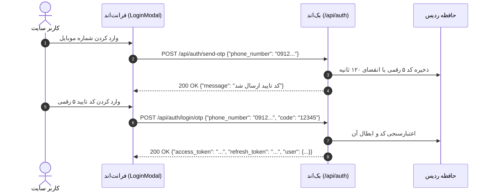
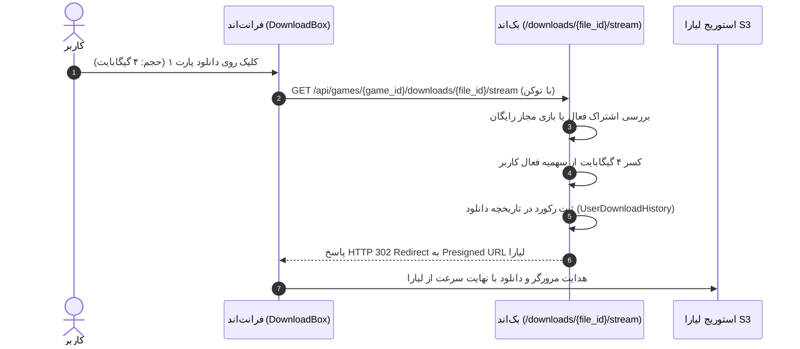

<div dir="rtl" lang="fa">

# راهنمای جامع و سرتاسری پیاده‌سازی APIهای گام ۱۴ برای تیم فرانت‌اند (`01-guide-for-step-14.md`)

> **مخاطب سند:** توسعه‌دهندگان فرانت‌اند (Frontend Developers / Next.js Engineers)  
> **موضوع سند:** مستندات دقیق، اندپوینت به اندپوینت، فیلد به فیلد و کامپوننت به کامپوننت جهت جایگزینی داده‌های ماک و اتصال کامل به بک‌اند  
> **مربوط به گام توسعه:** گام ۱۴ (`14-missing-apis-and-contract-fulfillment`)  
> **پروتکل ارتباطی:** RESTful JSON / Multipart Form-Data بر بستر `FastAPI`  
> **پایگاه نشانی پایه (Base URL):** `http://localhost:8000` یا مسیر پیکربندی‌شده در متغیر محیطی `NEXT_PUBLIC_API_URL`

---

## فهرست راهنما

1. [مقدمه و راهنمای احراز هویت](#۱-مقدمه-و-راهنمای-احراز-هویت)
2. [بخش اول: تنظیمات داینامیک هدر، فوتر و ابزار جیلبریک](#۲-بخش-اول-تنظیمات-داینامیک-هدر-فوتر-و-ابزار-جیلبریک)
3. [بخش دوم: ورود بدون پسورد با رمز یکبار مصرف (OTP Login)](#۳-بخش-دوم-ورود-بدون-پسورد-با-رمز-یکبار-مصرف-otp-login)
4. [بخش سوم: سوابق برداشت، مدیریت حساب‌های بانکی و داشبورد مالی](#۴-بخش-سوم-سوابق-برداشت-مدیریت-حسابهای-بانکی-و-داشبورد-مالی)
5. [بخش چهارم: مدیریت کامل مقالات و دسته‌بندی‌های وبلاگ در پنل ادمین (Admin Blog CRUD)](#۵-بخش-چهارم-مدیریت-کامل-مقالات-و-دستهبندیهای-وبلاگ-در-پنل-ادمین-admin-blog-crud)
6. [بخش پنجم: مدیریت کاربران، اعطای دستی اشتراک و ویرایش تخفیف‌ها در ادمین](#۶-بخش-پنجم-مدیریت-کاربران-اعطای-دستی-اشتراک-و-ویرایش-تخفیفها-در-ادمین)
7. [بخش ششم: آپلود تصویر آواتار در فضای ابری لیارا و تفکیک نشست جاری](#۷-بخش-ششم-آپلود-تصویر-آواتار-در-فضای-ابری-لیارا-و-تفکیک-نشست-جاری)
8. [بخش هفتم: لینک‌های استریم دانلود، کسر اتمیک سهمیه و ریدایرکت ۳۰۲](#۸-بخش-هفتم-لینکهای-استریم-دانلود-کسر-اتمیک-سهمیه-و-ریدایرکت-۳۰۲)
9. [خلاصه کدهای خطای رایج و استراتژی بازخورد به کاربر](#۹-خلاصه-کدهای-خطای-رایج-و-استراتژی-بازخورد-به-کاربر)

---

## ۱. مقدمه و راهنمای احراز هویت

در گام‌های ۱۳ و ۱۴ بک‌اند، تمامی نقاط کور قراردادی و داده‌های ماک موجود در سند `AUDIT_MOCKS_AND_MISSING_APIS.md` پیاده‌سازی شده و کلیه باگ‌های مالیاتی و سهمیه‌ای رفع شده‌اند.

### هدرهای احراز هویت (Auth Headers):
- **برای کاربران عادی:** هدر استاندارد `Authorization: Bearer <user_access_token>`.
- **برای مدیران سیستم (Admin):** هدر استاندارد `Authorization: Bearer <admin_access_token>`.
- **برای متدهای آپلود چندبخشی (`multipart/form-data`):** نیازی به تنظیم دستی `Content-Type` در `fetch` یا `axios` نیست و مرورگر مقدار `boundary` را به صورت خودکار اضافه می‌کند.

---

## ۲. بخش اول: تنظیمات داینامیک هدر، فوتر و ابزار جیلبریک

در نسخه قبلی فرانت‌اند، DNSهای بالای هدر، اطلاعات تماس فوتر، شبکه‌های اجتماعی، سوالات متداول و فریمورهای جیلبریک هاردکد بودند. اکنون تمام این داده‌ها به صورت داینامیک از بک‌اند قابل دریافت و در پنل ادمین قابل ویرایش هستند.

### ۱. دریافت تنظیمات عمومی سایت (Public Site Settings)
- **کامپوننت‌های هدف در فرانت‌اند:**
  - `components/layout/Header.tsx` (نوار DNS بالا)
  - `components/layout/Footer.tsx` (تلفن تماس، ایمیل، آدرس، پیام فوتر، شبکه‌های اجتماعی)
  - `app/tools/jailbreak/page.tsx` (DNSهای پیشنهادی و فریمورهای پشتیبانی‌شده)
  - `app/faq/page.tsx` (آکاردئون سوالات متداول)
- **روش فراخوانی:** `GET /api/settings` (یا alias آن: `GET /api/site-settings`)
- **احراز هویت:** عمومی (بدون نیاز به توکن)
- **کش ردیس:** این متد در بک‌اند روی Redis با کلید `drgame:settings:global` کش شده و پاسخ آن زیر ۵ میلی‌ثانیه است.

#### نمونه پاسخ موفق (`200 OK`):
```json
{
  "id": 1,
  "primary_dns": "178.22.122.100",
  "secondary_dns": "185.51.200.2",
  "contact_phone": "021-91001234",
  "contact_email": "support@drgame.ir",
  "contact_address": "تهران، میدان ونک، برج نگار، طبقه ۸",
  "footer_message": "دکتر گیم؛ مرجع تخصصی دیتای بازی‌های کنسولی و خدمات نوین گیمینگ در ایران.",
  "enamad_url": "https://enamad.ir",
  "samandehi_url": "https://samandehi.ir",
  "instagram_url": "https://instagram.com/drgame",
  "telegram_url": "https://t.me/drgame",
  "youtube_url": "https://youtube.com/@drgame",
  "twitter_url": "https://twitter.com/drgame",
  "discord_url": "https://discord.gg/drgame",
  "jailbreak_dns": "165.227.83.145",
  "jailbreak_supported_firmwares": ["9.00", "9.60", "11.00"],
  "faq_items": [
    {
      "question": "چگونه دیتای بازی‌ها را روی کنسول نصب کنم؟",
      "answer": "کافی است پس از دانلود پارت‌ها، از نرم‌افزار Package Sender یا پورت USB استفاده نمایید."
    }
  ],
  "updated_at": "2026-10-31T06:30:00Z"
}
```

---

### ۲. ویرایش تنظیمات سایت توسط ادمین (Update Site Settings)
- **صفحه هدف در فرانت‌اند:** `app/admin/settings/page.tsx`
- **روش فراخوانی:** `PUT /api/admin/settings`
- **احراز هویت:** توکن مدیر سیستم (`Admin Token`)
- **بدنه درخواست (`Content-Type: application/json`):**
  کلیه فیلدها اختیاری (Optional) هستند؛ تنها مقادیری که ارسال شوند ویرایش خواهند شد.
```json
{
  "primary_dns": "178.22.122.105",
  "secondary_dns": "185.51.200.5",
  "contact_phone": "021-88889999",
  "contact_email": "info@drgame.ir",
  "contact_address": "تهران، خیابان ولیعصر، پلاک ۱۰۰",
  "footer_message": "نسخه جدید دکتر گیم همراه با دانلود مستقیم ابری",
  "instagram_url": "https://instagram.com/drgame_official",
  "telegram_url": "https://t.me/drgame_official",
  "jailbreak_dns": "192.168.1.1",
  "jailbreak_supported_firmwares": ["9.00", "10.00", "11.00"],
  "faq_items": [
    {
      "question": "آیا دانلود نیم‌بها محاسبه می‌شود؟",
      "answer": "بله، سرورهای دکتر گیم روی ترافیک داخلی و CDN ثبت شده‌اند."
    }
  ]
}
```
- **رفتار بک‌اند:** پس از آپدیت موفق دیتابیس، کش ردیس فوراً پاک شده و تنظیمات تازه به تمام کاربران ارائه می‌شود.

---

## ۳. بخش دوم: ورود بدون پسورد با رمز یکبار مصرف (OTP Login)

در تب «ورود با رمز یکبار مصرف» مودال لاگین (`LoginModal.tsx`)، قبلاً فقط متد `register-verify` وجود داشت که کاربر را به عنوان عضو جدید ثبت‌نام می‌کرد. اکنون اندپوینت اختصاصی لاگین بدون پسورد پیاده‌سازی شده است.

### گردش کار احراز هویت دو مرحله‌ای OTP:



### اندپوینت ورود با کد یکبار مصرف:
- **روش فراخوانی:** `POST /api/auth/login/otp`
- **احراز هویت:** عمومی
- **بدنه درخواست (`application/json`):**
```json
{
  "phone_number": "09121234567",
  "code": "12345"
}
```
#### پاسخ موفق (`200 OK`):
```json
{
  "access_token": "eyJhbGciOiJIUzI1NiIsInR5c...",
  "refresh_token": "eyJhbGciOiJIUzI1NiIsInR5c...",
  "token_type": "bearer",
  "user": {
    "id": 42,
    "full_name": "امیرحسین رضایی",
    "username": "amir_rezaei",
    "phone_number": "09121234567",
    "avatar_url": "https://storage.c2.liara.site/drgame-storage/avatars/42.jpg",
    "referral_code": "AMIR4288",
    "is_active": true
  }
}
```
#### خطاهای احتمالی:
- `400 Bad Request`: `کد یکبار مصرف نامعتبر است یا منقضی شده است.`
- `404 Not Found`: `کاربری با این شماره موبایل یافت نشد. لطفاً ابتدا ثبت نام کنید.`

---

## ۴. بخش سوم: سوابق برداشت، مدیریت حساب‌های بانکی و داشبورد مالی

### ۱. دریافت سوابق درخواست‌های برداشت کاربر (Withdrawals History)
- **کامپوننت هدف در فرانت‌اند:** `app/(user)/dashboard/referral/page.tsx` (جدول سوابق تسویه‌حساب)
- **روش فراخوانی:** `GET /api/referral/withdrawals`
- **احراز هویت:** `User Bearer Token`
- **پارامترهای Query (اختیاری):**
  - `page`: شماره صفحه (پیش‌فرض: `1`)
  - `page_size`: تعداد در صفحه (پیش‌فرض: `20`)

#### نمونه پاسخ (`200 OK`):
```json
{
  "items": [
    {
      "id": 14,
      "amount_toman": 450000,
      "status": "completed",
      "tracking_code": "PAY-98765432",
      "admin_note": "تسویه پایا انجام شد.",
      "settlement_account_id": 3,
      "created_at": "2026-10-25T14:20:00Z",
      "updated_at": "2026-10-25T16:00:00Z"
    },
    {
      "id": 15,
      "amount_toman": 200000,
      "status": "pending",
      "tracking_code": null,
      "admin_note": null,
      "settlement_account_id": 3,
      "created_at": "2026-10-30T10:15:00Z",
      "updated_at": "2026-10-30T10:15:00Z"
    }
  ],
  "total": 2,
  "page": 1,
  "page_size": 20
}
```
> **وضعیت‌های مجاز `status` برای رندر برچسب در UI:**
> - `pending` (در انتظار بررسی - رنگ زرد)
> - `approved` (تایید شده / در نوبت حواله - رنگ آبی)
> - `completed` (واریز شده - رنگ سبز)
> - `rejected` (رد شده - رنگ قرمز)

---

### ۲. ویرایش حساب تسویه بانکی (Update Settlement Account)
- **کامپوننت هدف:** مودال ویرایش کارت بانکی در صفحه رفرال
- **روش فراخوانی:** `PUT /api/referral/settlement-accounts/{account_id}`
- **احراز هویت:** `User Bearer Token`
- **بدنه درخواست:**
```json
{
  "bank_name": "بانک ملت",
  "card_number": "6104337812345678",
  "shaba_number": "IR120120000000001234567890",
  "account_holder_name": "امیرحسین رضایی",
  "is_default": true
}
```

---

### ۳. حذف حساب تسویه بانکی (Delete Settlement Account)
- **روش فراخوانی:** `DELETE /api/referral/settlement-accounts/{account_id}`
- **احراز هویت:** `User Bearer Token`
- **پاسخ موفق:** `200 OK` با متن `{"message": "حساب بانکی با موفقیت حذف شد."}`

---

### ۴. مشاهده تمامی حساب‌های بانکی کاربران برای ادمین (Admin Bank Accounts)
- **صفحه هدف در پنل ادمین:** `app/admin/bank-accounts/page.tsx`
- **روش فراخوانی:** `GET /api/admin/settlement-accounts` (یا alias آن: `GET /api/admin/bank-accounts`)
- **احراز هویت:** `Admin Token`
- **پارامترهای Query:** `skip=0`, `limit=50`, `search=رضایی`

#### پاسخ (`200 OK`):
```json
[
  {
    "id": 3,
    "user_id": 42,
    "user_full_name": "امیرحسین رضایی",
    "user_username": "amir_rezaei",
    "bank_name": "بانک ملت",
    "card_number": "6104337812345678",
    "shaba_number": "IR120120000000001234567890",
    "account_holder_name": "امیرحسین رضایی",
    "is_default": true,
    "created_at": "2026-10-15T11:00:00Z"
  }
]
```

---

## ۵. بخش چهارم: مدیریت کامل مقالات و دسته‌بندی‌های وبلاگ در پنل ادمین (Admin Blog CRUD)

پیش از این، صفحه وبلاگ فرانت‌اند فاقد پنل مدیریت در ادمین بود. اکنون تمامی متدهای CRUD تحت پیشوند `/api/admin/blog/` در دسترس است.

### ماتریس اندپوینت‌های ادمین وبلاگ:

| عملیات | متد HTTP | اندپوینت | نیازمندی‌ها |
| :--- | :---: | :--- | :--- |
| **لیست مقالات (ادمین)** | `GET` | `/api/admin/blog/posts` | Query: `page`, `page_size`, `category_id`, `search` |
| **افزودن مقاله جدید** | `POST` | `/api/admin/blog/posts` | DTO: `BlogPostCreate` |
| **ویرایش مقاله** | `PUT` | `/api/admin/blog/posts/{post_id}` | DTO: `BlogPostUpdate` |
| **حذف مقاله** | `DELETE` | `/api/admin/blog/posts/{post_id}` | شناسه مقاله |
| **لیست دسته‌بندی‌ها** | `GET` | `/api/admin/blog/categories` | بدون پارامتر |
| **ایجاد دسته‌بندی** | `POST` | `/api/admin/blog/categories` | DTO: `BlogCategoryCreate` |
| **ویرایش دسته‌بندی** | `PUT` | `/api/admin/blog/categories/{category_id}` | DTO: `BlogCategoryUpdate` |
| **حذف دسته‌بندی** | `DELETE` | `/api/admin/blog/categories/{category_id}` | شناسه دسته‌بندی |

#### نمونه ایجاد مقاله جدید (`POST /api/admin/blog/posts`):
```json
{
  "title": "آموزش گام به گام جیلبریک پلی‌استیشن ۴ نسخه ۱۱.۰۰",
  "slug": "ps4-jailbreak-11-00-guide",
  "summary": "راهنمای جامع جیلبریک کنسول PS4 با روش PPPwn به صورت گام‌به‌گام و بدون نیاز به دانگل فیزیکی.",
  "content": "متن کامل مقاله به صورت HTML یا Markdown...",
  "cover_image_url": "https://storage.c2.liara.site/drgame-storage/blog/ps4-11.jpg",
  "category_id": 2,
  "reading_time_minutes": 8,
  "is_published": true
}
```
> **نکته کلیدی:** نویسنده مقاله به صورت خودکار بر اساس هویت ادمین واردشده (`admin.username`) ثبت می‌شود و نیازی به ارسال شناسه ادمین در بدنه نیست. همچنین پس از هر عملیات نوشتن/حذف، کش ردیس وبلاگ به صورت خودکار ابطال می‌شود.

---

## ۶. بخش پنجم: مدیریت کاربران، اعطای دستی اشتراک و ویرایش تخفیف‌ها در ادمین

### ۱. ویرایش اطلاعات پایه کاربر توسط ادمین
- **روش فراخوانی:** `PUT /api/admin/users/{user_id}`
- **احراز هویت:** `Admin Token`
- **بدنه درخواست:**
```json
{
  "full_name": "سارا محمدی",
  "email": "sara.m@gmail.com",
  "phone_number": "09351234567"
}
```

### ۲. تغییر وضعیت دسترسی کاربر (فعال/مسدود)
- **روش فراخوانی:** `PATCH /api/admin/users/{user_id}/status`
- **بدنه درخواست:**
```json
{
  "is_active": false
}
```

### ۳. اعطای دستی اشتراک به کاربر (Grant Manual Subscription)
- **صفحه هدف:** مودال «اعطای اشتراک» در جدول کاربران یا اشتراک‌های ادمین
- **روش فراخوانی:** `POST /api/admin/users/{user_id}/subscriptions`
- **احراز هویت:** `Admin Token`
- **بدنه درخواست:**
```json
{
  "tier_code": "gold",
  "days": 30
}
```
- **ویژگی‌های مهم این اندپوینت در بک‌اند:**
  1. تاریخ شروع را زمان جاری و تاریخ پایان را `now + days` محاسبه می‌کند.
  2. سهمیه ماهیانه دانلود متناسب با پلن (مثلاً ۷۰۰ گیگابایت برای طلایی) را **به صورت خودکار در جدول سهمیه کاربر (`user_quotas`) درج یا ریست می‌نماید**.
  3. وضعیت اشتراک‌های قبلی کاربر را به صورت منظم مدیریت می‌کند.

### ۴. ویرایش اشتراک صادرشده
- **روش فراخوانی:** `PUT /api/admin/subscriptions/{subscription_id}`
- **بدنه درخواست:**
```json
{
  "tier_code": "diamond",
  "status": "active",
  "end_date": "2026-12-01T00:00:00Z"
}
```

### ۵. ویرایش کد تخفیف
- **روش فراخوانی:** `PUT /api/admin/discounts/{discount_id}`
- **بدنه درخواست:**
```json
{
  "code": "YALDA1405",
  "percent": 30,
  "max_discount_toman": 150000,
  "usage_limit": 500,
  "is_active": true,
  "expires_at": "2026-12-25T23:59:59Z"
}
```

---

## ۷. بخش ششم: آپلود تصویر آواتار در فضای ابری لیارا و تفکیک نشست جاری

### ۱. آپلود مستقیم آواتار کاربر (Upload Avatar to Liara S3)
- **کامپوننت هدف:** `app/(user)/dashboard/profile/page.tsx` (کامپوننت آپلودر آواتار)
- **روش فراخوانی:** `POST /api/users/profile/upload-avatar`
- **احراز هویت:** `User Bearer Token`
- **فرمت ارسال:** `multipart/form-data`
- **نام فیلد فایل:** `file` (فایل عکس با فرمت‌های `image/jpeg`, `image/png`, `image/webp` و حداکثر ۵ مگابایت)

#### نمونه کد در کلاینت React / Next.js:
```typescript
async function handleAvatarUpload(file: File, token: string) {
  const formData = new FormData();
  formData.append('file', file);

  const res = await fetch(`${process.env.NEXT_PUBLIC_API_URL}/api/users/profile/upload-avatar`, {
    method: 'POST',
    headers: {
      Authorization: `Bearer ${token}`,
      // توجه: هدر Content-Type را دستی ست نکنید!
    },
    body: formData,
  });

  if (!res.ok) {
    const errorData = await res.json();
    throw new Error(errorData.detail || 'خطا در بارگذاری آواتار');
  }

  const data = await res.json();
  // data.avatar_url حاوی آدرس عکس روی باکت ابری لیارا است
  console.log('آواتار آپلود شد:', data.avatar_url);
  return data.avatar_url;
}
```

#### پاسخ موفق (`200 OK`):
```json
{
  "avatar_url": "https://drgame-storage.storage.c2.liara.site/avatars/avatar_42_a1b2c3d4.webp",
  "message": "تصویر آواتار با موفقیت بروزرسانی شد."
}
```

---

### ۲. تفکیک نشست کاربری جاری در لیست نشست‌ها (`SessionsList`)
- **کامپوننت هدف:** `app/(user)/dashboard/sessions/page.tsx`
- **روش فراخوانی:** `GET /api/users/profile/sessions`
- فیلد جدید `is_current: boolean` به خروجی افزوده شد:

```json
[
  {
    "id": 108,
    "ip_address": "5.218.42.10",
    "user_agent": "Mozilla/5.0 (Windows NT 10.0; Win64; x64)...",
    "created_at": "2026-10-31T09:00:00Z",
    "last_activity": "2026-10-31T10:15:00Z",
    "is_current": true
  },
  {
    "id": 102,
    "ip_address": "2.180.15.4",
    "user_agent": "Mozilla/5.0 (iPhone; CPU iPhone OS 17_0 like Mac OS X)...",
    "created_at": "2026-10-28T18:30:00Z",
    "last_activity": "2026-10-28T19:00:00Z",
    "is_current": false
  }
]
```
> **دستورالعمل طراحی:** برای رکوردی که `is_current: true` است، یک نشان سبز با متن «نشست جاری شما (همین دستگاه)» نمایش داده شود و دکمه «خاتمه نشست» برای آن غیرفعال گردد یا با تاییدیه ویژه باز شود.

---

## ۸. بخش هفتم: لینک‌های استریم دانلود، کسر اتمیک سهمیه و ریدایرکت ۳۰۲

در گام‌های پیشین، کلیک روی پارت‌های دانلود مستقیماً لینک فایل را باز می‌کرد و در نتیجه سهمیه‌ای از کاربر کم نمی‌شد. اکنون تمامی دکمه‌های دانلود باید به اندپوینت استریم هدایت شوند.

### ۱. معماری جریان دانلود و کسر سهمیه:



### ۲. مشخصات اندپوینت استریم دانلود:
- **روش فراخوانی:** `GET /api/games/{game_id}/downloads/{file_id}/stream`
- **احراز هویت:** `User Bearer Token`
- **رفتار پاسخ:**
  - اگر کاربر دارای سهمیه کافی باشد: کسر سهمیه، ثبت لاگ و پاسخ `HTTP 302 Found` همراه با هدر `Location` حاوی آدرس دانلود امضاشده لیارا.
  - مرورگر یا دانلود منیجر (IDM) کاربر به صورت خودکار ریدایرکت ۳۰۲ را دنبال کرده و فایل را دانلود می‌کند.
- **خطاهای مهم جهت هندل کردن در فرانت‌اند:**
  - `401 Unauthorized`: کاربر لاگین نیست -> باز کردن مودال ورود (`LoginModal`).
  - `403 Forbidden`: `حجم باقیمانده اشتراک شما برای دانلود این فایل کافی نیست.` یا `برای دانلود این بازی نیاز به اشتراک فعال دارید.` -> باز کردن مودال ارتقاء اشتراک (`SubscriptionUpgradeModal`).
  - `404 Not Found`: فایل دانلود یافت نشد.

---

## ۹. خلاصه کدهای خطای رایج و استراتژی بازخورد به کاربر

تمامی پاسخ‌های خطای بک‌اند دارای ساختار یکپارچه زیر هستند:

```json
{
  "detail": "پیام خطای فارسی و قابل نمایش مستقیم به کاربر"
}
```

| کد وضعیت | پیام نمونه | اقدام پیشنهادی فرانت‌اند |
| :---: | :--- | :--- |
| **`400`** | `کد تخفیف منقضی شده است.` | نمایش در پیام زیر فیلد فرم (Form Field Alert) |
| **`401`** | `توکن منقضی شده است.` | هدایت به صفحه لاگین یا فراخوانی `/api/auth/refresh` |
| **`403`** | `سهمیه دانلود شما به اتمام رسیده است.` | نمایش پاپ‌آپ ارتقاء پلن اشتراک |
| **`404`** | `مقاله مورد نظر یافت نشد.` | نمایش کامپوننت ۴۰۴ اختصاصی |
| **`422`** | `فرمت شماره شبا نامعتبر است.` | هایلایت کردن فیلدهای نامعتبر بر اساس آرایه `detail` پایدنتیک |
| **`500`** | `خطای داخلی سرور.` | نمایش تست کست یا نوتیفیکیشن قرمز «لطفاً لحظاتی بعد تلاش کنید» |

---

این سند به عنوان مرجع قطعی اتصال فرانت‌اند و بک‌اند عمل می‌کند. هرگونه سوال یا نیاز به متدهای جانبی از طریق هماهنگی در کانال تسک‌های پروژه پشتیبانی خواهد شد.

</div>
